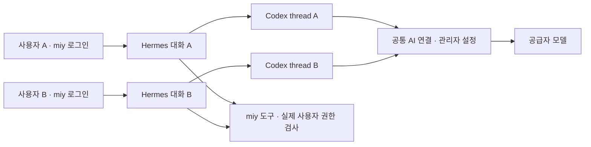

# miy 공통 AI 연결과 사용자별 독립 세션 계획

작성일: 2026-10-20  
수정일: 2026-10-21  
상태: 제품 방향과 설계안 · 공급자별 연동 검증과 구현은 후속 작업

## 기본 방향

**기업의 miy 설치에 공통 AI 연결을 설정하고, 여러 사용자가 같은 연결을 이용하되 사용자별·대화별로 독립 세션을 유지한다.** 직원은 miy에만 로그인하여 사이트 챗봇을 사용한다. 각 직원이 자신의 Codex·Claude Code 구독 계정을 연결하는 방식은 제품 요구사항에 포함하지 않는다.

관리자가 공통 Codex·Claude Code 연결을 설정하는 구독 이용 경로를 우선 검토하고, API 기반 LLM과 사내 모델 연결도 지원한다. 인증·사용량 한도는 공통 연결에 귀속되고 대화·메모리·첨부 파일·업무 실행 권한은 실제 miy 사용자에게 귀속된다. 공급자 연결 하나를 이용한다고 사용자들의 대화가 하나의 thread로 합쳐지는 것은 아니다.

구독 만료·한도 초과·연동 실패 시 API 과금이나 다른 계정으로 자동 전환하지 않는다. 모델 호출 기능과 허용되는 계정·요금제의 범위는 공급자별로 확인하며, 그 확인을 이유로 제품 구조를 개인별 계정 연결로 바꾸지 않는다.

“내부 AI”는 miy에 내장된 기능이라는 뜻이다. 외부 모델을 호출하면 사내에 miy를 설치했어도 데이터는 외부 공급자로 전달된다. 관리자 정책이 허용한 데이터만 전달하며, 내부 전용 자료는 승인된 사내 모델을 사용하거나 실행을 거부한다. 임베딩·음성·이미지 생성 등은 연결의 지원 기능을 확인하고 필요한 별도 workload와 모델 연결을 명시한다.

## 실행 구조와 책임

아래는 논리 구조다. 공통 AI 연결은 공급자 인증과 호출 경로를 뜻하며, 모든 사용자가 같은 실행 프로세스나 작업 디렉터리를 공유해야 한다는 뜻은 아니다.

| 구성 | 책임 |
| --- | --- |
| miy 코어 | 사용자 인증, 공통 연결 설정, 대화·실행의 소유 관계, 권한·확인·감사, 재접속 |
| Hermes | 사용자별 대화 맥락, 모델 요청과 도구 결과 반영, 업무 실행 루프 |
| AI 실행 어댑터 | 공통 공급자 연결, 대화별 공급자 세션, RPC·이벤트·도구 요청의 소유 실행 매핑 |
| 실행 환경 | 세션 작업 파일과 실행 권한의 격리, CPU·메모리·시간 관리 |
| miy 도구/API | 실제 사용자·앱·환경 권한으로 데이터 조회와 업무 변경 집행 |

**Codex·Claude Code는 자체 실행 루프를 가진 에이전트이므로 일반 LLM API와 같은 것으로 취급하지 않는다.** Hermes의 업무 루프 안에서 구독 실행 어댑터를 사용할 때 모델 요청·도구 요청·결과·취소의 책임이 성립하는지 선행 검증한다. 전체 코딩 에이전트에 한정된 작업을 위임하는 경우도 별도로 구분하여 도구 실행과 재시도가 중복되지 않게 한다.

앱과 웹 브라우저는 miy API만 호출한다. 공급자 비밀값, 전체 thread 목록, 공통 실행기의 원시 RPC에 직접 접근하지 않는다. 공통 연결의 권한을 사용자 업무 권한으로 사용하지 않는다.

## Codex 공식 인터페이스와 적용 설계

2026-10-21 OpenAI 공식 문서의 [Codex App Server](https://learn.chatgpt.com/docs/app-server)를 확인했다. 아래 왼쪽은 공식 기능이고 오른쪽은 이를 사용하는 miy 설계다. 여러 thread를 지원하는 기능이 miy의 다중 사용자 권한 격리까지 제공하는 것은 아니다.

| 공식 기능 | miy 적용 설계 |
| --- | --- |
| `initialize` / `initialized` | 내부 어댑터가 전송 연결을 초기화. 브라우저 로그인과 구분 |
| `thread/start` | 새 업무 대화에 새 thread를 만들고 소유 사용자·대화와 연결 |
| `thread/resume` | 저장한 소유 관계를 검사한 뒤 해당 대화의 thread만 재개 |
| `turn/start` | 지정 thread에 현재 요청을 전달하고 miy 실행 ID와 반환 turn ID를 연결 |
| `turn/interrupt` | 소유 실행의 thread·turn만 중지. 공통 프로세스를 종료하지 않음 |
| `thread/read` 및 이력 조회 | miy가 소유권을 검사한 후 필요한 대화 이력만 조회 |
| thread·turn·item 이벤트 | 내부에서 실행별로 분류한 후 해당 사용자의 miy SSE로 전달 |
| `account/read`, `account/rateLimits/read` | 공통 연결의 인증 상태·관측 가능한 한도를 확인 |

`threadId`는 공급자 대화 식별자이며 miy 사용자 식별자가 아니다. 공식 응답의 `thread.sessionId`도 별도로 보관하고 thread ID와 항상 같다고 가정하지 않는다. 특히 fork는 원래 맥락을 이어받으므로 다른 사용자의 새 대화를 만들 때 사용하지 않는다.

### 소유 관계와 저장 단위

| 단위 | 관계와 관리 기준 |
| --- | --- |
| 공통 연결 | 설치 + 공급자 + 계정·워크스페이스. 관리자 관리, 인증 참조·연결 세대·한도·상태 보관 |
| 업무 대화 | 설치 + miy 사용자 + 대화 ID. 한 사용자도 여러 대화를 가질 수 있음 |
| Hermes 세션 | 소유 대화에 귀속. 사용자별 메모리와 대화별 작업 파일 범위 유지 |
| 공급자 세션 | 공통 연결 + 연결 세대 + 소유 대화 + 공급자 thread·session ID |
| 실행 | 소유 대화 + miy 실행 ID + 요청 중복 방지 키 + 공급자 turn ID + 상태·이벤트 |

공급자 thread 하나는 하나의 miy 소유 대화에만 연결한다. 공급자 thread 식별자에 공통 연결·실행 저장소의 범위를 함께 적용하여 유일성을 관리한다. 조회·재개·중지·삭제 요청은 로그인 사용자로 소유 대화를 먼저 찾고, 서버가 보관한 공급자 식별자를 사용한다. 클라이언트가 전달한 사용자 ID·thread ID를 실행 권한으로 인정하지 않는다.

### 요청·응답·도구 실행

1. miy가 현재 사용자의 대화 접근 권한을 확인하고 실행을 등록한다. 같은 대화에 활성 실행이 있으면 새 요청을 대기시킨다.
2. 새 대화는 `thread/start`, 기존 대화는 필요한 경우 `thread/resume`을 사용한다. 생성 결과와 소유 관계를 저장한 뒤 `turn/start`를 보낸다. 저장 실패로 소유자가 없는 thread는 사용자에게 노출하지 않는다.
3. 어댑터는 RPC 요청 ID, thread·turn·item ID를 실행에 연결한다. 이벤트마다 제공되는 식별자가 다를 수 있으므로 고정한 프로토콜의 상관관계를 사용한다. 소유 실행을 식별할 수 없는 이벤트·도구 요청은 사용자에게 보내거나 실행하지 않는다.
4. 도구 요청의 사용자는 모델이 지정하지 않는다. miy가 저장한 실행 소유자로 현재 권한을 다시 검사하고 필요한 업무 변경 확인을 받는다. 확인 응답도 소유 사용자·실행·도구 요청·입력에 연결한다.
5. 이벤트는 miy의 실행별 저장·재연결 경로를 거쳐 소유 사용자에게만 전달한다. 공급자 스트림 전체를 여러 브라우저에 그대로 방송하지 않는다.
6. 종료 상태를 성공·실패·중지로 구분한다. 연결이 끊겼다는 이유만으로 새 turn을 다시 시작하지 않는다. 원래 실행 상태를 확인하고, 결과가 불명확한 업무 변경은 중복 실행하지 않는다.

위 RPC 조합과 소유권 집행은 설계 제안이다. 고정한 Codex 버전에서 응답·알림·승인 요청의 실제 스키마를 검사하며 실험적 인터페이스를 사용할 경우 별도 호환성 검증을 거친다.

## 대화와 실행 환경의 격리

독립 thread는 대화 문맥의 분리 단위다. 파일 시스템, 런타임 전역 설정, 장기 메모리, 도구 자격증명까지 자동 격리한다고 가정하지 않는다.

- 대화·요약·첨부 파일과 대화별 작업 디렉터리를 분리한다. 장기 메모리는 소유 사용자 범위로 제한하고 다른 사용자의 이력·메모리·검색 결과를 자동 합치지 않는다.
- Codex의 자동 메모리·과거 thread 검색·공유 플러그인·공유 실행 상태가 사용자 경계를 넘지 않도록 허용 기능을 제한하고 검증한다. 공통 런타임의 모든 대화 파일을 도구에서 읽을 수 있게 두지 않는다.
- 초기 챗봇 실행에는 miy가 중개하는 허용 도구만 제공하고 임의 호스트 셸·파일 접근은 제공하지 않는다. 파일·코드 실행이 필요하면 해당 대화의 파일만 연결한 별도 실행 환경을 사용한다. `cwd` 지정만으로 파일 접근 격리가 완성되었다고 보지 않는다.
- 도구 호출은 실행에 고정된 사용자·앱·환경 문맥으로 처리한다. 공통 실행기의 전역 MCP 자격증명이나 환경변수를 사용자마다 바꾸어 업무 권한을 전환하지 않는다.
- 한 사용자의 로그아웃·실행 취소·계정 비활성화는 해당 사용자의 접근과 작업만 처리한다. 사용자 로그아웃에 공급자의 `account/logout`이나 공통 프로세스 종료를 연결하지 않는다.

공통 AI 연결과 실행 프로세스 수는 별개다. 초기에는 신뢰된 내부 어댑터가 공통 연결을 관리하고 여러 대화를 매핑하는 구조를 검증한다. 세션 파일·메모리·도구 격리를 보장할 수 없는 실행 방식은 채택하지 않으며 필요한 실행 격리는 어댑터 뒤에서 제공한다. 이를 위해 직원별 공급자 로그인을 요구하지 않는다.

## 공통 인증과 연결 수명

관리자가 공통 AI 연결을 등록·갱신·해제한다. 공식 클라이언트가 관리하는 인증은 그 클라이언트에 맡기고, 승인된 별도 인증 연동이 필요한 경우에만 보호 저장소를 사용한다. 사용자는 공급자 비밀번호·토큰·인증 파일을 받지 않는다.

인증 갱신은 공통 연결 단위로 조정하여 여러 요청이 동시에 인증을 덮어쓰지 않게 한다. 공통 연결의 인증 만료·회수·한도 초과는 **해당 연결을 사용하는 모든 대화에 영향을 주는 상태**다. 새 실행의 대기·거부와 진행 중 실행의 처리 상태를 기록하고, 사용자에게 재시도 가능 여부를 알려준다.

관리자가 계정·워크스페이스·공급자를 바꾸면 연결 세대를 변경하고 기존 실행의 정리·재개 가능성을 확인한다. 다른 계정의 thread를 그대로 재개하지 않으며 필요한 경우 허용된 miy 대화 맥락으로 새 공급자 thread를 생성한다. 단순 인증 갱신과 계정 교체를 구분한다.

웹 연결과 실행 수명도 구분한다. 화면 이탈·재접속은 새 실행이 아니며 miy가 저장한 진행 상태를 이어 보여준다. 프로세스 재시작 후에는 대화별 소유 관계로 thread를 복구하고 진행 중이던 turn의 상태를 확인한다. 영속 대화·인증 상태와 유휴 프로세스 종료를 구분하여 관리한다.

예약·백그라운드 AI 작업도 공통 연결을 사용하되 실행 주체는 명시된 miy 사용자 또는 업무 서비스 계정이다. 디스패치와 도구 실행 시 현재 권한을 검사하며 공통 AI 계정의 권한으로 대체하지 않는다.

## 동시 실행과 사용량

같은 대화에는 활성 turn 하나를 기본으로 하고, 서로 다른 대화는 공통 연결·서버의 한도 안에서 처리한다. 여러 사용자가 접속할 수 있다는 것과 모델 요청을 동시에 무제한 실행한다는 것은 다르다. 검증된 동시 실행 수를 설정하고 초과 요청은 사용자별 공정한 대기열에 둔다.

전체 호출은 공통 연결의 사용량에 합산한다. miy는 별도로 사용자·대화·업무별 관측 사용량과 실행 시간을 기록하고 사용자별 예산·동시 실행 수를 집행한다. 구독 잔여량이 사용자마다 새로 생기는 것은 아니며, 관측할 수 없는 잔여량·청구액은 미확인으로 표시한다.

공통 실행기 장애는 여러 대화에 영향을 줄 수 있으므로 실행 상태를 영속 보관하고 복구 시 중복 작업을 막는다. 사용자 한 명의 취소는 해당 turn만 중지한다. CPU·메모리·디스크와 공급자 사용량은 별도로 관리하며 상세 기준은 [용량 관리](CAPACITY.md)를 따른다.

## 공급자별 적용 후보와 확인할 조건

Codex의 공식 thread·turn 프로토콜을 세션 설계의 우선 기준으로 삼는다. Claude Code도 같은 공통 연결·소유 대화 계약을 구현할 어댑터 후보이며 별도 세션·도구·취소 호환성을 검증한다. API LLM과 사내 모델 연결을 선택해도 사용자 세션과 권한 구조는 동일하게 유지한다.

공통 연결이라는 제품 요구사항과 실제 사용할 계정·요금제의 지원 범위는 구분한다. 개인 구독 하나의 다중 사용자 서비스 이용이 thread 기능만으로 허용된다고 단정하지 않는다. OpenAI의 조직 자동화용 서비스 계정은 사용량 기반 요금제에 제공되며, ChatGPT plan usage는 별도의 적용 조건이 있다. Claude Code도 공통 연결 이용 조건을 별도로 확인한다. 이는 공급자 연동의 검토 항목이며 각 직원의 개인 구독 연결을 요구한다는 뜻이 아니다. [OpenAI 서비스 계정](https://learn.chatgpt.com/docs/enterprise/service-accounts), [ChatGPT plan usage](https://developers.openai.com/siwc/token-sharing-open-source), [Claude Code 인증·호스팅 조건](https://code.claude.com/docs/en/legal-and-compliance)

## 구현 전 확인할 사항과 인수 조건

1. **공통 연결:** 관리자 설정 한 번으로 두 miy 사용자가 개인 공급자 로그인 없이 각자의 챗봇을 사용한다. 공급자별 공식 연결 방식·기능·지원 버전을 기록한다.
2. **소유 세션:** 두 사용자와 한 사용자의 여러 대화에 서로 다른 thread를 배정한다. 다른 소유자의 조회·재개·중지·삭제와 이력 열람을 거부한다.
3. **문맥·파일 격리:** 서로 다른 표식의 대화·메모리·파일을 사용하여 사용자 간 혼합과 도구를 통한 우회 접근이 없는지 확인한다.
4. **이벤트·도구 격리:** 동시 실행의 응답·오류·업무 확인·도구 결과가 소유 실행으로만 전달된다. 모델이 다른 사용자 ID를 제시해도 실행 주체가 바뀌지 않는다.
5. **개별 중지:** A의 로그아웃·실행 취소·권한 회수가 B의 thread나 공통 인증을 종료하지 않는다. A의 후속 도구 실행은 회수된 권한을 사용할 수 없다.
6. **공통 장애:** 공통 인증 만료·한도 초과·프로세스 재시작의 영향과 대기열 복구를 확인한다. 새 turn 중복 생성·업무 중복 실행·API 자동 과금이 없어야 한다.
7. **Hermes 연동:** 모델 요청·도구 결과·스트리밍·취소가 Hermes 계약과 맞고 두 에이전트 루프의 중복 실행이 없는지 최소 실험으로 확인한다.
8. **용량:** 한도 내 병렬 실행과 초과 대기, 사용자별 공정성, 유휴 종료 후 소유 대화 복구를 실제 부하로 검증한다.

기존 miy의 참고 구현은 [조사 문서](RESEARCH.md#구독-연결과-사용자별-세션에서-참고할-기존-구현)에 기록한다. 이 문서는 계획이며 공통 구독 연동이나 다중 사용자 지원이 구현·검증되었다는 뜻은 아니다.
