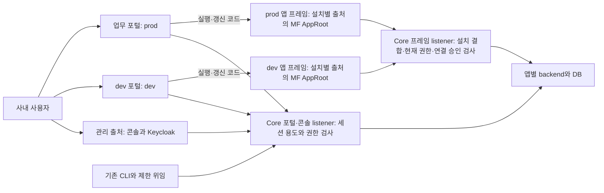

# 사내 업무용 앱 실행·관리 보안

- 수정일: 2026-11-14
- 상태: **사내 업무용 최소 설계 확정 · 세 출처 경계와 설치별 앱 프레임 구현 · 구현분 격리 검증과 개발 서버 반영 완료(실행 범위)**. 잔여 인수와 공개 접속 범위 재검토는 아래에서 구분한다.
- 변경 전 비교 기준: 소스 `22c219d`, CLI/core 0.7.0, 번들 0.8.0. 이 비교 기준을 현행 구현으로 읽지 않는다. 실제 주소·배포 소스·schema는 [운영 안내](SERVER-OPERATIONS.md), CLI 게시 상태는 [릴리스 안내](CLI-RELEASE.md)가 관리한다. 초기 두 출처·dev 포털·콘솔 이동·앱 프레임 도입과 후속 변경은 [실행별 기록](releases/)에 보존한다. 이 서버는 개발 단계이며 정식 오픈을 뜻하지 않는다.
- 적용 범위: 사내 제한 접속, 회사가 관리하는 개발자와 승인한 업무 앱. 외부망 공개·외부 개발자의 앱 수용을 위한 보안 인수는 포함하지 않는다.

**동적 UI·통합 라우팅·단일 IP HTTPS와 개발 편의를 유지하며 필요한 보안부터 적용한다.** 2026-11-10 업무 앱 UI만 설치별 출처 iframe에서 실행하는 [앱 프레임 설계](APP-FRAMES.md)를 채택했고 2026-11-12 운영에 반영했다([배포 기록](releases/app-frames-2026-11-12-deployment.json)). MF 산출물은 앱 프레임 안에서 읽으며 플랫폼 화면은 기존 구조를 유지한다. 앱 실행 계약은 APP-FRAMES가, 포털·콘솔 출처와 세션·인증은 이 문서가 담당한다. 업무 포털(prod), dev 포털(dev), 관리·로그인 콘솔의 세 출처와 설치별 앱 출처를 사용한다. 같은 사이트 배치(P2·P3)의 쿠키 간섭은 남으며 별도 사이트 격리와 구분한다. 같은 페이지 앱들이 UI 신뢰 영역을 공유했던 구조와 iframe 철회 결정은 채택 전 비교 이력이다.

이 문서가 포털·콘솔 경계와 인증·호환성의 정본이며 업무 앱 실행은 APP-FRAMES가 담당한다. 상세 권한과 업무 ACL은 [CORE-PERMISSIONS](CORE-PERMISSIONS.md), 작업 순서는 [PLAN](PLAN.md)이 담당한다. 공개 중인 v2.dwdcc.kr을 이 사내 전제에 해당한다고 간주하거나, 문서 확정을 제품 구현·운영 배포로 표시하지 않는다.

## 현재 필수와 후속

| 영역 | 현재 필수 | 후속 권장·기능 작업 |
| --- | --- | --- |
| 배치 | 한 IP의 업무 포털(prod) / dev 포털 / 관리·로그인 세 HTTPS 출처(2026-11-09 결정·운영 반영, dev 포털 `https://v2-dev.dwdcc.kr`) | 별도 IdP 출처·사이트. 외부 노출·외부 앱 도입 전 재검토 |
| 인증 | portal/dev_portal/console 세션 용도, 서버 경로·환경 제한, 콘솔에서만 device CLI 승인. legacy 로그인은 410 종료 | 전체 credential 모델 재설계, MFA 의무화, 세밀한 인증 관제 |
| UI | 업무 앱은 설치별 출처 iframe의 AppRoot([앱 프레임 설계](APP-FRAMES.md), 번들 0.9.0·0.8.0 앱 실행), 플랫폼 화면·독립 빌드·통합 라우팅 유지. 콘솔에 앱 코드 없음 | 외부 앱 수용 전 앱 전용 도메인(P1) 인수. 2026-11-12 운영 반영 |
| 권한 | 기존 사용자·그룹·use/develop/deploy, 현재 권한 재검사. prod 사용과 관리 분리 | 새 역할 체계·업무 action별 API Invoke·서비스 주체 |
| TLS | IP SAN 인증서 반입, CA·만료 검사와 단말/CLI 신뢰 등록 안내. 수동 교체 절차 | CA 신뢰 일괄 배포·인증서 자동 발급/갱신 |
| 방어·복구 | Origin/CSRF, 쿠키 용도, 안전한 응답 헤더·텍스트, 기존 credential 회수 보완, 변경 범위 백업/복원 | 정교한 탐지·모든 기기 조합 시험·대규모 일괄 전환 도구 |
| 업무 앱 | 공통 인증·앱 권한·기존 backend 연결 재사용 | 최소 보안 다음에 디렉터리·공통 ACL. 서비스 자동화·업무 이벤트·대용량 파일은 해당 기능 순서 |

후속 권장은 현재 기능 개발의 선행 조건으로 올리지 않는다. 미지원 권한·credential은 구현할 때까지 기본 거부다. PLM·PMS·PDM·MES·DAS는 독립 앱이며 코어에 내장하지 않는다. 플랫폼 전역 워크스페이스도 만들지 않는다.

## 확정 결정

AB ID는 참조를 유지한다. 이전 iframe 설계나 보안 후보의 검사 기록을 현행 설계의 PASS로 옮기지 않는다. 개발 단계에서는 AB-06·07의 API/CLI·설정 호환 보존이 필수가 아니다. 리팩토링·구조 변경은 호환 경로 없이 새 버전으로 끊어도 된다([개발 단계 원칙](../AGENTS.md#개발-단계-원칙-실제-운영-전환-전까지)).

| ID | 현재 기준 | 상태 |
| --- | --- | --- |
| AB-01 | 업무 포털 / 앱 관리 / 플랫폼 관리의 책임 분리. 두 관리 영역과 Keycloak 로그인은 하나의 신뢰 출처에 배치 | 소스 구현·격리 검사 PASS, 2026-11-07 운영 반영. 외부 인수 별도 |
| AB-02 | 단일 IP·사설 CA HTTPS. 외부 도메인·내부 DNS·추가 IP 불필수. 기존 포털 주소·포트 유지 가능 | 단일 IP HTTPS·실제 Keycloak/CLI 인수 PASS, Windows 별도 |
| AB-03 | portal/dev_portal/console 브라우저 용도와 경로·환경을 서버가 검사. device CLI 승인은 콘솔만, legacy 시작·승인·교환은 410. 기존 인증·위임·토큰 수명 재사용 | 세 출처 소스·격리 검사와 2026-11-09 운영 반영. 외부 인수 별도 |
| AB-04 | 업무 앱 UI는 설치별 출처 iframe에서 실행. 앱 코드는 포털·다른 앱의 문서·세션에 접근하지 못하고 다른 앱 API는 승인 연결로만 호출. 같은 사이트 쿠키 간섭·프로세스 분리는 주장하지 않음 | 2026-11-10 채택, 소스 구현·격리 검증(APP-FRAMES FV), 2026-11-12 운영 반영([배포 기록](releases/app-frames-2026-11-12-deployment.json)) |
| AB-05 | prod 사용과 관리 분리, 운영 기록은 관리 권한. dev 개발 미리보기 편의·앱 내부 ACL 독립 유지 | 정책 소스 구현·격리 검사 PASS, 2026-11-07 운영 반영. 외부 인수 별도 |
| AB-06 | 기존 CLI/MCP·제한 위임·생성 타입·개발/승격 흐름 재사용. 매 배포마다 새 사람 승인 절차를 추가하지 않음 | 기존 기반 재사용 |
| AB-07 | 앱 데이터·게시 번들 바이트 보존. 개발 단계의 API/CLI 변경은 새 버전으로 끊을 수 있고 재로그인 허용 | migration 0020·0021 운영 적용. 게시 CLI 0.9.0·번들 0.9.0(2026-11-13), legacy 로그인 종료 |
| AB-08 | 현재 필수·후속 권장·잔여 한계·구현 사실·역사 증거 구분. 문서당 담당 주제 하나 | 문서 정리 범위 |

## 변경 전과 현행 구현의 차이

| 항목 | 변경 전 소스(22c219d)의 사실 | 현행 구현 범위 |
| --- | --- | --- |
| UI | 같은 페이지 MF AppRoot와 사용자 세션 | MF 산출물을 설치별 출처 iframe에서 실행. prod와 dev는 별도 포털이며 통합 라우팅 유지 |
| 관리 | 홈에 기술 상태·관리 버튼 혼합, 담당자 콘솔 부족 | 기존 관리 기능을 신뢰 콘솔로 이동. 담당 앱/환경 권한에 맞게 표시 |
| 권한 | 관리자/develop/deploy 자동 Use, Observe는 관리 읽기 또는 Use | prod Use 명시 부여, 기록은 관리 읽기. 개발자 dev 미리보기 유지 |
| CLI·IdP | 브라우저 세션·CSRF로 CLI 승인, 운영 안내상 IdP도 같은 출처의 /identity | 콘솔 출처에 device 승인과 /identity 배치. legacy 로그인 종료, 기존 realm/sub 유지. 현재 게시 CLI는 릴리스 안내가 관리 |
| 설치 | HTTPS 도메인·명시적 HTTP IP 프로필 | 단일 IP HTTPS 세 출처 구성. 인증서 반입·신뢰 안내부터 제공 |
| 업무 앱 | 신원 전달·설치별 호출 승인·앱 DB 분리 | 기존 기반 유지, 공통 ACL은 다음 기능 작업 |

기존 관찰에서 같은 페이지 코드가 관리자 세션으로 합성 앱을 생성하고, A 연결 승인이 없어도 사용자의 B 사용 권한으로 B를 직접 호출했다. 일반 사용자의 관리자 변경과 B 권한 회수 후 호출은 거부됐다. **같은 페이지에서 요청한 코드의 앱 신원을 서버가 구별할 수 없는 문제**다. 범위는 page.evaluate·합성 backend·개발 로그인이며 실제 MF 설치 전체·OIDC·운영 공격 재현은 NOT_RUN이다.

### 추가 발견 사항과 처리 방향

추가 리뷰 1~9번의 발견 당시 사실·영향을 보존한다. 당시 공개 운영 헤더 설명은 제공된 리뷰의 관찰이며 공격 재현 결과가 아니다. 이후 두 출처 배포의 공개 응답 검사는 [운영 배포 기록](releases/internal-minimum-security-2026-11-07-deployment.json)으로 구분하고 코드상 가능성과 실제 침해를 혼동하지 않는다.

| 번호·중요도 | 사실·영향 | 현행 처리 |
| --- | --- | --- |
| 1 높음 | legacy 승인으로 8시간 CLI 토큰, device로 access 15분·refresh family 최대 30일 발급. 피해자의 현재 권한으로 동작. logout은 CLI를 회수하지 않고 목록에 legacy가 없음 | device 승인은 콘솔에서만 처리하고 legacy 회수 누락을 보완. 0.5 이전 CLI의 legacy 시작·승인·교환은 410 `cli_upgrade_required`, 발급된 토큰은 만료까지 목록·회수 유지. 새 인증 관제 제품은 후속. 공격 NOT_RUN |
| 2 높음 | 앱 코드와 IdP가 같은 출처. 리뷰상 오류 페이지 SAMEORIGIN, 실제 비밀번호 접근은 NOT_RUN | 앱 없는 콘솔 출처에 IdP 이동·frame 차단. 별도 IdP 출처는 후속. issuer/MCP/redirect/logout·realm/sub 보존은 필수 |
| 3 중간 | 당시 운영 7b43789 이후 검토 HEAD까지 16커밋, crates/web 34파일 +3881/−735. 대상 SHA CI 확인 도구 미완료 | 일반 `core-rollout.py`에 대상 SHA의 필수 CI 성공 확인을 구현하고 2026-11-09 배포에 사용. migration/설정 전환의 일반화는 후속이며 main 자동 배포는 하지 않음 |
| 4 중간 | 플랫폼 격리 스택만 앱 인수 수단으로 요구하면 개발자·위임 에이전트가 수행하기 어려움 | 플랫폼 경계 검사는 격리 스택. 앱 개발은 기존 dev 설치·CLI/위임·승격 흐름 유지 |
| 5 중간 | 현행 runtime/preview API proxy는 Content-Type만 전달 | 기본 미전달·검증한 Content-Type 허용 유지. upstream cookie·CSD·CSP·redirect를 그대로 통과시키지 않음 |
| 6 중간 | API HTML/SVG의 직접 탐색 시 실행 가능성, 리뷰상 포털 클릭재킹 방어 없음 | API만 sandbox/nosniff, 포털·콘솔·IdP HTML anti-frame. MF JS/preview UI 전체 sandbox 금지. 공격 NOT_RUN |
| 7 낮음 | worker-src만으로 기존 서비스워커를 제거하지 못함 | worker 제한·콘텐츠 gateway의 Service-Worker: script 거부, 전환 대상의 기존 worker 정리. 전 기기 자동 정리는 후속 |
| 8 낮음 | 권한 문서 현행 설명에 목표 prod Use가 혼재 | AB-05는 소스·운영 반영. 이전 `7b43789`와 새 서버 `a4ad370`의 정책을 구분 |
| 9 낮음 | __Host-로 포트 공유·cookie tossing/bomb을 완전히 막지 못함. 400/431 장애 가능 | 쿠키 이름·목적·중복 거부·복구 안내. 잔여 한계 명시. 별도 사이트·광범위 스트레스 인수는 후속 |
| 10 높음(2026-11-09) | 포트가 쿠키를 나누지 않아 다른 출처의 코드가 보낸 GET·탐색에도 쿠키 세션이 붙어 실행됨. 응답은 CORS로 읽지 못해도 부수 효과는 발생 | 쿠키 인증 요청은 세션 조회 전에 Fetch Metadata·Origin을 검사해 다른 출처 요청을 거부. `/auth/login`은 탐색만 허용 |
| 11 중간(2026-11-09) | 앱 간 연결의 후속 hop이 브라우저 원 호출자에게도 서명 identity `admin=true`를 실음 | 원 자격증명이 브라우저 세션이면 모든 hop에서 `admin=false` |
| 12 높음(2026-11-09) | dev 앱(승인 전 코드)이 prod 앱과 같은 포털 출처에서 실행되어 여는 사람의 prod Use를 행사 | dev 전용 포털 출처를 추가하고 기존 포털을 prod 전용으로 전환. 2026-11-09 운영 반영(`https://v2-dev.dwdcc.kr`, [영역과 설정](#영역과-설정)) |
| 13 높음(2026-11-09 발견) | 2026-11-07 경계 반영(`58cecff`) 이후 `nest_service`로 제공하는 CLI 다운로드·설치 파일에 MatchedPath가 없어 경로 경계가 403으로 거부. 새 CLI 설치 불가 | 고정된 두 공개 접두사만 요청 경로로 분류하고 나머지 미일치 요청은 계속 거부. 실제 중첩 서비스 시험 추가, `f9d4084` 운영 반영 후 공개 다운로드 7개 검증([배포 기록](releases/dev-portal-2026-11-09-deployment.json)) |

CLI 근거는 `cli_auth.rs`의 start/approve/exchange, `auth_sessions.rs`의 approve/issue/list_sessions, `0010_cli_sessions.sql`의 30일 family, `auth.rs`의 logout이다. 이 인증 소스는 `7b43789..22c219d`에서 변경되지 않았지만 운영 공격 입증은 아니다.

## 전환 전 임시 운영

**아래는 구 구조가 남거나 복구할 때의 임시 기준이다.** 현재 운영은 세 출처·콘솔 device 승인·IdP 분리, legacy 로그인 종료와 공유 개발 로그인 비활성화를 반영했다. 과거 임시 통제의 개별 적용·공격 재현·전 사용자 credential 점검은 NOT_RUN으로 남긴다. 경계 구현을 공개 운영의 잔여 위험 수용이나 사내 전제 충족으로 확대하지 않는다.

- 사내 개발은 회사가 관리하는 앱·개발자와 제한된 접속 범위에서 진행한다. dev는 시험 데이터를 사용한다. 임의 외부 앱 실행·외부망 공개는 이 최소 기준의 대상이 아니다.
- 구 구조에서는 관리·개발·배포 계정이 미검토 앱을 실행하지 않는다. 필요한 경우 관리용 계정/프로필과 시험용 계정/프로필을 구분한다. 현재 경계에서는 같은 계정으로 콘솔 관리와 각 환경에서 허용된 포털 사용을 할 수 있다.
- CLI 승인은 콘솔의 device 방식만 사용하며 사용자가 자기 터미널의 코드를 입력한다. 0.5 이전 CLI의 legacy 승인 흐름은 2026-11-09 사용자 결정으로 종료했다(콘솔 페이지 한 번의 클릭으로 요청자에게 CLI 자격증명이 넘어갈 수 있어서). 0.5 이전 CLI 사용자는 업그레이드 후 다시 로그인한다. CLI 전면 중지나 모든 개발자의 앱 사용 금지를 사내 개발의 기본 절차로 두지 않는다.
- 의심 CLI credential은 legacy/device와 연결 위임을 포함해 회수한다. 현재 device 목록만으로 전체 점검 완료를 선언하지 않는다. 브라우저 logout과 CLI 회수는 별개다. 미완료 승인 flow는 전환 시 무효화한다.
- 공개 운영의 임시 대응 책임은 플랫폼 운영 관리자, 구현·검증은 플랫폼 개발 담당자다. 적용·미조치·예외를 기록한다. 기존 공개 위험의 최초 재검토 기한은 2026-11-13(KST) 또는 다음 운영 변경 직전 중 이른 시점이었다. **2026-11-14 문서 정리 기준으로 재검토 완료 근거가 없어 재검토 대기이며 기한이 경과했다.** 이 정리가 새로운 위험 수용 결정은 아니다. 미완료 동안 주기적으로 확인하며, MFA는 추가 완화로만 다루고 같은 페이지 세션 악용의 해결책으로 취급하지 않는다.
- **콘솔 호스트 이동 전 노출 결정·관찰(2026-11-09):** 사용자는 당시 포털 443과 콘솔·Keycloak 9443의 공개 상태 유지를 결정했다. 근거는 접속 공인 IP가 사내망 출구 IP라는 사용자 설명이다. 당시 Nginx 로그의 비 loopback IdP 클라이언트는 사설 대역 0·공인 대역 2였고(IP는 기록하지 않음), 호스트 방화벽 비활성·9443의 모든 IPv4 주소 listen을 관찰했다. 외부망 차단 여부는 NOT_RUN이다. 현재 콘솔은 별도 호스트의 443으로 옮겼고 옛 9443은 redirect 전용이다. 당시 관찰과 이후 정상 연결 검사를 새 호스트의 외부 접근 인수로 옮기지 않는다. 대기 중인 재검토에서 현재 노출 범위를 다시 확인해야 한다.

신규 develop을 신뢰한 담당자에게만 부여하되 기존 사용자·그룹 정책을 전면 금지로 바꾸지 않는다. 공개 서버의 긴급 hotfix에는 운영 기준 소스·해당 SHA CI·변경 범위 백업/별도 복원 확인이 필요하다. 전체 hotfix 자동화나 이 공개 서버의 전환 완료를 사내 기능 개발의 일률적 선행 조건으로 두지 않는다.

## iframe 없는 보안 방안 비교

> 채택 전 비교 이력이다. 2026-11-10부터 업무 앱 실행은 [앱 프레임 설계](APP-FRAMES.md)를 따른다. 아래 A는 2026-11-12 반영 전 운영의 사실이다.

| 방안 | 채택 전 결정·검토 | 보장 범위·비용 |
| --- | --- | --- |
| A 승인한 기업 앱 통합 | **당시 채택**. MF/AppRoot 유지, 관리·로그인을 앱 없는 출처로 이동 | UI 호환·독립 배포 유지. 같은 페이지 앱 전체를 신뢰해야 함 |
| B 앱별 최상위 페이지 | 강한 앱 격리가 필요할 때 후속 검토 | 앱별 DOM 분리 가능, 통합 라우팅·상태 공유 변경 |
| C 제한된 선언형 UI | 장기 대안, 현재 구현하지 않음 | 자유로운 React/DOM 계약과 개발 도구 변경 필요 |

2026-11-09 사용자 요청으로, 플랫폼 화면은 그대로 두고 업무 앱만 설치별 출처 iframe에서 실행하는 혼합 구조를 [앱 프레임 설계](APP-FRAMES.md)로 실증했고 2026-11-10 채택했다. 앱 프레임은 명시적인 실행 구조이며 같은 페이지 실패 시의 자동 fallback이 아니다.

앱 ID 헤더·SDK·클로저·짧은 bearer·Shadow DOM·CSS·릴리스 서명은 같은 문서의 앱별 보안 주체를 만들지 않는다. A는 승인 앱의 사용자 권한 악용이나 앱 간 DOM 접근을 완전히 막는 모델이 아니다. 대상 서버의 사용자 ACL·backend 설치 승인·호출 체인은 계속 필요하다. iframe은 자동 fallback으로 도입하지 않는다.

## 출처와 자격증명

### 영역과 설정

플랫폼은 **세 출처에서 기존 Core·DB·Keycloak을 재사용**하고 업무 앱에는 설치별 프레임 출처를 추가한다. 2026-11-09 사용자 결정으로 추가한 dev 포털은 dev 설치, 업무 포털은 prod 설치의 실행만 발급한다. 도메인 없는 localhost·단일 IP 배치는 포트로 출처를 나누며, 앱별 포트 배정은 [프레임 배치 프로필](APP-FRAMES.md#4-배치-프로필과-격리-수준)을 따른다. 아래 표는 플랫폼 세 출처의 예시이며 기존 업무 포털 주소를 가능한 한 유지한다.

| 배치 | 업무 포털(prod) | dev 포털(dev) | 관리·로그인 | IdP issuer |
| --- | --- | --- | --- | --- |
| localhost | https://localhost:18443 | https://localhost:18445 | https://localhost:18444 | 관리 출처의 /identity/realms/miy |
| 단일 IP | https://192.168.10.20:8443 | https://192.168.10.20:9444 | https://192.168.10.20:9443 | https://192.168.10.20:9443/identity/realms/miy |
| 도메인 사용 시 | 기존 업무 UI 호스트 | dev 호스트(권장) 또는 포트 | 관리 호스트 | 관리 호스트의 /identity/realms/miy |

**dev 포털 상태:** 2026-11-09 사용자 요청으로 운영에 반영했다([배포 기록](releases/dev-portal-2026-11-09-deployment.json)). 운영 주소는 권장안인 별도 호스트명 `https://v2-dev.dwdcc.kr`(기존 `*.dwdcc.kr` DNS·인증서, 포트 없음)이다. 업무 포털 `https://v2.dwdcc.kr`은 prod 앱만 실행하고, dev 경로는 dev 포털로 옮긴다. 당시 게시 UI `3760ef0`의 `devPortalOrigin`이 없는 구 서버용 fallback은 과거 구현 사실이며 현재의 호환 유지 요구가 아니다.

- **집행:** Core는 dev 포털용 listener를 따로 열고(`devPortalOrigin`·`devPortalBind`, `MIY_DEV_PORTAL_ORIGIN`·`MIY_DEV_PORTAL_BIND_ADDR`) 세션 용도 `dev_portal`을 저장한다(migration `0021_dev_portal.sql`, 제약 확장만). 정책 한 곳(`policy.rs` `decide`)에서 포털 세션은 prod Use만, dev 포털 세션은 dev Use만 허용한다. 앱 API·UI 자산·directory·연결·목록·`canOpen`이 모두 이 판정을 따른다. 관리자도 prod 포털에서 dev 앱을 열 수 없다.
- **dev 포털이 제공하지 않는 것:** 관리 API, CLI·MCP bearer, CLI 승인, `/identity`, OAuth 메타데이터. CLI·MCP·로컬 preview는 기존 포털 주소를 계속 쓴다.
- **UI:** 포털이 dev 경로(게시 CLI가 출력하는 `/environments/dev/...`와 구 `/apps/...` 포함)를 받으면 로그인 확인이나 앱 import 전에 dev 포털로 같은 탭 이동한다. 환경 전환과 콘솔의 "포털에서 앱 열기"는 환경별 출처의 새 탭이다.
- **포트 구분의 한계:** 포트 분리에서는 쿠키 심기(login CSRF)와 쿠키 대량 주입을 막지 못한다. 별도 호스트명을 권장하되 같은 상위 도메인의 `Domain=` 쿠키 영향은 남는다. 포트 환경용 우회 코드는 두지 않는다([배치 프로필](#배치-프로필-도메인권장과-포트-분리지원)).

출처는 호스트 또는 포트로 나눌 수 있다. 도메인이 있으면 `v2.dwdcc.kr`과 `v2-console.dwdcc.kr`처럼 같은 IP의 기본 HTTPS 포트 443을 함께 사용할 수 있다. 운영 서버는 2026-11-07 처음에는 새 DNS 없이 `:9443`을 썼고, 2026-11-09 와일드카드 DNS·인증서로 `v2-console.dwdcc.kr`로 옮겼다. 포트 번호는 단일 IP 지원 정책이 강제하는 값이 아니다. 관리 하위 도메인 방식도 동일한 설정 계약을 사용한다.

기존 `origin`/`MIY_ORIGIN`과 CLI 서버 주소를 유지하고 `consoleOrigin`/`MIY_CONSOLE_ORIGIN`을 추가했다. `identityIssuer`/`MIY_ISSUER`는 관리 출처의 고정 경로로 설정한다. 별도 IdP 포트·새 credential 발견 API는 요구하지 않는다. `consoleBind`/`MIY_CONSOLE_BIND_ADDR`와 `devPortalBind`/`MIY_DEV_PORTAL_BIND_ADDR`를 추가했고 세 Core listener는 서로 다른 loopback 주소에 고정한다. `/auth/options`는 현재 surface와 고정된 세 origin을 반환한다. `bootstrap.py`·Nginx/Caddy 생성·IdP 구성과 `check-server-tls.py`가 이 설정을 사용한다.

- 사내 공유 서버는 HTTPS를 사용한다. 사설 IP는 IP SAN 사설 CA 인증서를 반입하고 체인·호스트·만료를 검사한다. Windows·브라우저·CLI의 신뢰 등록과 수동 교체 안내를 제공한다. TLS 경고 무시·검증 해제·HTTP fallback을 허용하지 않는다. 기존 loopback 개발 흐름과 공유 서버 인수는 구분한다.
- Nginx의 출처별 경로를 명시한다. 관리 출처는 플랫폼 콘솔과 Keycloak 로그인/필수 리소스만 제공하고 앱 artifact·preview·업무 콘텐츠를 제공하지 않는다. Keycloak 관리 API/관리 콘솔은 내부 관리 접근으로 제한한다.
- Core의 목적별 내부 진입점에서 portal/dev_portal/console을 고정한다. 클라이언트의 Host·forwarded·임의 surface 헤더로 목적을 선택하지 않는다. 내부 Core·Keycloak 포트는 proxy/내부 호출 경로로 제한하며 외부 직접 우회를 열지 않는다.
- 앱 코드·worker를 실행했던 origin을 새 신뢰 출처로 재사용하지 않는다. 같은 IP 새 포트는 새 origin이지만 기존 쿠키의 영향을 별도 확인한다.
- CA 일괄 배포·자동 발급/갱신·wildcard DNS 자동화와 관리/IdP의 별도 사이트 배치는 후속이다.

### 배치 프로필: 도메인(권장)과 포트 분리(지원)

오픈소스 설치는 도메인이 없을 수 있다. 그래서 **포트 분리도 정식으로 지원한다.** localhost나 IP 하나에서 업무 포털·dev 포털·콘솔을 포트로 나눌 수 있다. 별도 호스트명은 호스트 전용 쿠키 공유를 줄이지만 같은 상위 도메인의 `Domain=` 쿠키까지 격리하지는 않는다. 설치 안내·점검 도구는 이 한계를 표시하고 도메인 연결을 권장하며, 포트 분리 환경용 우회 코드나 임시 코드는 넣지 않는다.

| 문제 | 포트 분리(같은 호스트) | 도메인(별도 호스트명) |
| --- | --- | --- |
| 쿠키 공유 | 쿠키는 포트를 구분하지 않아 세 출처가 한 쿠키 저장소를 쓴다. 포털·dev 포털의 앱 코드가 다른 출처의 세션·로그인 쿠키를, 그 출처에 HttpOnly 쿠키가 없을 때 미리 심을 수 있다(피해자를 공격자 계정으로 로그인시키는 login CSRF) | `__Host-` 쿠키는 호스트에 묶여 다른 호스트가 심을 수 없다 |
| 쿠키 대량 주입 | 같은 호스트의 다른 출처가 쿠키를 가득 채워 431/400으로 접속을 막을 수 있다 | 다른 호스트의 쿠키는 보내지 않는다. 같은 등록 도메인의 다른 사이트가 `Domain=` 쿠키를 거는 경우는 남으므로, 신뢰하지 않는 사이트와 등록 도메인을 공유하지 않는 것을 권장한다 |
| 로그인 서버(IdP) 쿠키 | Keycloak 쿠키도 같은 호스트 쿠키 저장소에 있어 앱 코드가 간섭할 수 있다 | 별도 호스트는 호스트 전용 쿠키 공유를 줄인다. Keycloak 쿠키의 실제 속성과 같은 상위 도메인의 `Domain=` 쿠키 영향은 별도이며 완전 격리를 보장하지 않는다 |

두 프로필에 공통으로 적용하는 방어는 우회가 아니라 일반 방어다: 출처별 세션 용도와 쿠키 이름, `__Host-`, 중복 인증 쿠키 거부, 쿠키 요청의 Fetch Metadata·Origin 검사(같은 사이트의 다른 호스트도 쿠키를 보내므로 도메인 환경에도 필요), 정확한 CSRF, 앱 응답 헤더 제한. 운영 서버 v2.dwdcc.kr은 도메인 프로필을 쓴다(업무 포털 `v2.dwdcc.kr`, dev 포털 `v2-dev.dwdcc.kr`, 콘솔 `v2-console.dwdcc.kr`, 2026-11-09 전환 완료).

**포트는 DOM·JavaScript origin을 나누지만 쿠키를 나누지 않는다.** 이름·세션 용도·Origin·CSRF를 함께 검사하고 앱 backend에 원본 쿠키를 전달하지 않는다. cookie bomb/tossing의 완전 해결은 보장하지 않는다. 콘솔과 IdP도 같은 신뢰 영역이므로 콘솔 XSS가 IdP에 영향을 줄 수 있다. 별도 사이트·IdP 출처는 외부 노출·외부 앱 도입 시 다시 검토한다.

포털 셸과 각 앱 프레임은 다른 출처이며, dev와 prod를 포함한 설치끼리도 출처를 공유하지 않는다. 프레임 토큰은 자기 설치와 승인된 연결에만 사용할 수 있다. P2·P3의 같은 사이트 쿠키 간섭과 프로세스 분리 한계는 남는다([앱 프레임 배치 프로필](APP-FRAMES.md#4-배치-프로필과-격리-수준)).

### 자격증명과 경로 분류

| 자격증명 | 허용 범위 | 현행 계약 |
| --- | --- | --- |
| portal 세션 | 허용된 prod 앱 목록·개인 최소 정보·앱 실행/갱신 코드 발급 | dev 사용·관리·기록·CLI 승인과 기존 업무 데이터 경로의 쿠키 인증 거부 |
| dev_portal 세션 | 허용된 dev 앱 목록·개인 최소 정보·앱 실행/갱신 코드 발급 | prod 사용·관리·기록·CLI 승인과 기존 업무 데이터 경로의 쿠키 인증 거부. dev 포털은 CLI/MCP bearer도 받지 않음 |
| console 세션 | 자기 CLI 승인·허용된 앱 관리·플랫폼 관리 | 업무 UI/API 인증 거부. 콘솔 진입이 관리자 권한을 뜻하지 않음 |
| 프레임 토큰 | 자기 설치의 앱 출처에서 업무 API·승인된 연결·디렉터리 | 부모 세션·설치·환경·릴리스와 현재 권한을 재검사. 포털·콘솔·CLI 경로 사용 거부 |
| CLI bearer | 기존 사용자 scope·앱·환경·action | device 승인만 콘솔로. device 시작·poll/refresh·수명 유지. legacy 시작·승인·교환은 410 `cli_upgrade_required`, 발급된 legacy 토큰은 만료까지 유지 |
| 사용자 위임 | 현재 권한과 지정 대상·action·기간의 교집합 | 기존 계약 유지, 확대·재위임 금지 |
| miy_call_ | 원래 사용자·설치 승인 체인을 보존한 backend 호출 | 기존 계약 유지, 브라우저 앱 신원 증명에 사용하지 않음 |
| 서비스 계정(V1-A2) | 후속 기능에서 정할 앱·환경·업무 action | 미구현·기본 거부. 사용자 권한 실패의 대체 수단 아님 |
| AI 실행 | 소유 사용자 또는 구현된 서비스 주체의 제한 권한 | 기존 위임 재사용. 공급자 API 키를 업무 권한으로 취급하지 않음 |

기존 Principal·sessions·login_flows는 브라우저 용도 `portal | dev_portal | console`을 구분한다. 로그인 flow의 용도·정확한 callback을 서버 설정에 결합한다. `miy-web` confidential client에는 세 출처의 정확한 callback/logout URI를 등록하고 서버에서 code를 교환한다. 현재 realm·사용자 sub·게시 CLI의 scope/토큰 수명은 유지했다.

- 세션·로그인 보조 쿠키는 목적별 이름과 Secure·HttpOnly·__Host-·Path=/·Domain 없음을 사용한다. 인증 쿠키 중복은 거부하고 다른 목적 쿠키로 fallback하지 않는다. IdP 쿠키는 실제 속성과 로그인 호환을 확인한다.
- 기존 route 등록에 허용할 브라우저 용도를 선언하고 누락은 거부한다. API뿐 아니라 auth·MCP·artifact·download·preview·WebSocket도 확인한다. 기존 비브라우저 CLI·위임·app-call 판정을 재사용한다.
- 브라우저 쓰기에는 목적별 정확한 Origin과 기존 서버 synchronizer CSRF를 적용한다. credentialed cross-origin CORS는 열지 않는다. 같은 호스트의 다른 포트는 쿠키를 공유하므로, 쿠키 인증 요청은 세션 조회 전에 `Sec-Fetch-Site`·Origin을 검사한다. `Sec-Fetch-Site`가 same-origin/none이 아니거나 Origin이 해당 출처와 다르면 GET·탐색도 거부한다(명시적 개발 로그인 프로필의 개발 서버 출처만 예외). Fetch Metadata가 없는 구형 브라우저가 Origin 없이 보내는 GET은 잔여 한계다. `/auth/login`은 탐색 요청만 받는다. 비브라우저 CLI device 시작·poll/refresh는 기존 credential 검사로 유지한다.
- 콘솔/IdP 경로를 포털에서 proxy하지 않는다. 기존 승인 URL은 고정 콘솔로 flow ID만 보내는 redirect만 허용한다. 민감 정보·credential은 URL에 넣지 않는다.
- 브라우저 업무 WebSocket은 현재 미지원·기본 거부를 유지한다. CLI DB 터널은 기존 별도 자격증명으로 유지한다. 신규 업무 WebSocket은 해당 기능 때 Origin·만료·회수를 설계한다.

## 앱 실행 계약

업무 앱의 브라우저 실행 계약(실행 코드, 프레임 bearer, 브리지 v1, 능력값 자산, 프레임 listener)은 [앱 프레임 설계](APP-FRAMES.md) §3이 담당한다. AppRoot·독립 OCI 릴리스·분할 자산을 유지하고, 활성 digest·경로와 접근 허용은 서버가 결정한다. 직접 링크·reload·뒤로 가기·업데이트·preview가 정상 동작해야 한다. 포털 쿠키는 앱 업무 API·연결·디렉터리·UI 산출물에 쓰이지 않는다.

게시 SDK·번들·migration은 불변이다. 이 경계 때문에 앱의 업무 코드·데이터 모델을 재개발하거나 정적 UI의 현행 Use 보호를 제거하지 않는다. 기존 SDK 계약을 우선 유지하고 실제 추가 기능에만 새 버전을 발행한다.

### 응답과 브라우저 실행 방어

- app/preview API는 기본 헤더 미전달, 검증한 Content-Type만 허용한다. Set-Cookie·Clear-Site-Data·Location·Refresh·CSP·CORS·Service-Worker-Allowed는 upstream에서 그대로 넘기지 않는다. 파일 헤더는 해당 기능 때 별도 허용한다.
- app/preview **API**에 gateway의 CSP sandbox·nosniff를 적용한다. 정상 JSON fetch를 유지하고 HTML/SVG 직접 탐색 시 능동 실행을 제한한다. MF UI/JS·preview UI 전체에 sandbox를 걸지 않는다.
- 포털·콘솔·IdP HTML에 HTTP 응답의 frame-ancestors none을 적용한다. Nginx 정적 응답도 포함하며 실제 로그인 호환을 확인한다.
- 콘솔의 앱 이름·로그·오류·메모는 텍스트로 표시하고 raw HTML·inline SVG를 실행하지 않는다. 콘솔 CSP는 script-src self, object-src none, base-uri none과 inline/eval 제한을 기준으로 실제 빌드와 검증한다. 포털은 허용된 앱 출처를 frame-src로 제한하며 앱 MF는 프레임 안에서 읽는다. 프레임 문서·자산의 CSP와 sandbox는 [APP-FRAMES §3.5](APP-FRAMES.md#35-헤더와-iframe-속성)를 따른다.
- 현행 앱 콘텐츠의 worker-src 제한·Service-Worker: script 요청 거부와 기존 worker 정리를 확인한다. 전체 기기 자동 정리 제품이나 새 PWA 지원은 현행 최소 경계의 범위가 아니다.

### 선택기와 브리지 소유

제목은 기존 링크를 유지한다. 앱은 SDK의 타입 있는 함수와 공용 UI를 사용하고, 포털이 소유하는 기능은 프레임 런타임이 브리지 v1 메시지로 요청한다(APP-FRAMES §3.4). 함수 표면 자체는 보안 경계가 아니며 서버가 권한을 다시 확인한다.

| 기능 | 적용 방식 |
| --- | --- |
| 테마·언어·탐색 | 기존 AppRuntime·통합 라우터 유지. 관련 기능은 호환 검사를 거쳐 개발 |
| 디렉터리(V1-G4) | 최소 보안 다음 기능. 사용자/그룹 선택과 서버의 현재 권한 검사를 구분 |
| 파일(V1-F1) | 해당 기능에서 서버 ACL·파일 핸들을 구현. 최소 경계의 완료 조건으로 당기지 않음 |
| 인쇄·새 탭 | 기존 사용자 동작 유지. 외부 링크 검증·noopener/noreferrer |
| 첨부·대형 CAD | 파일 기능에서 인증 다운로드·버전·회수를 구현. JSON 호출과 분리 |

## API와 자동화 계약

포털은 업무 목록·업무 사용, 콘솔은 기존 관리·개인 CLI 인증 기능을 담당한다. 담당 앱 목록에는 사용 중지·미설치 앱도 포함한다. canManage 하나가 모든 변경을 허용하지 않으며 목록·상세·접수·worker는 기존 중앙 정책으로 현재 권한을 검사한다.

CLI context·공개 서버 발견·작업 추적·API 경로·응답 형태를 유지한다. 기존 `verificationPath`의 상대 경로를 절대 URL로 바꾸지 않고 서버 redirect로 콘솔에 연결한다. device 승인은 console 세션으로 제한하고 device 시작·poll/refresh는 유지한다. 0.5 이전 CLI의 legacy start/approve/exchange는 410 `cli_upgrade_required`로 종료했다. MCP issuer metadata와 재로그인은 실제 IdP 이동에 맞춰 갱신한다.

기존 device 세션 조회·철회는 재사용하고 legacy 토큰의 사용자별 조회·회수 누락만 별도 보완한다. 기존 게시 CLI의 응답 형식은 바꾸지 않으며 비밀·토큰 hash는 반환하지 않는다. 전용 인증 관제 UI·전체 credential 형식 통합은 후속이다. 허용된 위임에 반복 사람 승인을 요구하지 않되 --yes를 권한 증거로 사용하지 않는다.

### PLM 등 독립 업무 앱과 공통 ACL

PLM·PMS·PDM·MES·DAS는 각자 개발·배포한다. **현재 공통 신원·앱 입장·설치별 연결 승인은 있지만 재사용할 리소스 ACL 도구는 미완성**이다.

- 다음 기능 작업: 디렉터리·현재 그룹 확인 → 공통 ACL SDK/서버 검사·공유/회수. 앱 DB가 업무 데이터·선택적 공간·ACL 관계의 정본이다.
- 이후 해당 기능 작업: UI Use와 API Invoke 구분, 범위 있는 서비스 주체, 업무 이벤트/outbox·중복 방지, Storage API와 대형 파일. 현재 보안 완료를 위해 전부 구현하지 않는다.
- BOM·ECO·설계 승인·생산 상태는 앱의 규칙이다. 플랫폼 admin은 앱 owner가 아니며 앱 간 DB·역할·공간 권한을 자동 공유하지 않는다.
- 사용자 대행은 원래 사용자·설치 승인·대상 자원 권한을 유지한다. 사용자 권한 실패를 서비스 계정으로 자동 재시도하지 않는다.

상세 기준은 [공통 업무 권한과 앱 연계](CORE-PERMISSIONS.md#공통-업무-권한과-앱-연계)에 둔다. 기존 프로젝트·업무 대표 앱을 유지하고 해당 기능 때 작은 PLM→PDM/MES 연계 검사를 추가한다. 전체 PLM 개발을 코어 경계의 완료 조건으로 삼지 않는다.

### 구현된 최소 변경

- Core는 portal/dev_portal/console용 listener를 별도로 열고 route 전체를 분류한다. Host·forwarded 헤더는 목적 선택에 사용하지 않는다. 비브라우저 CLI는 기존 포털 API 주소를 사용하며 MCP의 익명 401 발견 응답도 유지한다.
- migration `0020_browser_boundaries.sql`로 기존 브라우저 세션·로그인 flow·미완료 CLI 승인을 무효화하고 목적·callback을 저장했다. `0021_dev_portal.sql`은 허용 목적에 `dev_portal`을 추가했다. 앱/사용자/그룹 데이터와 독립 CLI credential은 보존했다.
- HTTPS 쿠키는 `__Host-miy_portal_*`·`__Host-miy_dev_portal_*`·`__Host-miy_console_*`로 나누고 동일 인증 쿠키의 중복을 거부한다. 명시적 HTTP 개발 프로필만 Secure/접두사를 생략한다. 포트별 쿠키 격리로 해석하지 않는다.
- legacy CLI 개인 목록/회수는 `/api/v1/cli/legacy-sessions`와 `/{id}` DELETE에 추가했다. 응답은 공개 UUID·발급/만료 시각뿐이며 다른 사람의 토큰을 회수할 수 없다. 콘솔 개인 CLI 화면에 device·legacy를 함께 표시한다.
- 각 포털은 자기 환경의 업무 목록·앱과 개인 최소 정보를, 콘솔은 담당 앱·플랫폼 관리·개인 CLI를 표시한다. 콘솔에서는 remote AppView를 import/실행하지 않고 앱 API/artifact를 서버와 proxy가 거부한다.
- 앱 API/preview API는 Content-Type만 전달하고 sandbox·nosniff·no-store를 부여한다. MF UI/JS에는 API sandbox를 적용하지 않는다. 게시 SDK·번들·기존 migration은 바꾸지 않았다.
- 2026-11-09 추가: 쿠키 인증 요청의 다른 출처 거부(`http.rs` `foreign_cookie_request`), `/auth/login`의 탐색 전용, 브라우저에서 시작한 앱 간 연결의 서명 identity `admin=false`(모든 hop), legacy CLI 승인 흐름 종료와 콘솔 안내 화면, 포털 안 앱 이동의 같은 탭 복귀(다른 출처 링크만 새 탭).

## 전환과 복구

현재 서버·UI·프레임 런타임의 배포 소스는 [운영 안내](SERVER-OPERATIONS.md)가 관리한다. 프레임 최초 도입과 같은 schema 후속 갱신·되돌리기는 [APP-FRAMES §9](APP-FRAMES.md#9-운영-반영-계획)를 따른다. 아래는 후속 변경에도 적용할 원칙이며, 개발 서버의 재시작·재로그인·짧은 중단을 피하기 위한 호환 계층이나 무중단 전환은 요구하지 않는다.

초기 schema 19→20 전환·백업/복원은 [11-07 배포](releases/internal-minimum-security-2026-11-07-deployment.json), 세 출처와 schema 21은 [dev 포털 배포](releases/dev-portal-2026-11-09-deployment.json)·[콘솔 이동](releases/console-hostname-2026-11-09-deployment.json), schema 21→22는 [첫 프레임 배포](releases/app-frames-2026-11-12-deployment.json)에 고정 이력으로 보존한다.

1. 세 출처 설정·브라우저 용도·경로/환경 제한과 해당 버전의 CLI/OIDC 흐름을 격리 환경에서 먼저 인수한다. 각 환경의 포털은 해당 환경의 앱 프레임만 열고 콘솔/IdP에는 앱 코드를 적재하지 않는다.
2. 변경할 설정·DB·파일의 백업과 별도 복원을 확인한다. 기존 migration을 수정하지 않고 용도 필드 등을 새 migration으로 추가한다. realm/sub·사용자/그룹·앱 DB·ID·릴리스·게시 번들은 보존한다.
3. 구 브라우저 세션·미완료 login/CLI flow는 새 용도로 추측해 승계하지 않고 무효화한다. 의심 legacy/device credential은 회수하고 기존 정상 CLI의 유지 여부·재로그인 안내를 기록한다. issuer·callback/logout·MCP metadata는 함께 전환한다.
4. 앱 개발자는 dev 포털의 설치·CLI/위임으로 검증하고 승인/승격 흐름을 쓴다. 보안 경계와 무관한 전 앱 보류 게이트·일괄 재개발은 추가하지 않는다. 계약을 바꾸면 CLI·SDK·웹·문서를 함께 갱신하며 앱 데이터는 보존한다.
5. 구 앱 출처의 worker·cache/storage와 알려진 구 쿠키를 범위에 맞게 정리한다. 필요 시 Clear-Site-Data: "cache", "storage"를 사용하되 **"cookies"·"*"는 다른 서비스/포트에 영향을 주므로 사용하지 않는다.** 미접속 기기까지 정리됐다고 주장하지 않는다.
6. OIDC·CLI/MCP·직접 링크·권한 회수·데이터 보존·실패 복구를 확인한다. 경계 실패 시 새 노출을 닫고 변경 범위를 복원하며 구 위험 승인을 자동 재개하지 않는다.

실제 반영은 사용자 요청과 해당 SHA CI 확인 후 수행하고, DB·데이터를 바꾸면 변경 범위의 백업·별도 복원 확인을 먼저 한다. 일반 `core-rollout.py`의 정확한 SHA CI gate는 구현되어 2026-11-09부터 배포에 사용한다. migration/설정 전환의 일반화는 후속이며 자동 main 배포는 하지 않는다. Windows 실제 설치·갱신·제거는 사용자가 수행한다.

## 경계 인수

**필수 행은 현재 최소 계약의 인수, 후속 행은 해당 기능/베타 단계의 인수다.** 아래 초기 결과는 `a4ad370` 범위이며, 세 출처 후속 결과는 [dev 포털 격리 검증](releases/dev-portal-2026-11-09-validation.json), 운영 확인은 [dev 포털 배포](releases/dev-portal-2026-11-09-deployment.json)·[콘솔 이동](releases/console-hostname-2026-11-09-deployment.json)을 따른다. `7defdb0` 반영 후 확인은 [리뷰 보완 배포 기록](releases/app-frames-review-fixes-2026-11-12-deployment.json)에 별도로 남긴다. 과거 두 출처나 iframe 결과를 세 출처 전체나 새 배포의 PASS로 옮기지 않는다.

| ID | 단계·설계 | 시험과 판정 기준 | 현재 결과 |
| --- | --- | --- | --- |
| BV-01 | 필수 AB-01·03 | 세 출처의 prod/dev 업무·담당 앱·플랫폼 관리, 직접 URL·목록·미설치/중지 관리. 콘솔은 앱 코드를 실행하지 않음 | 세 출처 격리 PASS: 실제 Core UI 7개·전체 스택6개, dev 포털 앱 실행·prod 포털의 dev API 거부. 11-09 배포 당시 실제 dev/prod 앱 열기는 NOT_RUN. 11-12 앱 프레임 배포에서는 앱 4개를 읽기 전용으로 열어 확인 |
| BV-02 | 필수 AB-02·03 | 단일 IP HTTPS·IP SAN/CA 신뢰·만료 거부·수동 인증서 교체. 포트 공유 쿠키·중복 거부·기본 복구 확인. 자동 갱신·전 기기 스트레스는 후속 | PASS: 실제 IP HTTPS·Core/CLI/Chrome 신뢰·SAN/만료·중복쿠키. 수동 교체·431 복구 NOT_RUN |
| BV-03 | 필수 AB-03·04 | 실제 MF 앱에서 콘솔 변경·device 승인·IdP DOM 접근 거부, legacy 시작·승인·교환 410. 텍스트/XSS·anti-frame·API sandbox와 정상 UI/JSON | 초기 격리 PASS: 배포 MF 코드의 관리·콘솔 요청 거부, IdP frame/DOM 차단·API HTML 실행 차단. legacy 410·다른 출처 쿠키 거부는 [후속 검증](releases/boundary-followup-2026-11-09-validation.json). 운영 공격 재현 아님 |
| BV-04 | 필수 AB-03·04 | 기존 backend 승인 체인·현재 사용자/대상 권한·회수, Cookie/Authorization 미전달·헤더 allowlist. 같은 페이지 A→B 사용자 권한 호출은 격리 PASS로 표시 금지 | PASS: 실제 Core/DB와 서명 backend fixture의 체인·회수·응답 헤더. 이 backend 시험만으로 브라우저 발신 앱 격리를 판정하지 않음. 앱 프레임의 해당 검사는 APP-FRAMES FV-04에서 별도로 기록 |
| BV-05 | 필수 AB-03 | portal/dev_portal/console 목적·callback·쿠키 혼용 거부, 만료·회수. legacy/device 회수와 logout 차이 확인 | 세 출처 격리 및 배포 후 OIDC PASS: 별도 세션·callback, 같은 사용자 신원·SSO, dev 관리 거부. 만료·회수·logout 분리는 초기 검사 범위. callback 공격 전체 조합 NOT_RUN |
| BV-06 | 필수 AB-05 | prod 관리자/deploy 자동 Use 제거·명시적 use/all·앱 ACL 독립, dev 개발 미리보기 정상·회사 중지 정책 유지 | PASS: 권한 행렬·실제 DB 회수·prod 명시 use·dev 미리보기. 업무 리소스 ACL은 후속 |
| BV-07 | 필수 AB-05 | Use만으로 운영 기록 거부, 관리 action·목록·상세·접수·worker 현재 권한 일치 | PASS: Use-only 기록 거부와 관리 목록/상세·worker·회수·CLI status 호환 |
| BV-08 | 필수 AB-03·07 | 콘솔 /identity 실제 로그인/logout·realm/sub·miy-web 보존, 세 출처 callback·MCP metadata·재인증·구 flow/worker 정리. MFA 의무화는 후속 | 새 콘솔 issuer의 배포 후 OIDC 세 출처 SSO·별도 세션·로그아웃, CLI·stdio MCP 연결 22개 PASS. 직접 외부 OAuth MCP issuer 재인증·구 worker 정리 NOT_RUN |
| BV-09 | 필수 AB-04·07 | 업무 앱 로딩·라우팅(2026-11-10부터 앱 프레임 기준, 결과는 APP-FRAMES FV-01·09 기록이며 BV로 옮기지 않음)·직접 링크·reload·preview·업데이트, 포털 내부 같은 탭·다른 출처 링크 새 탭. 새 테마·선택기·파일 기능은 각 작업 때 | 세 출처 격리 MF·입력 보호 PASS. 같은 탭 복귀는 [후속 검증](releases/boundary-followup-2026-11-09-validation.json). 초기 운영 dev 앱 2개 검사는 이전 두 출처 범위. 11-09 배포 당시 실제 dev/prod 앱 열기는 NOT_RUN이었고 11-12 앱 프레임 배포의 앱 4개 읽기 전용 열기는 별도 기록. 운영 native UI 전체·인쇄 인수는 NOT_RUN |
| BV-10 | 필수 AB-06 | 기존 제한 CLI/MCP·위임·DB 터널 정상, 권한 확대·미지원 service/AI credential 거부, 반복 사람 승인 추가 없음 | PASS: CLI·제한 위임·합성 MCP 정책, shared DB/WS lease16개. 실제 OAuth MCP·새 gateway 경유 전체 DB 터널 인수 NOT_RUN |
| BV-11 | 필수 AB-06·07 | 게시 CLI의 상대 verificationPath·고정 콘솔 redirect, device start/poll/refresh·관리 API, legacy 흐름의 410 종료와 발급 토큰 목록·회수. 포털 승인 fallback 거부 | legacy 410·회수는 후속 격리 검증. 2026-11-09 콘솔 issuer 이동 후 게시 CLI device 승인/status/doctor·stdio MCP 포함 22개 PASS. 초기 게시 CLI 단일 IP HTTPS12개는 `a4ad370` 범위 |
| BV-12 | 필수 AB-07 | 변경 범위 백업/별도 복원·migration·앱 ID/DB/파일/릴리스 보존·실패 복구. 전체 앱 재개발·일괄 SDK 전환 없음 | PASS: 격리 schema19→20·기존 credential/앱 DB 보존·반복 migration, 운영 백업의 별도 복원(Core 40테이블·1,474행, identity 101테이블·1,279행), 운영 schema19→20·앱 컨테이너 7개·독립 CLI credential 보존. 실제 운영 DB rollback·전체 복구 제품 인수는 NOT_RUN |
| BV-13 | 후속 AB-04·06·07 | 베타 전 독립 에이전트 3회 개발·검사·배포·갱신. 플랫폼 소스·관리자 credential·Docker socket·평가 구현 없이 수행. 실패·개입 기록 | NOT_RUN |
| BV-14 | 문서 AB-08 | 사내 필수/후속/한계·미구현/운영 상태, 링크·도식·권한·개발 단계 계약 일치, 기존 증거 보존 | 초기 문서 검사의 PASS와 역사 파일198개 보존은 당시 이력. 2026-11-09 세 출처 정합성 보완과 문서 검사는 [당시 보완 검증 기록](releases/boundary-review-fixes-2026-11-09-validation.json)의 범위이며, 후속 문서 정리나 제품·운영 인수를 대신하지 않음 |

표의 PASS는 적힌 실행 범위에만 해당하며 같은 행의 NOT_RUN까지 완료한 것이 아니다. 잔여 수동 전환·외부 환경 검사는 운영 전환/베타 인수에서 계속 추적한다. 필수 구현 인수는 운영과 분리된 실제 Core/DB·앱·브라우저에서 수행한다. UI mock·코드 읽기·문서 검사만으로 제품 PASS를 선언하지 않는다. 공통 ACL·Invoke·서비스 주체·이벤트·파일은 각 기능의 인수로 분리한다.

## 기존 검증의 승계

archive와 당시 결과는 고정 이력이다. 원래 iframe 없는 UI 요구는 업무 앱 프레임 계약으로 대체했다. 플랫폼 화면·통합 라우팅 요구는 유지하며 아래 연결은 과거 PASS 이월이 아니다.

| 이전 ID/요구 | 담당·처리 | 미완료 조건 |
| --- | --- | --- |
| V0: UI 계약·인증·MCP | BV-03·05·08·09 | 세 출처/세션 실제 인수와 미실행 환경 확인 |
| V1: 앱 DB·migration·잠금·권한 | BV-06·07·12, 코어 안정화 | DB·권한·실패·회수 |
| V2: CLI·SDK·지침 | BV-10·11, 해당 번들 작업 | 실제 변경 계약의 잠금·호환·업그레이드 |
| V3: 독립 AI 앱 개발 | BV-13, 후속 종합 인수 | 새 작업공간/세션·독립 평가 |
| V4: 단일 이미지 배포 | BV-12·13 | digest·source·UI·migration 같은 릴리스 |
| V5: UI·승격 | BV-03·04·09·12 | 앱 프레임의 CRUD·연결·동일 digest·서버 dev/prod 권한 |
| V6: 장애·데이터 보존 | BV-12, 코어 안정화 | 행/파일·중지·복구·제거 후 보존 |
| V7: 독립 반복 | BV-13, 베타 전 | 독립 3회·OIDC·OS·자원/운영 |
| CLI 안내 릴리스 회귀 | CLI 행렬·CHECKS | describe/help·지침·잠금·예제 |
| 프로젝트·업무 대표 앱 | V1-G5·G6, 공통 ACL 인수 | 공유/회수·원래 사용자, 해당 기능의 PLM 연계 |
| 전체 자원·복원·새 서버 | PLAN 코어 3~5차 | 문서 정리를 베타 준비 완료로 표시하지 않음 |

## 증거와 판정

실행 기록은 docs/releases에 SHA·문서판·환경·명령·결과·한계를 남긴다. 미실행 NOT_RUN, 실행 실패 FAIL이며 실패 이력은 보존한다. 문서 링크 PASS는 BV-14 범위뿐이다. 비밀·쿠키·CSRF·토큰·hash·DB 문자열·복구 키는 기록하지 않는다.

세 출처·세션 용도·콘솔 device 승인·prod 사용/관리 분리는 소스 구현·격리 검증 후 개발 서버에 반영했다. 2026-11-09 콘솔 issuer 이동 후 OIDC·세 출처 SSO·게시 CLI·stdio MCP 연결을 확인했다. 2026-11-12 최초 앱 프레임 배포의 prod·dev 앱 4개 열기는 읽기 전용이며, 운영 앱 쓰기·연결·미저장 입력 검사는 그 배포에서 NOT_RUN이었다. 후속 실행은 [프레임 리뷰 보완 배포](releases/app-frames-review-fixes-2026-11-12-deployment.json)와 [응답 보완 배포](releases/app-api-response-2026-11-13-deployment.json)에 각각 남겼다. 공통 ACL·PLM 업무 연계·실제 Windows·전체 복구 제품·기존 기기 worker 정리·직접 외부 OAuth MCP 재로그인은 별도 미실행 범위다. 합성 계정/앱·격리 서버의 거부 결과를 운영 침해나 비밀번호/토큰 탈취 증거로 확대하지 않는다.

현재 경계의 명령·실패·잔여 검사는 [후속 보완](releases/boundary-followup-2026-11-09-validation.json)과 [dev 포털 검증](releases/dev-portal-2026-11-09-validation.json)에 있다. [초기 구현](releases/internal-minimum-security-implementation-2026-11-06-validation.json)과 [초기 문서 설계 검사](releases/internal-minimum-security-design-2026-11-06-validation.json)는 해당 시점의 이력이다. 후속 문서 정리의 실행 결과를 과거 PASS로 대신하지 않는다.

## 문서 소유와 정리

APP-BOUNDARIES는 필수/후속·실행/인증·전환/인수, CORE-PERMISSIONS는 권한·공통 ACL, PLAN은 순서·상태를 담당한다. PRD와 개발·UI·CLI·운영·Windows 안내도 같은 세 출처 최소 기준을 사용한다. 업무 앱 실행은 APP-FRAMES를 따르며 별도 IdP·외부 앱용 별도 사이트 인수·전면 차단·전체 SDK 전환을 현재 기능 개발의 선행 조건으로 추가하지 않는다.

archive·실행 결과·게시 번들은 보존한다. 이전 iframe·보안 후보 검증은 당시 이력이며 현재 구현 완료의 근거가 아니다. 각 제품 구현·운영 전환과 문서 정리 기록을 구분한다. 운영에서는 IdP issuer·miy-web callback/logout 설정과 core schema를 변경했으며 realm·사용자 sub·게시 번들·앱 데이터의 보존 범위는 배포 기록에 남긴다.

## 참고 자료

- [v1 적용](V1-ADOPTION.md), [플랫폼 사례](reference/RESEARCH.md#앱-사용과-관리-영역-분리): 공통 인증·최소 권한을 참고. 플랫폼 화면에는 iframe을 쓰지 않고 업무 앱은 [앱 프레임 설계](APP-FRAMES.md)를 따름.
- [HTML origin](https://html.spec.whatwg.org/multipage/browsers.html#origin), [cookie와 port](https://httpwg.org/specs/rfc6265.html#weak-confidentiality), [CSP sandbox](https://www.w3.org/TR/CSP3/#directive-sandbox), [Clear-Site-Data](https://www.w3.org/TR/clear-site-data/), [서비스워커](https://www.w3.org/TR/service-workers/).
- [Keycloak hostname](https://www.keycloak.org/server/hostname), [reverse proxy](https://www.keycloak.org/server/reverseproxy), [공인 인증서의 IP 제한](https://cabforum.org/working-groups/server/baseline-requirements/requirements/).
- 기존 [브라우저 관찰](releases/browser-boundary-review-2026-11-06-validation.json), [최초 정리](releases/app-boundaries-docs-2026-11-06-validation.json), [통합](releases/app-boundaries-consolidation-2026-11-06-validation.json), [15건 보완](releases/app-boundaries-review-fixes-2026-11-06-validation.json), [noiframe·PLM 검토](releases/noiframe-security-plm-review-2026-11-06-validation.json). 당시 결과 범위를 보존한다.
