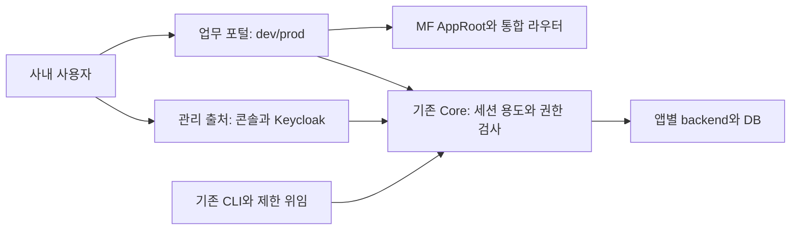

# 사내 업무용 앱 실행·관리 보안

- 수정일: 2026-11-06
- 상태: **사내 업무용 최소 설계 확정 · 최소 경계 구현 · 격리 검증 완료(실행 범위) · 운영 미반영**.
- 변경 전 비교 기준: 소스 `22c219d`, CLI/core 0.7.0, 번들 0.8.0. 마지막 운영 기록은 서버/UI `7b43789`, 게시 CLI `01e4d49`다. 이번 소스는 [이번 구현·검증 기록](releases/internal-minimum-security-implementation-2026-11-06-validation.json)에 별도로 고정하며 운영을 다시 측정하거나 변경하지 않았다.
- 적용 범위: 사내 제한 접속, 회사가 관리하는 개발자와 승인한 업무 앱. 외부망 공개·외부 개발자의 앱 수용을 위한 보안 인수는 포함하지 않는다.

**동적 UI·통합 라우팅·단일 IP HTTPS와 개발 편의를 유지하며 필요한 보안부터 적용한다.** iframe 필수·MF 폐기·DNS/추가 IP 필수 결정은 철회했다. 이번 설계는 업무 포털과 관리·로그인 두 출처만 사용한다. 같은 페이지의 승인 앱은 하나의 UI 신뢰 영역이며 앱별 악성 JavaScript 격리는 제공하지 않는다.

이 문서가 실행·인증·호환성의 정본이다. 상세 권한과 업무 ACL은 [CORE-PERMISSIONS](CORE-PERMISSIONS.md), 작업 순서는 [PLAN](PLAN.md)이 담당한다. 공개 중인 v2.dwdcc.kr을 이 사내 전제에 해당한다고 간주하거나, 문서 확정을 제품 구현·운영 배포로 표시하지 않는다.

## 현재 필수와 후속

| 영역 | 현재 필수 | 후속 권장·기능 작업 |
| --- | --- | --- |
| 배치 | 한 IP의 업무 포털 / 관리·로그인 두 HTTPS 출처. dev/prod는 같은 포털 | 별도 IdP 출처·사이트, dev/prod 포털 분리. 외부 노출·외부 앱 도입 전 재검토 |
| 인증 | portal/console 세션 용도, 서버 경로 제한, 콘솔에서만 CLI 승인. 기존 OIDC·CLI 체계 재사용 | 전체 credential 모델 재설계, MFA 의무화, 세밀한 인증 관제 |
| UI | MF/AppRoot·독립 빌드·통합 라우팅·게시 SDK 유지. 콘솔에 앱 코드 없음 | 불특정 앱 코드의 강제 격리. iframe 자동 도입은 없음 |
| 권한 | 기존 사용자·그룹·use/develop/deploy, 현재 권한 재검사. prod 사용과 관리 분리 | 새 역할 체계·업무 action별 API Invoke·서비스 주체 |
| TLS | IP SAN 인증서 반입, CA·만료 검사와 단말/CLI 신뢰 등록 안내. 수동 교체 절차 | CA 신뢰 일괄 배포·인증서 자동 발급/갱신 |
| 방어·복구 | Origin/CSRF, 쿠키 용도, 안전한 응답 헤더·텍스트, 기존 credential 회수 보완, 변경 범위 백업/복원 | 정교한 탐지·모든 기기 조합 시험·대규모 일괄 전환 도구 |
| 업무 앱 | 공통 인증·앱 권한·기존 backend 연결 재사용 | 최소 보안 다음에 디렉터리·공통 ACL. 서비스 자동화·업무 이벤트·대용량 파일은 해당 기능 순서 |

후속 권장은 현재 기능 개발의 선행 조건으로 올리지 않는다. 미지원 권한·credential은 구현할 때까지 기본 거부다. PLM·PMS·PDM·MES·DAS는 독립 앱이며 코어에 내장하지 않는다. 플랫폼 전역 워크스페이스도 만들지 않는다.

## 확정 결정

AB ID는 참조를 유지한다. 이전 iframe 설계나 보안 후보의 검사 기록을 이번 설계의 PASS로 옮기지 않는다.

| ID | 현재 기준 | 상태 |
| --- | --- | --- |
| AB-01 | 업무 포털 / 앱 관리 / 플랫폼 관리의 책임 분리. 두 관리 영역과 Keycloak 로그인은 하나의 신뢰 출처에 배치 | 소스 구현, 격리 구현 검사 PASS, 외부/운영 인수 별도 |
| AB-02 | 단일 IP·사설 CA HTTPS. 외부 도메인·내부 DNS·추가 IP 불필수. 기존 포털 주소·포트 유지 가능 | 단일 IP HTTPS·실제 Keycloak/CLI 인수 PASS, Windows 별도 |
| AB-03 | portal/console 브라우저 용도와 경로를 서버가 검사. CLI 승인은 콘솔만. 기존 인증·위임·토큰 수명 재사용 | 소스 구현, 격리 구현 검사 PASS, 외부/운영 인수 별도 |
| AB-04 | 회사가 승인한 앱의 MF/AppRoot·통합 라우팅 유지. 같은 페이지 UI 코드 전체를 신뢰하며 강제 격리를 주장하지 않음 | 신뢰 모델 확정 |
| AB-05 | prod 사용과 관리 분리, 운영 기록은 관리 권한. dev 개발 미리보기 편의·앱 내부 ACL 독립 유지 | 정책 소스 구현, 격리 구현 검사 PASS, 외부/운영 인수 별도 |
| AB-06 | 기존 CLI/MCP·제한 위임·생성 타입·개발/승격 흐름 재사용. 매 배포마다 새 사람 승인 절차를 추가하지 않음 | 기존 기반 재사용 |
| AB-07 | 앱 데이터·게시 번들·API/CLI 호환 보존. 실제 바뀐 인증 계약만 전환하고 브라우저 재로그인 허용 | migration 0020 준비, 앱 재개발·일괄 SDK 전환 없음 |
| AB-08 | 현재 필수·후속 권장·잔여 한계·구현 사실·역사 증거 구분. 문서당 담당 주제 하나 | 문서 정리 범위 |

## 변경 전과 이번 구현의 차이

| 항목 | 변경 전 소스(22c219d)의 사실 | 이번 소스 구현 |
| --- | --- | --- |
| UI | 같은 페이지 MF AppRoot와 사용자 세션 | 그대로 유지. 포털에서 dev/prod 전환 |
| 관리 | 홈에 기술 상태·관리 버튼 혼합, 담당자 콘솔 부족 | 기존 관리 기능을 신뢰 콘솔로 이동. 담당 앱/환경 권한에 맞게 표시 |
| 권한 | 관리자/develop/deploy 자동 Use, Observe는 관리 읽기 또는 Use | prod Use 명시 부여, 기록은 관리 읽기. 개발자 dev 미리보기 유지 |
| CLI·IdP | 브라우저 세션·CSRF로 CLI 승인, 운영 안내상 IdP도 같은 출처의 /identity | 콘솔 출처에 승인과 /identity 배치, 기존 realm/sub·CLI wire 보존 |
| 설치 | HTTPS 도메인·명시적 HTTP IP 프로필 | 단일 IP HTTPS 두 출처 인수. 인증서 반입·신뢰 안내부터 제공 |
| 업무 앱 | 신원 전달·설치별 호출 승인·앱 DB 분리 | 기존 기반 유지, 공통 ACL은 다음 기능 작업 |

기존 관찰에서 같은 페이지 코드가 관리자 세션으로 합성 앱을 생성하고, A 연결 승인이 없어도 사용자의 B 사용 권한으로 B를 직접 호출했다. 일반 사용자의 관리자 변경과 B 권한 회수 후 호출은 거부됐다. **같은 페이지에서 요청한 코드의 앱 신원을 서버가 구별할 수 없는 문제**다. 범위는 page.evaluate·합성 backend·개발 로그인이며 실제 MF 설치 전체·OIDC·운영 공격 재현은 NOT_RUN이다.

### 추가 발견 사항과 처리 방향

추가 리뷰 1~9번을 보존한다. 공개 운영 헤더는 제공된 리뷰의 관찰이며 이번 작업에서 재측정하지 않았다. 코드상 가능성과 실제 침해를 구분한다.

| 번호·중요도 | 사실·영향 | 이번 처리 |
| --- | --- | --- |
| 1 높음 | legacy 승인으로 8시간 CLI 토큰, device로 access 15분·refresh family 최대 30일 발급. 피해자의 현재 권한으로 동작. logout은 CLI를 회수하지 않고 목록에 legacy가 없음 | 두 승인 모두 콘솔로 이동. 기존 목록/회수 재사용, legacy 회수 누락 보완. 새 인증 관제 제품은 후속. 공격 NOT_RUN |
| 2 높음 | 앱 코드와 IdP가 같은 출처. 리뷰상 오류 페이지 SAMEORIGIN, 실제 비밀번호 접근은 NOT_RUN | 앱 없는 콘솔 출처에 IdP 이동·frame 차단. 별도 IdP 출처는 후속. issuer/MCP/redirect/logout·realm/sub 보존은 필수 |
| 3 중간 | 운영 7b43789 이후 HEAD까지 16커밋, crates/web 34파일 +3881/−735. 대상 SHA CI 확인 도구 미완료 | 공개 운영의 긴급 수정은 별도 최소 hotfix 후보. main 전체 자동 배포 금지. 이 문서 작업에서 배포하지 않음 |
| 4 중간 | 플랫폼 격리 스택만 앱 인수 수단으로 요구하면 개발자·위임 에이전트가 수행하기 어려움 | 플랫폼 경계 검사는 격리 스택. 앱 개발은 기존 dev 설치·CLI/위임·승격 흐름 유지 |
| 5 중간 | 현행 runtime/preview API proxy는 Content-Type만 전달 | 기본 미전달·검증한 Content-Type 허용 유지. upstream cookie·CSD·CSP·redirect를 그대로 통과시키지 않음 |
| 6 중간 | API HTML/SVG의 직접 탐색 시 실행 가능성, 리뷰상 포털 클릭재킹 방어 없음 | API만 sandbox/nosniff, 포털·콘솔·IdP HTML anti-frame. MF JS/preview UI 전체 sandbox 금지. 공격 NOT_RUN |
| 7 낮음 | worker-src만으로 기존 서비스워커를 제거하지 못함 | worker 제한·콘텐츠 gateway의 Service-Worker: script 거부, 전환 대상의 기존 worker 정리. 전 기기 자동 정리는 후속 |
| 8 낮음 | 권한 문서 현행 설명에 목표 prod Use가 혼재 | AB-05 소스 반영과 기존 운영을 구분 |
| 9 낮음 | __Host-로 포트 공유·cookie tossing/bomb을 완전히 막지 못함. 400/431 장애 가능 | 쿠키 이름·목적·중복 거부·복구 안내. 잔여 한계 명시. 별도 사이트·광범위 스트레스 인수는 후속 |

CLI 근거는 `cli_auth.rs`의 start/approve/exchange, `auth_sessions.rs`의 approve/issue/list_sessions, `0010_cli_sessions.sql`의 30일 family, `auth.rs`의 logout이다. 이 인증 소스는 `7b43789..22c219d`에서 변경되지 않았지만 운영 공격 입증은 아니다.

## 전환 전 임시 운영

**아래는 구 구조를 사용하는 동안의 임시 기준이며 적용 확인은 NOT_RUN이다.** 사내 최소 설계를 선택했다고 기존 공개 운영 위험을 수용한 것은 아니다.

- 사내 개발은 회사가 관리하는 앱·개발자와 제한된 접속 범위에서 진행한다. dev는 시험 데이터를 사용한다. 임의 외부 앱 실행·외부망 공개는 이 최소 기준의 대상이 아니다.
- 구 구조에서는 관리·개발·배포 계정이 미검토 앱을 실행하지 않는다. 필요한 경우 관리용 계정/프로필과 시험용 계정/프로필을 구분한다. 두 출처 경계 인수 후에는 같은 계정으로 콘솔 관리와 허용된 포털 사용을 할 수 있다.
- legacy/device 승인을 안전한 콘솔로 함께 옮기면 정상 CLI 인증을 유지한다. 별도 긴급 배포에서 안전한 승인을 제공할 수 없을 때만 구 승인 경로의 일시 중지를 선택하며, 영향·대체 인증·해제 조건을 기록한다. CLI 전면 중지나 모든 개발자의 앱 사용 금지를 사내 개발의 기본 절차로 두지 않는다.
- 의심 CLI credential은 legacy/device와 연결 위임을 포함해 회수한다. 현재 device 목록만으로 전체 점검 완료를 선언하지 않는다. 브라우저 logout과 CLI 회수는 별개다. 미완료 승인 flow는 전환 시 무효화한다.
- 공개 운영의 임시 대응 책임은 플랫폼 운영 관리자, 구현·검증은 플랫폼 개발 담당자다. 적용·미조치·예외를 기록한다. 기존 공개 위험의 최초 재검토는 2026-11-13(KST) 또는 다음 운영 변경 직전 중 이른 시점이며 미완료 동안 주기적으로 확인한다. MFA는 추가 완화이며 같은 페이지 세션 악용의 해결책으로 취급하지 않는다.

신규 develop을 신뢰한 담당자에게만 부여하되 기존 사용자·그룹 정책을 전면 금지로 바꾸지 않는다. 공개 서버의 긴급 hotfix에는 운영 기준 소스·해당 SHA CI·변경 범위 백업/별도 복원 확인이 필요하다. 전체 hotfix 자동화나 이 공개 서버의 전환 완료를 사내 기능 개발의 일률적 선행 조건으로 두지 않는다.

## iframe 없는 보안 방안 비교

| 방안 | 현재 결정 | 보장 범위·비용 |
| --- | --- | --- |
| A 승인한 기업 앱 통합 | **채택**. MF/AppRoot 유지, 관리·로그인을 앱 없는 출처로 이동 | UI 호환·독립 배포 유지. 같은 페이지 앱 전체를 신뢰해야 함 |
| B 앱별 최상위 페이지 | 강한 앱 격리가 필요할 때 후속 검토 | 앱별 DOM 분리 가능, 통합 라우팅·상태 공유 변경 |
| C 제한된 선언형 UI | 장기 대안, 현재 구현하지 않음 | 자유로운 React/DOM 계약과 개발 도구 변경 필요 |

앱 ID 헤더·SDK·클로저·짧은 bearer·Shadow DOM·CSS·릴리스 서명은 같은 문서의 앱별 보안 주체를 만들지 않는다. A는 승인 앱의 사용자 권한 악용이나 앱 간 DOM 접근을 완전히 막는 모델이 아니다. 대상 서버의 사용자 ACL·backend 설치 승인·호출 체인은 계속 필요하다. iframe은 자동 fallback으로 도입하지 않는다.

## 출처와 자격증명

### 영역과 설정

최소 구성은 **두 출처, 기존 Core·DB·Keycloak 재사용**이다. 포트는 아래 예시처럼 설정하며 기존 업무 포털 주소를 가능한 한 유지한다.

| 배치 | 업무 포털(dev/prod 공통) | 관리·로그인 | IdP issuer |
| --- | --- | --- | --- |
| 단일 IP | https://192.168.10.20:8443 | https://192.168.10.20:9443 | https://192.168.10.20:9443/identity/realms/miy |
| 도메인 사용 시 | 기존 업무 UI 호스트 | 관리 호스트 | 관리 호스트의 /identity/realms/miy |

기존 `origin`/`MIY_ORIGIN`과 CLI 서버 주소를 유지하고 `consoleOrigin`/`MIY_CONSOLE_ORIGIN`을 추가했다. `identityIssuer`/`MIY_ISSUER`는 관리 출처의 고정 경로로 설정한다. 별도 dev 포털·IdP 포트·새 credential 발견 API는 요구하지 않는다. `consoleBind`/`MIY_CONSOLE_BIND_ADDR`를 추가했고 두 Core listener는 서로 다른 loopback 주소에 고정한다. `/auth/options`는 현재 surface와 고정된 두 origin을 반환한다. `bootstrap.py`·Nginx/Caddy 생성·IdP 구성과 `check-server-tls.py`가 이 설정을 사용한다.

- 사내 공유 서버는 HTTPS를 사용한다. 사설 IP는 IP SAN 사설 CA 인증서를 반입하고 체인·호스트·만료를 검사한다. Windows·브라우저·CLI의 신뢰 등록과 수동 교체 안내를 제공한다. TLS 경고 무시·검증 해제·HTTP fallback을 허용하지 않는다. 기존 loopback 개발 흐름과 공유 서버 인수는 구분한다.
- Nginx의 출처별 경로를 명시한다. 관리 출처는 플랫폼 콘솔과 Keycloak 로그인/필수 리소스만 제공하고 앱 artifact·preview·업무 콘텐츠를 제공하지 않는다. Keycloak 관리 API/관리 콘솔은 내부 관리 접근으로 제한한다.
- Core의 목적별 내부 진입점에서 portal/console을 고정한다. 클라이언트의 Host·forwarded·임의 surface 헤더로 목적을 선택하지 않는다. 내부 Core·Keycloak 포트는 proxy/내부 호출 경로로 제한하며 외부 직접 우회를 열지 않는다.
- 앱 코드·worker를 실행했던 origin을 새 신뢰 출처로 재사용하지 않는다. 같은 IP 새 포트는 새 origin이지만 기존 쿠키의 영향을 별도 확인한다.
- CA 일괄 배포·자동 발급/갱신·wildcard DNS 자동화와 관리/IdP의 별도 사이트 배치는 후속이다.

**포트는 DOM·JavaScript origin을 나누지만 쿠키를 나누지 않는다.** 이름·세션 용도·Origin·CSRF를 함께 검사하고 앱 backend에 원본 쿠키를 전달하지 않는다. cookie bomb/tossing의 완전 해결은 보장하지 않는다. 콘솔과 IdP도 같은 신뢰 영역이므로 콘솔 XSS가 IdP에 영향을 줄 수 있다. 별도 사이트·IdP 출처는 외부 노출·외부 앱 도입 시 다시 검토한다.

P/A는 하나의 JavaScript 신뢰 영역이다. 그림의 박스가 앱 간 강제 격리를 뜻하지 않는다.

### 자격증명과 경로 분류

| 자격증명 | 허용 범위 | 이번 변경 |
| --- | --- | --- |
| portal 세션 | 허용된 dev/prod 업무 앱·목록·개인 최소 정보 | 관리·기록·CLI 승인 거부 |
| console 세션 | 자기 CLI 승인·허용된 앱 관리·플랫폼 관리 | 업무 UI/API 인증 거부. 콘솔 진입이 관리자 권한을 뜻하지 않음 |
| CLI bearer | 기존 사용자 scope·앱·환경·action | legacy/device 승인만 콘솔로. 시작·교환·poll/refresh·수명 유지 |
| 사용자 위임 | 현재 권한과 지정 대상·action·기간의 교집합 | 기존 계약 유지, 확대·재위임 금지 |
| miy_call_ | 원래 사용자·설치 승인 체인을 보존한 backend 호출 | 기존 계약 유지, 브라우저 앱 신원 증명에 사용하지 않음 |
| 서비스 계정(V1-A2) | 후속 기능에서 정할 앱·환경·업무 action | 미구현·기본 거부. 사용자 권한 실패의 대체 수단 아님 |
| AI 실행 | 소유 사용자 또는 구현된 서비스 주체의 제한 권한 | 기존 위임 재사용. 공급자 API 키를 업무 권한으로 취급하지 않음 |

전체 인증 체계를 다시 만들지 않고 기존 Principal·sessions·login_flows에 브라우저 용도 `portal | console`을 추가한다. 로그인 flow의 용도·정확한 callback을 서버 설정에 결합한다. 기존 `miy-web` confidential client에 두 출처의 정확한 callback/logout URI를 등록하고 서버에서 code를 교환한다. realm·사용자 sub·기존 scope/토큰 수명을 유지한다.

- 세션·로그인 보조 쿠키는 목적별 이름과 Secure·HttpOnly·__Host-·Path=/·Domain 없음을 사용한다. 인증 쿠키 중복은 거부하고 다른 목적 쿠키로 fallback하지 않는다. IdP 쿠키는 실제 속성과 로그인 호환을 확인한다.
- 기존 route 등록에 허용할 브라우저 용도를 선언하고 누락은 거부한다. API뿐 아니라 auth·MCP·artifact·download·preview·WebSocket도 확인한다. 기존 비브라우저 CLI·위임·app-call 판정을 재사용한다.
- 브라우저 쓰기에는 목적별 정확한 Origin과 기존 서버 synchronizer CSRF를 적용한다. credentialed cross-origin CORS는 열지 않는다. GET은 Origin이 없을 수 있으므로 목적지·세션·경로 검사로 보호한다. 비브라우저 CLI start/exchange/refresh는 기존 challenge/verifier·credential 검사로 유지한다.
- 콘솔/IdP 경로를 포털에서 proxy하지 않는다. 기존 승인 URL은 고정 콘솔로 flow ID만 보내는 redirect만 허용한다. 민감 정보·credential은 URL에 넣지 않는다.
- 브라우저 업무 WebSocket은 현재 미지원·기본 거부를 유지한다. CLI DB 터널은 기존 별도 자격증명으로 유지한다. 신규 업무 WebSocket은 해당 기능 때 Origin·만료·회수를 설계한다.

## 앱 실행 계약

MF AppRoot·독립 OCI 릴리스·분할 자산·플랫폼 라우터 마운트를 유지한다. 활성 digest·경로와 접근 허용은 서버가 결정한다. 직접 링크·reload·뒤로 가기·업데이트·preview가 정상 동작해야 한다. 별도 launch token·iframe bootstrap·postMessage 브리지·앱별 메모리 bearer를 추가하지 않는다.

게시 SDK·번들·migration은 불변이다. 이번 경계 때문에 앱의 업무 코드·데이터 모델을 재개발하거나 정적 UI의 현행 Use 보호를 제거하지 않는다. 기존 SDK 계약을 우선 유지하고 실제 추가 기능에만 새 버전을 발행한다.

### 응답과 브라우저 실행 방어

- app/preview API는 기본 헤더 미전달, 검증한 Content-Type만 허용한다. Set-Cookie·Clear-Site-Data·Location·Refresh·CSP·CORS·Service-Worker-Allowed는 upstream에서 그대로 넘기지 않는다. 파일 헤더는 해당 기능 때 별도 허용한다.
- app/preview **API**에 gateway의 CSP sandbox·nosniff를 적용한다. 정상 JSON fetch를 유지하고 HTML/SVG 직접 탐색 시 능동 실행을 제한한다. MF UI/JS·preview UI 전체에 sandbox를 걸지 않는다.
- 포털·콘솔·IdP HTML에 HTTP 응답의 frame-ancestors none을 적용한다. Nginx 정적 응답도 포함하며 실제 로그인 호환을 확인한다.
- 콘솔의 앱 이름·로그·오류·메모는 텍스트로 표시하고 raw HTML·inline SVG를 실행하지 않는다. 콘솔 CSP는 script-src self, object-src none, base-uri none과 inline/eval 제한을 기준으로 실제 빌드와 검증한다. 포털의 강화 CSP는 MF·HMR 호환을 확인하며 승인 앱을 격리한다고 주장하지 않는다.
- 현행 앱 콘텐츠의 worker-src 제한·Service-Worker: script 요청 거부와 기존 worker 정리를 확인한다. 전체 기기 자동 정리 제품이나 새 PWA 지원은 이번 범위가 아니다.

### 선택기와 브리지 소유

제목은 기존 링크를 유지한다. iframe 브리지 대신 기존 SDK의 타입 있는 함수와 공용 UI를 사용한다. 함수 호출 자체는 보안 경계가 아니다.

| 기능 | 적용 방식 |
| --- | --- |
| 테마·언어·탐색 | 기존 AppRuntime·통합 라우터 유지. 관련 기능은 호환 검사를 거쳐 개발 |
| 디렉터리(V1-G4) | 최소 보안 다음 기능. 사용자/그룹 선택과 서버의 현재 권한 검사를 구분 |
| 파일(V1-F1) | 해당 기능에서 서버 ACL·파일 핸들을 구현. 최소 경계의 완료 조건으로 당기지 않음 |
| 인쇄·새 탭 | 기존 사용자 동작 유지. 외부 링크 검증·noopener/noreferrer |
| 첨부·대형 CAD | 파일 기능에서 인증 다운로드·버전·회수를 구현. JSON 호출과 분리 |

## API와 자동화 계약

포털은 업무 목록·업무 사용, 콘솔은 기존 관리·개인 CLI 인증 기능을 담당한다. 담당 앱 목록에는 사용 중지·미설치 앱도 포함한다. canManage 하나가 모든 변경을 허용하지 않으며 목록·상세·접수·worker는 기존 중앙 정책으로 현재 권한을 검사한다.

CLI context·공개 서버 발견·작업 추적·API 경로·응답 형태를 유지한다. 기존 `verificationPath`의 상대 경로를 절대 URL로 바꾸지 않고 서버 redirect로 콘솔에 연결한다. legacy/device의 승인만 console 세션으로 제한하며 정상 start/exchange/poll/refresh는 유지한다. MCP issuer metadata와 재로그인은 실제 IdP 이동에 맞춰 갱신한다.

기존 device 세션 조회·철회는 재사용하고 legacy 토큰의 사용자별 조회·회수 누락만 별도 보완한다. 기존 게시 CLI의 응답 형식은 바꾸지 않으며 비밀·토큰 hash는 반환하지 않는다. 전용 인증 관제 UI·전체 credential 형식 통합은 후속이다. 허용된 위임에 반복 사람 승인을 요구하지 않되 --yes를 권한 증거로 사용하지 않는다.

### PLM 등 독립 업무 앱과 공통 ACL

PLM·PMS·PDM·MES·DAS는 각자 개발·배포한다. **현재 공통 신원·앱 입장·설치별 연결 승인은 있지만 재사용할 리소스 ACL 도구는 미완성**이다.

- 다음 기능 작업: 디렉터리·현재 그룹 확인 → 공통 ACL SDK/서버 검사·공유/회수. 앱 DB가 업무 데이터·선택적 공간·ACL 관계의 정본이다.
- 이후 해당 기능 작업: UI Use와 API Invoke 구분, 범위 있는 서비스 주체, 업무 이벤트/outbox·중복 방지, Storage API와 대형 파일. 현재 보안 완료를 위해 전부 구현하지 않는다.
- BOM·ECO·설계 승인·생산 상태는 앱의 규칙이다. 플랫폼 admin은 앱 owner가 아니며 앱 간 DB·역할·공간 권한을 자동 공유하지 않는다.
- 사용자 대행은 원래 사용자·설치 승인·대상 자원 권한을 유지한다. 사용자 권한 실패를 서비스 계정으로 자동 재시도하지 않는다.

상세 기준은 [공통 업무 권한과 앱 연계](CORE-PERMISSIONS.md#공통-업무-권한과-앱-연계)에 둔다. 기존 프로젝트·업무 대표 앱을 유지하고 해당 기능 때 작은 PLM→PDM/MES 연계 검사를 추가한다. 전체 PLM 개발을 코어 경계의 완료 조건으로 삼지 않는다.

### 구현된 최소 변경

- Core는 포털/콘솔용 listener를 별도로 열고 route 전체를 분류한다. Host·forwarded 헤더는 목적 선택에 사용하지 않는다. 비브라우저 CLI는 기존 포털 API 주소를 사용하며 MCP의 익명 401 발견 응답도 유지한다.
- migration `0020_browser_boundaries.sql`은 기존 브라우저 세션·로그인 flow·미완료 CLI 승인을 무효화한다. 앱/사용자/그룹 데이터와 독립 CLI credential은 보존한다. login flow에는 목적과 정확한 callback, 세션에는 목적을 저장한다.
- HTTPS 쿠키는 `__Host-miy_portal_*`와 `__Host-miy_console_*`로 나누고 동일 인증 쿠키의 중복을 거부한다. 명시적 HTTP 개발 프로필만 Secure/접두사를 생략한다. 포트별 쿠키 격리로 해석하지 않는다.
- legacy CLI 개인 목록/회수는 `/api/v1/cli/legacy-sessions`와 `/{id}` DELETE에 추가했다. 응답은 공개 UUID·발급/만료 시각뿐이며 다른 사람의 토큰을 회수할 수 없다. 콘솔 개인 CLI 화면에 device·legacy를 함께 표시한다.
- 포털은 업무 목록·앱과 개인 최소 정보, 콘솔은 담당 앱·플랫폼 관리·개인 CLI를 표시한다. 콘솔에서는 remote AppView를 import/실행하지 않고 앱 API/artifact를 서버와 proxy가 거부한다.
- 앱 API/preview API는 Content-Type만 전달하고 sandbox·nosniff·no-store를 부여한다. MF UI/JS에는 API sandbox를 적용하지 않는다. 게시 SDK·번들·기존 migration은 바꾸지 않았다.

## 전환과 복구

최소 경계를 소스에 구현하고 아래 절차를 격리 환경에서 검증한다. 운영의 설정 변경·migration·세션 무효화·서비스 재시작은 수행하지 않았다. 운영 전환은 별도 실행이다.

1. 두 출처 설정·브라우저 용도·경로 제한과 기존 CLI/OIDC 호환을 격리 환경에서 먼저 인수한다. 포털 주소·API·SDK를 유지하고 콘솔/IdP만 새 신뢰 출처에 둔다.
2. 변경할 설정·DB·파일의 백업과 별도 복원을 확인한다. 기존 migration을 수정하지 않고 용도 필드 등을 새 migration으로 추가한다. realm/sub·사용자/그룹·앱 DB·ID·릴리스·게시 번들은 보존한다.
3. 구 브라우저 세션·미완료 login/CLI flow는 새 용도로 추측해 승계하지 않고 무효화한다. 의심 legacy/device credential은 회수하고 기존 정상 CLI의 유지 여부·재로그인 안내를 기록한다. issuer·callback/logout·MCP metadata는 함께 전환한다.
4. 앱 개발자는 기존 dev 설치·CLI/위임으로 검증하고 기존 승인/승격 흐름을 쓴다. 전 앱 보류 게이트·일괄 재개발·SDK 강제 교체는 추가하지 않는다. 실제 위험 계약이 남은 앱만 해당 경로를 제한하고 데이터는 보존한다.
5. 구 앱 출처의 worker·cache/storage와 알려진 구 쿠키를 범위에 맞게 정리한다. 필요 시 Clear-Site-Data: "cache", "storage"를 사용하되 **"cookies"·"*"는 다른 서비스/포트에 영향을 주므로 사용하지 않는다.** 미접속 기기까지 정리됐다고 주장하지 않는다.
6. OIDC·CLI/MCP·직접 링크·권한 회수·데이터 보존·실패 복구를 확인한다. 경계 실패 시 새 노출을 닫고 변경 범위를 복원하며 구 위험 승인을 자동 재개하지 않는다.

공개 운영의 실제 반영은 별도 요청·해당 SHA CI·백업/복원 확인으로 수행한다. 운영 `7b43789` 긴급 hotfix 후보와 새 최소 설계 개발을 같은 배포로 묶지 않는다. Windows 실제 설치·갱신·제거는 사용자가 수행한다.

## 경계 인수

**필수 행은 이번 최소 구현의 인수, 후속 행은 해당 기능/베타 단계의 인수다. 아래 결과는 이번 소스의 실제 실행 범위만 기록한다.** BV ID를 유지하되 이전 iframe 결과를 이월하지 않는다.

| ID | 단계·설계 | 시험과 판정 기준 | 현재 결과 |
| --- | --- | --- | --- |
| BV-01 | 필수 AB-01·03 | 두 출처의 업무/담당 앱/플랫폼 관리, 직접 URL·목록·미설치/중지 관리. 콘솔은 앱 코드를 실행하지 않음 | PASS: 실제 Core UI 7개·전체 스택6개·관리 정책 행렬 |
| BV-02 | 필수 AB-02·03 | 단일 IP HTTPS·IP SAN/CA 신뢰·만료 거부·수동 인증서 교체. 포트 공유 쿠키·중복 거부·기본 복구 확인. 자동 갱신·전 기기 스트레스는 후속 | PASS: 실제 IP HTTPS·Core/CLI/Chrome 신뢰·SAN/만료·중복쿠키. 수동 교체·431 복구 NOT_RUN |
| BV-03 | 필수 AB-03·04 | 실제 MF 앱에서 콘솔 변경·legacy/device 승인·IdP DOM 접근 거부. 텍스트/XSS·anti-frame·API sandbox와 정상 UI/JSON | PASS: 배포 MF 코드의 관리·콘솔 요청 거부, IdP frame/DOM 차단·API HTML 실행 차단. 운영 공격 재현 아님 |
| BV-04 | 필수 AB-03·04 | 기존 backend 승인 체인·현재 사용자/대상 권한·회수, Cookie/Authorization 미전달·헤더 allowlist. 같은 페이지 A→B 사용자 권한 호출은 격리 PASS로 표시 금지 | PASS: 실제 Core/DB와 서명 backend fixture의 체인·회수·응답 헤더. 브라우저 발신 앱 격리 보장 없음 |
| BV-05 | 필수 AB-03 | portal/console 목적·callback·쿠키 혼용 거부, 기존 만료·회수. legacy/device 회수 누락과 logout 차이 확인 | PASS: 두 listener·저장 목적·쿠키 혼용·만료·회수·logout 분리, 실제 OIDC 양쪽 callback. callback 공격 전체 조합 NOT_RUN |
| BV-06 | 필수 AB-05 | prod 관리자/deploy 자동 Use 제거·명시적 use/all·앱 ACL 독립, dev 개발 미리보기 정상·회사 중지 정책 유지 | PASS: 권한 행렬·실제 DB 회수·prod 명시 use·dev 미리보기. 업무 리소스 ACL은 후속 |
| BV-07 | 필수 AB-05 | Use만으로 운영 기록 거부, 관리 action·목록·상세·접수·worker 현재 권한 일치 | PASS: Use-only 기록 거부와 관리 목록/상세·worker·회수·CLI status 호환 |
| BV-08 | 필수 AB-03·07 | 콘솔 /identity 실제 로그인/logout·realm/sub·miy-web 보존, 정확한 callback·MCP metadata·재인증·구 flow/worker 정리. MFA 의무화는 후속 | PASS: 실제 Keycloak 양쪽 로그인/logout·동일 sub, metadata/401·schema 전환. 기존 MCP issuer 재인증·구 worker 정리 NOT_RUN |
| BV-09 | 필수 AB-04·07 | 기존 SDK의 iframe 없는 로딩·라우팅·직접 링크·reload·preview·인쇄/새 탭·업데이트 정상. 새 테마·선택기·파일 기능은 각 작업 때 | PASS: 실제 MF 배포·직접 링크·갱신·미저장 입력·권한 회수. native UI 전체·인쇄/새 탭 인수 NOT_RUN |
| BV-10 | 필수 AB-06 | 기존 제한 CLI/MCP·위임·DB 터널 정상, 권한 확대·미지원 service/AI credential 거부, 반복 사람 승인 추가 없음 | PASS: CLI·제한 위임·합성 MCP 정책, shared DB/WS lease16개. 실제 OAuth MCP·새 gateway 경유 전체 DB 터널 인수 NOT_RUN |
| BV-11 | 필수 AB-06·07 | 게시 CLI의 상대 verificationPath·고정 콘솔 redirect, legacy/device start/exchange/poll/refresh·관리 API 호환. 포털 승인 fallback 거부 | PASS: 게시 CLI01e4d49+새 서버의 실제 HTTPS12개·구/신 CLI wire·콘솔 redirect·poll/refresh/회수 |
| BV-12 | 필수 AB-07 | 변경 범위 백업/별도 복원·migration·앱 ID/DB/파일/릴리스 보존·실패 복구. 전체 앱 재개발·일괄 SDK 전환 없음 | PASS: 격리 schema19→20·기존 credential/앱 DB 보존·반복 migration. 운영 백업/별도 복원·실패 복구 NOT_RUN |
| BV-13 | 후속 AB-04·06·07 | 베타 전 독립 에이전트 3회 개발·검사·배포·갱신. 플랫폼 소스·관리자 credential·Docker socket·평가 구현 없이 수행. 실패·개입 기록 | NOT_RUN |
| BV-14 | 문서 AB-08 | 사내 필수/후속/한계·미구현/운영 상태, 링크·도식·권한·호환성 일치, 기존 증거 보존 | PASS: 관련 문서 상태·권한·설정 동기화, 링크 검사·역사 파일198개 보존. 실행 상세는 검증 기록 |

표의 PASS는 적힌 실행 범위에만 해당하며 같은 행의 NOT_RUN까지 완료한 것이 아니다. 잔여 수동 전환·외부 환경 검사는 운영 전환/베타 인수에서 계속 추적한다. 필수 구현 인수는 운영과 분리된 실제 Core/DB·앱·브라우저에서 수행한다. UI mock·코드 읽기·문서 검사만으로 제품 PASS를 선언하지 않는다. 공통 ACL·Invoke·서비스 주체·이벤트·파일은 각 기능의 인수로 분리한다.

## 기존 검증의 승계

archive와 당시 결과는 고정 이력이다. 원래 iframe 없는 UI 요구는 유효하며 아래 연결은 과거 PASS 이월이 아니다.

| 이전 ID/요구 | 담당·처리 | 미완료 조건 |
| --- | --- | --- |
| V0: UI 계약·인증·MCP | BV-03·05·08·09 | 새 두 출처/세션 실제 인수 |
| V1: 앱 DB·migration·잠금·권한 | BV-06·07·12, 코어 안정화 | DB·권한·실패·회수 |
| V2: CLI·SDK·지침 | BV-10·11, 해당 번들 작업 | 실제 변경 계약의 잠금·호환·업그레이드 |
| V3: 독립 AI 앱 개발 | BV-13, 후속 종합 인수 | 새 작업공간/세션·독립 평가 |
| V4: 단일 이미지 배포 | BV-12·13 | digest·source·UI·migration 같은 릴리스 |
| V5: UI·승격 | BV-03·04·09·12 | iframe 없는 CRUD·연결·동일 digest·서버 dev/prod 권한 |
| V6: 장애·데이터 보존 | BV-12, 코어 안정화 | 행/파일·중지·복구·제거 후 보존 |
| V7: 독립 반복 | BV-13, 베타 전 | 독립 3회·OIDC·OS·자원/운영 |
| CLI 안내 릴리스 회귀 | CLI 행렬·CHECKS | describe/help·지침·잠금·예제 |
| 프로젝트·업무 대표 앱 | V1-G5·G6, 공통 ACL 인수 | 공유/회수·원래 사용자, 해당 기능의 PLM 연계 |
| 전체 자원·복원·새 서버 | PLAN 코어 3~5차 | 문서 정리를 베타 준비 완료로 표시하지 않음 |

## 증거와 판정

실행 기록은 docs/releases에 SHA·문서판·환경·명령·결과·한계를 남긴다. 미실행 NOT_RUN, 실행 실패 FAIL이며 실패 이력은 보존한다. 문서 링크 PASS는 BV-14 범위뿐이다. 비밀·쿠키·CSRF·토큰·hash·DB 문자열·복구 키는 기록하지 않는다.

이번 작업은 두 출처·세션 용도·콘솔 승인·prod 사용/관리 분리의 소스 구현과 격리 검증이다. 공통 ACL·PLM 업무 연계·실제 Windows·운영 배포는 NOT_RUN이다. 합성 계정/앱·격리 서버의 거부 결과를 운영 침해나 비밀번호/토큰 탈취 증거로 확대하지 않는다.

이번 소스 구현의 명령·결과·발견/수정·실패 이력·잔여 검사는 [이번 구현·검증 기록](releases/internal-minimum-security-implementation-2026-11-06-validation.json)에 있다. 이전 문서 정리의 범위·링크/정합성 검사·독립 검토·미실행 항목은 [사내 최소 설계 검증 기록](releases/internal-minimum-security-design-2026-11-06-validation.json)에 남긴다.

## 문서 소유와 정리

APP-BOUNDARIES는 필수/후속·실행/인증·전환/인수, CORE-PERMISSIONS는 권한·공통 ACL, PLAN은 순서·상태를 담당한다. PRD와 개발·UI·CLI·운영·Windows 안내도 같은 최소 기준을 사용한다. 여러 출처·전면 차단·전체 SDK 전환을 다시 선행 조건으로 넣지 않는다.

archive·실행 결과·게시 번들은 보존한다. 이전 iframe·보안 후보 검증은 당시 이력이며 현재 구현 완료의 근거가 아니다. 이번 제품 구현과 기존 문서 정리 기록을 구분하며 운영 IdP·데이터는 변경하지 않았다.

## 참고 자료

- [v1 적용](V1-ADOPTION.md), [플랫폼 사례](RESEARCH.md#앱-사용과-관리-영역-분리): 공통 인증·최소 권한을 참고하되 iframe을 채택하지 않음.
- [HTML origin](https://html.spec.whatwg.org/multipage/browsers.html#origin), [cookie와 port](https://httpwg.org/specs/rfc6265.html#weak-confidentiality), [CSP sandbox](https://www.w3.org/TR/CSP3/#directive-sandbox), [Clear-Site-Data](https://www.w3.org/TR/clear-site-data/), [서비스워커](https://www.w3.org/TR/service-workers/).
- [Keycloak hostname](https://www.keycloak.org/server/hostname), [reverse proxy](https://www.keycloak.org/server/reverseproxy), [공인 인증서의 IP 제한](https://cabforum.org/working-groups/server/baseline-requirements/requirements/).
- 기존 [브라우저 관찰](releases/browser-boundary-review-2026-11-06-validation.json), [최초 정리](releases/app-boundaries-docs-2026-11-06-validation.json), [통합](releases/app-boundaries-consolidation-2026-11-06-validation.json), [15건 보완](releases/app-boundaries-review-fixes-2026-11-06-validation.json), [noiframe·PLM 검토](releases/noiframe-security-plm-review-2026-11-06-validation.json). 당시 결과 범위를 보존한다.
