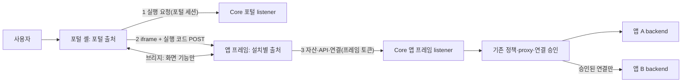

# 업무 앱 iframe 실행 후보 설계

- 작성일: 2026-11-09
- 상태: **후보 설계 · 실증 전.** 구현·격리 검증·운영 반영은 없다. 현재 기준은 [APP-BOUNDARIES](APP-BOUNDARIES.md)의 같은 페이지 MF 실행이며, 이 문서는 실증 결과로 채택 여부를 정하기 위한 후보다. 채택 전에는 현행 문서의 "iframe 없는 MF 유지"를 바꾸지 않는다.
- 배경: 2026-11-09 사용자가 iframe과 현행 구조의 장기 비교를 요청했다. 검토 결과 업무 앱만 별도 출처 iframe으로 분리하는 혼합 구조를 실증하기로 했고, 외부 검토 의견(보안 효과 과장, 인증서 범위, 공유 출처, 복잡성, 불완전 격리)을 아래 원칙에 반영했다.
- 범위: 업무 앱 UI의 브라우저 실행 계약. 권한 행렬·공통 ACL은 [CORE-PERMISSIONS](CORE-PERMISSIONS.md), 작업 순서는 [PLAN](PLAN.md)을 따른다.

## 1. 다시 검토하는 이유

**현행 한계(코드로 확인).** 같은 포털의 앱 코드는 하나의 JavaScript 출처를 공유한다. 앱 A의 코드는 `GET /api/v1/me`에서 CSRF 값을, `GET /api/v1/installations`에서 B의 설치·릴리스를 읽는다. 그 뒤 포털 쿠키로 `/api/v1/installations/{B}/api/...`를 직접 호출할 수 있다. `runtime::proxy`(`crates/miy/src/runtime.rs:1074`)는 사용자의 B Use와 쓰기 릴리스만 검사한다. 그래서 A의 연결 승인(`connections/{B}`)이 우회되고, B는 `callers=[]`를 받는다. 서버가 요청을 보낸 앱을 구별할 수 없는 구조라 같은 페이지에서는 보완할 수 없다([기존 관찰](APP-BOUNDARIES.md#변경-전과-이번-구현의-차이)).

**목표의 변화.** PLM·PDM·MES처럼 독립 개발되는 앱이 늘고, 오픈소스 공개와 외부 개발자 앱 수용, AI가 생성한 앱 실행이 예정되어 있다. 이 경우 앱마다 신뢰 경계가 필요하다. 2026-11-06에 iframe 설계를 철회한 근거는 iframe 없는 통합 UI 요구와 기존 SDK·호환 유지였다. 지금은 [개발 단계 원칙](../AGENTS.md#개발-단계-원칙-실제-운영-전환-전까지)으로 호환이 필수가 아니고, 운영 서버에 `*.dwdcc.kr` DNS와 인증서가 있다.

**iframe이 주는 것과 주지 않는 것.**

| 준다 | 주지 않는다 |
| --- | --- |
| 다른 출처 문서 간 DOM·실행 문맥·저장소 분리 | API 권한. 서버가 자격증명의 설치 결합과 현재 권한을 따로 검사해야 한다 |
| 자격증명을 설치별로 발급할 **전제 조건**. 같은 문서에서는 불가능하다 | 브리지를 잘못 만들면 생기는 대리 호출 우회(confused deputy) |
| CSS·전역 JavaScript·React 버전 충돌 제거 | CPU·메모리 고갈, 무한 루프 같은 자원 문제의 격리 |
| 앱 오류의 화면 전체 확산 차단 | iframe마다 별도 프로세스 보장. 브라우저는 사이트(scheme+등록 도메인) 단위로 배치한다 |
| | 같은 등록 도메인의 `Domain=` 쿠키 간섭 |

## 2. 원칙

| ID | 원칙 |
| --- | --- |
| AF-01 | 플랫폼 화면(포털 셸·공용 UI·콘솔)은 같은 페이지로 유지한다. 업무 앱 UI만 별도 출처 문서에서 실행한다. 두 실행 방식을 동시에 제품화하지 않는다. 채택하면 같은 페이지 MF 경로를 제거한다 |
| AF-02 | 앱 출처는 **설치 단위**다. dev와 prod 설치는 설치가 다르므로 출처도 다르다. 여러 설치가 한 출처를 공유하는 배치는 지원하지 않는다. 앱 출처는 포털·dev 포털·콘솔 출처와 겹치지 않는다 |
| AF-03 | 앱 프레임은 **쿠키를 쓰지 않는다.** 문서·자산·API의 자격증명은 실행 코드, 자산 경로 능력값, 메모리 안 토큰이다. 제3자 쿠키 차단이나 CHIPS 지원 여부, 포트 간 쿠키 공유에 의존하지 않는다 |
| AF-04 | 프레임 자격증명은 사용자, 부모 포털 세션, 설치, 환경, 릴리스에 묶인다. 서버는 **토큰의 설치, 요청 Host의 설치, Origin**이 모두 일치할 때만 처리한다. 경로·헤더·본문의 설치 ID는 믿지 않는다 |
| AF-05 | 다른 앱 호출은 기존 설치별 연결 승인 경로로만 한다. 프레임 토큰은 자기 설치의 API, 자기 연결 경로, directory만 쓸 수 있다. 연결 호출의 호출자 체인은 토큰의 설치에서 시작한다 |
| AF-06 | 브리지는 **화면 기능만** 다룬다. API 대행, 임의 URL 요청, 자격증명 전달(1회용 실행 코드 제외)은 하지 않는다. 메시지는 발신 창·출처·형식·크기를 검증한다 |
| AF-07 | 프레임 수명은 부모 포털 세션을 넘지 않는다. 갱신은 부모의 포털 세션으로만 한다. 포털 로그아웃과 권한 회수는 다음 요청에서 프레임을 막는다 |
| AF-08 | 배치 프로필별 격리 수준을 그대로 표시한다. 도메인으로만 해결되는 문제는 도메인을 권장하고, 포트 환경용 우회·임시 코드는 넣지 않는다([배치 프로필](APP-BOUNDARIES.md#배치-프로필-도메인권장과-포트-분리지원)과 같은 원칙) |
| AF-09 | 사용자·그룹·권한 정책, 연결 승인, 앱 DB, CLI/MCP, 빌드·배포·승격, artifact 해시는 재사용한다. 기존 서버 검사(현재 권한 재확인, 응답 헤더 제한)는 약화하지 않는다 |
| AF-10 | 계약은 작게 유지한다. 브리지 메시지와 프레임 API는 한 곳에서 정의하고 Rust·TypeScript 타입과 계약 시험을 같은 원본에서 만든다(구조 기반 ③과 같은 방식). 운영을 AI가 맡아도 인증 교환·회수·오류 복구 계약의 정확성 요구는 줄지 않는다 |

## 3. 실행 구조

### 3.1 실행 흐름

1. 포털 셸이 `POST /api/v1/app-frames`를 호출한다(포털 세션, CSRF, Origin). 서버는 해당 포털 환경의 Use와 실행 상태를 확인하고 앱 출처와 1회용 실행 코드를 돌려준다. 코드는 hash만 저장하며 60초 이하로 유효하다.
2. 부모는 iframe을 만들고, 숨긴 form으로 실행 코드를 `POST <앱 출처>/_miy/launch`에 보낸다(target은 iframe). 코드는 URL·기록·Referer에 남지 않고, Origin 헤더로 발신 포털을 확인할 수 있다.
3. 앱 프레임 listener가 다음을 확인한 뒤 코드를 소모한다: 코드가 유효하고, Host가 코드의 설치 출처이고, Origin이 발급한 포털 출처이고, 부모 포털 세션이 살아 있다. 그다음 프레임 세션을 만들고 프레임 문서를 응답한다. 문서에는 부트스트랩 값(설치·앱·릴리스·basePath·location·부모 출처·짧은 프레임 토큰·자산 경로)을 넣고 `no-store`로 응답한다.
4. 플랫폼이 제공하는 **프레임 런타임**이 앱 산출물을 자산 경로에서 읽어 `AppRoot`를 마운트한다. 프레임 런타임은 버전 관리하며 앱 출처의 `/_miy/runtime/<버전>/`에서 제공한다. 현행 `AppRuntime` 인터페이스(`packages/sdk/src/index.ts`)는 호스트가 props로 주입하므로 같은 형태로 구현할 수 있다.
5. 앱의 `runtime.api`·`platformApi`·`appApi`는 브리지를 거치지 않는다. 자기 출처의 `/_miy/api/...`, `/_miy/platform/directory`, `/_miy/connections/{대상}/api/...`로 프레임 토큰을 붙여 직접 요청한다. Core는 프레임 토큰에서 Principal과 출발 설치를 만든다. 그다음 기존 proxy·연결 검사를 그대로 거친다. 연결 호출에서 처음으로 브라우저 요청의 호출자 `callers=[A]`가 사실이 된다.
6. 토큰이 만료되기 전에 프레임이 브리지로 갱신을 요청한다. 부모는 포털 세션으로 갱신 코드를 받아 앱 출처로만 전달하고, 프레임이 그 코드를 교환한다. 포털 로그아웃은 그 세션의 프레임 세션을 모두 회수한다. Use 회수와 릴리스 변경은 매 요청의 현재 권한 검사와 릴리스 검사로 거부된다. 릴리스가 바뀌면 부모가 다시 불러오기 안내를 표시한다.

### 3.2 Core 변경 범위

- **앱 프레임 listener:** 브라우저 용도는 listener에 고정한다(기존 원칙). 허용 경로는 `/_miy/launch`, `/_miy/renew`, `/_miy/runtime/...`, `/_miy/a/<능력값>/...`, `/_miy/api/...`, `/_miy/connections/{대상}/api/...`, `/_miy/platform/directory`뿐이다. 나머지는 경로 경계가 거부한다. Host는 용도 선택에 쓰지 않는다. 설정된 설치 출처와 정확히 일치하는지만 확인한다.
- **포털:** 실행·갱신 API를 추가한다. 앱 산출물(`/artifacts/...`)과 앱 API 경로는 채택 후 포털에서 제거한다. 앱 코드가 포털 출처에서 실행되지 않으므로 `/api/v1/me`의 CSRF 노출 문제도 함께 사라진다.
- **자격증명:** 새 migration(번호는 현재 다음)에 프레임 세션과 1회용 코드 저장소를 추가한다. 프레임 토큰은 CLI bearer와 다른 종류로 둔다. 기존 "bearer에 Origin이 있으면 거부" 규칙 대신, 앱 출처 Origin을 요구하는 별도 규칙을 적용한다. 프레임 토큰을 포털·콘솔·CLI API에 제시하면 거부한다.
- **응답:** 앱 API 응답의 기존 헤더 제한·sandbox·nosniff를 유지한다. 프레임 문서에는 아래 헤더를 따로 정한다.
- **설정·배치:** 앱 출처 형식(호스트 형식 또는 포트 범위), Nginx/Caddy 생성, 인증서 이름 검사, `check-server-config.py`를 함께 바꾼다. 프로필은 4장을 따른다.

### 3.3 자산 제공

앱 산출물은 지금처럼 내용 해시 디렉터리에 둔다. 프레임에서는 `/_miy/a/<능력값>/ui/...`로 제공한다. 능력값은 프레임 세션·설치·릴리스·만료를 서버 키로 서명한 값이다. 상대 경로로 불러오는 청크는 같은 접두사를 그대로 이어받는다. 서버는 Host의 설치, 능력값, 프레임 세션의 유효성, 릴리스의 artifact를 확인한다. 프레임 문서와 자산에는 `Referrer-Policy: no-referrer`를 준다. 현행의 "정적 UI Use 보호"는 유지한다. 캐시 비용과 보호 수준의 선택은 [결정 D3](#7-결정이-필요한-사항)이다.

### 3.4 브리지 v1

봉투는 `{protocol: "miy.frame/v1", type, id, payload}`다.

| 현행 AppRuntime | iframe에서 | 방향 |
| --- | --- | --- |
| `installationId`·`appId`·`releaseId`·`basePath` | 서버 부트스트랩 값 | 없음 |
| `location` | `route.changed {pathname, search, hash}`. 부모의 뒤로·앞으로 가기와 직접 링크 | 부모→프레임 |
| `navigate(relative, {replace})` | `route.navigate`. 부모는 앱 basePath 아래의 상대 경로만 받는다. 절대 URL과 다른 앱·플랫폼 경로는 거부한다 | 프레임→부모 |
| `registerNavigationGuard` | `guard.state {dirty, message}`. 부모는 마지막 상태로 동기 판단한다(레일 이동, 로그아웃, 탭 닫기) | 프레임→부모 |
| `theme` | `theme.changed`. 언어는 U3 때 `locale.changed`를 추가한다 | 부모→프레임 |
| `api`·`platformApi`·`appApi` | 브리지 미사용. 앱 출처로 직접 요청 | 없음 |
| (신규) 실행 상태 | `frame.ready`, `frame.error`, `release.changed` | 프레임→부모 |
| (신규) 토큰 갱신 | `token.renew` 요청 → `token.code` 응답(1회용, 앱 출처로만 전송) | 양방향 |

- **검증:** 부모는 `event.source === iframe.contentWindow`이고 `event.origin`이 그 설치의 출처일 때만 받는다. 프레임은 `window.parent`에서 온 메시지이고 출처가 부트스트랩의 부모 출처일 때만 받는다. 보낼 때는 항상 대상 출처를 지정하고 `"*"`를 쓰지 않는다. 형식 검증, 크기 상한(예: 16KiB), 알 수 없는 type은 무시하고 집계한다.
- **하지 않는 것:** HTTP 요청 대행, 다른 앱으로 메시지 중계, 부모 DOM·저장소 접근 제공, 쿠키·포털 CSRF 전달.
- 프레임은 업무 영역 전체를 차지하는 고정 크기로 둔다. 높이 자동 조절 메시지는 두지 않으며, 앱 내부에서 스크롤한다. 모달·오버레이는 프레임 영역 안에 그려지며, 이것은 알려진 UX 변화다.

### 3.5 헤더와 iframe 속성

- **포털:** `frame-src`에 해당 환경의 앱 출처 형식만 허용한다. 포털 자신의 `frame-ancestors 'none'`은 유지한다.
- **프레임 문서:** `frame-ancestors <해당 환경 포털 출처>`, `default-src 'self'`, `script-src 'self'`, `connect-src 'self'`, `object-src 'none'`, `base-uri 'none'`, `form-action 'self'`, `Referrer-Policy: no-referrer`, `nosniff`. `X-Frame-Options`는 허용 출처를 표현할 수 없어 프레임 문서에서만 빼고 CSP로 대체한다. `worker-src 'none'` 유지 여부는 실증에서 정한다.
- **iframe 속성:** `sandbox="allow-scripts allow-same-origin allow-forms allow-downloads allow-modals allow-popups allow-popups-to-escape-sandbox"`, `referrerpolicy="no-referrer"`, `allow`는 기본으로 비운다.
  - `allow-scripts`와 `allow-same-origin`을 함께 주는 것은 **프레임이 부모와 다른 출처일 때만** 안전하다. 같은 출처라면 sandbox를 스스로 풀 수 있다. 서버 설정 검사가 앱 출처와 포털 출처가 다른지 확인한다.
  - 최상위 탐색 권한(`allow-top-navigation*`)은 주지 않는다.
- **장치 권한:** 마이크·카메라 등은 앱 manifest에 선언하고 관리자가 승인한 경우에만 `allow`로 위임한다. 보안 컨텍스트(HTTPS)가 필요하며, HTTP 개발 프로필에서는 해당 기능만 동작하지 않는다.

## 4. 배치 프로필과 격리 수준

| 프로필 | 앱 출처 예 | 격리 수준 | 필요 조건 |
| --- | --- | --- | --- |
| P1 별도 등록 도메인(권장) | `<설치키>.<앱 전용 도메인>` | 설치별 출처, 그리고 포털·콘솔과 **다른 사이트**. 브라우저 사이트 격리로 프로세스 분리를 기대할 수 있다. 앱 코드가 포털·콘솔·Keycloak·사내 다른 서비스에 `Domain=` 쿠키를 심지 못한다 | 앱 전용 등록 도메인, 와일드카드 DNS·인증서 |
| P2 같은 등록 도메인의 한 단계 이름 | `v2-app-<설치키>.dwdcc.kr` | 설치별 출처. 포털과 같은 사이트라 `Domain=dwdcc.kr` 쿠키 간섭(콘솔·Keycloak과 `dwdcc.kr`의 다른 사내 서비스 포함)과 같은 프로세스 배치 가능성이 남는다. 지금 포털에서 실행되는 앱 코드도 같은 간섭이 가능하므로 악화는 아니다 | 기존 `*.dwdcc.kr` 인증서로 가능. 두 단계 이름(`*.apps.dwdcc.kr`)은 현재 인증서가 포함하지 않는다. 사내 다른 호스트와 이름 충돌을 검사해야 한다 |
| P3 포트 분리(도메인 없음, 지원) | `https://<IP>:<설치별 포트>` | 설치별 출처(포트는 출처에 포함). 저장소는 출처별로 나뉜다. AF-03으로 앱 프레임은 쿠키를 쓰지 않으므로 앱 간 쿠키 문제는 없다. 같은 사이트라 프로세스는 보장되지 않는다. 포털 쿠키의 기존 포트 한계는 그대로다 | 포트 범위 개방, 설치·제거 때 프록시 갱신 |
| P4 sandbox 고유 출처(비교안) | 환경별 앱 제공 출처 하나 + `allow-same-origin` 없는 sandbox | 프레임마다 null origin이라 DOM·저장소가 분리된다(Figma 플러그인 UI 방식). 앱은 쿠키·localStorage를 쓸 수 없고, Origin이 `null`이라 토큰 결합만이 유일한 구분이다 | 포트·도메인 불필요. 실증 비교용이며, P3 운영이 실제로 어려울 때만 채택을 검토한다 |
| 금지 | 모든 설치가 한 출처, dev·prod가 같은 출처 | 같은 출처 앱끼리 실행 문맥·저장소에 접근할 수 있다. 이번에 확보한 환경 분리도 되돌린다 | 지원하지 않음 |

- localhost 개발에서는 P3(포트)를 기본으로 한다. `*.localhost` 호스트명 방식은 실증에서 브라우저별 동작을 확인한 뒤 정한다.
- 설치 안내와 점검 도구는 현재 프로필과 남은 한계를 표시하고 P1을 권장한다. 이 원칙은 기존 배치 프로필 절과 같다.

## 5. 바뀌는 것과 유지하는 것

| 구분 | 내용 |
| --- | --- |
| 유지 | 사용자·그룹·use/develop/deploy 정책, 설치별 연결 승인과 `miy_call_` 체인, 앱 backend·DB·서명 identity, artifact 내용 해시·불변 게시물, CLI/MCP·위임·빌드·dev 배포·prod 승격, 앱 API 응답 제한, 세 출처 세션 용도 |
| 바뀜 | 포털 `AppView`의 같은 페이지 마운트가 앱 프레임으로 바뀐다. 산출물·앱 API 경로가 포털에서 앱 출처로 옮겨진다. 프레임 자격증명·실행 API·listener·migration이 추가된다. 프레임 런타임과 새 SDK·번들 버전이 생기고, 템플릿의 `CONTRACT`·`AGENTS`에 있는 "iframe 금지·플랫폼 JS 문맥 실행" 문구가 바뀐다. Nginx/Caddy의 앱 출처 블록과 CSP가 추가된다 |
| 제거(채택 후) | 같은 페이지 MF 마운트, 셸 CSS의 `.miy-app-root` 제외 규칙과 CSS 격리 시험, 포털의 `/artifacts/` 경로 |
| 고칠 시험 | `tests/platform-shell`, `surface-boundaries`, `stack-ui`, `validation`, `runtime-health`의 같은 페이지 전제(`.miy-app-root`, iframe 0개 검사)와 `platform-css-isolation`, `app-css-baseline.mjs`. Rust `browser_boundary_regression`의 MF 자산 검사, `check-server-config.py`의 frame 헤더 기대값 |

로컬 preview(`miy app dev`)는 이미 `AppRoot`를 독립 문서로 실행한다(`templates/rust-react/sdk/preview/main.tsx`). 프레임 런타임은 이 구조를 재사용할 수 있다. preview의 자격증명·origin 계약은 실증 범위에서 바꾸지 않는다.

## 6. 실증 계획

격리 스택에서 수행하고 운영 서버는 바꾸지 않는다. 프로필은 P3(포트)와 P2 대응(시험용 호스트명과 시험 인증서)을 사용하고, P4는 비교용으로 함께 측정한다. 앱은 실제 업무 앱 하나와 차단 확인용 프로브 앱 하나를 쓴다. 실증 코드는 채택 전까지 운영 반영 대상이 아니다.

| ID | 시험과 판정 기준 |
| --- | --- |
| FV-01 실행 | 실행, 직접 링크, 다시 불러오기, 뒤로·앞으로 가기 동기화, 릴리스 변경 안내, 로드 실패 표시 |
| FV-02 입력 보호 | 미저장 입력이 있을 때 레일 이동·로그아웃·탭 닫기 경고. 프레임 상태와 부모 판단 일치 |
| FV-03 인증·회수 | 실행 코드가 다음 경우에 거부되는지: 재사용, 만료, 다른 Host, 다른 Origin, 죽은 포털 세션. 그 밖에 프레임 토큰의 설치 결합, 포털 로그아웃 후 다음 요청 거부, Use 회수 후 403, 프레임 토큰을 포털·콘솔·CLI API에 제시할 때 거부 |
| FV-04 앱 간 차단(핵심) | 사용자가 B의 Use를 가졌고 A→B 승인은 없다. 이때 A 프레임의 다음 요청이 모두 거부되어야 한다: B 출처에 A 토큰으로 요청, B의 API 경로에 직접 요청, 승인 없는 `connections/B`. 승인 후에는 `callers=[A]`로 성공해야 한다. 부모·다른 프레임 DOM 접근 차단, 브리지 남용(basePath 밖 이동, 위조 출처·발신 창, 크기 초과, API 대행 요청) 거부도 확인 |
| FV-05 자산 | 능력값이 없거나, 만료됐거나, 다른 Host·다른 릴리스이면 거부. 첫 실행·재실행 시간과 캐시 적중 측정 |
| FV-06 쿠키 간섭 | 프로브 앱이 P2에서 `Domain=` 쿠키, P3에서 같은 호스트 쿠키를 심었을 때 포털·콘솔·Keycloak에 주는 영향을 기록. 해결이 아니라 한계 기록이다 |
| FV-07 UX | 인쇄, 다운로드(blob과 서버 파일), 새 탭·외부 링크, 모달·오버레이 범위, 포커스 이동·키보드·기본 화면낭독, 테마 전달 |
| FV-08 성능 | 앱 1·3·5개를 차례로 열 때 첫 표시 시간과 메모리. 이전 프레임을 제거하는 경우와 유지하는 경우 비교 |
| FV-09 프로필 | P2·P3에서 FV-01~05 PASS. P4 결과(제약·실패 포함)를 기록 |
| FV-10 기존 기능 | CLI/MCP, dev 배포·prod 승격, backend 연결 체인, 로컬 preview 회귀 |

결과는 `docs/releases/`에 SHA·환경·명령·PASS/FAIL/NOT_RUN으로 남긴다. FV의 PASS를 기존 BV의 PASS로 옮기지 않는다. 반대로 같은 페이지에 대해 "A→B 격리 PASS"를 표시하지 않는다는 기존 금지(BV-04)는 채택 전까지 유지한다.

## 7. 결정이 필요한 사항

| ID | 결정 | 권고 |
| --- | --- | --- |
| D1 | 채택 여부 | FV-01~05와 FV-09가 PASS이고 FV-07·08의 비용을 받아들일 수 있으면 채택하고 APP-BOUNDARIES를 개정한다 |
| D2 | v2.dwdcc.kr의 앱 출처 프로필 | 실증 후 첫 반영은 P2(기존 인증서·DNS). 외부 앱·외부 개발자를 수용하기 전에 P1(앱 전용 도메인)로 옮긴다 |
| D3 | 자산 보호 방식 | (a) 프레임 세션별 능력값: 보호가 가장 좁지만 실행마다 캐시를 못 쓴다. (b) 사용자·릴리스별 능력값을 주기적으로 교체: 캐시를 쓸 수 있지만 유출 시 유효 기간이 길다. (c) 내용 해시만으로 공개: 캐시가 가장 좋지만 회수할 수 없고 현행 Use 보호를 없앤다. 실증 기본은 (a)로 하고, FV-05·08 측정 후 (b)를 검토한다. 공개 접속 서버라 (c)는 권하지 않는다 |
| D4 | 앱 빌드 형태 | 실증은 기존 MF 산출물을 프레임 런타임이 읽는 방식으로 한다(앱 재빌드 없이 실제 앱 시험). 장기적으로 앱이 자기 문서를 직접 내는 방식(프레임워크 자유, React 버전 결합 제거)과 비교해 정한다 |
| D5 | 프레임 유지 정책 | FV-08 결과로 정한다(떠날 때 제거 또는 최근 N개 유지) |

## 8. 채택 시 함께 바꿀 문서

APP-BOUNDARIES(AB-04, 앱 실행 계약, 선택기와 브리지 소유, iframe 없는 방안 비교), PRD의 브라우저 실행·통합 UI 요구·인수, FRONTEND의 모듈 로딩 절, UIUX-MIGRATION의 앱 화면 원칙, CORE-PERMISSIONS의 "브라우저 직접 요청의 발신 앱 증명 없음" 문구, 루트 AGENTS의 "iframe 없는 MF 유지", 템플릿 번들(새 버전). 채택하지 않으면 이 문서를 결과와 함께 archive로 옮긴다.

## 참고 자료

- iframe 기반 앱 플랫폼: [Shopify App Home](https://shopify.dev/docs/api/app-home/latest), [Shopify 세션 토큰](https://shopify.dev/docs/apps/build/authentication-authorization/id-tokens), [Forge Custom UI](https://developer.atlassian.com/platform/forge/custom-ui/iframe/), [Teams 탭](https://learn.microsoft.com/en-us/microsoftteams/platform/tabs/what-are-tabs?tabs=desktop), [Figma 플러그인 네트워크 요청(null origin)](https://developers.figma.com/docs/plugins/making-network-requests). 같은 페이지 실행의 격리 강화 사례: [Grafana 프런트엔드 샌드박스](https://grafana.com/whats-new/2025-01-14-plugin-frontend-sandbox/). 사례마다 실행 구조가 다르므로 일반화하지 않는다.
- 브라우저 규칙: [메시지 보안](https://html.spec.whatwg.org/multipage/web-messaging.html#security), [iframe sandbox](https://html.spec.whatwg.org/multipage/iframe-embed-object.html#attr-iframe-sandbox), [same-origin policy](https://developer.mozilla.org/en-US/docs/Web/Security/Defenses/Same-origin_policy), [쿠키와 포트](https://www.rfc-editor.org/rfc/rfc6265.html#section-8.5), [TLS 이름 일치(와일드카드는 한 단계)](https://www.rfc-editor.org/rfc/rfc9525.html#section-6.3), [Chromium 프로세스 모델과 사이트 격리](https://chromium.googlesource.com/chromium/src/+/main/docs/process_model_and_site_isolation.md).
- 제3자 쿠키: [CHIPS](https://privacysandbox.google.com/cookies/chips). Safari 지원이 버전에 따라 켜지고 꺼진 기록이 있다([WebKit 버그 292975](https://bugs.webkit.org/show_bug.cgi?id=292975)). AF-03이 쿠키에 의존하지 않는 이유다.
