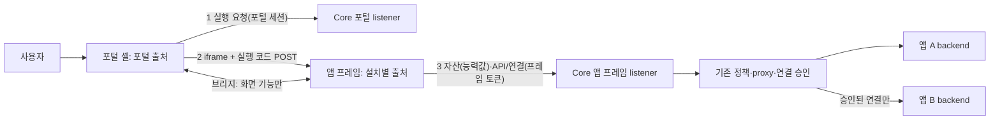

# 업무 앱 iframe 실행 설계

- 작성일: 2026-11-09
- 상태: **채택(D1, 2026-11-10) · 소스 구현(2026-11-11 main 병합) · 최초 도입과 리뷰 보완 운영 반영(2026-11-12).** 사용자가 2차 실증 보고를 받고 채택 후속 단계 진행을 지시했다. 채택 당시 격리 DB 회귀 127개(frames 12 포함), 서버 설정 검사(P2 호스트 패턴과 P3 포트 풀), 포트·호스트명 프로필의 Chromium·Firefox·WebKit 각 18개, 프레임으로 옮긴 모의 UI·실제 스택 UI 시험, 검증용 fixture 앱(`validation.spec`)과 번들 0.8.0 앱의 프레임 실행이 PASS였다. 같은 등록 도메인(P2)의 쿠키 간섭(FV-06)과 화면낭독 출력 확인은 남아 있다([1차](releases/app-frames-poc-2026-11-10-validation.json), [2차](releases/app-frames-poc-2026-11-10-second-validation.json), [채택 후속](releases/app-frames-adoption-2026-11-10-validation.json)). 최초 운영 반영은 2026-11-12 §9 절차로 수행했다(서버·UI `bcb6356`, schema 21→22, [첫 배포 기록](releases/app-frames-2026-11-12-deployment.json), 당시 앱 4개를 prod·dev 포털에서 읽기 전용으로 열어 확인). 현행 문서는 §8대로 개정했다. [11-12 리뷰 보완 검증](releases/app-frames-review-fixes-2026-11-12-validation.json) 후 서버·UI·프레임 런타임을 `7defdb0`으로 갱신하고 Nginx error log 차단을 반영했다(schema 22 유지, [수정 배포 기록](releases/app-frames-review-fixes-2026-11-12-deployment.json)). 게시 CLI는 `01e4d49`·번들 0.8.0이며 번들 0.9.0과 구 번들 업그레이드 보완을 포함한 CLI는 아직 게시하지 않았다.
- 배경: 2026-11-09 사용자가 iframe과 현행 구조의 장기 비교를 요청했다. 검토 결과 업무 앱만 별도 출처 iframe으로 분리하는 혼합 구조를 실증하기로 했고, 외부 검토 의견(보안 효과 과장, 인증서 범위, 공유 출처, 복잡성, 불완전 격리)을 아래 원칙에 반영했다.
- 범위: 업무 앱 UI의 브라우저 실행 계약. 권한 행렬·공통 ACL은 [CORE-PERMISSIONS](CORE-PERMISSIONS.md), 작업 순서는 [PLAN](PLAN.md)을 따른다.

## 1. 다시 검토하는 이유

**전환 전 한계(당시 코드로 확인).** 2026-11-12 앱 프레임 반영 전에는 같은 포털의 앱 코드가 하나의 JavaScript 출처를 공유했다. 앱 A의 코드는 `GET /api/v1/me`에서 CSRF 값을, `GET /api/v1/installations`에서 B의 설치·릴리스를 읽는다. 그 뒤 포털 쿠키로 `/api/v1/installations/{B}/api/...`를 직접 호출할 수 있다. `runtime::proxy`(`crates/miy/src/runtime.rs:1074`)는 사용자의 B Use와 쓰기 릴리스만 검사한다. 그래서 A의 연결 승인(`connections/{B}`)이 우회되고, B는 `callers=[]`를 받는다. 서버가 요청을 보낸 앱을 구별할 수 없는 구조라 같은 페이지에서는 보완할 수 없다([기존 관찰](APP-BOUNDARIES.md#변경-전과-이번-구현의-차이)).

**목표의 변화.** PLM·PDM·MES처럼 독립 개발되는 앱이 늘고, 오픈소스 공개와 외부 개발자 앱 수용, AI가 생성한 앱 실행이 예정되어 있다. 이 경우 앱마다 신뢰 경계가 필요하다. 2026-11-06에 iframe 설계를 철회한 근거는 iframe 없는 통합 UI 요구와 기존 SDK·호환 유지였다. 지금은 [개발 단계 원칙](../AGENTS.md#개발-단계-원칙-실제-운영-전환-전까지)으로 호환이 필수가 아니고, 운영 서버에 `*.dwdcc.kr` DNS와 인증서가 있다.

**iframe이 주는 것과 주지 않는 것.**

| 준다 | 주지 않는다 |
| --- | --- |
| 다른 출처 문서 간 DOM·실행 문맥·저장소 분리 | API 권한. 서버가 자격증명의 설치 결합과 현재 권한을 따로 검사해야 한다 |
| 자격증명을 설치별로 발급할 **전제 조건**. 같은 문서에서는 불가능하다 | 브리지를 잘못 만들면 생기는 대리 호출 우회(confused deputy) |
| CSS·전역 JavaScript·React 버전 충돌 제거 | CPU·메모리 고갈, 무한 루프 같은 자원 문제의 격리 |
| 앱 오류의 화면 전체 확산 차단 | iframe마다 별도 프로세스 보장. 브라우저는 사이트(scheme+등록 도메인) 단위로 배치한다 |
| | 같은 등록 도메인의 `Domain=` 쿠키 간섭 |

## 2. 원칙

| ID | 원칙 |
| --- | --- |
| AF-01 | 플랫폼 화면(포털 셸·공용 UI·콘솔)은 같은 페이지로 유지한다. 업무 앱 UI만 별도 출처 문서에서 실행한다. 두 실행 방식을 동시에 제품화하지 않는다. 채택하면 같은 페이지 MF 경로를 제거한다 |
| AF-02 | 앱 출처는 **설치 단위**다. dev와 prod 설치는 설치가 다르므로 출처도 다르다. 설치와 출처의 매핑은 영속 저장하고 삭제한 출처는 재사용하지 않는다. 여러 설치의 출처 공유와 포털·dev 포털·콘솔 출처의 재사용은 금지한다 |
| AF-03 | 앱 프레임은 **인증에 쿠키를 쓰지 않는다.** 문서·자산·API의 자격증명은 실행 코드, 자산 경로 능력값, 메모리 안 토큰이다. 제3자 쿠키 차단이나 CHIPS 지원 여부에 의존하지 않는다. 브라우저의 쿠키 저장·자동 전송과 포트 간 쿠키 간섭까지 막는다는 뜻은 아니다 |
| AF-04 | 프레임 자격증명은 사용자, 부모 포털 세션, 설치, 환경, 릴리스에 묶인다. 서버는 **자격증명의 설치와 요청 출처의 설치**를 대조하고, 요청 종류별 Origin·Fetch Metadata 검사를 추가한다(§3.2). Origin이 없는 정상 GET·HEAD를 구분한다. 요청이 주장한 설치 ID로 자격증명의 범위를 바꾸지 않는다 |
| AF-05 | 다른 앱 호출은 기존 설치별 연결 승인 경로로만 한다. 프레임 토큰은 자기 설치의 API, 자기 연결 경로, directory만 쓸 수 있다. 연결 호출의 호출자 체인은 토큰의 설치에서 시작한다 |
| AF-06 | 브리지는 **화면 기능만** 다룬다. API 대행, 임의 URL 요청, 자격증명 전달(1회용 실행 코드 제외)은 하지 않는다. 메시지는 발신 창·출처·형식·크기를 검증한다 |
| AF-07 | 프레임 수명은 부모 포털 세션을 넘지 않는다. 갱신은 부모의 포털 세션으로만 하며 기존 프레임·설치·환경·릴리스 결합을 유지한다. 포털 로그아웃과 권한 회수는 다음 프레임 요청과 이미 발급된 backend 후속 호출을 막는다 |
| AF-08 | 배치 프로필별 격리 수준을 그대로 표시한다. 도메인으로만 해결되는 문제는 도메인을 권장하고, 포트 환경용 우회·임시 코드는 넣지 않는다([배치 프로필](APP-BOUNDARIES.md#배치-프로필-도메인권장과-포트-분리지원)과 같은 원칙) |
| AF-09 | 사용자·그룹·권한 정책, 연결 승인, 앱 DB, CLI/MCP, 빌드·배포·승격, artifact 해시는 재사용한다. 기존 서버 검사(현재 권한 재확인, 응답 헤더 제한)는 약화하지 않는다 |
| AF-10 | 계약은 작게 유지한다. 브리지 메시지와 프레임 API는 한 곳에서 정의하고 Rust·TypeScript 타입과 계약 시험을 같은 원본에서 만든다(구조 기반 ③과 같은 방식). 운영을 AI가 맡아도 인증 교환·회수·오류 복구 계약의 정확성 요구는 줄지 않는다 |

## 3. 실행 구조

### 3.1 실행 흐름

1. 포털 셸이 `POST /api/v1/app-frames`를 호출한다(포털 세션, CSRF, Origin). 서버는 해당 포털 환경의 Use와 실행 상태를 확인하고 앱 출처와 1회용 실행 코드를 돌려준다. 코드는 hash만 저장하며 60초 이하로 유효하다.
2. 부모는 iframe을 만들고, 숨긴 form으로 실행 코드를 `POST <앱 출처>/_miy/launch`에 보낸다(target은 iframe). 코드는 URL·기록·Referer에 남지 않고, Origin 헤더로 발신 포털을 확인할 수 있다.
3. 앱 프레임 listener가 다음을 확인한 뒤 코드를 원자적으로 한 번 소모한다: 코드가 유효하고, Host가 코드의 설치 출처이고, Origin이 발급한 포털 출처이고, 부모 포털 세션과 현재 Use·실행 상태·릴리스가 유효하다. 그다음 프레임 세션을 만들고 프레임 문서를 응답한다. 문서에는 부트스트랩 값(설치·앱·릴리스·basePath·location·부모 출처·짧은 프레임 토큰·자산 경로)을 넣고 `no-store`로 응답한다. 부트스트랩은 안전하게 이스케이프한 비실행 JSON으로 넣으며 inline script 실행을 요구하지 않는다. 코드가 없거나 이미 소모됐거나 검사에 실패하면 비밀 없는 **재실행 안내 문서**를 응답한다. 이 문서는 `/_miy/runtime`의 정적 스크립트로 해당 환경의 포털 출처에 `frame.relaunch`를 보내고, 부모는 미저장 입력 상태를 확인한 뒤 새 iframe으로 다시 실행한다. 프레임 안의 다시 불러오기(`location.reload()`)는 소모된 코드를 `Origin: null`로 다시 POST하므로(2026-11-10 Chromium 실측) 이 경로로 처리된다. 실행 GET도 같은 문서를 받는다.
4. 플랫폼이 제공하는 **프레임 런타임**이 앱 산출물을 자산 경로에서 읽어 `AppRoot`를 마운트한다. 프레임 런타임은 버전 관리하며 앱 출처의 `/_miy/runtime/<버전>/`에서 제공한다. 실증에서는 MF 초기화·공유 React·기본 CSS·상대 청크 로딩을 이 런타임이 맡는다. props로 `AppRuntime`을 주입하는 형태는 재사용하되 미저장 입력 보호와 바이너리 응답은 새 SDK 계약으로 바꾼다(§3.4). 앱끼리의 문서 분리와 프레임 런타임·MF 사이의 React 버전 결합 제거는 구분한다.
5. 앱의 `runtime.api`·`platformApi`·`appApi`는 브리지를 거치지 않는다. 자기 출처의 `/_miy/api/...`, `/_miy/platform/directory`, `/_miy/connections/{대상}/api/...`로 프레임 토큰을 붙인다. 프레임 SDK는 `credentials: "omit"`과 요청 단위 `referrerPolicy: "same-origin"`을 고정한다. 문서 기본 정책이 `no-referrer`면 Fetch 표준상 같은 출처 쓰기 요청의 Origin이 `null`이 될 수 있고, `mode: "cors"`는 같은 출처 요청의 tainting을 바꾸지 않으므로 요청 단위 정책으로 Origin을 보장한다. Referer는 프레임 문서 주소(`/_miy/launch`)뿐이라 능력값이 실리지 않는다. Chromium은 세 변형 모두 실제 Origin을 보냈으며(2026-11-10 실측) Firefox·WebKit은 FV-03에서 확인한다. 대상 URL은 자기 출처로 제한한다. Core는 토큰에서 Principal·출발 설치·원 프레임 세션 문맥을 만든다. 기존 proxy·연결 승인 정책을 재사용하면서 원 자격증명 재검사를 프레임 인증까지 확장한다(§3.2). 연결 호출의 호출자 `callers=[A]`는 서버가 검증한 출발 설치로 만든다.
6. 토큰이 만료되기 전에 프레임이 브리지로 갱신을 요청한다. 부모는 자기 등록 정보의 프레임 세션을 대상으로 포털 세션·CSRF·Origin으로 갱신 코드를 받고, 등록된 앱 창·출처에만 전달한다. 앱 메시지의 설치 ID나 세션 ID로 갱신 대상을 고르지 않는다. 코드는 기존 프레임·부모 세션·사용자·설치·환경·릴리스에 묶고 hash만 저장하며 60초 이하, 원자적 1회 사용으로 한다. 프레임의 `POST /_miy/renew` 교환에도 현재 세션·Use·릴리스를 재검사한다. 동시 요청은 프레임당 하나로 합치며 실패 시 자동으로 다른 세션이나 릴리스에 재발급하지 않는다.
7. 프레임 세션 만료는 생성 시 고정하며 부모 세션의 절대 만료를 넘지 않는다. 짧은 API 토큰 갱신으로 프레임 세션이나 자산 URL의 수명을 늘리지 않는다. 포털 로그아웃은 그 부모의 프레임 세션을 모두 회수한다. Use 회수·릴리스 변경은 다음 요청과 후속 backend 호출에서 거부한다. 릴리스 변경·세션 만료 때 부모가 다시 불러오기 또는 재로그인을 안내한다. 오류 안내만으로 기존 iframe과 미저장 입력을 제거하지 않으며, 사용자가 새 실행을 선택할 때 입력 보호를 적용한다. 갱신 거부도 부모에게 전달하고 일시적인 통신 실패는 세션 종료와 구분해 재시도한다.

### 3.2 Core 변경 범위

- **앱 프레임 listener:** 브라우저 용도는 listener에 고정한다(기존 원칙). 허용 경로는 `/_miy/launch`, `/_miy/renew`, `/_miy/runtime/...`, `/_miy/a/<능력값>/...`, `/_miy/api/...`, `/_miy/connections/{대상}/api/...`, `/_miy/platform/directory`뿐이다. 경로별 허용 메서드 외에는 거부하고 쿠키 인증을 하지 않는다. Host는 용도 선택에 쓰지 않는다. 신뢰한 proxy 설정의 scheme·Host·port로 설치 출처와 정확히 대조하며, 미등록 Host와 외부의 임의 forwarded 헤더는 거부한다.
- **포털:** 실행·갱신 API를 추가한다. 채택 후 포털의 `/artifacts/` 제공과 쿠키 세션의 업무 데이터 API 접근을 제거한다. CLI·위임·backend 연결이 쓰는 기존 Core 주소와 API 경로는 아래 표의 비브라우저 인증으로 유지한다. 앱 코드가 포털 출처에서 실행되지 않으므로 앱이 `/api/v1/me`의 CSRF 값을 읽는 경로도 사라진다.
- **자격증명:** `0022_app_frames.sql`로 프레임 세션과 1회용 코드 저장소를 추가했고 현재 개발 서버에도 적용했다. 프레임 토큰은 CLI bearer와 다른 종류다. 기존 CLI bearer의 Origin 거부 규칙은 유지하고, 프레임 인증에만 아래 요청별 검사를 적용한다. 프레임 토큰을 포털·콘솔·CLI API에 제시하면 거부한다.
- **호출 체인:** `app_calls::origin/current/identity`와 proxy의 브라우저 판정을 함께 확장한다. 서버가 만든 `frame` 원 자격증명 문맥에 프레임 세션과 부모 세션의 결합을 보존하고, 모든 `miy_call_` 후속 호출에서 두 세션·현재 사용자 권한·설치·환경·릴리스·연결 승인을 재확인한다. 프레임을 `legacy_cli`로 분류하거나 원 문맥을 생략하지 않는다. 원 프레임의 설치·환경·릴리스는 호출 체인의 출발점과 일치해야 한다. 요청 본문 수집 중 배포가 겹쳐도 이전 프레임을 새 릴리스 문맥으로 바꾸지 않는다. 브라우저에서 시작한 체인은 모든 hop에서 `admin=false`이며 backend 증표를 프레임에 전달하지 않는다.
- **응답:** 앱 API 응답의 기존 헤더 제한·sandbox·nosniff를 유지한다. 프레임 문서에는 아래 헤더를 따로 정한다.
- **설정·배치:** 앱 출처 형식(호스트 형식 또는 포트 범위), Nginx/Caddy 생성, 인증서 이름 검사, `check-server-config.py`를 함께 바꾼다. 프로필은 4장을 따른다.

**프레임 listener의 요청 검사.** 보호 경로의 자격증명과 현재 권한 검사는 아래 브라우저 헤더 검사와 별개로 항상 수행한다. `null`·형식 오류·중복·허용 출처와 다른 Origin은 거부한다. CORS로 다른 출처의 프레임 API 접근을 열지 않는다.

| 요청 | 자격증명 | Origin·Fetch Metadata 조건 |
| --- | --- | --- |
| `POST /_miy/launch` | 발급한 포털 세션에 묶인 1회용 실행 코드 | 코드에 결합된 포털 Origin 필수. 포털→앱의 정상 교차 출처 form 제출을 허용. 거부 시 §3.1의 재실행 안내 문서(자격증명·업무 데이터 없음) |
| `POST /_miy/renew` | 기존 프레임에 묶인 1회용 갱신 코드 | 해당 앱 Origin 필수 |
| API·connections의 POST·PUT·PATCH·DELETE | 프레임 토큰 | 해당 앱 Origin 필수 |
| API·connections·directory의 GET·HEAD(각 경로가 지원하는 메서드만) | 프레임 토큰 | `Sec-Fetch-Site: same-origin` 필수. Origin은 없어도 허용하며, 있으면 해당 앱 Origin과 일치해야 함 |
| `/_miy/a/<능력값>/...`의 GET·HEAD | 프레임 세션별 자산 능력값 | 위 읽기 조건과 동일. 현재 세션·Use·릴리스 확인 후 응답 |
| `/_miy/runtime/<버전>/...`의 GET·HEAD | 인증 불필요한 플랫폼 공용 정적 코드 | 등록된 앱 출처와 알려진 버전·경로만 허용. 사용자·앱 데이터나 자격증명은 포함하지 않음 |

같은 출처 GET·HEAD에는 Origin이 없을 수 있다([Fetch 표준](https://fetch.spec.whatwg.org/#append-a-request-origin-header)). 프레임의 보호된 읽기에 필요한 Fetch Metadata가 없는 브라우저는 이번 실증의 지원 대상에서 제외하고 오류를 표시한다. 기존 포털·CLI의 호환 규칙을 이 조건으로 바꾸지 않는다.

**채택 후 업무 데이터 경로와 자격증명.** 플랫폼 관리·로그인·CLI 제어 경로의 현재 권한 정책은 유지한다. 아래 표는 이번에 실행 위치가 바뀌는 경로의 경계다.

| 자격증명 | 허용 경로와 제한 |
| --- | --- |
| portal/dev_portal 세션 | 해당 환경의 앱 목록·개인 정보와 실행·갱신 코드 발급. 기존 `/api/v1/installations/{id}/api/...`, `connections/...`, `platform/directory`의 쿠키 인증은 거부 |
| console 세션 | 기존 관리·CLI 승인 경로. 프레임 실행·업무 데이터 인증은 거부 |
| 프레임 토큰 | 해당 앱 출처의 자기 `/_miy/api/...`, 승인된 `/_miy/connections/{대상}/api/...`, `/_miy/platform/directory`만 허용 |
| CLI·사용자 위임 bearer | 기존 Core 주소의 `/api/v1/installations/{id}/api/...`, `connections/...`, `platform/directory`를 현재 scope·앱·환경·action·경로 제한의 교집합으로 허용. 프레임 경로에는 사용할 수 없음 |
| `miy_call_` | 기존 Core 주소에서 증표의 설치에 결합된 `connections/...`와 `platform/directory`만 허용. 모든 hop의 원 자격증명·연결 승인 재검사를 유지 |
| 실행 코드·갱신 코드·자산 능력값 | 각각 위 요청 표의 한 용도만 허용. 일반 API 토큰으로 사용할 수 없음 |

### 3.3 자산 제공

앱 산출물은 지금처럼 내용 해시 디렉터리에 둔다. 프레임에서는 `/_miy/a/<능력값>/ui/...`로 제공한다. 실증 기본은 **프레임 세션별 능력값**이다(D3). 무작위 256비트 값을 발급하고 hash만 프레임 세션 행에 저장한다(`miy_call_`과 같은 방식). 자산 요청마다 세션 행을 조회하므로 별도 서명 키와 키 교체를 두지 않는다. 능력값의 만료는 프레임 세션과 같다. API 토큰 갱신 시 자산 접두사를 교체하지 않아 이미 import한 모듈의 상대 청크·CSS URL이 프레임 수명 동안 유지된다. 새 실행은 새 프레임 세션과 능력값을 받는다.

- 서버는 요청 출처의 설치, 능력값, 부모·프레임 세션, 현재 Use, 활성 릴리스의 artifact와 안전한 상대 경로를 확인한다. 권한 회수·릴리스 변경·만료 후에는 서명이 맞아도 거부한다.
- 보호 자산은 `Cache-Control: private, no-cache`로 브라우저 재검증을 요구하고 proxy/CDN 공유 캐시에 저장하지 않는다. 조건부 요청도 인증·권한 검사 후에만 304를 반환한다. 이미 사용자에게 전달한 바이트를 회수한다는 의미는 아니다.
- 프레임 문서·보호 자산에 `Referrer-Policy: no-referrer`를 적용한다. URL 능력값은 비밀로 취급하며 Core 로그·감사·proxy access/error log·오류 수집·브라우저 검사 증거에서 원시 경로를 기록하지 않는다. 능력값을 가린 경로만 남기고, 마스킹할 수 없는 proxy 로그는 해당 경로에서 끈다. `no-referrer`만으로 로그 노출을 막았다고 보지 않는다.

### 3.4 브리지 v1

봉투는 `{protocol: "miy.frame/v1", type, id, payload}`다.

| 현행 AppRuntime | iframe에서 | 방향 |
| --- | --- | --- |
| `installationId`·`appId`·`releaseId`·`basePath` | 서버 부트스트랩 값 | 없음 |
| `location` | `route.changed {pathname, search, hash}`. 부모의 뒤로·앞으로 가기와 직접 링크 | 부모→프레임 |
| `navigate(relative, {replace})` | `route.navigate`. 부모는 앱 basePath 아래의 상대 경로만 받는다. 절대 URL과 다른 앱·플랫폼 경로는 거부한다 | 프레임→부모 |
| `registerNavigationGuard` → 신규 `setNavigationState({dirty, message?})` | 앱이 입력·저장·진행 중 작업의 합산 상태를 바꿀 때 `guard.state`를 보낸다. 콜백을 부모가 동기 실행하는 기존 계약은 새 SDK에서 교체 | 프레임→부모 |
| `theme` | `theme.changed`. 언어는 U3 때 `locale.changed`를 추가한다 | 부모→프레임 |
| `api`·`platformApi`·`appApi`·신규 `apiBlob(path, init?)` | 브리지 미사용. 앱 출처로 직접 요청. JSON과 바이너리 응답을 구분 | 없음 |
| (신규) 실행 상태 | `frame.ready`, `frame.error`, `release.changed` | 프레임→부모 |
| (신규) 토큰 갱신 | `token.renew` 요청 → `token.code` 응답(1회용, 앱 출처로만 전송) 또는 분류된 `token.failed` | 양방향 |

- **검증:** 부모는 `event.source === iframe.contentWindow`이고 `event.origin`이 그 설치의 출처일 때만 받는다. 프레임은 `window.parent`에서 온 메시지이고 출처가 부트스트랩의 부모 출처일 때만 받는다. 보낼 때는 항상 대상 출처를 지정하고 `"*"`를 쓰지 않는다. 형식 검증, 크기 상한(예: 16KiB), 알 수 없는 type은 무시하고 집계한다.
- **위치:** 프레임 런타임은 부모가 보낸 메모리 location만 쓰고 `history.pushState`·`replaceState`·`back`을 호출하지 않는다. iframe의 history 항목은 부모와 같은 세션 기록에 쌓여 뒤로 가기를 꼬이게 하기 때문이다. 처음 빈 iframe에 form POST로 실행하면 항목이 늘지 않는다(2026-11-10 Chromium 실측). 앱 지침도 history API 직접 사용을 금지하고 `runtime.navigate`만 쓰게 한다.
- **입력 보호:** 부모는 시작·재로딩 때 상태를 `unknown`으로 두고 현재 프레임의 첫 `guard.state`를 받은 뒤 `clean/dirty`로 바꾼다. `dirty` 또는 `unknown`이면 레일 이동·로그아웃·재실행 전에 확인한다. 탭 닫기는 브라우저의 beforeunload 제한에 따라 기본 경고를 요청하며 사용자 정의 문구나 모든 종료 상황의 경고를 보장하지 않는다. 오류 안내 중에도 기존 iframe을 유지하며 재실행은 사용자의 확인 후 새 iframe과 등록 정보로 만든다. `frame.relaunch`는 clean 상태에서만 자동 처리하고 dirty·unknown이면 명시적인 다시 열기를 기다린다. 옛 창의 지연 메시지와 갱신 응답은 무시한다. 구 콜백 API의 비교용 어댑터는 상태를 `unknown`으로 유지하며 새 입력 보호의 PASS로 인정하지 않는다.
- **바이너리:** `apiBlob`은 JSON API와 같은 자기 설치·상대 경로·토큰 검사로 `Promise<Blob>`을 돌려준다. 작은 서버 파일을 인증된 fetch로 받은 뒤 앱 안에서 object URL과 다운로드 링크를 만들고 사용 후 해제한다. URL에 API 토큰을 넣거나 부모에게 다운로드를 대행시키지 않는다. 일반 새 탭 링크에 bearer를 붙일 수 있다고 가정하지 않는다. 대용량 스트리밍·파일 공유 URL은 후속 Storage 계약에서 다룬다.
- **하지 않는 것:** HTTP 요청 대행, 다른 앱으로 메시지 중계, 부모 DOM·저장소 접근 제공, 쿠키·포털 CSRF 전달.
- 프레임은 업무 영역 전체를 차지하는 고정 크기로 둔다. 높이 자동 조절 메시지는 두지 않으며, 앱 내부에서 스크롤한다. 모달·오버레이는 프레임 영역 안에 그려지며, 이것은 알려진 UX 변화다.

### 3.5 헤더와 iframe 속성

- **포털:** `frame-src`에 해당 환경의 앱 출처 형식과 `blob:`만 허용한다(P2의 표현 한계는 §4). `blob:`은 앱 프레임이 `apiBlob`으로 만든 다운로드 링크 때문이다. Firefox는 iframe 안의 `<a download href=blob:>`에 부모 문서의 `frame-src`를 적용한다(2026-11-10 실증). 포털 자신의 `frame-ancestors 'none'`은 유지한다. 실행 form POST의 Origin은 포털 문서의 Referrer-Policy를 따르므로(포털이 `no-referrer`면 `Origin: null`, 2026-11-10 Chromium 실측) 포털·dev 포털은 `Referrer-Policy: strict-origin-when-cross-origin`을 명시하고 설정 검사가 확인한다. iframe의 `referrerpolicy` 속성은 form 제출의 Origin에 영향을 주지 않는다.
- **프레임 문서:** `frame-ancestors <해당 환경 포털 출처>`, `default-src 'self'`, `script-src 'self'`, `style-src 'self' 'unsafe-inline'`, `img-src 'self' data: blob:`, `media-src 'self' blob:`, `connect-src 'self'`, `object-src 'none'`, `base-uri 'none'`, `form-action 'self'`, `worker-src 'none'`, `frame-src 'none'`, `Referrer-Policy: no-referrer`, `nosniff`. `X-Frame-Options`는 허용 출처를 표현할 수 없어 프레임 문서에서만 빼고 CSP로 대체한다. Nginx/Caddy가 기존 공통 `X-Frame-Options: DENY`나 `frame-ancestors 'none'`을 이 문서에 중복 추가하지 않게 한다. 스타일·이미지 허용은 CSS-in-JS·style 속성 문자열과 `apiBlob` 미리보기를 위한 것이며 콘솔 CSP와 같은 수준이다. 스크립트는 `'self'`만 허용한다. MF runtime-core 2.9.2는 `FEDERATION_ALLOW_NEW_FUNCTION`이 없으면 일반 `import()`로 진입점을 읽는다.
- **API·자산:** API에는 기존 응답 헤더 허용 목록·CSP sandbox·nosniff를 유지한다. UI 자산에는 §3.3의 캐시·referrer 정책을 적용한다. 앱 gateway도 `Service-Worker: script` 요청을 거부한다. 실증에서 worker 허용을 위한 예외를 만들지 않는다.
- **iframe 속성:** `sandbox="allow-scripts allow-same-origin allow-forms allow-downloads allow-modals allow-popups allow-popups-to-escape-sandbox"`, `referrerpolicy="no-referrer"`, `allow`는 기본으로 비운다.
  - `allow-scripts`와 `allow-same-origin`을 함께 주는 것은 **프레임이 부모와 다른 출처일 때만** 안전하다. 같은 출처라면 sandbox를 스스로 풀 수 있다. 서버 설정 검사가 앱 출처와 포털 출처가 다른지 확인한다.
  - 최상위 탐색 권한(`allow-top-navigation*`)은 주지 않는다.
- **장치 권한:** 마이크·카메라 등은 앱 manifest에 선언하고 관리자가 승인한 경우에만 `allow`로 위임한다. 보안 컨텍스트(HTTPS)가 필요하며, HTTP 개발 프로필에서는 해당 기능만 동작하지 않는다.

## 4. 배치 프로필과 격리 수준

| 프로필 | 앱 출처 예 | 격리 수준 | 필요 조건 |
| --- | --- | --- | --- |
| P1 별도 등록 도메인(권장) | `<설치키>.<앱 전용 도메인>` | 설치별 출처, 그리고 포털·콘솔과 **다른 사이트**. 브라우저 사이트 격리로 프로세스 분리를 기대할 수 있다. 앱 코드가 포털·콘솔·Keycloak·사내 다른 서비스에 `Domain=` 쿠키를 심지 못한다 | 앱 전용 등록 도메인, 와일드카드 DNS·인증서. 포털용과 별도로 앱 인증서를 설정·검사하며 활성화 전 다른 사이트 인수 필요 |
| P2 같은 등록 도메인의 한 단계 이름 | `v2-app-<설치키>.dwdcc.kr` | 설치별 출처. 포털과 같은 사이트라 `Domain=dwdcc.kr` 쿠키 간섭(콘솔·Keycloak과 `dwdcc.kr`의 다른 사내 서비스 포함)과 같은 프로세스 배치 가능성이 남는다. 지금 포털에서 실행되는 앱 코드도 같은 간섭이 가능하므로 악화는 아니다. CSP host 와일드카드는 맨 왼쪽 라벨 전체에만 쓸 수 있어 포털 `frame-src`를 앱 호스트로 좁히지 못하고 `https://*.dwdcc.kr`이 된다. 실제 방어는 대상 문서의 `frame-ancestors`이며 콘솔·IdP는 `'none'`을 유지한다 | 기존 `*.dwdcc.kr` 인증서로 가능. 두 단계 이름(`*.apps.dwdcc.kr`)은 현재 인증서가 포함하지 않는다. 사내 다른 호스트와 이름 충돌을 검사해야 한다 |
| P3 포트 분리(도메인 없음, 지원) | `https://<IP>:<설치별 포트>` | 설치별 출처와 저장소 분리. 인증은 쿠키에 의존하지 않지만 앱의 `document.cookie`와 같은 호스트 요청의 자동 쿠키 전송은 남는다. 쿠키 주입·요청 크기 초과는 다른 앱·포털·콘솔·IdP에 영향을 줄 수 있다. 같은 사이트라 프로세스 분리도 보장하지 않는다 | 클라이언트가 신뢰하는 IP SAN 인증서(포트와 무관하게 하나로 충분), 포트 풀 개방, 영속 매핑·출처 비재사용. 풀 전체를 서버 블록 하나로 받는다(Nginx 1.28 포트 범위 `listen`) |
| P4 sandbox 고유 출처(후속 비교안) | 환경별 앱 제공 출처 하나 + `allow-same-origin` 없는 sandbox | 프레임마다 opaque origin이며 메시지·요청 Origin은 `null`이다. 이번 AF-02·04와 정확한 targetOrigin 계약을 그대로 적용할 수 없다. 별도 브리지·CORS·저장소 설계가 필요하다 | 이번 실증에서 제외. P3 운영의 구체적인 장애가 확인되면 별도 설계로 검토하며 자동 fallback은 금지 |
| 금지 | 모든 설치가 한 출처, dev·prod가 같은 출처 | 같은 출처 앱끼리 실행 문맥·저장소에 접근할 수 있다. 이번에 확보한 환경 분리도 되돌린다 | 지원하지 않음 |

- localhost 개발에서는 P3(포트)를 기본으로 한다. `*.localhost` 호스트명 방식은 실증에서 브라우저별 동작을 확인한 뒤 정한다.
- **출처 수명:** 설치→출처 매핑과 삭제 표식을 DB에 보존하고 서버 재시작·설치 삭제 뒤에도 같은 출처를 다른 설치에 배정하지 않는다. 옛 앱 창·저장소가 새 설치와 같은 출처가 되는 것을 막는다. P3는 브라우저 차단 포트·플랫폼/기존 서비스 포트를 제외한 설정된 풀만 사용하고, 고갈 시 명시적 오류로 실패한다. 풀은 커널의 임시(ephemeral) 포트 범위(Linux 기본 32768–60999) 밖에 둔다. 그 안의 포트는 나가는 연결이 먼저 쓰고 있어 프록시가 bind하지 못한다(2026-11-10 실증에서 확인). 포털 `frame-src`는 풀 전체를 나열하면 Nginx 파라미터 한도를 넘으므로 프레임 호스트의 포트 와일드카드(`https://<IP>:*`)를 쓴다. 같은 호스트의 플랫폼 포트는 `frame-ancestors 'none'`으로 계속 막힌다. 공유 출처로 대체하지 않는다. 출처를 재사용하지 않으므로 dev 설치를 반복하면 포트가 소모된다. 기본 풀은 넉넉히(예: 20000–29999) 두고 점검 도구에 사용량을 표시한다. P2 호스트 패턴과 P3 포트 풀은 서버 구성 때 프록시에 한 번 열어 두고, 설치마다 프록시를 갱신하지 않는다. Core는 DB에 등록된 매핑의 Host만 받으며 실행 코드 발급 전에 출처를 할당한다. 할당에 실패한 설치의 출처도 재사용하지 않는다.
- **쿠키 한계:** SDK의 API fetch는 `credentials: "omit"`, 프레임 listener는 쿠키 인증 불허, backend 전달은 기존 헤더 허용 목록을 유지한다. form·정적 자산 등 브라우저 요청의 쿠키 전송과 쿠키 대량 주입까지 제거하지는 않는다. P2·P3의 잔여 영향은 FV-06으로 기록한다.
- 설치 안내와 점검 도구는 현재 프로필과 남은 한계를 표시하고 P1을 권장한다. 이 원칙은 기존 배치 프로필 절과 같다.

## 5. 바뀌는 것과 유지하는 것

| 구분 | 내용 |
| --- | --- |
| 유지 | 사용자·그룹·use/develop/deploy 정책, 설치별 연결 승인과 `miy_call_` 체인 정책, 앱 backend·DB·서명 identity, artifact 내용 해시·불변 게시물, CLI/MCP·위임과 비브라우저 업무 API의 기존 Core 주소·경로, 빌드·dev 배포·prod 승격, 앱 API 응답 제한, 세 출처 세션 용도 |
| 바뀜 | 포털 `AppView`의 같은 페이지 마운트가 앱 프레임으로 바뀐다. 브라우저의 산출물·업무 API 접근은 앱 출처로 옮기고 포털 쿠키 접근은 거부한다. 프레임 자격증명·실행 API·listener·migration과 원 자격증명 재검사가 추가된다. 프레임 런타임과 입력 상태·바이너리 응답을 포함한 새 SDK·번들 버전이 생긴다. 템플릿의 "iframe 금지·플랫폼 JS 문맥 실행" 계약, Nginx/Caddy의 출처·인증서·CSP·민감 경로 로깅이 바뀐다 |
| 제거(채택 후) | 같은 페이지 MF 마운트, 셸 CSS의 `.miy-app-root` 제외 규칙과 CSS 격리 시험, 포털의 `/artifacts/` 경로 |
| 고칠 시험 | `tests/platform-shell`, `surface-boundaries`, `stack-ui`, `validation`, `runtime-health`의 같은 페이지 전제(`.miy-app-root`, iframe 0개 검사)와 `platform-css-isolation`, `app-css-baseline.mjs`. Rust `browser_boundary_regression`의 MF 자산 검사, `check-server-config.py`의 frame 헤더 기대값 |

로컬 preview(`miy app dev`)는 이미 `AppRoot`를 독립 문서로 실행한다(`templates/rust-react/sdk/preview/main.tsx`). 프레임 런타임은 이 구조를 재사용할 수 있다. 새 SDK의 `setNavigationState`·`apiBlob`은 preview 호스트에도 구현하되 preview의 자격증명·origin 계약은 바꾸지 않는다. 프레임 전용 fetch 설정을 기존 preview 인증에 그대로 적용하지 않는다.

## 6. 실증 계획

격리 스택에서 수행하고 운영 서버는 바꾸지 않는다. 코드는 브랜치 `poc/app-frames`에서 만들었고 채택(D1) 뒤 2026-11-11 main에 합쳤다. 브라우저는 Chromium·Firefox·WebKit을 사용한다. 프로필은 P3(포트)와 P2 대응(시험용 호스트명과 시험 인증서)으로 한정한다. 앱은 실제 업무 앱 하나와 차단 확인용 프로브 앱 하나를 쓰고, 후속 호출 회수에는 최소 C backend fixture를 추가한다. 기존 MF 산출물은 로딩·기본 API 비교에 사용하고 입력 보호·바이너리 검증은 새 SDK로 빌드한 앱에서 수행한다. 실증 코드는 채택 전까지 운영 반영 대상이 아니다. P4는 후속이며 P1은 활성화 전 별도 인수를 수행한다.

| ID | 시험과 판정 기준 |
| --- | --- |
| FV-01 실행 | 실행, 직접 링크, 다시 불러오기, 뒤로·앞으로 가기 동기화, 릴리스 변경 안내, 로드 실패 표시. 프레임 자체 다시 불러오기(소모된 코드 재전송)가 재실행 안내를 거쳐 새 프레임으로 복구되고 history 항목이 늘지 않음 |
| FV-02 입력 보호 | 새 SDK의 입력·저장·진행 중 상태 변경이 부모에 반영됨. dirty·unknown 상태의 레일 이동·로그아웃·재실행 확인, 만료·갱신 거부 안내 중 iframe·입력 보존, clean 전환, 재로딩과 옛 창의 지연 메시지 무시. 탭 닫기 경고는 브라우저가 허용한 범위와 제한을 기록. 구 콜백 어댑터 결과로 대신하지 않음 |
| FV-03 인증·회수 | 실행·갱신 코드의 재사용·만료·다른 Host/Origin·다른 프레임/부모 세션 교환 거부. 동시 갱신과 회수 직후 발급·교환 거부. 절대 만료·부모 갱신 거부·앱 출처 교환 거부·릴리스 변경을 부모에게 알리고, 일시 오류는 입력을 보존하며 재시도. 업무 API의 401만으로 플랫폼 세션 종료로 판정하지 않음. 정상 GET·HEAD는 Origin 없이 same-origin Fetch Metadata로 성공하고, 잘못된 Origin·읽기 Metadata 누락·쓰기 Origin 누락은 거부. 포털 로그아웃 후 다음 요청 거부, Use 회수 후 403, 프레임 토큰의 포털·콘솔·CLI API 사용 거부 |
| FV-04 앱 간 차단(핵심) | 사용자가 B Use를 갖고 A→B 승인은 없을 때 B 출처에 A 토큰 제시·B API 직접 요청·승인 없는 connections/B를 모두 거부. 승인 후 callers=[A]로 성공. A→B→C 모든 hop에서 admin=false와 원 프레임·부모 세션 결합 유지. 부모 로그아웃·프레임 회수·Use/연결 승인 회수·릴리스 변경 후 이미 발급된 후속 증표도 거부. 최초 인증 뒤 릴리스가 바뀌어도 전달 직전 원 프레임 결합을 검사해 읽기·쓰기·후속 호출을 거부. 부모/다른 프레임 DOM 접근, basePath 밖 이동·위조 창/출처·크기 초과·API 대행·다른 프레임 갱신 요청 거부 |
| FV-05 자산 | 능력값 없음·만료·다른 Host/릴리스·회수된 세션/Use는 거부. API 토큰 갱신 후 처음 여는 화면의 지연 청크·CSS 로딩 성공. private,no-cache와 공유 캐시 금지, 조건부 요청의 권한 검사 후 304, 회수 후 304 거부, Core·감사·proxy·진단 로그의 능력값 미노출(프록시 upstream 장애의 error log 포함). 첫 실행·재실행 시간과 캐시 적중 측정 |
| FV-06 쿠키 간섭 | 프로브 앱이 P2에서 `Domain=` 쿠키, P3에서 같은 호스트 쿠키를 심었을 때 포털·콘솔·Keycloak에 주는 영향을 기록. 해결이 아니라 한계 기록이다 |
| FV-07 UX | 인쇄, bearer fetch→blob으로 작은 서버 파일 다운로드·object URL 해제, 일반 새 탭·외부 링크, 모달·오버레이 범위, 포커스 이동·키보드·기본 화면낭독, 테마 전달. 원시 API 토큰을 URL로 넘기지 않음 |
| FV-08 성능 | 앱 1·3·5개를 차례로 열 때 첫 표시 시간과 메모리. 이전 프레임을 제거하는 경우와 유지하는 경우 비교 |
| FV-09 프로필 | P2·P3에서 FV-01~05 PASS. TLS 이름·IP SAN·신뢰, 프레임 문서의 anti-frame 헤더 중복 없음, 포털 Referrer-Policy가 실행 POST의 Origin 유지, worker 차단, 미등록 Host 거부. 설치·삭제·재시작 후 출처 매핑 유지, 옛 앱 창이 남은 상태의 출처 재할당 거부, 포트 고갈·proxy 반영 실패 시 실행 거부. P1 활성화 전에는 다른 등록 도메인·제3자 쿠키 차단 환경에서 실행·갱신·지연 자산을 추가 인수. P4는 이번 인수에서 제외 |
| FV-10 기존 기능 | CLI/MCP, dev 배포·prod 승격, backend 연결 체인, 로컬 preview 회귀. 기존 Core 주소의 비브라우저 업무 API 성공과 포털 쿠키 업무 API 거부, 프레임 자격증명의 기존 API 사용 거부 |

결과는 `docs/releases/`에 SHA·환경·명령·PASS/FAIL/NOT_RUN으로 남긴다. FV의 PASS를 기존 BV의 PASS로 옮기지 않는다. 반대로 같은 페이지에 대해 "A→B 격리 PASS"를 표시하지 않는다는 기존 금지(BV-04)는 같은 페이지로 실행하는 운영에 대해 반영 전까지 유지한다.

## 7. 결정이 필요한 사항

| ID | 결정 | 권고 |
| --- | --- | --- |
| D1 | 채택 여부 | **채택(2026-11-10, 사용자).** 근거는 FV-01~05·09·10 PASS, FV-06 한계 기록, FV-07·08 결과다. APP-BOUNDARIES 등 현행 문서는 §8로 개정한다. P1 도입 전의 별도 인수는 P2·P3 결과로 대신하지 않는다 |
| D2 | v2.dwdcc.kr의 앱 출처 프로필 | 첫 반영은 P2 `https://v2-app-{key}.dwdcc.kr`(기존 인증서·DNS, §9). 외부 앱·외부 개발자를 수용하기 전에 P1(앱 전용 도메인)의 별도 인수를 거쳐 옮긴다. P4는 후속이다 |
| D3 | 자산 보호 방식 | 실증 기본 확정: 프레임 세션별 능력값·고정 접두사·매 요청 현재 권한 검사(§3.3). 실행 간 캐시 공유 최적화는 FV-05·08 측정 이후 후속 검토한다. 사용자·릴리스 공통 능력값은 부모 세션별 회수를 약화하므로 초기 범위에서 제외한다. 내용 해시만으로 공개하는 방식도 현행 Use 보호를 없애므로 제외한다 |
| D4 | 앱 빌드 형태 | 실증은 기존 MF를 프레임 런타임이 읽는다. 구 산출물의 로딩 비교와 새 SDK를 적용한 앱의 입력 보호·바이너리 검증을 구분한다. 프레임워크 자유와 런타임의 React 버전 결합 제거는 앱이 자기 문서를 제공하는 장기안과 비교해 정한다 |
| D5 | 프레임 유지 정책 | 실증 결과 떠날 때 제거(현재 구현)를 기본으로 권고한다. 한 프레임만 살아 있으면 앱을 옮길 때 약 15–25MiB·120–320ms이고, 프레임을 유지하면 탭 하나당 약 130–200MiB(Chromium·Firefox), 330–470MiB(WebKit)가 늘었다([2차 기록](releases/app-frames-poc-2026-11-10-second-validation.json)) |

## 8. 현행 문서 개정

채택에 따라 APP-BOUNDARIES(AB-04, 앱 실행 계약, 선택기와 브리지 소유, iframe 없는 방안 비교), PRD의 브라우저 실행·통합 UI 요구·인수, FRONTEND의 모듈 로딩 절, UIUX-MIGRATION의 앱 화면 원칙, CORE-PERMISSIONS의 "브라우저 직접 요청의 발신 앱 증명 없음" 문구, 루트 AGENTS·README의 "iframe 없는 MF 유지"와 각 문서 머리말의 같은 문구를 이 설계로 바꾼다. 템플릿 번들(0.9.0)·CHECKS는 구현과 함께 바뀌었다. 2026-11-11 main 병합 때 개정을 시작했고, 2026-11-13 전체 현황 점검에서 남은 현행 서술과 도식을 동기화했다. 같은 페이지 MF에 대한 보관 기록은 2026-11-12 반영 전 운영의 사실이다.

## 9. 운영 반영 계획

v2.dwdcc.kr은 개발 단계 서버이므로 짧은 중단·재로그인은 허용한다([개발 단계 원칙](../AGENTS.md#개발-단계-원칙-실제-운영-전환-전까지)). 반영은 사용자가 요청할 때만 하고, DB를 바꾸는 단계는 변경 범위 백업과 별도 영역 복원 확인을 먼저 한다.

**현재 갱신(`7defdb0`, schema 22 유지).** 2026-11-12 리뷰 보완은 정확한 SHA CI와 후보 검사를 거쳐 core → 기존 Nginx 프레임 블록에 `error_log /dev/null;` 한 줄 추가 → 프레임 런타임 → 포털 UI 순서로 반영했다. `app-frame-settings.py apply`와 `--widen-migration`은 사용하지 않았고 프레임 설정·DB schema는 유지했다. core 도구의 새 백업·별도 복원 확인 후 적용했으며, 후속 연결 검사의 범위는 [수정 배포 기록](releases/app-frames-review-fixes-2026-11-12-deployment.json)을 따른다. 되돌리기는 포털 UI → 프레임 런타임 → Nginx 백업 복원 → core의 역순이며 설정 restore나 DB 복원은 포함하지 않는다. `nginx-apply`는 프레임 블록을 처음 추가하는 도구라 이번 기존 블록의 한 줄 갱신에는 사용하지 않았다.

**최초 도입(`bcb6356`, schema 21→22).** 아래 표와 단계는 2026-11-12의 [첫 배포](releases/app-frames-2026-11-12-deployment.json) 절차와 되돌리기 기준이다. 현재의 같은 schema 갱신과 구분한다.

| 항목 | 값과 확인 결과(2026-11-10, 읽기 전용) |
| --- | --- |
| 앱 출처 | P2 `https://v2-app-{key}.dwdcc.kr`(키는 32자리 16진수). 임의 `*.dwdcc.kr` 이름이 서버 IP로 해석되고, 인증서 SAN이 `*.dwdcc.kr`(2027-01-23 만료)이라 DNS·인증서 변경이 없다 |
| 내부 listener·런타임 | `127.0.0.1:18184`(포털·콘솔·dev 포털 `18180`·`18182`·`18183`과 구분), 프레임 런타임 `.local/frame-runtime` |
| 사전 점검 | `scripts/app-frame-settings.py inspect --app-frame-origin 'https://v2-app-{key}.dwdcc.kr'` READY: listener 포트 비어 있음, 활성 Nginx 사이트에 `v2-app-` 이름 없음 |
| migration | 0022는 새 표만 추가한다. `core-rollout.py`가 `--widen-migration 22`로 고정 해시를 확인하고, core 중지 → DB 백업 → 별도 컨테이너 복원·migrate 확인 → 적용 순서로 실행한다. 되돌릴 때 이전 바이너리는 새 표를 읽지 않으므로 넓어진 schema에서 그대로 동작한다 |

**선행 조건.** main 병합 후 정확한 반영 커밋을 push하고 main-push CI(web, cli-foundation, runtime-regression)가 그 커밋에서 통과해야 한다(`core-rollout.py` preflight). 새 앱 개발용 CLI 릴리스(번들 0.9.0 및 구 번들 업그레이드 보완)는 별도 게시 대상이며 아직 게시하지 않았다. 기존 0.8.0 앱은 다시 빌드하지 않아도 프레임에서 실행되고 API 쓰기·이동이 동작한다. 다만 입력 상태가 unknown이라 앱을 떠날 때마다 확인을 묻는다. 0.9.0 SDK로 다시 빌드하면 해소된다.

**최초 도입 전 주의.** `compose.yaml`이 프레임 변수(`MIY_APP_FRAME_SITES`·`MIY_APP_FRAME_SOURCES`)를 필수로 요구한다. 그래서 1단계 전까지 운영 `compose.env`로 실행하는 `docker compose` 명령은 변수 오류로 멈춘다. 실행 중인 Postgres·Keycloak 컨테이너에는 영향이 없고, 1단계가 키를 추가한다(2026-11-12 추가함).

**최초 도입 순서.** 각 단계는 상태 디렉터리 아래 새 release 디렉터리에 백업·영수증을 남긴다.

1. `app-frame-settings.py apply`: server.json·runtime.env·compose.env의 전체 백업과 변경 전후 digest·복구 기록을 먼저 확정한 뒤 프레임 키만 추가한다. 부분 적용·부분 복원 뒤에는 `restore`를 재시도할 수 있어야 한다. 이전 바이너리는 새 키를 무시한다.
2. `core-rollout.py apply --widen-migration 22`: 새 core를 설치하고 migration을 적용한다. 이 시점부터 이전 포털 UI의 앱 화면은 포털 쿠키 업무 API 거부로 열리지 않는다. 5단계까지의 짧은 중단이다.
3. `app-frame-settings.py nginx-apply --certificate … --key …`: 렌더한 설정이 기존 파일에 프레임 서버 블록 하나와 포털·dev 포털의 `frame-src`·Referrer-Policy만 더했는지 확인한다. 그 뒤 설치·`nginx -t`·reload한다. 렌더러는 실행한 checkout의 `web/platform/dist`를 정적 경로로 쓰므로 이 단계는 운영 checkout(main)의 같은 도구로 실행한다.
4. `ui-rollout.py build/apply --target frame-runtime`: 프레임 런타임을 처음 설치한다. Core는 프레임 문서마다 `index.html`을 읽으므로 재시작이 필요 없다.
5. `ui-rollout.py build/apply`: 포털 UI를 `AppFrame` 실행으로 교체한다.
6. 확인: health, prod·dev 포털에서 앱 열기(프레임 출처 `v2-app-<키>.dwdcc.kr`, 포털 출처가 아님), 운영 앱 전체 실행, 포털 쿠키 업무 API 403, CLI bearer 업무 API 200, 콘솔·IdP `frame-ancestors 'none'` 유지. 첫 실행의 렌더 실패도 본다(격리 실행에서 배포 직후 첫 프레임이 한 번 실패했고 이후 재현되지 않았다, [채택 후속 기록](releases/app-frames-adoption-2026-11-10-validation.json)).

**최초 도입 되돌리기.** 역순으로 실행한다: 포털 UI rollback → `ui-rollout.py rollback --target frame-runtime`(첫 설치였다면 index만 제거) → `nginx-restore` → `core-rollout.py rollback` → `app-frame-settings.py restore`. 첫 설치 롤백·중단으로 index 없이 자산만 남아도 다음 빌드·적용은 가능해야 하며, 남은 자산의 digest·동일 이름 충돌 검사는 유지한다.

**P2 잔여 한계.** 포털 `frame-src`가 `https://*.dwdcc.kr`이다. 그래서 포털 문서는 같은 서버의 다른 `*.dwdcc.kr` 사이트도 frame할 수 있고, 실제 방어는 그 사이트들의 `frame-ancestors`·X-Frame-Options이다. 앱과 포털이 같은 사이트라 `Domain=dwdcc.kr` 쿠키 간섭과 같은 프로세스 배치 가능성이 남는다(FV-06 P2 브라우저 실행은 NOT_RUN). 외부 앱 수용 전에는 P1로 옮긴다(D2).

## 참고 자료

- iframe 기반 앱 플랫폼: [Shopify App Home](https://shopify.dev/docs/api/app-home/latest), [Shopify 세션 토큰](https://shopify.dev/docs/apps/build/authentication-authorization/id-tokens), [Forge Custom UI](https://developer.atlassian.com/platform/forge/custom-ui/iframe/), [Teams 탭](https://learn.microsoft.com/en-us/microsoftteams/platform/tabs/what-are-tabs?tabs=desktop), [Figma 플러그인 네트워크 요청(null origin)](https://developers.figma.com/docs/plugins/making-network-requests). 같은 페이지 실행의 격리 강화 사례: [Grafana 프런트엔드 샌드박스](https://grafana.com/whats-new/2025-01-14-plugin-frontend-sandbox/). 사례마다 실행 구조가 다르므로 일반화하지 않는다.
- 브라우저 규칙: [메시지 보안](https://html.spec.whatwg.org/multipage/web-messaging.html#security), [iframe sandbox](https://html.spec.whatwg.org/multipage/iframe-embed-object.html#attr-iframe-sandbox), [same-origin policy](https://developer.mozilla.org/en-US/docs/Web/Security/Defenses/Same-origin_policy), [쿠키와 포트](https://www.rfc-editor.org/rfc/rfc6265.html#section-8.5), [TLS 이름 일치(와일드카드는 한 단계)](https://www.rfc-editor.org/rfc/rfc9525.html#section-6.3), [Chromium 프로세스 모델과 사이트 격리](https://chromium.googlesource.com/chromium/src/+/main/docs/process_model_and_site_isolation.md).
- 제3자 쿠키: [CHIPS](https://privacysandbox.google.com/cookies/chips). Safari 지원이 버전에 따라 켜지고 꺼진 기록이 있다([WebKit 버그 292975](https://bugs.webkit.org/show_bug.cgi?id=292975)). AF-03이 쿠키에 의존하지 않는 이유다.
