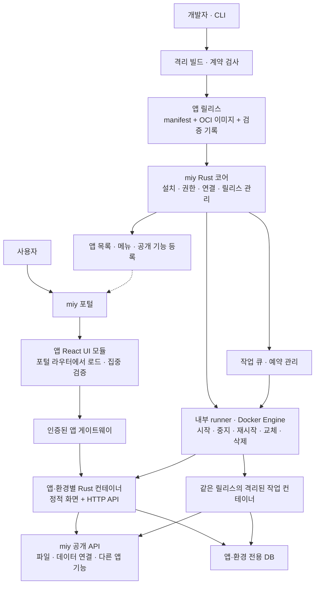

# miy 앱 개발 흐름과 CLI 계획

2026-10-27 후속 구현 범위는 [CLI 0.5 개선과 Windows 네이티브 지원](CLI-IMPLEMENTATION-PLAN.md)으로 확정했다. 다중 서버 운영, 사람/AI 공통 명령·출력, 사용자 세션 인증, 작업·로그, Windows 11 x64 PowerShell 개발·관리의 상세 계약은 해당 계획을 따른다. 아직 구현 전이며 다른 환경에서 이어갈 작업 순서는 [CLI 개발 인계](CLI-HANDOFF.md)에 있다. 이 문서의 장기 설계 예시와 현재 명령은 구분한다.

현재 CLI 0.4 / bundle 0.6은 앱의 미저장 상태를 `runtime.registerNavigationGuard`로 등록받아 셸·앱·브라우저 기록 이동을 보호한다. 로컬 preview와 같은 계약이며 앱의 명시적 등록·effect cleanup이 필요하다. 플랫폼 표시 이름은 관리자 메타데이터로 관리하고 배포 이름과 구분한다. 인수 기록은 정확한 릴리스별 검사 범위·실행 계정·결과를 제공한다. 실제 계약·예제는 [번들 계약](../templates/rust-react/docs/CONTRACT.md)과 [검사 기록 형식](../templates/rust-react/docs/ACCEPTANCE.md)을 따른다.

작성일: 2026-10-20  
수정일: 2026-10-27
상태: 개발 경험 설계 초안

**CLI가 실행 가능한 앱의 기본 구조를 준비하고, 개발자는 공통 계약을 지키면서 화면과 업무 로직을 자유롭게 개발한다.** 개발 중에는 로컬에서 바로 실행하거나 miy의 개발 영역에 올려 평가하고, 검증한 릴리스를 운영으로 승격한다.

제품 요구사항은 [PRD](PRD.md), 추진 순서는 [PLAN](PLAN.md), Windmill에서 참고한 기능과 차이는 [조사 문서](RESEARCH.md#개발-맥락과-배포-경험)에 연결한다. 아래 명령과 파일 구조는 설계 예시이며, 현재 구현된 CLI나 확정된 인터페이스는 아니다.

최소 플랫폼과 이 개발 계약으로 Codex가 실제 앱을 완성·배포할 수 있는지 먼저 확인한다. 생성 지침·검사·진단을 묶은 하네스, MCP 사용 증거, 독립 인수 검사와 Docker·DB·UI 런타임 검증은 [집중 검증 계획](VALIDATION.md)을 따른다.

## 현재 구현한 컴포넌트 배포 분리

CLI 0.3 / 개발 번들 0.5부터 공용 컴포넌트는 CLI 내장 코드와 분리한다. 템플릿은 기본 컴포넌트를 선언하고, 플랫폼 로그인 후 `miy app components sync`가 버전 소스와 사용 예제를 가져온다. 새 컴포넌트는 관리자가 플랫폼 API에 게시하며 CLI·서버 재빌드 없이 발견·설치할 수 있다.

현재 구현은 인증된 자체 source-package API이며 npm/Gitea 패키지 레지스트리 연동은 아래 장기 설계의 선택안이다. 패키지에는 버전·호환 번들·파일 목록·README가 있고 플랫폼에서 같은 이름/버전의 변경을 거부한다. CLI는 같은 프로토콜로 모든 컴포넌트를 취급하고, MCP도 이 실시간 목록과 설명을 사용한다.

`platform-components/`와 잠금 파일을 앱 저장소에 포함한다. `sync`는 고정 버전 복원, `add`는 신규 설치, `update`는 명시적 갱신이다. 기본 SDK·CLI·앱 계약의 업그레이드와 공용 UI 컴포넌트 갱신은 별개다. 실행 중인 앱은 재빌드·배포 전까지 바뀌지 않는다. 실제 명령·제약은 [실행 안내](RUNNING.md#공용-컴포넌트-설치와-업데이트)를 기준으로 한다.

## 개발과 유지관리의 참여자

앱 제작자는 고객사 개발자, miy 개발사·파트너사, 앱을 직접 구현할 수 있는 도메인 전문가다. 고객사에 개발 인력이 없는 경우 외부 제작자가 개발을 수행하고 고객사 업무 담당자가 요구 정의와 평가에 참여한다. 제작자의 소속과 관계없이 같은 CLI·MCP·SDK·앱 계약을 사용한다.

외부 제작자는 고객사 설치별 계정으로 지정된 앱·환경·저장소에 접근한다. 앱 개발과 미리보기 권한은 운영 배포나 코어·서버 유지관리 권한을 자동으로 포함하지 않는다. 배포와 유지관리도 위임받은 개발사·파트너가 수행할 수 있으며, 업무별 담당자와 작업 범위를 정한다.

대상 miy가 사내 서버에 있든 클라우드에 있든 개발 흐름은 동일하다. 수행자는 허용된 접속 경로를 사용하며, CLI는 고객사 서버·앱·환경과 자격증명을 구분한다. 코어 업데이트 제공·적용·복구는 [PRD의 운영 요구사항](PRD.md#일상-운영과-복구)에서 관리한다.

## 개발 흐름

1. CLI로 기본 템플릿을 선택하고 프로젝트를 생성한다.
2. SDK·UI 자산·개발 지침·테스트 데이터와 의존성을 준비한다.
3. 필요하면 기업의 miy에 로그인하고 앱·개발 환경을 연결한다. 개발 에이전트는 MCP에서 권한이 있는 데이터 스키마와 지침을 조회한다.
4. 로컬에서 화면·백엔드·작업을 실행하며 업무 기능을 개발한다.
5. CLI로 계약을 검사하고, 중간 평가가 필요하면 개발 영역에 작업본을 업로드한다.
6. 고객사 업무 담당자 등 허용된 평가자가 미리보기 URL에서 사용해 보고 제작자는 실행 결과와 로그를 확인한다.
7. 운영 후보를 기준 저장소에 커밋하고, 커밋에 연결된 릴리스를 빌드·검증한다.
8. 배포 권한을 가진 담당자가 해당 릴리스의 산출물을 운영으로 승격하고 상태를 확인한다.

로컬 수정과 개발 영역 평가는 여러 번 반복할 수 있다. 중간 평가를 위해 운영 배포나 관리자 개입을 매번 요구하지 않는다.

개발 대행을 종료하거나 수행자를 바꿀 때에는 기준 저장소, 릴리스·설정 정보와 유지보수 절차를 인계하고 기존 접근을 회수한다. 인계받은 담당자는 같은 계약과 도구로 개발을 이어갈 수 있어야 한다.

## 도구별 책임

| 도구 | 책임 |
| --- | --- |
| CLI | 기본 프로젝트·개발 지침·SDK·UI·예제 준비, 연결 설정, 개발 자산 갱신, 로컬 실행, 계약 검사, 미리보기·승격 요청, 상태·로그 조회 |
| MCP | 코어 공개 API 전체의 명세·권한·예제·오류·지원 버전 조회, 허용된 데이터·앱 기능 검색, 권한이 있는 검증·배포 도구 호출 |
| SDK | 앱에서 인증·데이터·파일·공개 업무 기능을 일관된 타입과 오류 계약으로 이용 |
| UI 자산 | 공통 컴포넌트, 디자인 토큰, 화면 예제와 접근성·상태 표시 규칙 |
| 플랫폼 API | CLI·MCP·관리 화면의 공통 서버 기능, 권한 검사, 작업·배포 상태 관리 |
| 관리 화면 | 데이터 연결과 권한 설정, 개발 영역 평가, 앱·환경별 시작·중지·재시작·업데이트·삭제, 상태·로그·자원·작업 이력 |

개발 에이전트가 CLI를 실행할 수 있고 MCP 도구를 직접 호출할 수도 있다. 한 경로에만 있는 별도 권한 체계를 만들지 않는다. CLI에는 사람이 읽는 출력과 자동화용 JSON 출력·종료 코드를 제공하며, 장시간 작업은 작업 ID로 결과를 다시 조회할 수 있게 한다.

## 개발 자산 제공과 MCP의 역할

**CLI는 기본 개발 지침과 SDK·UI까지 갖춘 프로젝트를 준비하고, MCP는 코어가 앱에 공개한 API 전체와 사용 방법을 조회할 수 있는 표준 경로를 제공한다.** CLI만으로 생성·개발·검사·배포를 완료할 수 있어야 한다. MCP는 같은 서버 기능을 개발 에이전트에서 발견하고 호출하는 추가 경로이며, 앱의 런타임 의존성으로 요구하지 않는다.

### CLI가 제공하는 개발 번들

개발 번들은 템플릿·SDK·UI·계약·문서의 호환되는 버전을 묶은 배포 단위다. 기본 번들에 필요한 패키지·타입·지침·예제를 포함하고 CLI가 프로젝트 생성과 의존성 설치를 안내·수행하여 실제로 사용할 수 있게 한다. 문서 링크만 전달하고 개발자가 SDK 구성부터 다시 준비하도록 하지 않는다.

| 제공 자산 | 준비할 내용 | 제공 방식 |
| --- | --- | --- |
| 앱 템플릿 | React 화면, Rust API·작업, 화면·서버 통합 이미지 빌드, DB 마이그레이션, manifest, 테스트·로컬 샘플 | 버전이 있는 템플릿에서 앱 소스 생성 |
| SDK | 인증, 데이터 연결, 파일, 공개 앱 기능 호출과 서버용 실행 문맥 검증 | 브라우저용 가칭 `@miy/sdk`, Rust 서버용 가칭 `miy-sdk` crate, 타입·예제 포함 |
| 공통 UI | 테마·디자인 토큰, 입력·표·파일 선택 등 지원 컴포넌트 | 가칭 `@miy/ui` 의존성과 사용 예제 |
| 화면·API 예제 | 목록·등록 화면, 파일 업로드, 권한 오류 처리, 공개 기능·예약 작업 | 앱에서 수정할 수 있는 예제 소스 |
| API 계약 | 대상 플랫폼이 지원하는 공개 API 명세와 타입 | OpenAPI·JSON Schema와 생성 클라이언트 |
| 개발 지침 | 앱 구조, 인증·권한, UI 규칙, DB 변경, 검사·배포 절차 | 짧은 `AGENTS.md`, 상세 문서와 필요 시 에이전트별 지침 어댑터 |
| 고객사 개발 맥락 | 허용된 데이터 연결·스키마·공개 앱 기능, 대상 설치의 기능 상태 | 로그인·앱 연결 후 별도로 조회·동기화 |

코어 공통 기능은 공개 API와 SDK로 사용하며 플랫폼 내부 Rust 모듈을 앱에 복사하지 않는다. UI 공통 코드는 버전 패키지로 제공하고, 업무별 화면 예제는 개발자가 수정할 소스로 생성한다. 따라서 공통 UI 패키지의 업데이트와 고객사가 수정한 화면 예제의 변경을 구분한다.

SDK·UI 패키지에는 타입 선언·지원 API 범위·사용 예제를 포함한다. API 호출 예제는 성공 응답뿐 아니라 인증 만료·권한 거부·오류·페이지 조회·재시도 조건도 설명하고, 지원되는 예제를 해당 버전의 SDK로 검사한다.

### 저장 위치와 배포 경로

miy 코어에 개발 자산 목록을 제공하는 API를 둔다. 여기에는 번들·템플릿·SDK·UI 버전, 호환되는 플랫폼·CLI·런타임 범위, 문서·스키마 버전과 파일 해시를 기록한다. CLI·MCP·관리 화면이 이 목록과 같은 계약을 사용하며, 별도의 개발 자산 관리 제품을 추가하는 것은 기본 범위에 포함하지 않는다.

```text
miy의 공개 계약·개발 자산 목록
├─ CLI → 개발 번들 준비 → 로컬 프로젝트·SDK·UI·지침
├─ MCP → API 검색·상세 문서·예제·허용된 도구
└─ 개발 문서 화면 → 사람이 읽는 같은 명세·예제
```

템플릿·문서는 버전 파일로, 브라우저 SDK·UI는 npm 호환 패키지로 배포하는 구성을 추천한다. Gitea를 채택하면 내장 npm Package Registry를 브라우저 SDK·UI 배포에 활용할 수 있다. Gitea는 scope 패키지와 npm 설치를 지원한다. miy 로그인과 패키지 읽기 권한의 연동은 별도로 구현하며, 패키지 접근에 플랫폼 관리자 토큰을 전달하지 않는다. [Gitea npm Registry](https://docs.gitea.com/usage/packages/npm/)

Rust SDK는 초기 개발 번들에 버전·해시가 고정된 독립 crate 소스로 포함하고 Cargo 경로 의존성으로 연결하는 구성을 검토한다. 플랫폼 내부 모듈을 복사하는 방식과 구분하며, 갱신은 CLI가 호환성을 확인해 수행한다. 별도 Cargo 레지스트리 도입은 후속 선택이다. 폐쇄망에는 Cargo 의존성도 반입·캐시하는 경로가 필요하다.

CLI는 내장·로컬 캐시 번들을 사용하거나 대상 플랫폼과 호환되는 번들을 내려받아 준비한다. 고객사 연결 없이 시작할 때에도 기본 템플릿과 지침·SDK를 제공하고, 나중에 플랫폼을 연결하면 호환성을 다시 검사한다. 인터넷이 차단된 설치에는 개발 번들뿐 아니라 필요한 외부 의존성·런타임의 반입·내부 배포 경로도 준비해야 한다. Gitea npm Registry만 설치하면 외부 패키지 전체가 자동 미러링된다고 가정하지 않는다.

프로젝트에는 가칭 `miy.dev.lock`으로 개발 번들·템플릿·계약·문서 버전과 해시를 기록한다. 프런트 의존성은 패키지 관리자 잠금 파일, Rust 의존성은 `Cargo.lock`, 도구체인은 `rust-toolchain.toml`로 고정하고 서로의 호환성을 검사한다. 고객사마다 코어 버전이 다를 수 있으므로 항상 가장 최신 SDK를 선택하지 않고 대상 설치의 지원 범위를 기준으로 고른다.

### MCP가 제공해야 하는 API 정보

외부 앱에 공개된 코어 API는 모두 목록·검색·상세 조회가 가능해야 한다. 각 API에는 다음 정보를 연결한다.

- 기능 설명, 고유 ID, HTTP 메서드·경로와 지원 버전.
- 인증 방식, 필요한 권한, 앱·환경·리소스 범위와 선행 조건.
- 경로·쿼리·본문의 입력 타입, 필수값·제약, 응답·오류 형식.
- 해당 SDK의 호출 방법, 실행 가능한 예제와 관련 UI·템플릿.
- 조회·변경 여부, 멱등성·재시도·페이지 조회·장시간 작업 처리 규칙.
- 비활성 기능, 폐기 예정 API, 대체 API와 호환성 정보.

OpenAPI 등에서 가져올 수 있는 명세는 자동 생성하고, 권한 의미·업무 제약·예제는 같은 버전의 메타데이터로 보완한다. 새 공개 API를 추가할 때 명세·문서·SDK 대응 여부와 예제를 함께 검사하여 MCP 문서와 실제 API의 차이를 방지한다.

공개 API의 일반 사용법과 고객사 고유 정보를 구분한다. 고객 데이터 소스의 스키마·다른 앱의 비공개 API·운영 로그 등은 조회 권한과 외부 AI 정책을 확인한다. 문서에 필요한 권한이 설명되어 있다는 사실은 호출 권한 부여를 뜻하지 않는다.

MCP에서 전체 명세를 찾을 수 있게 하되 매 요청마다 모든 문서를 모델에 전달하지 않는다. 기능 목록·키워드 검색·API ID별 상세 조회·예제 조회로 필요한 부분을 선택하게 한다. 각 결과에 적용 버전·출처·조회 범위를 표시하고 CLI의 문서 조회와 같은 내용을 반환한다.

| MCP 제공 형태 | miy에서 제공할 내용 |
| --- | --- |
| Resources | 버전별 규격·API 문서·컴포넌트 사용법·허용된 스키마 |
| Tools | 문서 검색·상세 조회, 기능·데이터 연결 조회, 서버 검증·미리보기·배포·상태 확인 |
| Prompts | 앱 시작·데이터 연결·검증과 같은 선택 가능한 작업 안내 |

Resources를 언제 모델에 전달할지는 클라이언트가 정하고, Prompts는 사용자가 선택해 호출하는 방식이다. MCP 연결만으로 모든 지침이 자동 적용된다고 가정하지 않는다. 핵심 문서는 Tools 조회와 로컬 지침으로도 제공한다. MCP의 Resource Template은 매개변수화된 자료 주소를 뜻하며 앱 프로젝트 생성 템플릿과는 다른 개념이다. [MCP Resources](https://modelcontextprotocol.io/specification/2026-07-28/server/resources), [MCP 서버 구성](https://modelcontextprotocol.io/docs/2026-07-28/learn/server-concepts)

문서화된 모든 HTTP API를 개별 MCP 실행 도구로 자동 등록할 필요는 없다. 처음에는 문서·기능 검색과 주요 개발·배포 작업 중심의 도구를 제공하고, 앱이 공개한 업무 기능은 기존 권한 계약에 따라 연결한다. 원격 MCP 서버가 로컬 경로를 받아 개발자 PC에 직접 파일을 생성한다고 설계하지 않는다. 실제 로컬 생성·설치·실행은 개발 에이전트의 로컬 도구 또는 사람이 CLI로 수행한다.

### 처음 시작할 때의 경험

1. CLI 설치 후 대상 miy에 로그인하거나 기본 로컬 번들로 시작한다.
2. `miy app init`이 호환되는 템플릿·지침·SDK·UI·예제를 준비한다. 앱 생성 이름 등 명시된 입력으로 파일을 생성하고 선택한 버전을 기록한다.
3. 앱과 개발 환경을 연결하고 `miy context sync`로 허용된 스키마·앱 기능·현재 설치 정보를 가져온다.
4. 개발자는 지침과 예제를 이용해 구현한다. MCP를 사용하는 에이전트는 필요한 API·컴포넌트 설명·연결 정보를 추가 조회한다.
5. `miy dev`, `miy check`, 미리보기·승격 명령으로 같은 흐름을 반복한다. MCP를 사용하지 않는 경우에도 CLI·문서 조회로 완료할 수 있다.

개발 지침은 프로젝트의 필수 계약과 실행·검사 명령을 먼저 설명하고 상세 문서로 연결한다. 특정 파일 이름을 모든 에이전트가 자동 인식한다고 가정하지 않으며, 클라이언트별 지침·skill 연결은 지원 버전을 확인한 어댑터로 제공한다. 기존 `AGENTS.md`나 고객 지침은 무조건 덮어쓰지 않고 변경 내용을 비교한다. 지침은 개발을 돕고, 필수 계약은 검사 도구와 서버가 검증한다.

### CLI와 MCP의 선택 기준

| 수단 | 주된 역할 | 적용 판단 |
| --- | --- | --- |
| HTTP API·공개 계약 | 인증·개발 자산·배포·업무 기능의 공통 기준 | 먼저 정의하고 모든 경로가 같은 정책 사용 |
| CLI·개발 번들 | 로컬 파일 생성, SDK 설치, 실행·검사·업로드, 사람·CI 자동화 | 기본 개발 경로 |
| MCP | 에이전트의 API·문서 발견, 현재 플랫폼 정보 조회, 허용된 서버 작업 | 표준 연동으로 제공하되 CLI 사용의 전제조건으로 삼지 않음 |
| 로컬 지침·에이전트별 skill | 프로젝트 규칙과 반복 작업 순서 안내 | 버전이 있는 보조 자료. API·권한 집행을 대체하지 않음 |
| 전용 IDE 확장 | 편집기 안의 화면·로그·배포 조작 | 사용성 요구가 확인되면 후속 검토 |

이 조합을 miy의 기본안으로 추천한다. MCP만으로 프로젝트 배포·패키지 버전 관리·로컬 실행을 모두 해결하려 하지 않고, CLI와 MCP가 같은 API·문서·정책을 사용하게 한다. MCP 필수 기능의 클라이언트별 검증은 유지하되, 프로토콜 연동 문제로 기본 개발 흐름 전체가 막히지 않게 한다.

## 프로젝트 생성 기본안

첫 템플릿은 인증된 사용자가 목록을 조회하고 항목을 등록하는 업무 웹앱을 기준으로 한다. 화면은 TypeScript·React·Vite, 백엔드는 Rust·Axum·SQLx를 기본안으로 삼고 배포 빌드에서 서버와 정적 화면을 같은 OCI 이미지로 묶는다. 정적 파일의 바이너리 내장은 선택안이다. 도구의 실제 호환 버전은 후속 검증에서 고정한다.

```text
purchase-app/
├── miy.app.yaml        # 식별자, 계약 버전, 실행 프로필, 권한과 자원 선언
├── miy.dev.lock        # 개발 번들·템플릿·계약·문서의 고정 버전과 해시
├── package.json        # 예시 템플릿의 개발 명령과 의존성
├── pnpm-lock.yaml      # 제안 템플릿의 패키지 의존성 고정
├── Cargo.toml          # 앱·SDK crate의 workspace와 의존성
├── Cargo.lock          # Rust 의존성 고정
├── rust-toolchain.toml # Rust 도구체인 고정
├── frontend/           # 화면, 공통 UI 연동, 사용자 정의 컴포넌트
├── backend/
│   ├── Cargo.toml      # 앱 서버 crate
│   ├── build.rs        # 내장 마이그레이션 등 컴파일 입력 변경 추적
│   └── src/            # 서버, 앱 DB 연결, 공개 API, 작업·migration 진입점
├── sdk/miy-sdk/        # 개발 번들이 제공하는 버전 고정 Rust SDK
├── contracts/          # 공개 기능의 입력·출력과 데이터 연결 정의
├── migrations/         # 버전 관리하는 앱 전용 DB 변경 SQL과 메타데이터
├── fixtures/           # 합성 샘플과 테스트용 사용자
├── tests/              # 업무 로직·계약·연동 검사 예제
├── generated/          # 재생성 가능한 클라이언트 타입 등
├── docs/               # 앱 문서와 버전이 있는 기본 개발 지침
├── .miy/context/       # 사용자·설치별 허용 맥락 캐시, 기본 Git 제외
├── AGENTS.md           # 에이전트가 읽을 프로젝트 규칙과 검증 방법
├── .gitignore          # 로컬 비밀값·캐시·빌드 출력 제외
└── README.md           # 실행, 검증, 미리보기와 배포 안내
```

언어·실행 프로필에 따라 파일과 의존성 잠금 파일은 달라질 수 있다. 생성한 앱은 플랫폼 저장소와 분리하여 내장 Git 또는 외부 Git에 보관한다. 플랫폼 내부 코드를 import하거나 수정하지 않고 SDK와 공개 계약으로 연결한다.

## 필수 계약과 개발자의 선택

| 영역 | 지켜야 할 계약 | 개발자가 선택할 부분 |
| --- | --- | --- |
| 앱 패키지 | manifest, 지원 버전·실행 프로필, 진입점과 불변 릴리스 | 앱 내부 디렉터리·모듈과 업무 구조 |
| UI | 앱 실행·로그인 연결, 지원 테마·디자인 토큰, 필수 접근성·오류 상태 규칙 | 화면 배치, 업무별 컴포넌트, 호환되는 표·차트 등 라이브러리 |
| 데이터 | 논리적 연결 이름, 타입과 허용 작업, 환경별 바인딩, 서버 권한 검사 | 업무 데이터 모델, 앱 전용 DB의 쿼리·변환 로직 |
| 공개 기능 | 입력·출력·오류, 필요한 권한, 조회·변경 구분, 공개 대상 | 업무 알고리즘과 내부 비공개 함수 |
| 작업 실행 | 실행 주체, 시간·자원 한도, 취소·재시도 정책과 중복 변경 방지 | 업무에 필요한 처리 순서와 작업 분할 |
| 의존성 | 지원 런타임, 잠금 파일, SDK·UI·계약 호환 범위 | 범위 내 라이브러리와 도구 |

UI 컴포넌트와 예제는 기본 사용 경로로 제공한다. 모든 화면을 고정된 템플릿으로만 구성하도록 제한하지 않으며, 반드시 따라야 하는 규칙과 권장 스타일을 구분한다. 정확한 필수 규칙은 UI 계약 설계에서 정한다.

계약은 설명 문서와 검사 도구를 함께 제공한다. 정적으로 확인할 수 있는 오류는 CLI가 먼저 알리고, 서버는 배포 계약과 현재 권한을 독립적으로 검사한다. 단순히 지침을 읽었거나 검사 명령이 성공했다는 사실만으로 앱에 접근 권한을 부여하지 않는다.

## Rust 풀스택 앱의 플러그인 구조

**Rust 서버와 정적 화면을 묶은 앱을 앱·환경별 컨테이너로 실행하고, miy에서 설치·시작·중지·재시작·업데이트·삭제를 관리하는 방식을 기본안으로 삼는다.** 제작자는 플랫폼과 별도 저장소에서 React 화면과 Rust 백엔드를 함께 개발한다. 버전 교체 중 대상 앱의 일시 중단을 허용한다. 아래 프로필·필드·패키지 이름은 설계 제안이며 구현된 인터페이스가 아니다.

### 패키지와 설치 정보

한 앱은 manifest, 공개 기능 스키마와 Rust 서버·React 정적 화면을 포함한 OCI 이미지로 배포한다. 기본 추천은 실행 파일을 `/app/miy-app`, React·Vite 빌드 결과를 `/app/public`에 두고 같은 Rust 서버가 화면과 API를 제공하는 방식이다. SQL 마이그레이션도 같은 릴리스에 고정해 포함한다. 운영 이미지에는 필요한 시스템 라이브러리·인증서 등을 포함하되 프런트 개발 서버와 컴파일러는 요구하지 않는다. 지원 Linux·CPU 대상별 이미지를 빌드한다.

정적 화면을 `rust-embed` 등으로 실행 파일에 넣는 것도 가능하다. 두 방식 모두 서버에서는 앱 컨테이너 하나로 관리한다. 파일을 같은 이미지에 따로 넣으면 화면만 바뀔 때 기존 Rust 빌드 결과를 재사용할 수 있고, 실행 파일에 내장하면 화면 변경도 Rust 재컴파일을 요구한다. 현재는 이미지 내 파일 분리를 기본 추천으로 두고 바이너리 내장은 선택안으로 둔다. [rust-embed](https://docs.rs/rust-embed/latest/rust_embed/)

업무 DB·업로드 파일·환경 설정·비밀값은 이미지 밖에서 관리한다. 화면 수정은 새 이미지 배포로 반영하며 실행 중인 코드 파일을 직접 덮어쓰지 않는다. 개발 중에는 Vite와 Rust 개발 서버를 함께 실행해 수정 피드백을 제공한다. CLI가 이 개발 모드와 화면·서버 통합 이미지 빌드를 구분한다.

Rust 컴파일은 앱 산출물을 만드는 단계이고 Docker는 그 산출물의 실행·격리·자원을 관리하는 계층이다. 호스트에서 실행 파일을 직접 관리하는 방식도 가능하지만 서비스 등록·OS 의존성·격리·교체·복구를 별도로 구성해야 하므로 첫 프로필은 Docker 기반으로 좁힌다. 대안과 차용 범위는 [런타임 설치·업데이트 기술 비교](RESEARCH.md#런타임-앱-설치와-업데이트-기술-비교)를 따른다.

| 정보 | 내용 | 관리 주체 |
| --- | --- | --- |
| Manifest | 앱 ID·표시 이름·버전, 지원 계약·프로필, 화면·서버·작업 진입점, 필요한 자원·권한 | 제작자가 소스에 선언하고 플랫폼이 검사 |
| Release | 기준 Git 커밋, manifest 해시, 실제 런타임·의존성, OCI 이미지 digest, 검증 결과 | 플랫폼이 빌드 결과로 기록하고 불변 관리 |
| Installation | 고객사 설치 내 앱·환경, 활성·대상 릴리스, 목표·실제 실행 상태, 실제 부여 권한·연결·자원 한도·접근 대상 | 권한이 있는 운영자가 설정하고 플랫폼이 집행 |

Manifest에 필요한 권한을 쓴 것만으로 권한이 생기지 않는다. 실제 DB 주소·기업 연결 자격증명·운영 비밀값은 설치 환경에서 바인딩하며 배포 패키지에 포함하지 않는다. 고객사마다 같은 릴리스를 다른 연결과 정책으로 설치할 수 있다.

필요한 자원도 제작자의 요청과 실제 설치 한도를 구분한다. 플랫폼은 앱·환경별 CPU·메모리·동시 작업·파일 한도와 DB 관리 한도를 정하고, 실행·배포 전에 서버 전체의 여유를 확인한다. 한도 집행 방식과 부족 시 대기·중지·복구는 [용량 관리 계획](CAPACITY.md)을 따른다.

```yaml
# miy.app.yaml — 필드 이름과 값은 제안용 예시
contractVersion: miy.app/v1alpha1
id: purchase
name: 구매 관리
version: 1.0.0
runtime:
  profile: rust-web-v1
  server:
    command: ["/app/miy-app", "serve"]
    port: 3000
    readinessPath: /health/ready
  jobs:
    command: ["/app/miy-app", "job"]
ui:
  delivery: module
  assets: /app/public
  moduleEntry: mf-manifest.json
  moduleExport: ./AppRoot
  navigation:
    label: 구매 관리
    entryPath: /
resources:
  database: postgresql
  files: true
connections:
  inventory:
    contract: contracts/inventory.json
    required: true
requestedPermissions:
  - storage.read
  - storage.write
  - sources.inventory.read
publicActions:
  contract: contracts/actions.json
migrations:
  directory: migrations
  command: ["/app/miy-app", "migrate"]
```

이 예시의 `rust-web-v1`은 지원 도구체인·대상 CPU, 화면·서버 통합 이미지 빌드, 포트·정상 상태 확인, 종료 신호, 로그·작업·마이그레이션 계약을 묶은 실행 프로필이다. 실제 도구체인·의존성·기반 이미지 digest를 릴리스에 고정한다. `migrations.directory`는 소스 위치이며 빌드 시 포함한 변경을 `migrate` 명령으로 적용한다. API 전용 앱은 UI를, 작업이 없는 앱은 작업 진입점을 생략할 수 있다.

UI 필드는 통합형 모듈 로딩을 검증하기 위한 제안이다. `moduleEntry`는 이미지의 정적 자산 안에 있는 진입점이며, 플랫폼이 설치·환경·릴리스별 제공 URL을 결정한다. 원격 모듈 규격·필드·SDK는 집중 검증의 V0에서 고정한다. 분리형 UI의 진입점·인증 계약은 별도로 정의한다.

### 플랫폼과 실행 환경의 연결



Rust 코어가 담당하는 것은 설치 정보·정책·라우팅·실행 상태이며, 업무 코드는 앱의 별도 Rust 프로세스에서 실행한다. 언어가 같아도 코어에 앱 바이너리를 동적 로드하지 않고 HTTP·JSON 등의 공개 계약으로 연결한다. 첫 프로필은 Axum 서버가 같은 이미지의 정적 화면과 API를 함께 제공한다. [Axum 응답](https://docs.rs/axum/latest/axum/response/index.html)

작업 큐는 실행 요청·임대·재시도·취소 상태를 관리하고, Rust 작업 코드는 해당 앱·환경의 별도 실행 프로세스에서 수행한다. API 서버와 작업은 같은 이미지의 앱 실행 파일을 서로 다른 하위 명령으로 실행한다. 작업용 컨테이너는 필요한 실행 동안만 사용하며 한 앱의 코드가 다른 앱의 실행 프로세스에 로드되지 않도록 한다.

Docker 실행만으로 앱 간 접근 정책이 완성되지는 않는다. Docker는 기본 외부 통신과 쓰기 가능한 컨테이너 계층을 제공하므로, runner가 네트워크 접근·권한·자원 제한을 명시적으로 적용해야 한다. [Docker 컨테이너 실행 문서](https://docs.docker.com/engine/containers/run/)

miy의 기본 프로필에는 비관리자 실행, 읽기 전용 앱 코드, 제한된 임시 공간, CPU·메모리·프로세스·동시 작업 한도와 허용된 통신 경로를 포함한다. 호스트 경로·관리 소켓·플랫폼 DB 자격증명은 제공하지 않는다. 업무 파일은 컨테이너 내부에 영구 저장하지 않고 Storage API에 보관한다. 초기 대상은 고객사가 승인한 앱이며, 공개 마켓의 임의 코드 실행에는 별도의 강화된 격리 검토가 필요하다.

### 포털에 앱 화면을 통합하는 방법

신뢰한 앱의 React UI 모듈을 플랫폼 라우터에서 직접 렌더링하는 방식을 우선 검증한다. Rust·Docker 배포는 유지하고 Module Federation을 첫 후보로 비교한다. 브라우저 신뢰 경계·UI 빌드·인증 연결·화면 갱신의 세부 계약은 [통합형 UI 검토](FRONTEND.md#플랫폼-라우터에서-독립-앱-화면-통합)와 [집중 검증 계획](VALIDATION.md)을 따른다.

설치된 앱의 등록 정보에서 접근 가능한 메뉴·이름·아이콘·활성 릴리스·UI 진입점을 읽어 포털에 표시한다. `/apps/{appId}/{나머지 경로}`를 처리하는 공통 라우트에서 해당 모듈을 불러오므로 새 앱을 추가해도 플랫폼 화면 코드를 수정하거나 다시 빌드하지 않는다. 앱은 상대 경로·테마·사용자 문맥·API 연결을 SDK 계약으로 사용하고, 브라우저의 최상위 경로와 이동은 플랫폼이 관리한다.

앱은 로컬 개발용 페이지와 통합용 공개 UI 진입점을 같은 React 코드로 구성한다. 빌드한 UI 모듈·CSS·분할 자산을 Rust 실행 파일과 같은 이미지에 포함하며, 설치 시 검증해 릴리스별 읽기 전용 자산으로 제공한다. 활성 UI와 API는 같은 릴리스에 연결한다. 이미 열린 이전 화면은 버전 갱신을 안내하고 입력을 처리한 뒤 새로고침하며, 상태를 보존하는 실시간 강제 교체는 초기 필수 범위에 넣지 않는다.

공통 UI는 가칭 `@miy/ui`, 인증·테마·언어·탐색 연동은 SDK로 제공한다. 통합 UI는 플랫폼과 같은 브라우저 실행 공간을 사용하므로 앱별 SDK 객체·CSS 범위를 보안 격리로 취급하지 않는다. 서버는 사용자·앱·환경·자원 권한을 계속 검사하며, 통합형 UI 코드는 플랫폼 페이지에서 실행해도 되는 신뢰 범위로 관리한다.

별도 브라우저 격리가 필요한 앱은 다른 출처 iframe·독립 실행 프로필을 검토한다. 이 경우 앱·환경용 짧은 수명 세션과 정확한 대상 출처를 가진 창 간 메시지 계약을 사용한다. 포털의 광범위한 토큰을 전달하거나 앱 토큰을 URL·로그에 기록하지 않는다. 일회용 코드의 대상·출처·만료·재사용 방지, 쿠키·CSRF·iframe 정책과 브라우저 제한을 별도로 검증한다. 분리형 UI 결과를 이번 통합형 라우터 검증의 성공으로 대신하지 않는다. [MDN postMessage](https://developer.mozilla.org/en-US/docs/Web/API/Window/postMessage)

### SDK·공개 기능·데이터 연결

SDK는 TypeScript 브라우저용 로그인·파일·데이터 클라이언트와 Rust 서버용 요청 인증·공개 기능·작업 실행 도우미를 구분한다. 앱 업무 로직은 Rust로 작성하고 첫 템플릿은 Axum을 제공한다. Rust API의 OpenAPI에서 화면용 TypeScript 타입·클라이언트를 생성해 계약을 맞춘다. 다른 라이브러리는 실행 프로필·인증·공개 API 계약을 만족하는 범위에서 사용할 수 있다.

일반 사용자 요청은 게이트웨이가 인증한 사용자·앱·환경을 바탕으로 처리한다. 서버 SDK는 대상과 만료가 검증된 실행 문맥을 사용하며 브라우저가 임의로 보낸 사용자 ID 헤더를 신뢰하지 않는다. 후속 플랫폼 API 호출에도 원래 사용자와 호출 앱을 유지하고, 현재 사용자 권한·토큰 범위·앱 설치 권한·대상 자원 정책을 함께 확인한다. 다른 앱 호출에서 원래 호출자가 사라지거나 수신 앱의 강한 자격증명으로 자동 대체되지 않게 한다.

예약 작업은 명시적으로 부여된 서비스 계정을 사용한다. 사용자 요청에서 시작한 지연 작업과 서비스 계정 작업을 구분하고, 큐 등록 시뿐 아니라 실제 실행 시에도 권한을 확인한다. 앱 전용 DB는 서버에서만 접근하며, 레코드별 업무 권한은 앱 로직에서 검사한다.

공개할 업무 기능은 이름, 입력·출력 스키마, 필요한 권한, 조회·변경 구분, 동기·비동기 실행 방식으로 선언한다. 플랫폼은 이 계약을 앱 간 호출 및 내장 Hermes 도구 연결에 활용한다. 앱마다 MCP 서버를 새로 만들 필요는 없으며, miy의 어댑터가 공개된 HTTP 기능을 도구로 연결한다. 내부 함수 전체가 자동 공개되지 않고, Hermes의 업무 변경 확인과 실행 시 권한 검사는 기존 PRD를 따른다.

파일 기능은 Storage API를 통해 이용한다. 초기 로컬 볼륨과 선택적 S3 backend는 플랫폼의 저장 어댑터 뒤에 두고, 앱에 저장 경로나 관리자 키를 노출하지 않는다. MinIO는 구성에 포함하지 않는다.

### 앱 전용 DB와 스키마 적용

**초기 추천안은 하나의 PostgreSQL 서버 안에 코어용 DB와 앱·환경별 DB를 따로 생성하는 구조다.** 앱마다 PostgreSQL 서버나 컨테이너를 하나씩 실행하는 방식은 아니다. 플랫폼이 DB와 접근 계정을 준비하고, 제작자가 해당 앱의 테이블·컬럼·관계·인덱스를 정의한다.

```text
PostgreSQL 서버 1개
├── miy_core             # 사용자 권한, 앱 등록, 배포 상태 등 코어 데이터
├── purchase_dev         # 구매 앱의 개발 데이터
├── purchase_prod        # 구매 앱의 운영 데이터
│   ├── purchase_orders  # 구매 요청
│   └── purchase_items   # 구매 항목
└── inventory_prod       # 자산 앱의 운영 데이터
    └── assets           # 자산
```

DB 이름은 설명용 예시다. 미리보기도 소유 영역별로 별도 DB를 할당한다. 각 앱에는 해당 환경의 DB 연결 권한만 부여하고, 기본 `PUBLIC` 권한을 포함한 접속·객체 권한을 점검하여 코어·다른 앱·다른 환경의 DB에 접근하지 못하게 한다. PostgreSQL의 CPU·메모리·디스크는 공유하므로 논리적 DB 분리와 서버 자원 격리는 별개의 관리 항목이다.

여기서 업무 스키마는 테이블·컬럼 등 데이터 구조를 뜻한다. PostgreSQL의 `SCHEMA`는 DB 내부의 이름 공간으로, `DB → schema → table` 계층을 이룬다. 하나의 DB 안에 앱별 schema만 나누는 구성도 가능하지만, 현재 기본안은 앱·환경별 DB와 역할을 분리하는 것이다. [PostgreSQL schema 공식 문서](https://www.postgresql.org/docs/current/ddl-schemas.html)

#### 개발자가 정의하고 배포에 포함할 내용

Rust 템플릿에서는 버전이 있는 SQL 파일로 `migrations/`에 테이블·인덱스 등의 변경을 정의하고 SQLx로 앱 DB에 접근한다. 앱 내부 테이블 사이의 외래 키는 앱 DB 안에서 관리한다. 플랫폼 사용자나 다른 앱의 레코드는 공개된 식별자로 참조하고 API로 확인하며, 다른 DB의 테이블에 직접 외래 키나 조인을 연결하지 않는다.

```text
migrations/에 변경 SQL 작성·검토
  → 로컬 DB에 적용하고 업무 기능 확인
  → 스키마·마이그레이션을 앱 소스와 함께 커밋
  → 같은 마이그레이션을 포함한 릴리스로 개발 영역 검증
  → 운영 배포 시 운영 DB에 아직 적용하지 않은 변경만 실행
```

SQLx의 migration 기능을 앱 실행 파일의 `migrate` 하위 명령으로 감싸 지정 DB의 미적용 변경을 실행·기록하는 구성을 추천한다. CLI는 SQL 파일 생성·로컬 적용·검사 절차를 제공하며 miy의 배포 제어·권한 확인·동시 실행 방지는 별도로 구현한다. 운영 DB를 소스와 즉석 동기화하지 않고 검토·검증한 변경 파일과 적용 이력으로 관리한다. [SQLx](https://github.com/transact-rs/sqlx)

Manifest의 `resources.database`는 DB 필요 여부를, `migrations.directory`는 변경 SQL의 소스 위치를 선언한다. 변경 파일과 고정 버전의 실행기를 불변 릴리스에 포함하고 변경 파일 해시도 기록한다. 코어 DB와 앱 DB가 같은 SQLx를 사용하더라도 마이그레이션 이력·권한·수명주기는 분리한다.

#### 설치와 업데이트에서의 적용

| 시점 | miy가 수행할 일 |
| --- | --- |
| 최초 설치 | 앱·환경 전용 DB와 역할 준비 → 초기 마이그레이션 적용 → 필요한 기본값 준비 → 정상 상태 확인 후 앱 활성화 |
| 앱 업데이트 | 대상 DB·이력·릴리스 및 복구 가능성 확인 → 앱 요청·작업 차단과 기존 실행 종료 → 같은 DB에 미적용 마이그레이션 적용 → 새 앱 버전 시작·정상 확인 → 접근 재개 |
| 개발 영역 재생성 | 전용 DB에 이력을 처음부터 적용하여 재현성 검증. 샘플 데이터는 해당 개발 환경에만 주입 |
| 운영 승격 | 개발에서 검증한 동일한 변경 파일을 운영 DB의 현재 이력에 맞춰 적용. 개발 DB나 샘플 데이터를 복사하지 않음 |

DB는 앱 설치와 환경에 귀속하며 릴리스·컨테이너 교체 후에도 유지한다. 예를 들어 구매 앱에 `status` 컬럼을 추가하면 새 마이그레이션이 기존 `purchase_prod`에 컬럼을 추가한다. 업데이트마다 빈 운영 DB를 다시 만들지 않는다.

적용 전에 앱·환경별 배포 잠금을 확보해 동시에 두 변경 작업이 실행되지 않게 한다. 변경 ID·파일 해시·적용 순서·소요 시간·결과를 릴리스와 연결하고, 적용된 파일의 사후 수정이나 알 수 없는 이력은 자동 덮어쓰기 대신 배포 오류로 처리한다. 빈 DB 설치와 지원하는 이전 운영 버전에서의 업그레이드를 모두 검증한다.

#### 실행 계정과 변경 계정

| 주체 | DB 접근 범위 |
| --- | --- |
| 플랫폼의 DB 준비 기능 | DB·역할 생성과 접근 권한 설정. 앱에 이 권한을 전달하지 않음 |
| 격리된 마이그레이션 작업 | 지정 앱 DB의 허용된 schema 안에서 객체 생성·변경과 필요한 데이터 변환 |
| 앱 API·백그라운드 작업 | 앱 업무에 필요한 조회·추가·수정·삭제. 객체 소유자나 DDL 권한은 기본 제공하지 않음 |
| 브라우저·외부 개발 에이전트 | 운영 DB 자격증명 없이 인증된 API 이용. 로컬 테스트 DB는 별도 개발 설정 사용 |

DB 준비 단계에서 schema·객체 소유 역할과 실행 역할을 구분하고, 신규 테이블·시퀀스에도 실행 역할의 필요한 권한이 적용되게 한다. 마이그레이션 자격증명은 작업 실행 때만 제공한다. 앱은 서버에서 SQLx 등으로 자기 DB를 조회할 수 있고, 사용자별 레코드 권한은 앱 API에서 검사한다.

#### 기존 데이터가 있는 변경

컬럼 추가, 기본값 설정과 기존 데이터 보정은 순서를 명시한다. 큰 데이터 보정은 재개 가능한 별도 작업으로 나누고, 컬럼 삭제·형식 축소·강제 초기화처럼 데이터 손실이나 긴 잠금이 가능한 변경은 영향·백업·작업 시간을 배포 정책에 따라 검토한다.

기본 배포는 앱 쓰기·작업을 중지하고 DB를 변경한 뒤 새 코드를 시작한다. 신구 서버의 동시 실행 호환성을 필수로 요구하지 않는다. 다만 이전 코드로 복구할 수 있는지 별도로 검사하고, 필요하면 컬럼 추가·데이터 보정·후속 삭제처럼 변경을 나눈다. 일시 중단 허용이 데이터 손실이나 무조건적인 자동 DB 복원을 허용하는 것은 아니다.

가능한 변경은 트랜잭션으로 묶지만 모든 SQL에 같은 원자성 보장을 적용하지 않는다. 예를 들어 PostgreSQL의 `CREATE INDEX CONCURRENTLY`는 트랜잭션 블록 안에서 실행할 수 없으므로 별도 실행·실패 복구 절차가 필요하다. 초기 실행기가 지원하지 않는 변경은 사전 검사에서 거부한다. [PostgreSQL CREATE INDEX](https://www.postgresql.org/docs/current/sql-createindex.html)

마이그레이션 실패 시 새 버전 활성화를 중단한다. 이미 적용된 DB 변경과 이전 앱의 호환성을 확인하여 기존 버전을 유지하거나 명시적인 복구 상태로 전환한다. 앱 이미지 롤백과 DB 복원을 구분하고, DB 복원으로 배포 이후의 쓰기가 유실될 수 있는 경우에는 쓰기 중지·데이터 보전 절차를 먼저 수행한다.

### 설치·시작·중지·업데이트·삭제

| 단계 | 플랫폼이 수행할 일 |
| --- | --- |
| 등록·검증 | manifest·계약 버전·진입점·의존성 검사, 격리 빌드, 산출물 digest·소스 연결 기록 |
| 설치 준비 | 설치 권한 확인, 요청 권한과 실제 부여 범위 검토, 환경별 DB·파일 영역·연결 준비 |
| 시작 | 설치 상태·릴리스·DB 이력·자원 확인, 필요한 초기 준비 후 컨테이너 시작, 정상 확인 후 요청·작업 허용 |
| 중지 | 목표 상태를 중지로 기록, 신규 요청·작업 실행 차단, 실행 중 요청·작업의 종료·취소 정책 적용, 앱 서버·작업 컨테이너 종료. 설정·DB·파일 보존 |
| 재시작 | 같은 릴리스·설정으로 중지 후 시작. 실행 중 실패와 관리자 요청을 구분해 기록 |
| 업데이트 | 이미지 확보·사전 검사 → 점검 상태 → 기존 실행 종료 → 복구 지점 확인·확보 → migration → 새 버전 시작·정상 확인 → 활성 버전 기록·접근 재개 |
| 이전 버전 복구 | DB·설정 호환성을 확인하고 이전 digest로 중지 후 교체. 데이터 복원은 별도 절차 |
| 앱 삭제 | 대상 앱·환경을 중지하고 컨테이너·라우트·예약·설치 연결·앱 자격증명을 정리. 업무 데이터는 기본 보존 |

기본 업데이트는 대상 앱의 일시 중단을 허용하는 중지 후 교체다. 기존 앱 실행 파일을 덮어쓰지 않고 새 이미지 digest로 컨테이너를 교체한다. 내려받기·빌드·사전 검사는 중지 전에 완료하며, 신구 앱을 동시에 실행할 메모리는 기본 요구가 아니다. 코어와 다른 앱은 계속 운영·관리할 수 있어야 한다. 무중단·블루·그린·롤링 배포는 초기 범위에 포함하지 않는다.

DB·파일 복구 지점은 변경 위험과 복구 정책에 맞춰 준비한다. 관련 쓰기·작업을 중지한 후 일관된 상태를 확보하고, 복구 지점의 대상·시점·릴리스를 기록한다. 검증된 이미지 digest를 명시적으로 승격·업데이트하며 변경 가능한 태그를 감지해 업무 앱을 임의로 자동 교체하지 않는다.

중지·점검 중 화면에는 상태를 안내하고 API·앱 간 호출·Hermes 도구에는 구분 가능한 이용 불가 오류를 반환한다. 실행 중 HTTP 요청은 제한 시간 안에 종료하고 장기 연결은 끊김·재접속을 허용한다. 작업은 앱이 선언한 종료·취소·재개 정책을 따르며 정상 종료 제한 초과 시 강제 종료 여부와 영향을 기록한다. 업데이트 후 열린 이전 화면에는 갱신을 안내하고, 이전 자산 요청 실패·API 버전 불일치를 처리한다.

중지 상태인 앱은 업데이트해도 중지 상태를 유지한다. 변경 적용·필요한 검증을 위한 일회성 작업은 가능하지만 일반 요청·예약을 열지 않으며, 이후 명시적 시작에서 정상 동작을 확인한다. 중지된 설치의 선택 릴리스와 마지막 정상 실행 릴리스를 구분한다.

모든 수명주기 작업은 작업 ID·수행자·대상 앱·환경·현재 및 대상 릴리스·단계·실패 지점을 기록한다. 사전 검사 실패는 기존 실행을 유지한다. 중지 후 migration·시작·정상 확인이 실패하면 이전 코드와 현재 DB의 호환성이 확인될 때만 이전 버전을 재실행한다. 불가능하면 복구 필요 상태와 원인을 표시하고 앱 접근을 차단한다. 코드 교체만으로 DB와 외부 업무 변경이 되돌아간다고 가정하지 않는다.

### 메인 플랫폼의 앱 운영 화면과 제어 계약

앱 목록에 이름·환경·담당자·활성/선택 버전·목표 상태·실제 상태·CPU·메모리·최근 작업을 표시한다. 앱 상세에서 시작·중지·재시작·업데이트·이전 버전 복구·삭제를 실행하고 로그·DB/파일 용량·진행 중 작업·실패 원인을 확인한다. 운영자는 Docker 명령이나 Kubernetes 리소스를 직접 다루지 않아도 된다.

관리 화면·CLI·API·허용된 MCP 도구는 같은 관리 API를 사용한다. CLI 예시는 `miy app start|stop|restart|update|delete <app> --env <env>`이며 인터페이스 이름은 설계 예시다. 앱 사용 권한과 운영 제어 권한을 구분하고 앱·환경·행위별 위임을 검사한다. 코어가 영속 작업으로 요청을 기록하고 내부 runner가 제한된 명령으로 Docker Engine을 제어한다. 브라우저·사용자 앱·공개 API에 관리 소켓을 제공하지 않는다.

목표 상태는 실행·중지·제거로, 관측 상태는 설치 준비·시작 중·실행 중·중지 중·중지됨·업데이트 중·실패·복구 필요·상태 미확인·제거됨 등으로 구분한다. 버튼 클릭을 실제 완료로 표시하지 않는다. 코어·runner·호스트 재시작 후 저장된 목표와 실제 컨테이너를 대조한다. 운영자가 중지·삭제한 앱은 트래픽·예약 작업·재시작 정책으로 부활하지 않으며, 상태를 확인할 수 없을 때에는 중복 인스턴스를 새로 만들지 않는다.

앱·환경별 작업 잠금과 멱등 키로 상충하는 제어 요청을 직렬화한다. 업데이트 중 중지·삭제 요청은 현재 단계와 취소 가능 여부에 따라 대기·취소 처리하고, DB 변경 도중 임의 강제 종료하지 않는다. 자동 장애 재시작은 목표가 실행이고 배포 작업과 충돌하지 않을 때만 제한 횟수·대기를 적용한다. 수동 중지 시 예약 정의는 보존하되 실행을 막고, 재시작 시 밀린 작업을 일괄 재생하지 않도록 누락 실행 정책을 둔다.

앱 삭제는 해당 설치의 실행 환경 제거다. DB·업무 파일은 기본 보존하고 보존 상태·재연결 방법을 표시한다. 데이터 영구 삭제는 대상·범위·백업을 명시하는 별도 권한의 요청으로 처리하며 매번 일반 중지·업데이트에 확인을 추가하지 않는다. 다른 환경, Git 저장소, 공유 DB 서버·스토리지를 함께 삭제하지 않는다. 이미지도 다른 설치나 복구 정책에서 참조 중이면 정리하지 않는다.

개발 중에는 로컬 Vite·Rust·테스트 서비스로 빠르게 확인하고, 플랫폼 개발 영역에서는 통합 앱 이미지·인증·격리·자원 연결을 검증한다. 운영 후보의 커밋 이미지로 검증을 완료한 뒤 같은 digest를 운영으로 승격한다. 환경별 비밀값·권한·데이터는 함께 복사하지 않는다.

## 실행 환경

| 구분 | 로컬 실행 | 플랫폼 개발 영역 | 운영 |
| --- | --- | --- | --- |
| 목적 | 빠른 개발·개인 평가 | 동료 평가·플랫폼 통합 검증 | 실제 업무 |
| 앱 실행 | 로컬 화면과 지원 프로필의 백엔드·작업 실행기 | 플랫폼이 관리하는 격리 환경 | 검증한 릴리스의 격리 환경 |
| 데이터 | 테스트 DB·파일, 합성 샘플·대체 서비스 | 별도 개발 데이터와 허용된 테스트 연결 | 운영용 연결과 실제 부여 권한 |
| 접근 | 로컬 테스트 사용자 | 개발자와 허용된 평가자 | 앱 이용 권한이 있는 사용자 |
| 버전 기준 | 현재 작업 디렉터리 | 소스 스냅샷·해시 또는 커밋 릴리스 | 기준 Git 커밋과 불변 산출물 |

### 로컬 실행

필요한 도구·의존성을 준비하면 기본 앱은 기업 플랫폼에 접속하지 않고도 화면·백엔드·작업을 실행할 수 있어야 한다. 개발 실행기는 지원 프로필에 맞는 런타임, 테스트용 DB·파일과 최소 플랫폼 API 대체 기능을 준비한다. 기존 로컬 데이터를 초기화하는 작업은 일반 실행과 구분한다.

화면 변경의 빠른 반영, 백엔드 변경 반영, 요청·작업 로그와 오류 위치를 제공한다. 샘플 사용자와 권한별 시나리오로 업무 로직을 확인하되, 실제 인증·권한 회수·격리·외부 데이터 정책은 플랫폼 개발 영역에서 검증한다.

운영과 같은 계약·런타임 버전·의존성을 사용하고, 로컬 대체 기능이 지원하지 않는 항목은 명시적인 오류 또는 제한 표시로 알린다. 로컬 화면에 원격 실행·데이터를 연결하는 추가 모드의 필요성과 범위는 후속 설계에서 정한다.

### 플랫폼 개발 영역

제작자별 또는 팀별 영역에서 앱을 실행하고 평가자를 지정한다. 미리보기 URL은 기본적으로 공개하지 않으며, 앱 접근 권한과 데이터 접근 권한을 각각 검사한다.

커밋 전 작업본은 업로드 제외 규칙을 적용하여 소스 스냅샷과 해시로 기록한다. 서버가 격리 빌드·검증하고 성공한 미리보기 버전만 활성화한다. 사전 검사 실패는 기존 실행을 유지한다. 미리보기 교체 중 일시 중단은 허용하며 시작 실패 시 이전 버전 복구 또는 복구 필요 상태를 표시한다. 운영 앱에는 영향을 주지 않는다.

개발 영역에는 별도 DB·파일·연결 설정·토큰·자원 한도를 적용한다. 예약 실행과 외부 시스템 변경은 기본 비활성 상태에서 개발용 대상으로 명시적으로 설정한다. 소유자, 평가자, 실행 상태, 로그, 만료 시점과 삭제 범위를 표시한다. 미리보기 정리는 해당 개발 자원만 대상으로 하고 보존 규칙을 따른다.

### 운영 승격

중간 작업본의 미리보기는 운영 릴리스가 아니다. 운영 후보는 기준 Git 커밋, 잠금 파일, 계약·런타임 버전과 산출물 해시를 연결한 뒤 플랫폼에서 검증한다. 작업본과 커밋 내용이 달라지면 새로운 산출물로 다시 검증한다.

운영으로 승격할 때는 검증한 산출물을 다시 빌드하지 않고 사용하며, 환경별 연결·비밀값·권한을 별도로 바인딩한다. 프런트엔드에 환경 주소나 비밀값을 고정하지 않도록 SDK의 실행 시 설정 계약을 제공한다. 개발 DB·파일·사용자 토큰은 승격 대상으로 삼지 않는다.

## 데이터 연결과 개발 맥락

앱은 `inventory` 같은 논리적 연결 이름과 필요한 데이터·작업 계약을 선언한다. 동일한 앱 코드가 로컬에서는 샘플 서비스, 개발 영역에서는 테스트 데이터 소스, 운영에서는 허용된 실제 연결을 사용하도록 한다. 연결을 바꿀 때 스키마와 허용 작업의 호환성을 검사한다.

기업 데이터 소스의 자격증명은 서버에 두고, CLI·MCP는 현재 사용자와 앱에 허용된 스키마·예제만 가져온다. 앱 전용 로컬 테스트 DB의 자격증명과 기업 연결 자격증명을 구분한다. 로컬에서 받은 플랫폼 세션은 소스·일반 로그·생성 지침에 포함하지 않는다.

`miy context sync`는 허용된 설치 정보·지침·스키마와 해당 계약의 생성 타입을 갱신한다. SDK·UI 의존성이나 앱 소스를 자동 업그레이드하지 않는다. 개발 번들·패키지 업그레이드는 별도 변경으로 버전·호환성·차이를 검토하고 잠금 파일을 갱신한다.

생성 파일과 사용자 작성 파일을 구분하고, 수정된 지침·예제를 무조건 덮어쓰지 않는다. 고객사 맥락 캐시는 설치·사용자·앱·환경별로 분리하고 `.miy/context/` 등을 기본 Git·업로드 제외 대상으로 둔다. 자격증명은 소스·생성 파일에 넣지 않고 OS 자격증명 저장소 등 별도 위치에 보관한다. 지침·스키마 갱신에 실제 업무 데이터를 자동 포함하지 않으며, 플랫폼은 자료를 전달할 때 권한과 외부 AI 정책을 검사한다. 로컬에 이미 전달한 자료는 권한 회수만으로 소급 삭제되지 않는다.

## CLI 명령 예시

다음은 사용자 흐름을 설명하기 위한 가칭 명령이다. 인증 방식, 옵션과 실제 패키지 배포 방법은 후속 설계에서 확정한다.

```sh
miy app init purchase-app --template business-web
cd purchase-app
miy dev --mode local
miy login --server https://miy.example.com
miy app link --app purchase --env dev
miy context sync
miy check
miy preview create --env dev
miy logs --operation <operation-id>
# 운영 후보를 Git에 커밋·push한 뒤
miy release create --commit <commit-sha> --env dev
miy release promote <release-id> --env prod
```

`preview create`는 중간 작업본을, `release create`는 기준 저장소의 정확한 커밋을 대상으로 한다. 승격은 해당 릴리스의 검증 완료와 현재 배포 권한을 서버에서 확인한다. 모든 원격 명령에서 대상 서버·앱·환경을 표시하며, 필수 대상이 모호하면 임의의 운영 환경을 선택하지 않는다.

자동화에서는 필요한 대상을 명시하고 구조화된 결과를 받는다. 로컬 CLI의 저장 설정이나 검사 결과로 서버 권한을 우회할 수 없어야 한다.

## 관리형 실행 구조의 적용 범위

표준 업무 앱은 화면과 백엔드 기능·작업을 하나의 앱 패키지로 관리하는 방향을 우선 검토한다. 플랫폼이 실행 환경·작업 큐·로그·시간 제한을 관리하되, 짧은 API 요청과 장시간 작업은 요구 응답 시간과 실행 특성에 맞게 처리한다.

공개 업무 기능은 화면, 다른 앱과 Hermes에서 같은 권한 계약으로 호출할 수 있게 한다. 모든 내부 함수를 자동으로 MCP 도구로 공개하지 않고, 앱이 공개 대상으로 선언한 기능만 노출한다.

상시 연결이나 특수 서버가 필요한 앱을 위해 독립 서비스 실행 프로필을 고려한다. 초기 프로필·지원 언어와 지원 순서는 대표 앱의 요구를 기준으로 정한다. Windmill 전체 기능이나 실행 엔진의 직접 도입은 확정하지 않는다.

## 다음 설계에서 결정할 사항

- CLI 설치·업데이트, 인증·토큰 보관과 지원 개발 OS.
- 여러 고객사를 담당하는 수행자의 설치별 연결·계정 구분, 권한 회수와 소스·릴리스 인계 절차.
- 기본 개발 번들·템플릿, SDK·UI 패키지·문서의 배포 경로와 호환성 표, 패키지 인증·오프라인 제공 범위.
- 공개 API 목록·검색·상세 문서의 메타데이터와 SDK 대응 검사, MCP의 초기 도구·리소스 및 클라이언트별 지침 어댑터.
- manifest·공개 기능·데이터 바인딩의 정확한 스키마와 버전 호환 정책.
- 로컬 실행기·테스트 데이터 서비스의 구성, 운영과의 차이와 검증 방법.
- 초기 실행 프로필·언어, 격리 엔진과 동기 API·백그라운드 작업 처리 방식.
- 개발 영역 소유·평가자 모델, 자원 한도·만료·데이터 보존 정책.
- 소스 업로드 제외 규칙, 작업본에서 커밋 릴리스로 전환하는 절차와 검증 기록.

완료 기준은 [PRD의 인수 조건](PRD.md#대표-검증-시나리오)에 따라 프로젝트 생성부터 로컬 실행, 중간 평가, 운영 승격까지 확인한다.

## CLI 릴리스와 개발 안내 유지관리

CLI 사용법 원본은 `crates/miy/guidance/miy-cli/`다. 명령·인자·옵션·기본값은 `AppCommand`/컴포넌트 명령의 Clap 정의에서 생성하고, 절차·권한·실패 처리 설명은 같은 디렉터리의 workflow에서 관리한다. 생성된 프로젝트 파일을 따로 수정해 릴리스를 만들지 않는다.

CLI 변경 시 명령의 help 설명과 workflow의 해당 절차를 함께 검토하고 Cargo 패키지 버전을 올린다. CLI 전용 안내 변경에는 SDK bundle 버전이나 공용 UI 릴리스를 올리지 않는다. 실행 파일에 안내 원본을 포함하며 init/setup/upgrade가 그 버전의 스킬·문서·miy.cli.json을 배포한다. 현재 SDK 보호 파일의 변경은 별도 SDK 번들 전환 규칙을 따른다.

템플릿 `AGENTS.md`와 `CLAUDE.md`는 CLI 전용 스킬·전체 매뉴얼로 연결하는 진입점이며 SDK 보호 파일이다. 이 파일을 바꾸면 이전 번들 해시를 보관하고 새 번들 버전과 명시적 업그레이드를 제공한다. 0.6.1은 두 진입점만 바꾸므로 0.6.0 컴포넌트 호환성을 명시적으로 유지한다. 이는 모든 패치 버전을 자동 호환으로 간주하는 규칙이 아니다. 스킬·매뉴얼 본문의 일반적인 갱신은 계속 CLI 버전만으로 관리한다.

릴리스 전 `cargo test -p miy`, `cargo clippy -p miy --all-targets -- -D warnings`, 스킬 형식 검사와 `scripts/check-cli-guidance.mjs`를 실행한다. 이 회귀 검사는 실제 --help와 생성 참조의 명령·옵션 일치, JSON/Markdown/MCP 버전 일치, 두 에이전트 파일 일치, 관리 파일 수정 거부·복구, 구버전 CLI 전환 시 업무 파일 보존을 확인한다. 자연어 절차의 의미까지 자동 검증하지 않으므로 동작 변경에 맞춘 원본 검토는 릴리스 작업에 포함한다.
