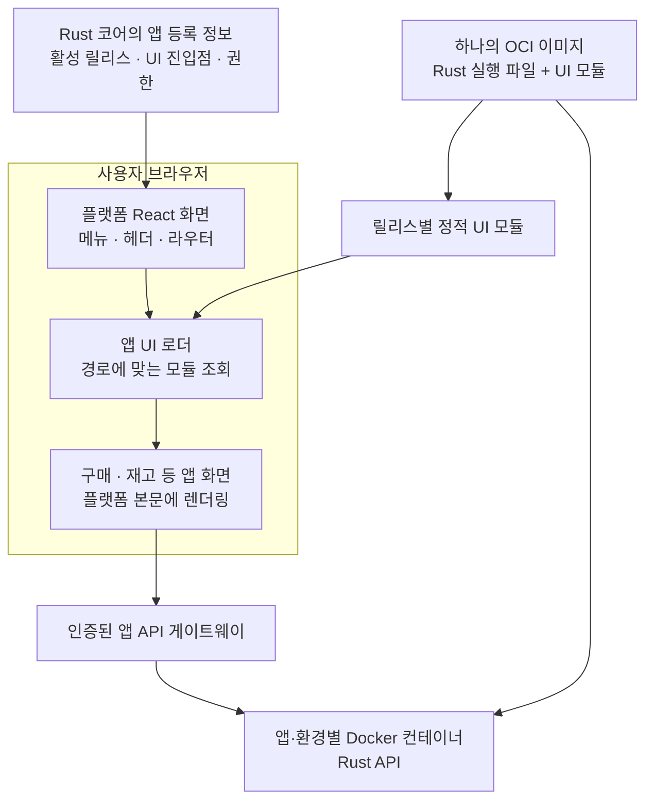

# miy-v2 프론트엔드 기술 검토

검토일: 2026-10-20  
앱 화면 통합 검토 보완: 2026-10-21  
상태: 검토안

Rust 백엔드와 분리된 관리 웹에는 **TypeScript + React + Vite + TanStack Router + TanStack Query**를 우선 추천한다. [PRD](PRD.md)의 고객사 사용자와 위임받은 외부 수행자가 인증 후 사용하는 기본안에 맞춘 검토이며, 공개 콘텐츠의 검색 노출과 서버 렌더링 요구는 후속 기획에서 확인한다.

이 검토는 플랫폼 관리 웹의 기술 선택을 다룬다. 독립 배포 앱은 지원 실행 프로필과 플랫폼 API·패키지·UI 계약 안에서 별도의 구현 기술을 사용할 수 있다.

## 앱 개발 템플릿과 공통 UI

CLI가 생성할 첫 업무 웹앱 템플릿에도 TypeScript·React·Vite를 우선 검토한다. 관리 웹과 앱은 독립적으로 빌드·배포하며, 앱이 플랫폼 내부 코드를 직접 가져다 쓰지 않도록 버전이 있는 SDK·UI 자산을 제공한다. 전체 개발 흐름은 [앱 개발 계획](DEVELOPMENT.md)을 따른다.

공통 UI에는 디자인 토큰, 인증·앱 실행 연결, 입력 폼·목록·상세 화면 예제, 로딩·오류·권한 부족 상태와 접근성 지침을 포함한다. 필수 연동 규칙과 권장 화면 스타일을 구분하고, 개발자가 업무별 컴포넌트와 호환되는 UI 라이브러리를 추가할 수 있게 한다.

SDK는 로컬 테스트 데이터와 플랫폼의 개발·운영 연결을 같은 앱 코드에서 선택할 수 있는 인터페이스를 제공한다. 실제 데이터 소스 자격증명은 브라우저에 전달하지 않는다. CLI는 템플릿·SDK·UI 자산의 호환 버전을 관리하고 갱신 시 사용자 코드를 보존한다.

## 선택 기준

사용자가 제시한 기준은 타입 검사, AI를 활용한 프론트엔드 개발, 널리 사용되는 생태계와 Next.js 제외다. 새로 출시된 기술이라는 이유만으로 우선하지 않고, 현재 유지되는 기술의 안정성과 적용 비용을 함께 평가한다.

React는 UI 라이브러리, TypeScript는 언어, Vite는 개발·빌드 도구다. 이들을 라우터와 데이터 조회 도구로 조합해 프론트엔드를 구성한다. React 공식 문서는 Vite의 TypeScript 템플릿과 TanStack Router, TanStack Query를 이러한 구성의 선택지로 안내한다. [React 공식 구성 안내](https://react.dev/learn/build-a-react-app-from-scratch)

## 후보 비교

| 후보 | 특징 | miy-v2에서의 판단 |
| --- | --- | --- |
| React + TypeScript + Vite | UI, 라우팅, 데이터 조회 도구를 선택해 구성 | Rust API 중심의 앱에 우선 추천 |
| React Router Framework Mode | 타입이 있는 라우트 API, 코드 분할, SPA·SSR·정적 렌더링 제공 | 통합된 프레임워크 구성이 필요할 때 비교 |
| TanStack Start | TanStack Router 기반으로 SSR, 스트리밍과 서버 함수 제공 | SSR 또는 프론트엔드 서버 기능이 필요할 때 비교 |
| Vue + TypeScript + Vite | TypeScript를 공식 지원하며 컴포넌트 중심으로 구성 | 템플릿 문법과 Vue 개발 방식을 선호할 때 대안 |
| Svelte + TypeScript | 컴포넌트 안에서 TypeScript를 지원 | 문법 선호와 필요한 UI 라이브러리 호환성을 검토할 대안 |

각 후보의 기능은 [React Router](https://reactrouter.com/start/modes), [TanStack Start](https://tanstack.com/start/latest/docs/framework/react/overview), [Vue](https://vuejs.org/guide/typescript/overview.html), [Svelte](https://svelte.dev/docs/svelte/typescript) 공식 문서를 기준으로 한다.

## 추천 이유

React는 State of JavaScript 2025에서 지배적인 프론트엔드 프레임워크로 설명되는 주요 생태계다. 이 조사는 전체 시장의 점유율 측정과는 구분한다. [State of JavaScript 2025](https://2025.stateofjs.com/en-US/libraries/front-end-frameworks/)

기존 miy의 `dev/package.json`에도 React 19, TypeScript, Vite와 여러 React UI 라이브러리가 선언되어 있다. React를 선택하면 기존 UI 자산의 재사용 가능성을 검토하기 쉽다. 실제 재사용 범위는 새 요구사항에 따라 정한다.

AI 개발 적합성은 생태계와 프로젝트 맥락에 기반한 판단이다. 특정 AI 모델이 React에서 항상 더 정확하다는 의미는 아니다. 사용 라이브러리와 버전을 고정하고 타입 검사와 실제 화면 검증으로 생성 결과를 확인한다.

TanStack Router는 경로, 파라미터와 검색 파라미터를 포함한 라우팅 전반에 타입 추론을 연결한다. TypeScript를 화면 컴포넌트뿐 아니라 화면 이동에도 적용하려는 목적에 맞는다. [TanStack Router 타입 안정성](https://tanstack.com/router/latest/docs/guide/type-safety)

## 추천 구성

| 역할 | 검토안 |
| --- | --- |
| 언어 | TypeScript 엄격 모드 |
| UI | React의 지원되는 안정 버전 |
| 개발과 빌드 | Vite |
| 라우팅 | TanStack Router |
| 서버 데이터 조회와 캐시 | TanStack Query |
| 백엔드 | Rust |
| API 타입 연결 | OpenAPI 스키마에서 TypeScript 타입 생성 |

SPA 구성에서는 빌드한 정적 프론트엔드를 제공하고 Rust API를 호출할 수 있다. 프론트엔드 빌드 도구와 운영 시 API 서버의 역할을 분리한다.

Rust와 TypeScript 사이의 타입은 자동으로 공유되지 않는다. API 스키마를 공통 계약으로 삼고, 예를 들어 openapi-typescript로 프론트엔드 타입을 생성하는 방식을 검토한다. 생성 타입은 실행 시 데이터 검증을 대신하지 않으므로 서버 입력 검증과 필요한 응답 검증을 별도로 설계한다. [openapi-typescript 공식 안내](https://openapi-ts.dev/introduction)

## 결정 전에 확인할 사항

- 검색 노출이 필요한 공개 화면과 SSR 필요 여부
- 편집기, 표, 차트 등 핵심 UI 기능과 라이브러리 요구
- 배포 환경과 프론트엔드 정적 파일 제공 방식
- 기존 React UI 자산의 재사용 가치

SSR이 핵심 요구라면 TanStack Start 또는 React Router Framework Mode를 다시 비교한다. 구체적인 의존성 버전은 프로젝트 초기화 시점에 호환성을 확인해 고정한다.

## 플랫폼 라우터에서 독립 앱 화면 통합

Rust 백엔드를 Docker로 관리하면서 앱의 React 화면을 플랫폼 안의 일반 페이지처럼 실행할 수 있다. 플랫폼이 메뉴·공통 레이아웃·최상위 라우팅을 유지하고, 경로에 따라 독립 빌드된 앱 UI 모듈을 불러오는 마이크로프런트엔드 방식이다. 이 통합형 UI를 [핵심 흐름 검증](VALIDATION.md)의 우선 대상으로 삼고 브라우저 신뢰 경계와 호환성을 확인한다. 구체적인 로더·버전은 검증 결과로 결정한다. 플랫폼·개별 앱의 Rust 백엔드와 단일 이미지 배포 방향은 유지한다.

### 화면 통합 방식 비교

| 방식 | 화면·배포 특성 | miy에서의 판단 |
| --- | --- | --- |
| 별도 출처 iframe | 독립 문서와 실행 공간에서 앱을 표시. 메뉴·경로·테마 연동은 메시지 계약 필요 | 서로 격리해야 하는 앱·미리보기의 후보. 올바른 출처·sandbox·메시지 정책 필요 |
| Module Federation | 독립 빌드한 React 모듈을 런타임에 등록·로드하고 공통 의존성 공유 | 신뢰한 앱을 하나의 플랫폼 화면으로 통합하는 우선 검증 후보 |
| ES Module 동적 import | 버전이 있는 `.mjs` 등 모듈 주소를 읽고 공개된 컴포넌트·진입점 실행 | 작은 표준 계약에 적합한 비교 후보. 의존성 공유·호환성·로더를 직접 관리 |
| single-spa | 경로별 앱의 로드·마운트·언마운트를 관리. import map 기반 독립 배포 구성 제공 | 여러 UI 프레임워크를 함께 운영해야 할 때 비교. React 중심 초기 구성에서는 필수로 추가하지 않음 |
| 경로별 별도 SPA | 리버스 프록시가 `/apps/a`와 `/apps/b`를 별도 웹앱으로 연결 | 주소 통합은 가능하지만 페이지 전환 시 플랫폼 화면을 유지하는 통합 라우팅과는 다름 |

iframe은 다른 문서를 삽입하는 웹 표준 구성이다. Module Federation은 Vite 연동과 공통 의존성 설정을 제공하며, 런타임 API로 원격 모듈을 등록하고 불러올 수 있다. single-spa는 브라우저 모듈·import map을 이용한 독립 개발·배포 구성을 안내한다. 위 적용 판단은 miy의 요구에 따른 제안이다. [iframe](https://developer.mozilla.org/en-US/docs/Web/HTML/Reference/Elements/iframe), [Module Federation Vite](https://module-federation.io/integrations/build-tool/vite.html), [런타임 API](https://module-federation.io/guide/runtime/runtime-api), [single-spa 권장 구성](https://single-spa.js.org/docs/recommended-setup/), [동적 import](https://developer.mozilla.org/en-US/docs/Web/JavaScript/Reference/Operators/import)

### 라우팅과 빌드 계약 제안

예를 들어 `https://miy.example.com/apps/purchase/orders/123`에 접근하면 플랫폼의 메뉴·헤더는 유지하고 본문에 구매 앱의 주문 화면을 표시한다. `/apps/inventory/items`로 이동하면 본문에 재고 앱을 로드한다. 고객별 화면을 플랫폼 소스에 import하고 다시 빌드하는 방식으로 구성하지 않는다.

1. CLI는 Rust 백엔드와 React·Vite 화면을 생성한다. 화면은 통합용 `AppRoot` 같은 공개 진입점을 내보내고, 로컬 개발용 페이지가 같은 진입점을 사용한다. 일반 SPA의 `index.html`을 받아 본문에 삽입하는 것으로 대체하지 않는다.
2. 하나의 빌드 명령이 Rust 실행 파일, UI 진입점·분할 파일·CSS와 manifest를 같은 OCI 이미지에 포함한다. 설치할 때 UI 자산을 검증해 릴리스별 읽기 전용 저장 영역으로 추출하는 구성을 제안한다. 별도 프런트엔드 배포나 재빌드 없이 같은 이미지에서 나온 자산을 사용한다.
3. 앱 등록 정보는 설치·환경, 활성 릴리스, UI 계약 버전, 모듈 URL·공개 진입점, 경로 접두사, API 연결을 제공한다. 플랫폼은 현재 사용자가 열 수 있는 설치를 조회하고 로더에 전달한다. 모듈 주소는 검증된 릴리스에서 결정한다.
4. 플랫폼 라우터에 `/apps/{appId}/{나머지 경로}`를 처리하는 범용 진입점을 두면 새 앱마다 플랫폼의 라우트 소스를 수정할 필요가 없다. 앱은 상대 경로·이동 요청을 SDK로 전달하고, 최상위 브라우저 history는 플랫폼이 관리한다. 새로고침·직접 링크·뒤로 가기·검색 파라미터도 같은 계약으로 처리한다.
5. 화면은 SDK의 앱·환경별 API 경로를 사용하고 게이트웨이가 해당 Rust 컨테이너로 연결한다. 앱 중지 시 신규 화면 진입을 막고 열린 화면에는 이용 불가 상태를 표시하며, 서버 API·예약 작업도 기존 중지 정책을 따른다.

기존 TanStack Router 후보는 동적 경로와 splat 경로를 이용한 공통 앱 진입점으로 검증할 수 있다. 플랫폼이 나중에 설치될 모든 앱의 내부 경로를 컴파일 시점에 타입 검사할 수 있다고 보장하지 않는다. 앱 내부 타입과 공개 이동 계약을 구분한다. Module Federation의 React Bridge는 React Router 연동을 문서화하므로 이를 TanStack Router에서 그대로 쓸 수 있다고 가정하지 않는다. `AppRoot` 로드와 SDK 이동 계약을 먼저 검증하고 라우터 교체를 전제로 삼지 않는다. [TanStack 라우팅](https://tanstack.com/router/latest/docs/routing/routing-concepts), [React Bridge](https://module-federation.io/guide/bridge/react/load-app)

### 독립 배포와 사용 중 화면 교체

플랫폼을 다시 빌드하지 않고 새 앱·새 UI 버전을 등록하는 것은 가능하다. 다만 이미 실행 중인 화면의 모듈을 상태 손실 없이 바꾸는 것까지 자동으로 보장하지는 않는다. 모듈·React 상태·이벤트 구독·스타일과 API 호환성이 남기 때문이다. 동적 import의 모듈 캐시를 임의로 제거할 수 있다고 가정하지 않는다. Module Federation도 이미 로드한 모듈을 강제로 교체하는 옵션에 주의를 명시한다. [동적 import 캐시](https://developer.mozilla.org/en-US/docs/Web/JavaScript/Reference/Operators/import), [원격 모듈 재등록](https://module-federation.io/guide/runtime/runtime-api#registerremotes)

초기 운영 정책은 기존 중지 후 교체에 맞춘다. 배포 시 새 자산을 먼저 준비하고 앱 요청을 차단한 뒤 migration·컨테이너 교체·정상 확인을 완료한다. 이후 UI와 API의 활성 릴리스를 함께 갱신한다. 새 접속은 새 UI를 로드하고 열린 화면에는 버전 갱신을 안내해 저장되지 않은 입력을 처리한 뒤 새로고침한다. 입력 상태를 유지하는 실시간 강제 교체는 필수 범위에 넣지 않는다.

모듈·CSS·분할 파일은 릴리스별 불변 URL로 제공하고 활성 릴리스 정보는 재검증한다. 복구·기존 탭의 지연 로딩에 필요한 이전 정적 자산을 보존하며, 기존 컨테이너를 지우면서 참조 중인 자산까지 즉시 지우지 않는다. 오래된 화면이 새 API를 호출할 때는 API에서 릴리스 호환성을 확인해 재로딩을 요구한다. UI 자산을 보관하는 비용은 [용량 관리](CAPACITY.md)의 릴리스·캐시 정책에 포함해 검증한다.

### 격리와 적용 범위

**같은 페이지에 로드한 앱 UI는 플랫폼과 브라우저 실행 공간을 공유한다.** 파일을 다른 도메인에서 내려받아도 로드된 코드는 플랫폼 페이지에서 실행되므로 iframe의 출처 격리를 얻지 못한다. Docker는 서버 프로세스 경계이고 브라우저 UI의 경계가 아니다. CSS Modules·Shadow DOM·React 오류 경계는 각각 스타일 충돌·일부 오류 처리를 돕지만 보안 샌드박스는 아니다. [동일 출처 정책](https://developer.mozilla.org/en-US/docs/Web/Security/Defenses/Same-origin_policy)

따라서 통합형 UI는 플랫폼 코드와 같은 수준으로 신뢰하는 개발사·검증된 파트너의 앱에 적용하는 방향을 추천한다. 고객사가 앱 설치를 승인했다는 사실만으로 UI 코드에 플랫폼 페이지의 실행 권한까지 자동 부여했다고 간주하지 않는다. 개발 중이거나 신뢰 범위가 다른 앱은 별도 출처 iframe·독립 실행을 비교한다.

서버의 사용자·설치·자원 권한 검사는 계속 필요하다. 다만 같은 페이지의 다른 코드가 사용자 세션을 이용해 요청하는 것을 앱별 SDK 객체만으로 막을 수는 없다. 민감한 관리 화면과 검증되지 않은 앱을 같은 실행 공간에 섞지 않는 원칙, UI 코드의 허용 범위와 검증 절차를 함께 결정해야 한다.

검증 대상은 React·React DOM·SDK·UI 버전 호환, 중복 React 방지, CSS 범위, 앱별 데이터 캐시, 이벤트·타이머 해제, 경로 충돌, 로드 실패, UI/API 버전 불일치와 이전 릴리스 복구다. Vite 플러그인의 원격 개발 갱신 지원은 버전별로 확인하며 운영 배포의 화면 교체 보장으로 해석하지 않는다. 설치 가능한 임의 앱을 지원하는 로더·계약은 miy에서 구현해야 하며 Module Federation 자체가 앱 권한·배포·DB 변경을 대신하지 않는다.
