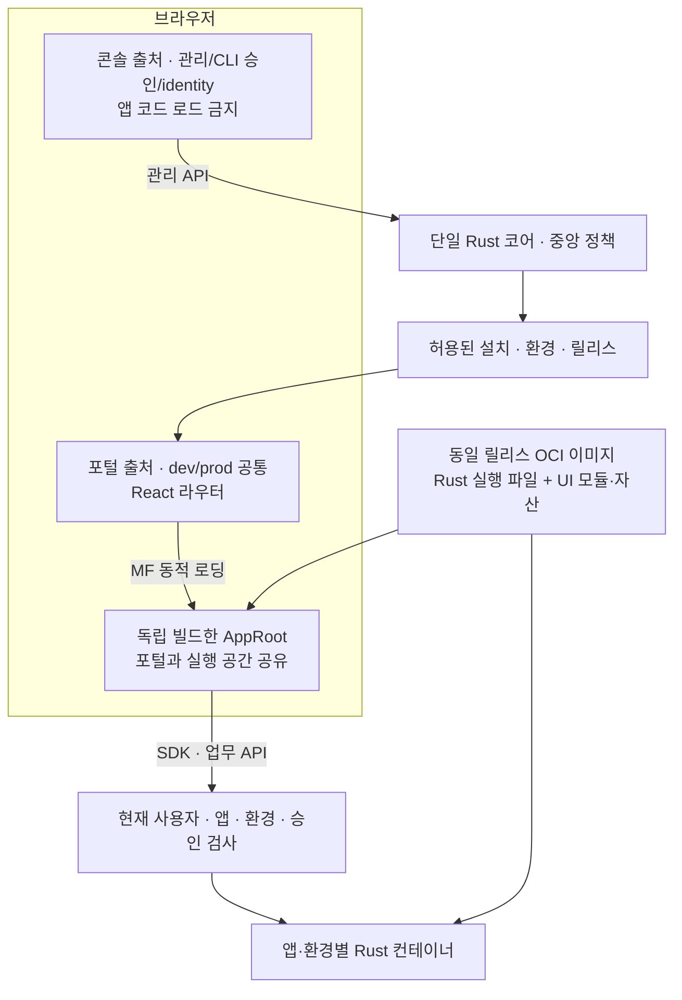

# miy-v2 프론트엔드 기술 검토

검토일: 2026-10-20  
앱 실행 최소 경계 확정: 2026-11-06\
상태: 사내 신뢰 앱의 iframe 없는 통합 UI·두 출처 설계 확정. 출처·세션 분리는 소스 구현·운영 미배포

Rust 백엔드와 분리된 관리 웹에는 **TypeScript + React + Vite + TanStack Router + TanStack Query**를 우선 추천한다. [PRD](PRD.md)의 사내 사용자와 회사가 통제하는 앱 개발·운영을 위한 구성이다. 외부 앱·외부 개발자 수용과 공개 콘텐츠의 검색 노출·서버 렌더링은 현재 범위 밖이다.

이 문서는 프론트엔드 기술 비교를 담당한다. 출처·세션·권한과 전환 기준은 [앱 실행·관리 경계](APP-BOUNDARIES.md#확정-결정)가 관리한다. 회사가 통제하는 앱을 같은 포털에 적재하고 관리·CLI 승인·Keycloak `/identity`는 앱 코드 없는 콘솔에 둔다. 독립 앱 빌드·동적 로딩·통합 라우팅과 단일 IP·사설 CA 지원을 유지하며, 별도 IdP/dev 포털이나 강한 앱 격리를 현재 기능의 선행 조건으로 두지 않는다.

## 앱 개발 템플릿과 공통 UI

CLI가 생성할 첫 업무 웹앱 템플릿에도 TypeScript·React·Vite를 우선 검토한다. 관리 웹과 앱은 독립적으로 빌드·배포하며, 앱이 플랫폼 내부 코드를 직접 가져다 쓰지 않도록 버전이 있는 SDK·UI 자산을 제공한다. 전체 개발 흐름은 [앱 개발 계획](DEVELOPMENT.md)을 따른다.

공통 UI에는 디자인 토큰, 인증·앱 실행 연결, 입력 폼·목록·상세 화면 예제, 로딩·오류·권한 부족 상태와 접근성 지침을 포함한다. 필수 연동 규칙과 권장 화면 스타일을 구분하고, 개발자가 업무별 컴포넌트와 호환되는 UI 라이브러리를 추가할 수 있게 한다.

SDK는 로컬 테스트 데이터와 플랫폼의 개발·운영 연결을 같은 앱 코드에서 선택할 수 있는 인터페이스를 제공한다. 실제 데이터 소스 자격증명은 브라우저에 전달하지 않는다. CLI는 템플릿·SDK·UI 자산의 호환 버전을 관리하고 갱신 시 사용자 코드를 보존한다.

## 선택 기준

사용자가 제시한 기준은 타입 검사, AI를 활용한 프론트엔드 개발, 널리 사용되는 생태계와 Next.js 제외다. 새로 출시된 기술이라는 이유만으로 우선하지 않고, 현재 유지되는 기술의 안정성과 적용 비용을 함께 평가한다.

React는 UI 라이브러리, TypeScript는 언어, Vite는 개발·빌드 도구다. 이들을 라우터와 데이터 조회 도구로 조합해 프론트엔드를 구성한다. React 공식 문서는 Vite의 TypeScript 템플릿과 TanStack Router, TanStack Query를 이러한 구성의 선택지로 안내한다. [React 공식 구성 안내](https://react.dev/learn/build-a-react-app-from-scratch)

## 후보 비교

| 후보 | 특징 | miy-v2에서의 판단 |
| --- | --- | --- |
| React + TypeScript + Vite | UI, 라우팅, 데이터 조회 도구를 선택해 구성 | Rust API 중심의 앱에 우선 추천 |
| React Router Framework Mode | 타입이 있는 라우트 API, 코드 분할, SPA·SSR·정적 렌더링 제공 | 통합된 프레임워크 구성이 필요할 때 비교 |
| TanStack Start | TanStack Router 기반으로 SSR, 스트리밍과 서버 함수 제공 | SSR 또는 프론트엔드 서버 기능이 필요할 때 비교 |
| Vue + TypeScript + Vite | TypeScript를 공식 지원하며 컴포넌트 중심으로 구성 | 템플릿 문법과 Vue 개발 방식을 선호할 때 대안 |
| Svelte + TypeScript | 컴포넌트 안에서 TypeScript를 지원 | 문법 선호와 필요한 UI 라이브러리 호환성을 검토할 대안 |

각 후보의 기능은 [React Router](https://reactrouter.com/start/modes), [TanStack Start](https://tanstack.com/start/latest/docs/framework/react/overview), [Vue](https://vuejs.org/guide/typescript/overview.html), [Svelte](https://svelte.dev/docs/svelte/typescript) 공식 문서를 기준으로 한다.

## 추천 이유

React는 State of JavaScript 2025에서 지배적인 프론트엔드 프레임워크로 설명되는 주요 생태계다. 이 조사는 전체 시장의 점유율 측정과는 구분한다. [State of JavaScript 2025](https://2025.stateofjs.com/en-US/libraries/front-end-frameworks/)

기존 miy의 `dev/package.json`에도 React 19, TypeScript, Vite와 여러 React UI 라이브러리가 선언되어 있다. React를 선택하면 기존 UI 자산의 재사용 가능성을 검토하기 쉽다. 실제 재사용 범위는 새 요구사항에 따라 정한다.

AI 개발 적합성은 생태계와 프로젝트 맥락에 기반한 판단이다. 특정 AI 모델이 React에서 항상 더 정확하다는 의미는 아니다. 사용 라이브러리와 버전을 고정하고 타입 검사와 실제 화면 검증으로 생성 결과를 확인한다.

TanStack Router는 경로, 파라미터와 검색 파라미터를 포함한 라우팅 전반에 타입 추론을 연결한다. TypeScript를 화면 컴포넌트뿐 아니라 화면 이동에도 적용하려는 목적에 맞는다. [TanStack Router 타입 안정성](https://tanstack.com/router/latest/docs/guide/type-safety)

## 추천 구성

| 역할 | 검토안 |
| --- | --- |
| 언어 | TypeScript 엄격 모드 |
| UI | React의 지원되는 안정 버전 |
| 개발과 빌드 | Vite |
| 라우팅 | TanStack Router |
| 서버 데이터 조회와 캐시 | TanStack Query |
| 백엔드 | Rust |
| API 타입 연결 | OpenAPI 스키마에서 TypeScript 타입 생성 |

SPA 구성에서는 빌드한 정적 프론트엔드를 제공하고 Rust API를 호출할 수 있다. 프론트엔드 빌드 도구와 운영 시 API 서버의 역할을 분리한다.

Rust와 TypeScript 사이의 타입은 자동으로 공유되지 않는다. API 스키마를 공통 계약으로 삼고, 예를 들어 openapi-typescript로 프론트엔드 타입을 생성하는 방식을 검토한다. 생성 타입은 실행 시 데이터 검증을 대신하지 않으므로 서버 입력 검증과 필요한 응답 검증을 별도로 설계한다. [openapi-typescript 공식 안내](https://openapi-ts.dev/introduction)

## 결정 전에 확인할 사항

- 검색 노출이 필요한 공개 화면과 SSR 필요 여부
- 편집기, 표, 차트 등 핵심 UI 기능과 라이브러리 요구
- 배포 환경과 프론트엔드 정적 파일 제공 방식
- 기존 React UI 자산의 재사용 가치

SSR이 핵심 요구라면 TanStack Start 또는 React Router Framework Mode를 다시 비교한다. 구체적인 의존성 버전은 프로젝트 초기화 시점에 호환성을 확인해 고정한다.

## 플랫폼 라우터에서 독립 앱 화면 통합

앱 UI는 **iframe 없이 독립 빌드한 React 모듈을 플랫폼 라우터에 직접 로드**한다. 플랫폼은 메뉴·공통 레이아웃·상위 경로를 유지하고, 등록된 설치·릴리스 정보로 앱을 연결한다. 새 앱을 추가할 때 플랫폼 소스 수정이나 전체 프런트엔드 재빌드를 요구하지 않는다. 단일 Rust 코어·IdP와 앱별 Rust 백엔드·단일 이미지 배포도 유지한다.

현행 구현은 Module Federation의 `./AppRoot`를 직접 마운트한다. [기존 검증 계획](archive/VALIDATION-MODULE-FEDERATION.md)의 iframe 없는 통합 UI 요구를 유지한다. 후속 보완은 dev/prod 공통 포털과 관리·CLI 승인·IdP를 담은 콘솔의 두 출처 및 브라우저 세션 용도 분리다. 이 경계는 소스에 구현했으며 운영에는 배포하지 않았다. 당시 기능 PASS를 이번 보안 인수로 옮기지 않는다.

### 화면 통합 방식 비교

| 방식 | 화면·배포 특성 | miy에서의 판단 |
| --- | --- | --- |
| Module Federation | 독립 빌드한 모듈을 호스트 페이지에서 실행하고 의존성 공유 | 현행 실행 방식 유지. 같은 문서에 넣을 앱 코드의 신뢰·배포 통제를 보완해야 함 |
| ES Module 동적 import | 모듈을 호출한 페이지의 실행 공간에서 실행 | 필요할 때 로더 비교 후보. MF를 교체해도 보안 격리가 생기지는 않음 |
| single-spa | 앱의 로드·마운트·언마운트 관리 | 수명주기 관리 대안일 뿐 보안 경계가 아니며 현재 추가하지 않음 |
| 별도 출처의 최상위 앱 페이지 | iframe 없이 앱 전체 페이지로 이동 | 외부 앱 등 강한 격리가 필요해질 때 후속 검토. 현재 사내 통합 UI에는 도입하지 않음 |
| 제한된 UI 실행기 | 플랫폼이 검증된 UI 선언만 렌더링 | 자유로운 React 개발 계약을 바꾸므로 현재 범위에 도입하지 않음 |
| iframe | 별도 문서와 메시지 기반 통합 | 사용자 요구에 따라 채택하지 않음. 실패 시 자동 대체 경로로도 사용하지 않음 |

같은 출처의 스크립트는 같은 브라우저 권한을 공유한다. MF·동적 import는 앱별 자격증명의 강제 격리 기술이 아니므로 현재는 회사가 소스·릴리스를 통제하는 앱에 사용한다. 비교 근거는 [HTML 출처 모델](https://html.spec.whatwg.org/multipage/browsers.html#origin), [Module Federation Vite](https://module-federation.io/integrations/build-tool/vite.html), [single-spa 구성](https://single-spa.js.org/docs/recommended-setup/)이다.

### 라우팅과 빌드 계약 제안

현재의 모듈 진입점·등록 정보·타입이 있는 SDK 함수 계약을 유지한다. 보안 보완에 필요한 자격증명·API 형식은 [앱 실행 계약](APP-BOUNDARIES.md#앱-실행-계약)을 검토한 뒤 새 불변 버전으로 확장한다. iframe용 메시지 브리지나 문서 진입점으로의 일괄 전환은 하지 않는다.

- 템플릿의 `AppRoot`와 로컬 개발 화면은 같은 업무 UI 코드를 사용한다. 앱 소스가 플랫폼 내부 코드를 가져다 쓰지 않도록 SDK·공용 UI를 버전으로 관리한다.
- UI 모듈·CSS·분할 자산과 Rust 실행 파일을 같은 OCI 이미지에 포함하고 활성 UI와 API를 동일 릴리스로 연결한다. 자산 URL은 검증한 등록 정보에서 결정한다.
- 포털의 공통 앱 진입점은 상대 경로·직접 링크·뒤로 가기·검색 파라미터·미저장 입력을 SDK 함수와 연결한다. 앱 내부 라우트 전체를 포털의 컴파일 시점 타입으로 보장하지 않는다.
- 테마·언어·탐색·인쇄·파일 선택기는 공용 UI와 타입이 있는 SDK로 일관되게 제공한다. 함수 표면을 제한해도 같은 페이지 앱의 DOM·fetch 접근이 보안상 제한됐다고 주장하지 않는다.
- G4는 공통 디렉터리와 현재 그룹 확인 계약을 사용하며, F1은 선택 파일의 좁은 권한을 서버에서 집행한다. 공통 ACL·파일 연계는 후속 미구현 범위이고 iframe 브리지 구현을 선행 조건으로 두지 않는다.
- 단일 IP·사설 CA HTTPS에서 포털·콘솔 두 출처를 구성하고 IdP는 콘솔의 `/identity`를 사용한다. 별도 IdP/dev 포털은 지금 만들지 않는다. 포트는 DOM 출처만 나누므로 세션 용도·정확한 Origin/CSRF·쿠키 미전달을 함께 검사한다. 도메인은 권장하며 외부 도메인 구매·내부 DNS·추가 IP는 필수가 아니다.

### 독립 배포와 사용 중 화면 교체

독립 배포와 플랫폼 재빌드 없는 앱 추가는 유지한다. 다른 버전의 모듈을 로드한다고 기존 입력·React 상태·이벤트 구독이 자동 보존되는 것은 아니다. 열린 화면에는 버전 갱신을 안내하고 저장되지 않은 입력을 처리한 뒤 다시 연다. 입력 상태를 보존하는 강제 실시간 교체는 필수 범위가 아니다.

일반 릴리스 교체는 이미지 확보·검사, 기존 실행 종료, migration, 새 실행·정상 확인을 거친다. UI와 API의 릴리스가 어긋나면 새로고침을 요구한다. 릴리스별 정적 자산과 복구용 산출물은 보존 정책에 따라 관리한다. 보관 비용은 [용량 관리](CAPACITY.md)를 따른다.

MF 제거·전체 앱의 iframe SDK 전환·새 앱 런타임 재작성은 하지 않는다. 기존 SDK·AppRuntime을 유지하며 실제 인증/API 변경에 필요한 부분만 새 불변 버전으로 추가한다. 앱 담당자는 같은 포털의 dev 설치에서 확인하고 검증한 digest를 prod로 승격한다. 앱·설치 ID·DB·파일·적용 SQL과 게시물·과거 검증 기록을 보존하며 상세 전환은 [전환과 복구](APP-BOUNDARIES.md#전환과-복구)를 따른다.

### 격리와 적용 범위

**같은 페이지에 로드한 앱 UI는 플랫폼과 브라우저 실행 공간을 공유한다.** 파일을 다른 도메인에서 내려받아도 플랫폼 페이지에서 실행하면 격리되지 않는다. Docker는 서버 프로세스 경계이며 CSS Modules·Shadow DOM·React 오류 경계는 보안 샌드박스가 아니다. 짧은 앱 토큰·SDK 함수·CSP만으로 같은 페이지의 악성 모듈이 다른 모듈의 권한을 쓸 수 없다고 보장하지 않는다.

현재 제품 범위는 사내망에서 회사가 소스·의존성·릴리스를 통제하는 앱이다. 포털에는 이 앱들의 dev/prod UI를 통합하고 콘솔에는 앱 코드를 적재하지 않는다. 관리·개발 담당자의 dev 미리보기 편의를 유지하고, 관리자라는 이유만으로 prod 업무 데이터 권한을 부여하지 않는다. 외부 앱·외부 개발자 수용과 강한 앱 간 격리는 후속 범위이며 현재 공통 ACL·디렉터리 구현을 지연시키는 선행 조건이 아니다.

최소 보안 보완은 앱 문자열의 안전한 텍스트 표시, 포털/콘솔의 frame 차단, 앱 응답 헤더 허용 목록, 앱/preview API에 한정한 CSP sandbox·nosniff를 포함한다. MF 자산·통합 UI·preview UI 전체에 sandbox를 적용하지 않는다. 두 세션 용도, 콘솔의 CLI 승인·`/identity`, 일반 앱 사용과 dev 미리보기·prod 권한, 기존 라우팅을 함께 검사하며 현재 신규 인수는 NOT_RUN이다. 별도 사이트·IdP·dev 출처나 MFA 의무화·복잡한 자동화는 현재 최소 인수에 추가하지 않는다.
