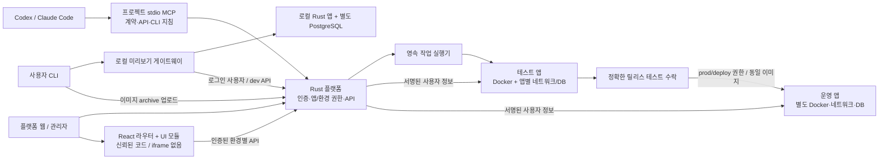
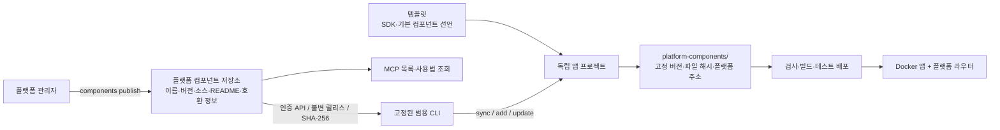

# 구현과 검증 결과

CLI 사용법 배포의 최신 상태는 [CLI 0.4.1 스킬·매뉴얼 동기화](#cli-사용법-스킬과-버전-동기화-2026-10-23-cli-041)를 따른다. SDK 번들은 0.6.0을 유지한다.

현재 실행 상태(2026-10-22 플랫폼·CLI 개선 후): 앱 `my-cli-test`는 메모 0.1.1에서 메모·할 일 0.2.0으로 dev 업데이트됐으며 prod 설치는 없다. 아래 [독립 Codex 세션 재검토](#독립-codex-세션-재검토-2026-10-22)와 [할 일 추가 요청 검토](#할-일-추가-요청과-업데이트-배포-검토)에 실제 실행 상태와 보완점을 기록했다. 이후 플랫폼·CLI에 적용한 수정은 [운영 개선 결과](#플랫폼cli-운영-개선-cli-040--bundle-060)를 따른다.

앞선 정리에서는 사용자 요청으로 앱 44개, 개발·운영 설치 항목 67개, 컨테이너 7개와 앱 DB 35개를 삭제했다. 관련 역할·이미지·네트워크·배포 자료도 정리했으며, 플랫폼 재시작 없이 개발·운영 앱 목록을 비웠다. 당시 플랫폼·로그인 계정·공용 기본 UI 컴포넌트·앱 소스 저장소와 검증 이력은 보존했다. 삭제 전 자료는 Git에서 제외한 `.local/backups/user-app-cleanup-20261022-204604/`에 보관한다. 정리 전 앱 주소는 당시의 검증 기록이며 현재 실행 중인 앱을 뜻하지 않는다.

[구조 심층 진단과 핵심 9개 요건 개선](#구조-심층-진단과-핵심-9개-요건-개선) 이후 공용 컴포넌트 분리와 독립 Codex 세션 재검토를 추가했다. 아래 V0~V1·bundle 0.3.0·계산기 조사 내용은 당시의 구현 범위와 한계를 기록한 이력이며 최신 미구현 목록으로 읽지 않는다.

검증일: 2026-10-21

판정: **V0~V1 범위 통과.** `scripts/up.sh`와 `scripts/check.sh`의 연속 실행이 종료 코드 0으로 완료됐다. Rust 단위 검사 2개, 실제 DB 장애·격리 통합 검사, Playwright 인수 시나리오, 실제 Codex OAuth·MCP 호출·갱신, 독립 OAuth/MCP 검사 15개를 수행했다. Rust 포맷·Clippy의 경고 금지 검사와 프런트 타입 검사도 통과했다.

## 구현 범위

Rust 코어·인증·API/MCP·앱 등록 정보, 별도 DB 실행기, React 플랫폼과 런타임 UI 로더를 구현했다. 대상은 로컬 Docker 기반의 V0~V1이며, 제품 전체와 앱 OCI 배포를 완료한 결과는 아니다.

구현 전 문서·아키텍처·검증 계획은 원격 `main`의 체크포인트 `3cecbe1`에 보존했다. 실행 방법은 [RUNNING](RUNNING.md), 요구 범위는 [IMPLEMENTATION](IMPLEMENTATION.md)을 따른다.

## 확인한 동작

| 영역 | 실제 검증 결과 |
| --- | --- |
| UI 런타임 | 서로 다른 진입점·Module Federation 이름으로 독립 빌드한 기준정보·진단 모듈을 호스트 빌드 이후 새 앱 ID로 등록. iframe·호스트 재빌드 없이 실행 |
| 라우팅 | 플랫폼 메뉴·헤더 유지, 하위 경로·검색 파라미터·직접 링크·새로고침·뒤로 가기·앱 전환 |
| 실패 처리 | React 오류를 앱 영역에 표시하고 포털 메뉴 유지. 지원하지 않는 UI 계약과 미배포 backend 호출은 명시적으로 거부 |
| 웹 인증 | Keycloak OIDC + PKCE, 서버 측 암호화 토큰, Secure·HttpOnly 쿠키, CSRF·Origin 검사, 만료 후 갱신, 로그아웃 복귀 |
| MCP 인증 | 실제 Codex OAuth 로그인, 계약 도구 조회, access token 만료 후 갱신·재조회 |
| 권한 | 개발자의 지정 앱·개발 환경만 허용. 운영 환경·사용 권한만 가진 사용자의 DB 변경 거부. A/B 접근 분리와 권한 회수 |
| API 계약 | 구현한 공개 JSON API 목록과 OpenAPI operation 일치. HTTP·MCP의 공통 도메인 서비스와 manifest 검사 |
| DB 격리 | 코어·인증·앱·환경별 DB, 객체 소유·migration·실행 역할 분리. 실행 역할의 타 DB·DDL·임시 테이블·migration 이력 변경 거부 |
| DB 변경 | 기존 레코드 보존, 새 컬럼·테이블 적용, 신규 객체의 실행 역할 권한, 실패 migration의 트랜잭션 롤백 |
| 작업 복구 | 중복 요청의 같은 작업 ID, 다른 입력의 멱등성 충돌. DB 생성 직후·migration 직후 실행기 강제 종료와 재개 |
| Migration 이력 | 적용 파일 checksum 변경과 알 수 없는 적용 이력을 거부 |
| 독립 OAuth 검사 | metadata·PKCE·resource binding·Resources 조회, 잘못된 서명·audience·resource·만료 토큰 거부. 세션 철회·refresh 거부와 offline grant 철회 |

기본 Rust 검사에서는 계약·경로·산출물 변조 검사를 수행한다. 실제 서비스가 필요한 DB 검사는 일반 검사에 `ignored`로 표시하고 전체 검사 스크립트가 별도로 실행한다. 실제 Codex 검사와 독립 OAuth 클라이언트 검사를 구분하여 기록한다.

## 환경과 증거

- Apple Silicon macOS, Docker Desktop Linux 엔진, Rust 1.99.1, pnpm 10.34.5, Codex CLI 0.163.0.
- Axum 0.8.9, SQLx 0.8.6, rmcp 3.6.0, React 19.3.1, Vite 8.3.5, Module Federation Vite 1.23.5·runtime 2.9.2.
- PostgreSQL 18.3, Keycloak 26.8.1, Caddy 2.11.2. 기반 이미지 digest와 전체 패키지 잠금을 저장했다.
- 검증 브라우저는 전용 컨테이너의 신뢰 저장소에 로컬 CA를 등록했다. 인증서 검증을 끄지 않았으며 호스트의 시스템 신뢰 설정을 변경하지 않는다.
- `.local/evidence/`에 브라우저·DB·Codex·MCP 결과, 플랫폼 빌드 해시, UI 산출물·작업·설치 식별자와 화면을 저장한다. `.local`은 Git에서 제외한다.
- `scripts/check.sh`가 전체 실행 순서를 담당하고 `scripts/report.py`가 결과를 취합한다. 누락된 검사 결과를 성공으로 생성하지 않는다.

## 구현 중 확인하여 반영한 사항

검증용 Keycloak realm의 scope·subject mapper를 명시했다. 웹 토큰과 MCP 토큰의 audience를 나누고, MCP 리소스 클라이언트 ID를 canonical resource URI와 일치시켜 introspection의 audience 검사도 유지했다.

Codex 갱신에 필요한 `offline_access`를 명시적인 client scope·개발 계정 역할로 구성했다. 일반 세션 로그아웃과 offline client grant 철회는 각각 검사한다. 이 연결은 외부 개발자의 플랫폼 MCP 인증이며 내장 Hermes의 모델 연결 검증을 대신하지 않는다.

## 개발 화면의 간편 로그인

로컬 개발에서는 `http://localhost:18000`의 계정 버튼으로 비밀번호·인증서 설정 없이 접속한다. 관리자·개발자·사용자 A/B를 제공하고, 서버에 개발 세션을 저장해 기존 권한 검사를 적용한다. 명시적인 개발 설정과 loopback 서비스 주소가 함께 있을 때만 활성화한다. 실제 OAuth 로그인은 별도로 유지한다.

추가 변경 후 Rust 단위 검사 3개, Clippy·포맷·타입 검사, Playwright 시나리오 3개를 통과했다. 계정 버튼·로그아웃·계정 전환·잘못된 Origin/계정 거부와 기존 실제 OAuth 세션 갱신·권한·DB 준비를 확인했다. HTTP에서 동적 앱 모듈과 하위 라우팅도 확인했으며 HTTPS 요청이나 iframe 없이 실행됐다. 화면과 별도 실행 기록은 `.local/evidence/development-*`에 저장했다. 간편 로그인은 OAuth·MCP 인증 통과 증거를 대체하지 않는다.

## 다음 단계와 적용 한계

2026-10-22 추가 실증에서는 CLI로 만든 별도 앱을 실제 Codex가 개발하고 로컬 Docker에 배포했다. [휴가 관리 대장 실증 결과](LEAVE-LEDGER-RESULTS.md)에 38개 독립 인수 검사, 실제 이미지·소스 연결과 보완 기록을 정리했다. 아래 항목은 최초 V0~V1 검증 당시의 다음 단계이며, 추가 실증을 정식 V2~V7 전체 통과로 확대하지 않는다.

최초 V0~V1 이후에는 독립 앱용 CLI·SDK·개발 지침, Codex 앱 개발, 로컬 단일 이미지 배포와 실제 backend 연결을 추가했다. 아래 bundle 0.3.0 실증에서는 스키마 변경 업데이트와 실패 migration의 전진 복구까지 확인했다. 별도 Linux 서버·원격 이미지 전송·정식 운영 승격·백업 복원·전체 흐름의 독립 3회 반복은 아직 수행하지 않았다.

최초 V0~V1 릴리스는 UI·SQL fixture이며 `not_deployed`로 유지한다. 후속 실증의 Docker 앱은 실제 실행 상태를 별도로 제공한다. 실제 고객 데이터·기업 SSO 전체·신뢰하지 않는 UI 코드·다중 서버·전체 자원 관리·백업 복원·Hermes는 통과 범위에 포함하지 않는다.

코어의 프로세스 환경에서는 DB 생성 자격증명을 제거했다. 동일 OS 계정의 로컬 프로세스 분리를 제품의 OS 계정·컨테이너 격리 완료로 해석하지 않는다. Keycloak `resource-indicators`는 실험 기능이며 다른 인증 제품·개발 클라이언트의 호환성은 별도 검증해야 한다.

## 개발·등록·배포 과정 재검증 (bundle 0.3.0)

검증일: 2026-10-22 KST. 목적은 휴가 업무 기능이 아니라 **독립 개발자가 지침·SDK·MCP로 앱을 만들고 CLI로 등록·배포·갱신할 수 있는지** 확인하는 것이다. 판정은 **이번에 정한 로컬 개발 경로 통과**이며, 원격 서버를 포함하는 정식 V2~V7 완료는 아니다.

### 바꾼 사항

- CLI·MCP 개발 지침을 같은 파일에서 제공하고 bundle 0.3.0으로 고정했다. SDK·Dockerfile·도구체인·지침·초기 migration의 해시를 CLI 내장 번들과 비교한다. 기존 bundle은 자동 업그레이드하지 않는다.
- `app check`에 Rust 포맷, 보호 파일 무결성, migration 이름·번호·트랜잭션 규칙, frozen 의존성 설치, UI 빌드와 Federation 진입점·CSS/JS 자산 검사를 포함했다. `app build`도 같은 검사를 실행한다. SDK를 수정하지 말라는 지침과 포맷 검사의 충돌을 수정했다.
- 등록 신청 → 관리자 승인/거절 → dev 권한 부여 → 사용자 권한 부여를 CLI 명령으로 연결했다. 미승인 신청은 권한을 주지 않는다. 승인·거절 상태와 앱 생성·개발 권한 부여는 DB 트랜잭션으로 처리한다.
- 제출 전 멱등성 키 저장, `--no-wait`, `app resume`, 명시적 `--retry`, 오래된 빌드 배포 거부를 추가했다. 결과 JSON과 하위 빌드 로그를 stdout/stderr로 구분한다.
- 서버도 동일한 migration·UI 산출물 검사를 사용한다. DB migration이 실패하면 앱 상태와 함께 DB 상태도 `failed`로 표시한다.

### 실제 수행 결과

| 검사 | 결과 |
| --- | --- |
| 새 템플릿 3개 | 각각 생성 직후 포맷·Rust 테스트·TypeScript·UI 빌드 통과. 컴파일 캐시는 공유했으며 소스 폴더는 별개 |
| 잘못된 개발 자산 | SDK/Dockerfile 변경, 잘못된 bundle/UI 진입점, 중복 migration 번호, 명시적 트랜잭션·no-transaction 거부 |
| CLI 등록과 권한 | 일반 사용자의 신청 거부, 개발자 자기 승인 거부, 미승인 배포 거부, 관리자 승인·반복 승인, CLI 사용자 권한 부여, 개발자의 prod 제어 거부 |
| 계약 일치 | 실행 중인 계약 API와 CLI가 생성한 지침·보호 파일 해시 일치. MCP도 같은 도메인 응답 사용 |
| 실제 Codex v1 | 별도 앱 폴더에서 MCP 조회 후 Rust·React·SQL·테스트·README 작성. 추가 수정 요청 없이 check 통과. 입력 단위 테스트 4개 |
| 실제 Codex v2 | 기존 0001/0002 migration을 보존하고 새 tag 컬럼·API·UI 개발. 추가 수정 요청 없이 check 통과. 단위 테스트 7개 |
| CLI 배포와 DB | Git 커밋 후 CLI build/deploy로 이미지·DB·컨테이너 준비. 앱 등록·승인·권한은 수동 API 스크립트 없이 CLI로 수행 |
| 응답 유실 복구 | worker를 잠시 멈추고 제출 응답의 로컬 job ID만 지우는 장애를 주입. 같은 명령 재실행이 같은 서버 작업 ID를 반환. worker 재개 후 resume 성공 |
| UI 통합 | 기존 플랫폼 빌드 그대로 실제 브라우저 생성·상세 링크·직접 링크 새로고침. iframe 없이 동작, 브라우저 JS 오류 없음 |
| 앱 제어 | CLI 중지 시 API 503, 시작 후 동일 레코드 보존 |
| 스키마 변경 업데이트 | 0.1.0 → 0.1.1에서 새 컬럼 추가, 기존 ID·소유자·제목·내용 보존, 새 컬럼의 조회·변경과 v2 UI 동작 |
| 실패 migration | 0.1.2에서 컬럼 추가 직후 의도적 SQL 오류. DDL과 migration 이력 롤백, 기존 레코드 보존, 앱 정지·실패 상태 표시 |
| 전진 복구 | 적용되지 않은 migration을 수정한 새 이미지 0.1.3을 CLI로 배포. DB ready·앱 running, 기존 데이터와 새 컬럼 확인 |

별도 스크립트의 assertion은 기본/등록 20개, v1 10개, v2 6개, 실패·복구 5개다. 단계별 번들·호스트 해시 반복 확인도 이 수에 포함되므로 독립 요구사항 41개를 의미하지 않는다. 플랫폼 Rust 단위 검사 7개, Clippy 경고 금지, 포맷·타입 검사, 기존 Playwright 3개 시나리오와 실제 DB 격리·이력·실행기 장애 복구 회귀 검사도 통과했다. Playwright 직접 실행 시 로컬 CA 환경 변수를 누락한 실패 1회가 있었으며, 신뢰할 CA를 지정한 재실행은 통과했다. TLS 검증을 끄지 않았다.

Codex v1은 실행 명령 실패가 없었다. v2는 README 편집 명령의 인코딩 오류 1회를 스스로 수정하고 보고했다. 평가자가 앱 업무 코드를 대신 수정하거나 지침 피드백으로 고치도록 요청하지 않았다. Git 커밋·이미지 빌드·배포는 지침에 따라 평가자가 CLI로 실행했다. 0.1.2/0.1.3의 실패 주입·수정 migration은 평가 스크립트가 만든 시험 데이터이며 Codex가 구현한 기능으로 집계하지 않는다. v1/v2 개발·배포 중 제공 번들 및 플랫폼 UI의 해시는 동일했다.

### 소스·실행 증거

- 앱: `~/projects/miy-apps/workflow-notes-mvib6wzm` (별도 Git 저장소).
- 접속: `http://localhost:18000/apps/workflow-notes-mvib6wzm`. 사용자 A로 검증 레코드를 확인한다.
- v1 커밋: `038d0c93b323c3d4f509a170c2ce4686c1e1d86d`.
- v2 커밋: `f3d519a1d4da04b2cf92e90d778efa03aeb3c4f5`.
- 최종 복구 커밋: `dab1648cc54df3bb4b7e2e5af16ca1e7fc316f3a`, 릴리스 `0.1.3`.
- 최종 실행 이미지 ID: `sha256:e0c3cbfcd66785b5f232559455c34aca1acbdff23b32aee8b7d42302d1c57ea3`.
- 검사 코드: `scripts/check-developer-workflow.mjs`, `scripts/check-workflow-deployment.mjs`.
- 로컬 증거: `.local/evidence/workflow-mvib6wzm/{baseline,v1,v2,failure}.json`, 명령 로그와 화면. 실제 Codex 기록은 `.local/evidence/workflow-{v1,v2}-codex.jsonl`.

### 남은 범위

CLI 로그인은 localhost 개발 계정이며 정식 CLI OAuth는 미구현이다. 실제 Codex MCP OAuth와 기존 웹 OAuth 회귀 검사는 별도로 수행했다. 이미지 전송은 같은 Docker Engine의 로컬 저장소에 한정하며, 원격 레지스트리·별도 Linux 서버·운영 승격은 미검증이다.

실패 후 **새 릴리스로 전진 복구**를 확인했으며 자동 구버전 롤백·백업 복원·임의의 비호환 스키마 변경 복구를 검증한 것은 아니다. CLI의 정적 SQL 검사는 실제 DB migration 리허설을 대신하지 않는다. 새 템플릿 생성은 3회, 실제 Codex 전체 개발 경로는 한 앱의 v1/v2 1세트다. 다음 검증은 정식 CLI 인증과 원격 이미지 전송을 연결한 뒤 전체 개발·배포 경로를 독립적으로 3회 반복하는 것이다.

## 수동 개발 경로에서 발견한 환경·배포 문제

2026-10-22, 사용자의 Codex 대화 `01a160b8-0cad-72f2-9a38-f3e3736a9308`과 `my-local-test` 계산기 배포를 조사했다. 자동 평가가 제공한 환경을 일반 사용자의 Codex 세션도 자동으로 받는 것으로 볼 수 없었다.

| 증상 | 확인한 원인 | 조치 |
| --- | --- | --- |
| Codex에 miy_app MCP가 없음 | 평가 스크립트만 프로세스별 MCP 설정을 전달. app init/login은 일반 Codex 세션을 설정하지 않음 | 프로젝트 전용 `app setup-codex`, MCP·CA·PATH를 전달하는 `app codex` 실행/대화 재개 명령 추가 |
| cargo가 없다고 보고 | Rust는 설치돼 있었으나 Codex PATH에 `~/.cargo/bin`이 없었음 | CLI check/build가 rustup 경로를 탐색. doctor 진단과 Codex 실행 환경에 Rust PATH 제공 |
| 계산기 대신 기본 앱 화면 | 기본 앱 커밋 d7b855c와 계산기 수정 커밋 76a46a4를 모두 0.1.0으로 빌드. 새 이미지는 immutable_release_conflict로 거부되고 기존 앱 계속 실행 | 새 버전 0.1.1, 커밋 7a89f1a로 재빌드·배포. status에 활성 버전·로컬 이미지 일치 여부·마지막 작업과 해결 안내 추가 |

계산기 개발 세션은 MCP 미연결에 대해 사용자에게 확인받고 로컬 계약으로 진행했으며, Rust 검사 실패도 보고했다. 이 동작을 Codex의 무단 계약 우회로 판단하지 않는다. 빠진 부분은 수동 개발 환경 준비와 배포 실패 설명이었다. TypeScript 오류 한 건은 해당 세션이 스스로 수정해 재검사했다.

후속 확인: Rust PATH를 제외한 환경에서 전체 app check 통과, 계산기 테스트 12개 통과, 새 실행기로 실제 Codex `get_contract`·`search_api` 호출 및 cargo 버전 조회 성공. 코어 단위 검사 9개와 Clippy 경고 금지 검사도 통과했다. 계산기 0.1.1의 실제 Docker 이미지 ID는 `sha256:bd69c85419b09bb963e708da45a3da1e20b6d0e8103a2e998395eaec93e67c4e`이며 기존 설치 ID를 유지했다.

접속은 `http://localhost:18000/apps/my-local-test`, 개발자 또는 관리자 계정을 사용한다. 등록된 메뉴 이름은 `내 로컬 테스트`, 앱 내부 제목은 `계산기`다. 일반 사용자에게는 별도 사용 권한이 필요하며 이 수정에서 권한을 확대하지 않았다. `scripts/check-calculator-recovery.mjs`로 배포 이미지 일치·버튼/키보드 연산·오류 복구·직접 URL 새로고침을 검사하고 `.local/evidence/calculator-*`에 결과를 기록한다.

## 구조 심층 진단과 핵심 9개 요건 개선

검증일: 2026-10-22. 비교 기준은 커밋 `a7a409a`와 실제 실행 중이던 휴가·메모·계산기 앱이다. CLI 0.2.0 / 개발 번들 0.4.0으로 개선했다. 결론은 **요청한 개발·로컬 테스트·테스트 배포·운영 승격·관리 경로를 실제로 연결했다**는 것이다. 기존 자료의 성공 기록을 원격 서버나 전체 제품 완성의 증거로 확대하지 않았다.

### 진단에서 발견한 핵심 공백

이전 자동 평가에서는 Codex 실행 스크립트가 MCP·CA·PATH를 주입했다. 앱을 만든 뒤 일반 Codex를 실행하는 사용자는 같은 환경을 받지 못했다. CLI가 플랫폼 빌드 경로에 묶여 있었고, 앱 자체를 로컬에서 실행하는 명령이 없었다. 배포도 같은 Docker Engine에 이미 있는 이미지를 참조했다.

UI는 dev 환경만 표시했고, 운영 실행 권한에 별도 deploy 구분이 없었다. 특정 dev 릴리스를 테스트한 후 동일 이미지로 승격하는 절차도 없었다. 앱 간 API와 공통 데이터를 위한 SDK 연결 경로가 빠져 있었다. 따라서 이전 성공 사례만으로 9개 요건을 충족했다고 판단할 수 없었다.

운영상으로는 전체 artifact 디렉터리를 정적으로 제공해 SQL 파일까지 노출할 수 있었고, 앱들이 같은 Docker 네트워크를 사용했다. 외부 Docker 제어 후 DB에 기록된 실행 상태가 실제 컨테이너와 달라질 수 있었다. 대기 작업의 권한 회수, 실패 경로의 임시 파일·잠금 정리도 추가 점검 대상이었다.

### 현재 실행 경계

### 9개 요건별 변경과 실제 증거

| 요건 | 이전 상태 | 개선과 검증 |
| --- | --- | --- |
| 1. CLI·코딩 에이전트 개발 환경 | 평가 전용 설정 또는 Codex wrapper 의존 | init이 독립 Rust/React 앱·SDK·지침·프로젝트 MCP를 생성. 일반 Codex는 프로젝트 신뢰 승인 후 인식, Claude Code도 해당 MCP 설정을 인식. 실제 stdio MCP 계약·CLI 도움말·API 검색 호출 검사 |
| 2. CLI 셋업·배포 | 개발 계정 로그인과 같은 Engine 배포 | setup/login/register/check/fmt/dev/build/deploy/accept/promote/status/control/resume/logout 연결. 실제 Keycloak 웹 로그인에서 CLI 승인까지 HTTPS로 검사 |
| 3. 쉬운 CLI 설치 | target/debug/miy 직접 사용 | 사용자 경로 installer 제공. 소스 빌드 설치와 실행 파일 복사 설치를 모두 실행. 설치한 CLI로 플랫폼 저장소 밖에 앱 생성. 공개 OS별 바이너리 다운로드 서비스는 미제공 |
| 4. MCP/API·스킬·CLI 지침 | API/MCP는 있으나 CLI 사용법과 일반 클라이언트 연결 부족 | 표준 stdio MCP, Codex·Claude Code용 스킬, AGENTS/CLAUDE/CONTRACT/CLI 문서. live 계약과 제공 보호 파일 해시 일치 검사. CLI 도움말은 clap 명령 정의에서 생성 |
| 5. 로컬 실행과 인증된 데이터 연결 | 정적 check만 제공 | 로컬 PostgreSQL·Rust 컨테이너·React preview·인증 게이트웨이. 실제 사용자 Identity, 공통 사용자 목록, 다른 dev 앱 API 사용. 서버 dev DB에 로컬 레코드가 들어가지 않음을 확인 |
| 6. 서버 테스트 영역 배포 | 같은 Docker 저장소 전제 | 인증된 최대 1 GiB archive 업로드 → 해시·단일 이미지·앱 검증 → worker import → dev 배포. 저장 직후 서버에서 새 이미지를 제거한 조건에서도 전송·배포 성공 |
| 7. 별도 권한의 운영 배포 | prod/develop과 배포 권한 구분 없음 | 테스트 수락 기록 + 정확한 release ID 승격, prod/deploy 별도 권한. prod/develop만으로 승격 불가. 일반 deploy와 fixture API의 운영 우회 거부. 운영 DB는 별도이며 dev 데이터는 복제되지 않음 |
| 8. 서버 재시작 없는 라우터 통합 | dev 동적 UI는 검증, prod 경로 없음 | `/environments/dev/apps/ID`, `/environments/prod/apps/ID`. 독립 앱 업데이트·schema 변경 중 core PID와 플랫폼 UI 해시 불변. dev v2 후 prod v1 유지, 직접 링크·새로고침·iframe 없음 검사 |
| 9. 관리자 앱 관리 | dev 앱 시작·중지 일부 | `/admin` 등록 승인/거절, 앱·환경 권한 부여/회수, 전체 환경 앱 제어. 관리자 웹에서 합성 앱 중지/시작 실제 수행. CLI 운영 제어와 권한 회수도 검사 |

### 경계를 강화한 부분

서버 API와 실행기가 같은 운영 권한 정책을 사용한다. 요청이 승인됐어도 실행 전에 권한을 회수하면 대기 중 작업은 `permission_revoked`로 실패하며 기존 앱을 중지하지 않는다. 독립 DB 작업도 실행 직전 권한을 다시 검사한다. 새 CLI 인증은 verifier에 묶인 단일 교환, 만료, 명시적 웹 승인, 즉시 철회를 제공한다. 브라우저 Origin을 가진 CLI bearer 요청은 거부한다.

앱 UI 자산은 앱 접근 권한이 있을 때 `/artifacts/HASH/ui/...`로만 제공한다. migration·build 메타데이터 전체를 공개 파일 서버로 노출하지 않는다. 이미지 안의 symlink는 파일 내용을 읽기 전에 거부한다. 업로드는 크기·해시·앱 ID·단일 이미지 envelope를 확인하고 Docker import는 worker가 수행한다. 전송 중단으로 남은 수신 작업은 만료 처리한다.

앱·환경마다 네트워크와 DB를 분리하며 컨테이너 제한을 유지한다. Docker에서 직접 중지한 컨테이너도 플랫폼 상태에 반영하고, 다시 시작할 때 실제 포트를 갱신한다. 적용된 DB와 실행 컨테이너의 릴리스가 다르면 단순 start로 억지로 실행하지 않는다. 임시 import 디렉터리와 자격증명 파일은 정상 오류 경로에서 정리하고, advisory lock을 보유한 연결은 오류로 pool에 남기지 않는다.

라우터 통합 UI는 **승인한 신뢰 코드**가 같은 JavaScript 실행 환경을 공유한다. React 오류 경계, CSS Modules 지침, 플랫폼 전역 스타일 축소, SDK 경로 규칙으로 우발적 충돌을 줄인다. 악성 코드의 DOM 접근·CPU 점유·사용자 권한 내 임의 fetch까지 막는 sandbox는 아니다. 이 수준의 격리가 필요하면 별도 origin/iframe 등 다른 신뢰 경계가 필요하다.

### 실제 검증과 이력의 구분

이번 새 앱 업무 코드는 구조 검사용 합성 probe이며 별도 LLM이 개발한 업무 기능으로 집계하지 않는다. 실제 Codex 업무 앱 개발은 앞선 0.3 v1/v2 이력이다. 이번에는 표준 CLI의 프로젝트 설정 인식, 실제 MCP 프로토콜 호출, 최종 CLI·서버 계약 일치, 스킬 형식, CLI 실행 하네스 준비를 검사했다. Claude Code로 업무 앱을 끝까지 생성하는 실험은 아직 하지 않았다.

주요 증거는 다음과 같다.

- installer 두 경로 → 독립 앱 두 개 생성 → Rust/TypeScript/UI 전체 check → 실제 HTTP archive 배포.
- 브라우저 승인 CLI 로그인, 실제 Keycloak OIDC + HTTPS CLI 로그인, verifier 오류·교환 재사용·로그아웃 후 접근 거부.
- 로컬 backend/UI에서 데이터 생성, 실제 사용자 확인, 공통 directory와 다른 앱 API 조회, 서버 dev DB와의 레코드 분리.
- 실제 dev 배포·수락·동일 이미지 prod 승격·별도 DB·운영 라우터·운영 제어. 개발 권한만 있는 사용자와 권한 회수 후 대기 작업의 거부.
- dev UI/schema 업데이트와 기존 레코드 보존, prod 이전 릴리스 유지, 서버 이미지 캐시 없이 archive 전달, core PID와 호스트 UI 해시 보존.
- DB 격리·역할·migration 이력·실행기 강제 종료 회귀, 기존 웹 OAuth/라우팅 Playwright 시나리오, 독립 OAuth/MCP 15개 검사.
- 원본 계산기를 복제한 저장소에서 0.3 → 0.4 전환 후 업무 코드·SQL 바이트 동일성 및 전체 check. 원본 소스 저장소에는 변경하지 않음.

초기 회귀 검사에서 기존 테스트가 dev 전용 메뉴 URL과 prod fixture 직접 생성을 가정해 실패했다. 테스트를 새 환경 경로와 **운영 fixture API 거부**에 맞췄다. DB 격리만 확인하는 낮은 수준 fixture는 테스트 전용 SQL로 생성하며, 실제 운영 배포는 별도의 Docker 승격 시나리오로 검증한다. 실패를 그대로 성공 기록으로 바꾸지 않았다.

최종 개발 번들의 보호 파일 목록 해시는 `0fb414f0a90427d8cc7e3daf8ebde1f8e8c0ce1bfe04f3f357956765ce39f145`다. 검증용 앱에 최종 지침을 반영할 때 업무 코드·SQL을 보존하고 새 버전으로 빌드·배포했다. 테스트 코드와 런타임 변경을 위한 플랫폼 자체 재시작은 있었으며, **개별 앱 배포 구간의 무재시작**을 PID·UI 해시로 별도 확인했다.

기존 `leave-ledger`, `workflow-notes-mvib6wzm`, `my-local-test`도 **동일 이미지·동일 릴리스**로 재배포해 앱별 네트워크로 전환했다. 각 앱의 모든 app 테이블 행 수와 migration version·success·checksum을 전후 비교했고 일치했다. 플랫폼 core PID는 변하지 않았다. 계산기는 실제 브라우저 연산·오류 복구·새로고침 검사도 다시 통과했다. 기존 앱 소스나 DB 레코드를 수정해서 검사를 통과시킨 것이 아니다.

최종 회귀 결과는 Rust 단위 검사 9개, 별도 실행한 실제 DB 통합 검사, Playwright 시나리오 3개, 독립 OAuth/MCP 검사 15개, 기존 계산기 브라우저 검사 5개 통과다. Clippy 경고 금지·포맷·TypeScript 검사도 통과했다. 로컬 미리보기 재실행에서 저장된 로컬 데이터 유지와 같은 프로젝트 중복 실행 거부를 확인했다. 잘못된 환경 URL은 dev/prod로 대체하지 않고 오류를 표시하며, 정상 환경의 직접 링크·새로고침도 별도로 검사했다.

현재 실행 상태와 확인 주소는 다음과 같다. 관리자는 로컬 홈페이지의 **관리자로 시작**으로 접속한다. 검증 과정에서 개발자의 운영 배포 권한은 다시 회수했으므로 개발자로 운영 관리가 거부되는 것은 정상이다.

| 앱 | 테스트 영역 | 운영 영역 |
| --- | --- | --- |
| `leave-ledger` | 기존 0.1.1 유지 | 미설치 |
| `workflow-notes-mvib6wzm` | 기존 0.1.3 유지 | 미설치 |
| `my-local-test` | 기존 0.1.1 유지 | 미설치 |
| `arch-mvix06lk-data` | 0.1.1 | 미설치 |
| `arch-mvix06lk-ui` | [0.1.2](http://localhost:18000/environments/dev/apps/arch-mvix06lk-ui) | [0.1.0](http://localhost:18000/environments/prod/apps/arch-mvix06lk-ui) |

앱 승인·권한·실행 관리는 [플랫폼 관리](http://localhost:18000/admin)에서 확인한다. 과거 검사의 `not_deployed` fixture는 실제 Docker 앱과 구분한다.

실행 증거는 `.local/evidence/structural-audit/`에 보관하며 Git에 포함하지 않는다. 재현 코드는 `scripts/check-architecture.mjs`, 기존 앱 전환 코드는 명시적인 ID만 받는 `scripts/migrate-runtime-networks.mjs`다. 실제 현재 릴리스·이미지·네트워크 결과는 이 디렉터리의 `apps.json`, `final-bundle.json`, `existing-networks.json`에 기록한다.

### 남은 제품 범위

이번 환경은 macOS ARM64 + Docker Desktop의 단일 서버다. HTTP 전송 자체는 서버 이미지가 없는 조건에서 검사했지만 별도 Linux 호스트·다른 CPU·WAN 장애·대용량 전송 재개를 완료한 것은 아니다. CLI 공개 바이너리 배포, 다중 서버 runner, 전체 CPU/메모리/디스크 총량 제어, egress 정책, 백업·복원·자동 rollback은 후속 작업이다.

공통 데이터는 현재 사용자 directory 예제로 연결했고, 다른 앱의 공개 API 호출을 제공한다. 모든 기업 데이터소스·파일 스토리지·앱별 OpenAPI 자동 수집과 버전 호환성까지 제공하는 상태는 아니다. backend가 별도 업무 권한을 구현해야 한다. 사용자 신규 프로비저닝·기업 SSO 운영 정책 전체와 Hermes는 이번 범위에 포함하지 않았다.

로컬 미리보기는 빌드/재실행 방식이다. 운영 수락 기록은 사용자가 수행한 검사를 증명하는 기록이며 자동 QA가 아니다. 컨테이너 제거는 DB 삭제가 아니며, 실패 migration 후에는 이전 릴리스 자동 복구 대신 검토한 새 릴리스로 전진 복구한다.

## 공용 컴포넌트 배포를 CLI에서 분리

2026-10-22, CLI 0.3.0 / 기반 개발 번들 0.5.0. 공용 컴포넌트가 추가될 때마다 CLI 실행 파일을 배포해야 하는 의존성을 제거했다. 처음 이 기능을 도입하는 CLI 업그레이드는 필요하지만 이후 컴포넌트 릴리스는 같은 CLI와 같은 서버 프로세스에서 게시·조회·설치한다.

### 구현한 분리

- 컴포넌트 소스는 CLI의 컴파일 입력에서 제거했다. 기반 SDK와 `@miy/ui` 호환 진입점만 템플릿에 남긴다. 플랫폼 UI와 초기 UI 패키지는 `registry/components/ui/1.0.0/`의 같은 원본을 사용한다.
- `component_releases` 테이블에 불변 버전·패키지·해시·게시자·시간을 저장한다. 인증된 API로 조회하고 관리자만 게시한다. 같은 이름/버전의 변경은 거부한다. 새 게시에 코어 재시작이나 CLI 교체가 필요하지 않다.
- CLI에 `components list/show/sync/add/update/check/publish`를 추가했다. 새 프로젝트는 로그인 후 sync로 기본 UI를 가져온다. 기존 설치의 sync는 정확한 잠금 버전 복원이며 자동 최신화가 아니다.
- 앱은 `platform-components/`와 잠금을 Git에 커밋한다. 추가 컴포넌트는 `@miy/components/NAME`으로 사용한다. 수정한 관리 파일이나 사용자 파일을 덮어쓰지 않으며, 경로 탈출·symlink·패키지 해시 불일치·비호환 버전을 거부한다.
- 프로젝트 stdio MCP와 플랫폼 HTTP MCP에 `list_components`, `get_component`를 추가했다. 소스 설치와 별개로 같은 실시간 저장소의 버전별 사용법·호환 정보·설치 명령을 조회한다.
- 0.3·0.4 기반 번들은 깨끗한 작업 트리에서 명시적으로 0.5로 전환할 수 있다. 업무 Rust/React와 SQL은 보존하고 컴포넌트 alias·관리 디렉터리를 추가한다.

### 실제 검증

`scripts/check-components.mjs`를 실행해 별도 앱 `component-probe-mvj1s0ue`와 컴포넌트 `badge-mvj1s0ue`를 만들었다. 확인 주소는 [공용 컴포넌트 검증 앱](http://localhost:18000/environments/dev/apps/component-probe-mvj1s0ue)이며 관리자 또는 개발자로 접속한다. 최종 앱 버전은 0.1.1, 컴포넌트는 1.1.0으로 화면에 `badge v2`를 표시한다.

| 검증 | 실제 결과 |
| --- | --- |
| 기본 UI 분리 | 새 템플릿에는 구현 대신 기본 선언·호환 진입점이 있고 로그인 후 UI 1.0.0 다운로드. 원본 소스 해시 일치 |
| 새 컴포넌트 발견 | CLI 바이너리를 복사·고정한 다음 처음 존재하는 이름을 게시. 같은 CLI와 실제 stdio MCP에서 목록·README·설치 명령 조회 |
| 게시 권한·불변성 | 비로그인 목록 조회 401, 개발자 게시 403, 관리자 게시 성공. 동일 내용 재전송 성공, 같은 버전의 다른 내용 409, 경로 탈출 패키지 400 |
| 파일 보호·복원 | 누락 파일은 잠금 버전으로 복원. 편집된 파일은 변경을 보존하고 sync 거부. 잠금의 패키지 해시 치환도 거부 |
| 최초 앱 배포 | 내려받은 기본 UI와 새 컴포넌트를 빌드·Docker 배포하고 실제 플랫폼 라우터에서 v1 표시. iframe 없음 |
| 새 버전 게시·동기화 | 1.1.0을 게시해도 기존 설치와 실행 앱은 v1 유지. sync 후에도 1.0.0 고정 |
| 호환성·명시적 업데이트 | 호환되지 않는 9.0.0 설치 거부. 버전 생략 update는 호환되는 1.1.0 선택. 로컬 업데이트만으로 실행 앱이 바뀌지 않음 |
| 앱 재배포 | 앱 버전 증가·커밋·빌드·배포 후 v2 표시, 직접 링크·새로고침 성공. CLI 해시·core PID·플랫폼 UI 해시와 기존 사용자 앱 릴리스 불변 |
| 기존 앱 전환 | 0.4 합성 앱과 0.3 계산기를 각각 복제한 저장소에서 upgrade·전체 check 통과. 업무 Rust/React·SQL 파일 해시 전후 동일. 원본 저장소 미변경 |
| 로그인 없는 검사 | 설치 후 CLI 세션 파일을 임시 제거하고 전체 app check 통과. 설치된 컴포넌트를 검사·빌드할 때 저장소 로그인 불필요 |

고정 CLI SHA-256은 `ae3d439a7c089b2644ec6f0567ea6569b2497892c48308719875667635a9f605`다. 결과·명령 로그·화면은 `.local/evidence/component-registry/mvj1s0ue/`에 보관한다. 8개 PASS 그룹은 여러 assertion을 묶은 시나리오이며 독립 제품 요구사항 8개를 의미하지 않는다.

Rust 단위 검사 12개, Clippy 경고 금지, 포맷·TypeScript 검사와 양쪽 에이전트 스킬 형식 검사를 통과했다. 실제 DB 장애 복구 검사는 기본 cargo test에서 ignored이며 이번 컴포넌트 변경을 위해 재실행하지 않았다. 레지스트리 DB migration·게시·조회는 실행 중인 실제 DB에서 확인했다. HTTP OAuth/MCP 검사는 새 컴포넌트 조회 2개를 포함해 17개 통과했다.

추가 회귀에서 웹 OAuth 검사와 MCP 세션 철회 검사를 병렬 실행한 첫 시도는, 같은 developer 계정의 세션을 다른 검사가 철회해 웹 갱신 assertion이 401로 실패했다. 실패 로그를 보존하고 계정을 공유하는 두 검사는 순차 실행하도록 명시했다. 이 실패를 제품 기능 성공으로 집계하지 않는다.

웹 회귀를 단독으로 재실행한 결과 Playwright 시나리오 3개를 모두 통과했다. 이 분리 기능을 도입하면서 코어 migration과 서비스 재시작은 한 번 수행했으며, 그 이후 컴포넌트 게시·업데이트·앱 배포 구간에서 core PID가 유지되는 것을 별도로 확인했다.

### 적용 범위

이번 변경은 컴포넌트 **배포 체계**다. 공통 로그인 컴포넌트, CLI 계정과 별개인 로컬 앱 이용자 로그인은 아직 구현하지 않았다. 기본 UI와 검증용 badge로 분리를 실증했다.

패키지는 신뢰된 UTF-8 소스·문서이며 설치 hook·외부 의존성 자동 설치·컴포넌트 간 의존성 해석은 제공하지 않는다. 버전은 안정 숫자 3자리 형식이고 호환 기반 번들 목록을 명시한다. 별도 서명 키·폐쇄망 미러·공용 컴포넌트 관리 화면은 후속 범위다. 같은 플랫폼 저장소의 인증된 전송과 SHA-256 검증은 악성 UI 심사를 대체하지 않는다.

컴포넌트 게시가 실행 중인 앱을 자동 갱신하지 않는다. 앱에서 명시적으로 업데이트하고 기존 테스트·배포·운영 승격 절차를 따른다. 플랫폼 자체 UI도 자신의 빌드에 고정한 UI 버전을 사용한다.

## 독립 Codex 세션 재검토 (2026-10-22)

대상은 사용자가 별도 터미널에서 준비한 `/Users/edward/projects/miy-apps/my-cli-test`와 Codex 세션 `01a163af-9e2c-7b32-939e-e5e9cd6c08e5`다. 대화 기록, 앱 소스·Git 커밋, 플랫폼 등록·배포·업로드·테스트 기록, 실제 Docker와 PostgreSQL, 독립 브라우저/API 검사를 대조했다. 리뷰 중 앱 소스·릴리스·권한·운영 배포 상태는 변경하지 않았다.

다음 표와 최초 개선점은 메모 0.1.1 검토 시점의 기록이다. 이후 같은 세션에 들어온 `todo 기능도 추가해줘` 요청과 0.2.0의 검토는 아래 별도 절에 기록한다.

판정은 **지침·MCP를 이용한 앱 개발 → 로컬 검증 → dev 배포 경로 통과**다. 운영 승격이나 원격 서버·다른 OS의 전체 검증을 의미하지 않는다.

| 단계 | 확인한 근거 |
| --- | --- |
| 준비·등록 | 세션 시작 시 생성된 템플릿과 개발자 로그인이 이미 존재. 서버에서 developer 신청·admin 승인·dev/develop 권한 확인. init/login/register를 Codex가 직접 수행한 세션은 아님 |
| 에이전트 하네스 | 코딩 전 miy-app 스킬·계약 문서 읽기, 실제 MCP get_contract/get_cli_help/search_api/list_components/get_component 성공 |
| 컴포넌트 배포 | ui 1.0.0 조회·sync·잠금 검사 성공. 실제 화면은 자체 JSX/CSS Modules이며 공용 UI import는 없음 |
| 계약 준수 | Rust + React, runtime.api/navigate, 검증된 Identity, 앱 전용 DB, 새 0002 migration. SDK·Dockerfile·지침 등 보호 파일 17개 해시 불변 |
| 원래 세션의 로컬 검사 | fmt/check 성공, Rust 테스트 5개, 실제 로컬 PostgreSQL과 Chrome에서 CRUD·검색·새로고침·모바일 화면 확인 |
| 배포 | 커밋 c52dd88a408bae00b99e908d67780151eec7e427 → build → HTTP 이미지 업로드 → dev 배포 성공. 업로드 ready, 크기 30,776,832 bytes |
| 실행 상태 | dev 0.1.1, release ac46fb46-ed4d-40d9-8616-e329d0576696, DB ready, runtime running. 빌드·서버·컨테이너 이미지 모두 sha256:a8b9a6b66ddb9f55303bf23b7c97193998b5475dd7fb5309ad0548479a1697d0 |
| DB·컨테이너 | DB miy_app_6bf1fdab88184ea490cbec3082ad320d에 0001/0002 migration 성공. runtime role은 superuser/createdb/createrole 및 core/identity DB CONNECT 권한 없음. 앱 전용 네트워크, 비루트·읽기 전용 FS·자원 제한 확인 |
| 플랫폼 영향 | 코어 PID 49652의 시작 시각은 앱 개발·배포보다 이전이며 유지. 실제 화면은 iframe 없이 플랫폼 라우터에 통합 |
| 원래 세션의 배포 검증 | 기존 admin 웹 세션으로 서버 CRUD·새로고침을 검사하고 테스트 데이터 삭제. developer CLI로 해당 릴리스의 accept 기록 저장. prod 설치·promote 작업 없음 |

리뷰에서는 `app check`를 다시 실행해 Rust 테스트 5개와 전체 계약·타입·빌드 검사를 통과했다. 개발자 브라우저에서 직접 상세 경로·새로고침·뒤로 가기·iframe 0개·JavaScript 오류 0개를 확인했다. 임시 developer 메모 한 건으로 관리자에게 목록 비노출, 개별 조회·수정·삭제 404, 본인 수정·삭제 성공을 검사했다. 작성자 위조 필드 400, 비로그인 401, 앱 권한 없는 alice 403도 확인했다. 임시 메모 삭제 후 developer/admin 데이터 수는 각각 검사 전과 같은 0건이다. 관리자와 개발자 사이의 레코드 분리 및 무권한 사용자 차단 검사이며, 별도 두 일반 사용자에게 권한을 부여하는 시나리오는 아니다.

명령 로그·독립 검사 코드·결과·화면은 `.local/evidence/session-review-01a163af/`에 보관한다. 원래 세션에는 없는 경로 읽기, 최초 커밋 전 git log 실패, 브라우저 선택·모달 자동화 오류가 있었지만 복구했고 필수 check/build/deploy 실패는 없었다.

### 확인된 개선점과 이번 검증의 한계

1. **계약 문서의 과거 설명 제거 필요.** 생성되는 `docs/CONTRACT.md`의 같은 Docker 엔진 요구·원격 전송 미지원 설명(16·20행)이 HTTP archive 업로드를 설명하는 Delivery 절(35행)과 충돌한다. 22행은 CLI 로그인을 localhost 계정 중심으로 설명해 브라우저 승인 방식도 누락한다. 같은 문서가 CLI 번들·플랫폼 계약 안내에 사용되므로 원본을 정리하고 새 번들로 배포해야 한다. 보호된 기존 앱 문서를 임의 수정하지 않았다.
2. **공용 컴포넌트 설치와 사용을 구분해야 한다.** Codex는 패키지를 조회·설치했지만 Button/Panel을 사용하지 않았다. 현재 계약은 설치 무결성을 확인하며 실제 사용을 강제하지 않는다. 디자인 일관성까지 요구하려면 기본 컴포넌트 적용 예제·스타일 확장 방식·필수 사용 범위를 하네스에 명시해야 한다. 현 계약의 명시적 위반으로 단정하지 않는다.
3. **등록 이름과 릴리스 이름의 정책 필요.** 플랫폼 메뉴·status는 최초 등록 이름 `CLI 테스트 앱`, manifest와 앱 화면은 `업무 메모`다. 배포 시 이름을 갱신하거나 관리자가 별도 표시 이름을 관리하도록 규칙과 명령을 정해야 한다.
4. **테스트 완료 표시의 범위 구체화 필요.** accept는 자유 형식 검사 기록과 실행 상태 확인이다. 원래 세션은 admin 한 계정의 웹 검사 후 기록했으며 사용자 간 접근 분리는 미검증이라고 명시했다. 이번 독립 검사에서 그 부분은 추가 확인했지만, 사용자·검사 항목별 결과를 구조화하면 이후 운영 판단이 명확해진다.
5. **로컬 미리보기 종료 안내 필요.** 리뷰 시 로컬 preview 앱·DB 컨테이너 2개가 계속 실행 중이다. 원래 첫 요청에서 미리보기를 제공한 결과이며 서버 앱과 별개다. 배포가 preview를 자동 종료하지 않으므로 사용자가 테스트를 끝냈을 때 Ctrl-C/dev-stop을 안내해야 한다. 리뷰에서 사용자 실행 환경을 임의 중지하지 않았다.

최초 메모 검토 시점에는 localhost 간편 로그인을 사용했다. 브라우저 승인 로그인, 공통 로그인 UI, 앱 간 API 호출, prod 승격·운영 사용자 권한, v1→v2 업데이트, 다른 Docker 서버·CPU·OS, 재부팅·복원은 최초 검토의 통과 범위가 아니었다. 이후 할 일 요청으로 수행한 dev 업데이트 결과는 다음과 같다.

### 할 일 추가 요청과 업데이트 배포 검토

추가 요청은 같은 세션의 `todo 기능도 추가해줘`다. Codex는 다시 스킬·MCP 계약·CLI 도움말·API 정보를 확인하고, 기존 앱에 할 일 등록·수정·삭제·완료/취소·상태 필터를 추가했다. Git 변경은 업무 코드·스타일·README·manifest·새 migration의 9개 파일이며, 보호 파일 17개는 그대로다. 별도 앱 등록이나 SDK/플랫폼 변경 없이 같은 앱의 0.1.1 → 0.2.0 업데이트를 수행했다.

| 항목 | 확인 결과 |
| --- | --- |
| 버전·소스 | 0.2.0, 커밋 11a5bd1e626269131317eb1f2d8ff37ae1b8ad41, 작업 트리 깨끗함 |
| 릴리스·이미지 | release 9340c04b-b2d1-4228-af04-8a9f68f4af70, 이미지 sha256:705ba4a9f88cff7c7cad2f5d8bcb9f3916c0fa02de600169d4486e95385bf6a6. 로컬 빌드·서버·실행 컨테이너 일치 |
| 이미지 전송 | archive 30,820,352 bytes, 업로드 ready, dev deploy succeeded, runtime running, DB ready |
| DB 업데이트 | 기존 설치 ID와 앱 DB 유지. 0001/0002 파일 및 DB checksum 일치·불변, 0003_todos.sql만 추가 적용. todos에 기존 runtime role의 CRUD 권한 부여 |
| 기존 데이터 보존 | 원래 세션에서 0.1.1 배포 상태에 검증용 메모 생성 → 0.2.0 배포 → 같은 제목·내용 표시를 브라우저 도구 응답에서 확인 → 검증용 메모 삭제 |
| 실행 영향 | 코어 PID 49652 유지, 사용자 앱 컨테이너 교체. 새 `/todos` 화면은 같은 플랫폼 라우터에 표시. prod 설치 없음 |
| 원래 검사 | 메모 5개 + 할 일 4개 Rust 테스트와 app check/build 통과. 로컬 및 서버 브라우저의 CRUD·완료/취소·필터·새로고침·모바일 검증 후 0.2.0 accept 기록 |

이번 독립 재검사에서도 `app check`와 Rust 테스트 9개가 통과했다. 실제 dev API에서 메모 CRUD 회귀, 할 일 기본 미완료 상태·완료/취소, 제목만 수정할 때 완료 상태 보존, 서로 다른 필드의 동시 PATCH 후 두 값 보존을 확인했다. 빈 PATCH·null·잘못된 타입·공백·길이 초과·작성자 위조는 400, 다른 소유자(admin)의 할 일 조회·수정·삭제는 404, 비로그인은 401, 무권한 alice는 403이었다. 실제 개발자 브라우저에서 `/todos` 직접 진입·새로고침·완료 필터·iframe 없음·JavaScript 오류 없음을 확인했다. 검증용 메모·할 일은 모두 삭제했고 검사 전후 각 0건으로 유지했다. 업데이트를 재배포하거나 사용자 권한을 변경하지 않았다.

#### 재현한 문제와 개선 우선순위

1. **미저장 입력 보호가 플랫폼 전체 이동에 적용되지 않음.** 할 일 입력 후 앱 내부 `메모` 버튼을 누르면 확인창이 나오고 취소 시 입력이 유지된다. 같은 입력 상태에서 브라우저 뒤로/앞으로 또는 플랫폼의 `테스트 영역` 링크로 이동했다 돌아오면 확인창 없이 입력이 사라진다. `AppRoot.tsx` 72~84행은 beforeunload와 앱 내부 navigate만 처리하며, 현재 AppRuntime에는 플랫폼 라우터에 미저장 상태를 등록하는 계약이 없다. DB 저장 데이터가 아닌 작성 중 초안의 유실이다. SDK의 미저장/진행 중 작업 등록과 셸 라우터의 공통 이동 차단을 제공하고, 템플릿과 인수 검사에 내부 메뉴·셸 메뉴·브라우저 기록·새로고침을 포함해야 한다.
2. **dev-stop 후 로컬 실행기가 남아 다음 개발 실행을 막음.** Codex가 배포 전에 dev-stop을 성공적으로 실행했고 preview 컨테이너는 없어졌지만, 리뷰 시 PID 81793의 `miy app dev --no-open`이 18100 포트와 프로젝트 잠금을 계속 점유했다. 독립적으로 app dev를 재실행하면 `preview_already_running_for_this_project`로 실패한다. `preview.rs`의 stop은 컨테이너만 제거하며 foreground 게이트웨이를 종료하지 않는다. 현재 문서에는 Ctrl-C 별도 종료가 명시되어 있지만 CLI 명령·하네스 사용 경험으로는 불완전하다. 프로젝트 소유 실행기를 식별해 정상 종료하고 포트·잠금·컨테이너를 함께 정리하는 기능과 `dev → dev-stop → dev` 회귀 검사가 필요하다. 리뷰에서 기존 실행기를 임의 종료하지 않았다.
3. **필수 검사에 실제 통합 경계를 추가할 필요.** Rust 9개 테스트는 입력·직렬화·부분 수정 입력 등의 단위 검사다. Codex는 실제 브라우저 검사를 수행했지만 관리자 계정 중심이며 위 두 생명주기 문제는 놓쳤다. 사용자 간 접근, 미저장 이동, 기존 버전 데이터 보존, preview 종료 후 재실행을 독립 인수 항목으로 제공하고 accept에 검사 범위·실행 주체·결과를 구조화해 기록하는 것이 좋다.
4. **이전 하네스 개선점은 유지됨.** 상충하는 배포/로그인 계약 문서, 설치만 되고 사용되지 않는 공용 UI, 등록명과 manifest 이름 불일치는 이번 변경에서도 해결되지 않았다. 공용 컴포넌트 강제 사용은 현재 계약에 없으므로 에이전트의 계약 위반으로 취급하지 않는다.

원래 세션의 완료 필터에서 체크를 해제하는 브라우저 검사는 항목이 필터에서 즉시 빠지면서 자동화 assertion이 시간 초과됐다. 이후 진행 중 필터의 미완료 상태와 성공 메시지를 확인했고 이 사실을 accept에 기록했으므로 저장 실패로 판정하지 않는다. 필터 이동을 일으키는 동작의 검사는 체크박스의 잔존보다 API 응답과 도착 필터의 상태를 기준으로 해야 한다.

검사 코드·결과·화면·app check 로그와 preview 재실행 오류는 `.local/evidence/session-review-01a163af/todo-020/`에 보관한다. 이 결과는 성공한 추가 migration과 dev 업데이트의 검증이다. 실패 migration 복구·파괴적 스키마 변경·prod 승격·다른 서버/OS는 이번 검토의 통과 범위가 아니다.

## 플랫폼·CLI 운영 개선 (CLI 0.4.0 / bundle 0.6.0)

앞선 메모·할 일 앱 리뷰에서 플랫폼 책임에 해당하는 부분만 개선했다. 독립 앱 `my-cli-test`의 Rust/React 업무 코드, 이름, manifest, migration, 고정 SDK, 릴리스·이미지·DB·권한을 수정하거나 재배포하지 않았다. 공용 Button/Panel 사용 강제나 할 일 기능 수정도 하지 않았다. 사용자 앱의 구버전 preview에서 남아 있던 실행기는 PID와 작업 경로를 확인한 후 정상 종료 신호로 정리했다.

| 개선 | 적용 내용 |
| --- | --- |
| 로컬 실행 종료 | dev-stop이 프로젝트 잠금·고유 실행 ID로 실행기에 종료 요청. 게이트웨이·포트·잠금·컨테이너 정리 완료 후 성공. 로컬 DB 볼륨 보존. 시작 중 요청은 진행 중 빌드·migration 완료 후 처리하며 시간 초과는 종료 대기로 표시. 구버전 실행기는 명시적인 Ctrl-C 안내 |
| 공통 이동 보호 | runtime.registerNavigationGuard 계약과 셸/preview 연동. 앱·셸 메뉴, 뒤로/앞으로, 새로고침, 로그아웃 취소/허용 지원. 해제·unmount 후 경고 제거. 배포 변경 감지 시 기존 화면을 유지하고 stale API 호출을 거부해 사용자가 내용을 확인 후 새로고침 |
| 일관된 지침 | 같은 Docker 엔진 요구·CLI 브라우저 승인 미지원이라는 과거 설명 제거. 이미지 업로드·인증·종료·이동 보호·검사 범위를 CLI/MCP/AGENTS/스킬 문서에 반영. 프로젝트 stdio MCP는 검증된 설치 번들의 계약과 서버 번들 버전을 구분해 반환 |
| 표시 이름 | 등록 이름을 플랫폼 관리자 메타데이터로 정의. admin 전용 app rename 추가. 배포는 이름을 덮어쓰지 않으며 status에서 플랫폼·manifest 이름을 함께 표시 |
| 검사 기록 | app accept --report가 정확한 releaseId와 scope/actor/result/evidence를 기록. 실제 기록자는 인증 정보로 저장. 실패 결과·다른 릴리스 보고서 거부. note-only 기존 CLI는 유지하며 unstructured로 표시 |
| 버전·업그레이드 | 기존 0.5 보호 해시 보관. 0.6으로 명시적 전환하며 업무 코드·migration 보존. 컴포넌트 호환 검사와 의존성 잠금 계산을 앱 파일 변경 전에 수행. ui 1.0.1을 새 불변 릴리스로 게시하고 1.0.0은 그대로 유지 |

미저장 상태는 **앱이 새 SDK 계약에 등록해야 보호**된다. 기존 앱에 해당 등록을 자동 삽입하지 않았다. 따라서 기존 0.5 앱에서 발견한 초안 유실까지 자동 해결됐다고 주장하지 않는다. 브라우저 unload 경고 문구·사용자 상호작용 요건은 브라우저 정책을 따른다. 구조화된 인수 기록도 사용자가 수행한 검사의 기록이며 업무 정확성·증거 파일을 서버가 자동 검증하지 않는다.

### 이번 검증

`scripts/check-operations.mjs`가 임시 합성 앱을 새로 만들고 실제 CLI·Docker·PostgreSQL·Chrome으로 아래를 통과했다. 실패 원인 조사 중 로컬 preview가 취소된 history 이동의 일시적인 브라우저 URL을 읽는 결함을 발견해 history의 확정 위치를 사용하도록 수정했다. 이후 전체 회귀 검사가 통과했다.

- 신규 init/login/컴포넌트 sync/등록·승인, app check/build/HTTP 업로드/dev 배포, 실제 라우터 실행.
- 로컬 dev → dev-stop → dev: 실행기 종료·포트/잠금 해제·중복 실행 거부·DB 데이터 보존. 별도 시작 도중 종료 요청 검사도 통과.
- 로컬·플랫폼의 내부 메뉴/셸 메뉴/뒤로·앞으로/실제 새로고침에서 취소 시 초안 보존, 이동 허용·저장 후 정상 이동. 플랫폼 로그아웃 취소·허용 및 중복 경고 없음, unmount 후 guard 정리.
- developer 이름 변경 거부, admin 변경 허용, manifest 이름·릴리스 불변.
- 구조화 기록의 조회·기록 주체·항목 보존, 실패 결과·stale release 보고서 거부, note-only 호환성.
- 별도 0.5 템플릿 프로젝트의 비호환 UI 사전 거부 → ui 1.0.1 갱신 → 0.6 전환 → 전체 app check 통과, 업무 코드·manifest·기존 migration 해시 불변.
- 프로젝트 stdio MCP의 설치 계약·플랫폼 버전 구분, 새로운 CLI 도움말과 실시간 rename API 조회.
- Rust 단위 검사 13개, fmt, Clippy 경고 금지, 프런트 타입·플랫폼 빌드, Codex/Claude 스킬 형식 검사 통과. 기존 장기 DB 장애복구 통합 검사 1개는 이번 단위 실행에서 제외했고 전체 OAuth 철회·장애 시나리오는 반복하지 않았다.

최종 실행 증거는 `.local/evidence/operations/mvjnmndy/`의 result.json, mcp-and-startup.json, 개별 명령 로그다. 합성 앱·설치·DB·권한·등록과 preview 컨테이너·볼륨은 종료 후 정리했다. 기존 설치의 릴리스·이미지가 검사 전후 같음을 확인했다. 사용자 목록에는 기존 my-cli-test dev 0.2.0만 유지한다.

전역 CLI를 0.4.0으로 설치했고 플랫폼 코어에는 추가 migration 0007과 변경을 반영했다. 플랫폼 자체 코드 반영을 위해 코어 서비스를 재시작했으며, 그 후 합성 앱 배포 중에는 core PID가 유지됨을 별도로 검증했다. 기존 프로젝트의 동봉 CLI·SDK는 그대로 두었으므로 새 SDK 기능은 [명시적 업그레이드](RUNNING.md#cli-04--bundle-06-운영-보완) 후 사용할 수 있다. 다른 OS/CPU 검증이나 새로운 Codex 업무 앱 생성은 이번 작업 범위가 아니다.

## CLI 사용법 스킬과 버전 동기화 (2026-10-23, CLI 0.4.1)

초기화 시 기존에도 `docs/CLI.md`, `miy-app` 스킬과 실행 파일에서 생성하는 JSON 도움말을 제공했다. 이번에는 CLI 운영 절차를 전용 `miy-cli` 스킬로 분리하고 설치된 실행 파일·스킬·매뉴얼이 같이 갱신되도록 했다.

- 단일 스킬·workflow 원본은 `crates/miy/guidance/miy-cli/`다. init/setup/upgrade가 Codex `.agents/skills/miy-cli`와 Claude Code `.claude/skills/miy-cli`에 같은 원본을 설치한다.
- 전체 명령·옵션·기본값은 실제 Clap 정의에서 생성한다. 스킬의 commands.md, 사용자용 docs/CLI-REFERENCE.md, app describe JSON/Markdown, MCP get_cli_help가 같은 CLI 버전의 정보를 사용한다. 자연어 workflow는 CLI 동작 변경 시 원본을 검토하는 릴리스 절차를 명시했다.
- `miy.cli.json`에 CLI·SDK 번들 버전과 관리 파일 해시를 기록한다. app check/doctor가 불일치·편집을 알린다. setup은 임의 수정·이름 충돌·심볼릭 링크를 덮어쓰지 않으며 누락 파일을 복구한다. 동시 setup은 프로젝트 잠금으로 직렬화하고, 부분 기록은 같은 CLI로 재시도할 수 있다.
- 전역 CLI를 갱신한 후 같은 SDK 프로젝트에서 `miy app setup`을 실행하면 동봉 CLI·스킬·매뉴얼·MCP 설정을 함께 갱신한다. SDK 변경은 명시적 app upgrade를 사용한다. SDK가 이미 현재 버전인 경우에도 upgrade가 CLI 동기화를 수행하도록 수정했다.
- SDK 번들은 **0.6.0 유지**, 보호된 템플릿과 ui 1.0.1도 유지한다. CLI 전용 안내는 SDK 잠금과 분리했으므로 CLI 사용법 변경 때문에 공용 컴포넌트나 SDK를 교체하지 않는다. 기존 docs/CLI.md는 SDK의 빠른 안내로 보존하며 최신 CLI 전체 사용법은 새 매뉴얼을 따른다.

`scripts/check-cli-guidance.mjs`에서 새 프로젝트 생성, 실제 --help와 생성 참조의 일치, JSON/Markdown/stdio MCP의 버전·내용 일치, 두 에이전트 파일 일치, 문서 수정 거부·누락 복구·반복 setup을 통과했다. 별도 0.4.0 CLI / bundle 0.6 프로젝트에서 0.4.1 전환을 검사했고, 미커밋 업무 수정과 SDK 보호 파일을 보존했다. 관리 스킬과 충돌하는 파일이 있으면 실행 파일 교체 전 거부했고, 같은 SDK의 app upgrade도 실제 동봉 CLI를 갱신했다. 로컬 개발 로그인·컴포넌트 설치 후 전체 app check도 통과했다. 앱 등록·배포는 수행하지 않았다.

Rust 단위 검사 17개(기존 장기 DB 통합 1개 제외), Clippy 경고 금지, fmt, 생성된 양쪽 스킬 형식 검사를 통과했다. 증거는 `.local/evidence/cli-guidance/mvk5b9l9/`다. 기존 사용자 앱 소스·SDK·배포는 유지했다. 전역 CLI는 0.4.1로 갱신했으며 기존 프로젝트 도구는 자동 변경하지 않는다. 실행 방법은 [CLI 스킬·매뉴얼 동기화](RUNNING.md#cli-사용법-스킬과-매뉴얼-동기화)를 따른다.

## 에이전트 진입 안내 보완 (2026-10-23, CLI 0.4.2 / bundle 0.6.1)

초기화 템플릿의 `AGENTS.md`와 `CLAUDE.md`에서 각 클라이언트의 `miy-cli/SKILL.md`와 `docs/CLI-REFERENCE.md`를 직접 읽도록 안내한다. MCP 연결·로그인 전에도 CLI 사용법을 찾을 수 있으며, 같은 SDK의 `app setup`과 SDK 변경 시 `app upgrade`, 이후 에이전트 세션 재시작을 구분했다.

두 파일이 SDK 보호 대상이므로 기존 0.6.0 잠금을 보관하고 새 번들 0.6.1을 부여했다. 보호 파일의 변경은 두 안내 파일뿐이다. 0.6.0 → 0.6.1 업그레이드는 로그인·다운로드·의존성 재해석 없이 안내·잠금과 CLI 도구를 갱신한다. 컴포넌트의 실행 계약은 같으므로 0.6.0 호환 릴리스를 명시적으로 허용하며 ui 1.0.1의 불변 소스·메타데이터를 보존한다.

`scripts/check-cli-guidance.mjs`의 새 프로젝트 링크/대상 파일 검사, 오프라인 0.6.0 업그레이드, 수정 안내 파일의 덮어쓰기 거부, 전체 추적 업무·SDK·설정·의존성 파일 보존, 실제 설치된 컴포넌트 보존 검사와 새 템플릿 `app check`를 통과했다. 증거는 `.local/evidence/cli-guidance/mvk854xn/`(오프라인) 및 `mvk85kms/`(로컬 플랫폼 연결)다. 최신 호환 컴포넌트 조회는 ui 1.0.1을 선택했고 0.5.0만 지원하는 ui 1.0.0은 거부했다. Rust 검사 17개, fmt, Clippy 경고 금지와 diff 검사를 통과했다. 기존 장기 DB 통합 검사 1개는 실행하지 않았다.

전역 CLI 0.4.2를 설치하고, 플랫폼의 계약/MCP 안내도 갱신하기 위해 serve만 재시작했다. 실제 계약 API의 CLI·번들 버전과 새 링크를 확인했으며 사용자 앱 등록·배포는 수행하지 않았다. 기존 사용자 앱 작업 트리는 깨끗하고 설치의 릴리스·실행 상태도 동일했다. 라이브 확인 기록은 `.local/evidence/agent-guidance/live-result.json`이다.

## 런타임 관찰과 앱 실행 경계 보완 (2026-10-24)

건강 상태를 추가한 미커밋 변경을 검토하면서, 이전 앱의 늦은 응답이 현재 앱을 교체하는 문제와 관찰 데이터 갱신이 SDK 함수 참조를 바꾸는 문제를 브라우저에서 재현했다. 앱·환경별 실행 세션을 분리하고 요청 취소·응답 무효화·중복 없는 폴링을 적용했다. 실행 중인 릴리스는 고정하고 건강 상태만 별도 저장하므로 관찰 갱신이 업무 데이터 재조회나 입력 초기화를 유발하지 않는다. 실제 릴리스 변경 시에는 기존 입력을 보존하면서 API를 차단한다.

HTTP 상태 검사를 단일 제어 큐에서 분리했다. worker에 종속된 관찰 작업이 최대 4개 요청을 동시 처리하고, 검사 사이클은 중첩되지 않는다. 0008 migration의 `health_generation`과 릴리스·포트·실행 상태·진행 중 작업을 확인한 뒤 관찰 결과를 반영한다. 같은 릴리스의 재시작 전 검사도 최신 상태를 덮어쓸 수 없다. 컨테이너 프로세스 동기화와 시작·중지·배포 처리는 기존 제어 워커에서 수행한다.

격리 회귀 실행기는 준비 단계부터 정리를 보장한다. DB 연결이 안 되거나 컨테이너가 만들어지기 전 실패해도 소유 라벨·이 실행의 Docker 명령 기록으로 자원을 확인한다. 기록 직전 실패한 이미지도 라벨로 정리하며 기존 컨테이너의 ID·이미지·시작 시각을 대조한다. 빈 Docker 환경과 반복 정리도 지원한다.

검증 결과:

- 실제 Docker·PostgreSQL 격리 회귀 29개 통과. 기존 배포·권한·마이그레이션·중단 복구 검증에 더해, 12개 지연 HTTP 서비스의 응답 전 다른 앱 시작 완료 및 이전 실행 세대 결과 폐기를 검증했다. 12개 관찰 대상은 합성 설치 메타데이터와 HTTP 서버이며, 제어 대상 앱은 실제 Docker 컨테이너다. 종료 유예시간과 큐 대기를 혼동하지 않도록 시작 동작으로 제어 독립성을 검사했다.
- 실제 Federation 테스트 앱을 사용하는 브라우저 검증 4개 통과. 홈/관리 상태 표시, 미저장 입력과 SDK 함수 보존, 릴리스 변경 차단, 늦은 응답의 앱·환경 경계 침범 방지를 확인했다. 빌드·서버는 별도 검증 경로와 포트를 사용하며 API 데이터는 fixture다.
- Docker 모의 실행으로 준비 실패 3개 지점, DB가 없는 상태의 정리, 기록되지 않은 이미지 정리와 반복 실행을 통과했다.
- Rust 단위 검사 19개, TypeScript, fmt, Clippy 경고 금지, diff 검사를 통과했다. 기본 Rust 실행에서 제외되는 기존 공유 DB 통합 검사 1개는 재실행하지 않았고, 격리 회귀 및 자식 worker 검사는 전용 실행기로 수행했다.

실제 회귀 증거는 `.local/evidence/runtime-boundaries/miy-runtime-regression-fb87f84_/`의 results.jsonl·cleanup.json이다. UI 증거는 `.local/evidence/runtime-health-ui/results/`에 있다. 기존 실행 서비스와 사용자 앱 소스는 유지했으며 이번 변경을 현재 서버에 재배포하거나 migration 0008을 적용하지 않았다. 재현 명령은 [격리 런타임 회귀 안내](../scripts/runtime-regression/README.md)를 따른다.
