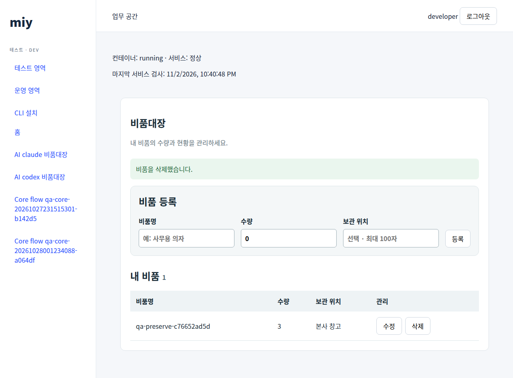
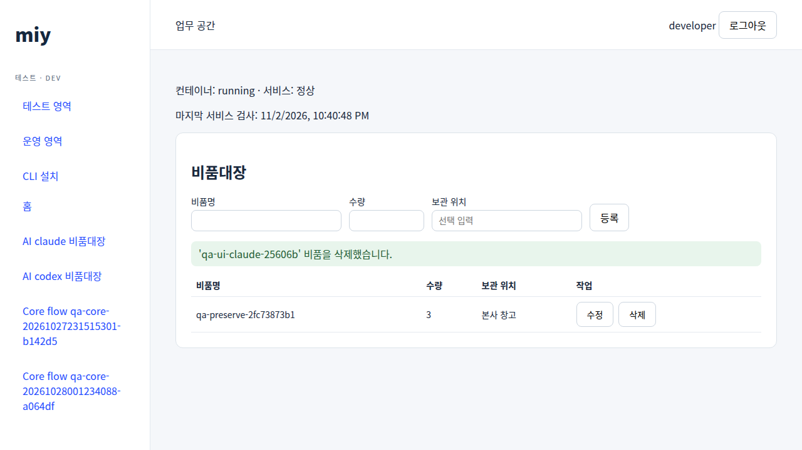

# CLI 0.6.3 독립 Codex·Claude 개발 인수

2026-11-02 Linux에서 **두 도구 모두 평가환경 보완 후 최종 인수를 통과**했다. 각자 새 앱·작업 폴더·대화에서 비품대장을 구현하고, 자신의 대화를 재개하여 보관 위치를 추가한 v2를 배포했다. 실제 원격 빌드·dev 배포, API·브라우저 CRUD, 사용자 소유권과 v1→v2 데이터 보존을 확인했다. 최초 시도 무개입 성공이나 제품 전체 V7 완료를 의미하지 않는다.

사용자가 요청한 1~3번의 결과는 다음과 같다.

| 작업 | 결과·증거 |
| --- | --- |
| 운영 소스 main 통합 | `a6fae065ed627bb63798cf74ea8a2c73a744c104` 게시. [CI 41447528061](https://github.com/hurxxxx/miy-v2/actions/runs/41447528061) 5개 job 성공. [로컬 검사·출처](releases/cli-0.6.3-main-integration.json) |
| Windows 설치기 | 구현과 [사용자 실행 안내](WINDOWS-0.6.3-ACCEPTANCE.md) 준비. 사용자 지시에 따라 실제 Windows 설치·갱신·제거는 `NOT_RUN` |
| 독립 AI 개발 | Codex·Claude 각각 v1·v2 서버 빌드·dev 배포와 최종 독립 검사 PASS. [구조화 증거](releases/cli-0.6.3-independent-agents-validation.json) |

서버·게시 CLI는 **0.6.3 / SDK 번들 0.7.1**, 배포 artifact source는 `8d7d04271f9467d8bbdd16308e73715b33e4dc0c`다. Linux 게시 CLI SHA-256은 `86d0d6294eb751ab88e7d7ed1d6925c0a477b4e71686e1cb087f17f5026bbf54`다. main 통합·문서 추가를 서버 재배포로 기록하지 않는다.

## 실제 개발 결과

| 항목 | Codex | Claude Code |
| --- | --- | --- |
| 도구 버전 | 0.166.0 | 2.1.316 |
| 로그에서 확인한 모델 | `gpt-6.1-sol` | `claude-opus-5-5` |
| 앱 | `qa-ai-codex-mvz9422x` | `qa-ai-claude-mvz9422x` |
| v1 source | `e4818942bc35d3311e603a73af710ee1245a5b17` | `db21393e2f1f72f7ef840c3da9979578e1211aa4` |
| v2 source | `7b78ac06fc0893e39a39ab804b3019cb1fee1a4b` | `5e3d3608f24e06bbfcb272b5a4e9b380eadd1c61` |
| v2 원격 build | `1608733f-6b12-4a60-831e-f9f0cd9121e2` | `2d0fa043-e920-4af2-a4bf-d99681521a70` |
| v2 deploy job | `42f0b915-aaaa-439d-9e03-47e5c27c2506` | `9eca2975-5e25-4c03-82ba-e60175bd597f` |
| v2 release | `99663bc6-669a-471d-b8e9-08fc0ca0215f` | `ccd6ea3e-3b99-4e2b-96a2-7110a22a5338` |
| 동일 DB·installation UUID | `9dbde4bf-23e1-4625-ad90-2829ad554359` | `f0ddc8fd-0ad9-4766-9032-f745c854ffca` |
| 업무 단위 검사 v1→v2 | 4→7개 통과 | 7→10개 통과 |
| 업무 소스 원본 | [Codex 예제](../examples/ai-assets-codex/README.md) | [Claude 예제](../examples/ai-assets-claude/README.md) |

[Codex 앱](https://v2.dwdcc.kr/environments/dev/apps/qa-ai-codex-mvz9422x)과 [Claude 앱](https://v2.dwdcc.kr/environments/dev/apps/qa-ai-claude-mvz9422x)은 dev에 남겨뒀다. 검증용 developer 소유의 보존 레코드가 앱마다 하나씩 있다. 다른 사용자로 로그인하면 자기 데이터만 보이는 것이 정상이다. 보존 레코드의 UUID·이름·수량과 전체 이미지 digest는 구조화 증거에 있다.

## 검사 범위와 판정

v1은 UUID·비품명·정수 수량과 SDK Identity 소유권을 구현했다. v2는 적용된 SQL을 수정하지 않고 `0003` migration으로 선택적 보관 위치를 추가했다. 평가자는 v1에 수량 3인 보존 행을 만들고 v2에서 같은 UUID·이름·수량과 DB 식별자가 유지되는지 확인했다. 보관 위치 `본사 창고`는 v2 평가에서 추가했다.

| 확인 | 실제 범위 |
| --- | --- |
| 원격 빌드·배포 | 각 버전의 서버 build 성공, dev deploy 성공, installation running/DB ready. v2의 build·job·release·image·source와 독립 앱 Git HEAD 일치 |
| 데이터 보존 | v1→v2 동일 DB UUID·DB 이름·installation, 새 release, 기존 행의 UUID·이름·수량 유지 |
| API | 생성·조회·부분 수정·삭제, 빈 이름·음수·실수 수량·위조 owner 입력 거부와 무변경, 새 location 생성·수정 |
| 사용자 소유권 | v1은 타 사용자 목록 차단. 최종 v2는 별도 admin 사용자 목록 비어 있음 및 원본 행 PATCH/DELETE 각각 404·무변경까지 확인 |
| 브라우저 | 로그인한 실제 dev URL에서 제목·보존 행·새로고침. 최종 v2는 폼 생성→수량 수정→삭제와 각 DB 반영 확인 |
| 보호 파일 | 최종 v2에서 원래 `miy.bundle.json` hash와 보호 파일별 hash 일치, 추적 소스가 앱 commit과 일치 |
| 정리·기존 서비스 | 이번 CLI·플랫폼 브라우저 세션 철회, 로그아웃 후 `/me` 401. 프록시·소켓 종료 및 복사한 provider OAuth 파일 제거. 기존 서비스 PID·시작·재시작 횟수·바이너리, 기존23개 running 컨테이너와 기존5개 installation의 배포 상태 보존 |

기존 앱 전체 데이터 내용이나 모든 설정 파일을 포괄 비교한 것은 아니다. 새 앱 두 개와 build·release·job은 의도적으로 추가되었으므로 전체 앱·작업 건수 불변을 주장하지 않는다. 검증용 두 dev 컨테이너만 추가되었다.

## 독립성, MCP와 수동 개입

각 도구에는 새 격리 HOME·대화·앱 폴더와 제공된 SDK/지침/MCP/CLI를 전달했다. 일반 OIDC developer 계정의 dev 권한을 사용했으며, 평가자가 앱 등록과 관리자 승인을 준비했다. 플랫폼 소스·실제 MIY 토큰·관리자 자격증명·Docker 소켓은 개발 AI에 제공하지 않았다. 네트워크 namespace와 Unix 소켓 프록시로 지정 앱의 dev 작업을 제한했다. 두 프록시의 경계16개 확인은 허용4건과 GET/POST/CONNECT 거부 각4건이다. 원래 결과의 거부 case가 모두 `scope_denial`로 익명화되어 있어 이 기록만으로 개별 차단 경로를 재구성하지 않는다.

기존 provider 로그인을 복사한 새 프로필을 사용했다. 이는 별도 OAuth 로그인이나 별도 공급자 계정이라는 뜻이 아니다. 원본 사용자 설정·이전 대화·플러그인은 가져오지 않았고, 실행 모델을 별도로 지정하지 않았다. 완료 후 인증 사본만 지우고 provider 전체 로그아웃은 실행하지 않았다.

- 첫 시도는 프록시의 업로드 본문 짧은 읽기, 컴파일러 `cc` 별칭 누락과 Codex 신뢰 설정 때문에 배포를 완료하지 못했다. 실패 기록을 보존하고 평가환경을 수정한 뒤 각 도구의 원래 대화를 재개했다. 평가자가 앱 업무 코드·SDK를 작성하거나 복구하지 않았다.
- Codex의 초기 네이티브 MCP 일부는 `context_not_found`, 이후에는 프록시 환경변수 누락으로 실패했다. 초기 직접 stdio 호출과 네이티브 호출을 구분했다. 격리용 기본 context와 MCP 환경변수 전달을 수정한 뒤 읽기 전용 대화 재개에서 `get_contract`, `search_api`, `list_components`, `get_cli_help` 네 가지가 모두 유효 JSON으로 완료됐다. 이전 네이티브 실패9건도 증거에 남겼다. 환경변수 전달은 [공식 MCP의 env_vars 설정](https://learn.chatgpt.com/docs/extend/mcp)에 따른다.
- Claude는 네이티브 MCP를 사용했다. 전체 계약119,525자는 클라이언트 인라인 출력 한도를 넘어 `tool-results` 파일에 저장되었다. 평가자가 이 파일의 JSON·버전을 확인했으며, 인라인 전체 전달 성공으로 표시하지 않는다. 계약 요약·섹션 조회는 [보류 중인 사용성 개선](PLAN.md#보류-중인-사용성-개선)에 기록했다.
- 평가기 자체의 동시 결과 저장, 사용자 경계 검사 위치, 행 내부/상단 폼과 접근성 버튼 이름 선택도 보완했다. 최종 v2는 두 UI 모두 실제 브라우저 CRUD를 재실행했다. 이전 v1 결과의 범위를 v2 검사로 소급 확대하지 않았다.
- 이후 리뷰에서 프록시 refresh 동시성과 준비 중 실패한 세션 추적·오래된 PASS 재사용을 보완했다. 최종 프록시 회귀6개와 실패 재평가의 PASS 대체 검사를 수행했다. 이 마지막 보완 뒤 AI 개발·배포를 새로 반복하지는 않았다.

원시 대화·도구 결과·비밀 설정은 Git에서 제외한 `.local/evidence/independent-agents-20261102`에 보관한다. 공개 증거에는 허용한 식별자·hash·검사 결과만 포함한다. phase별 평가기 hash, 최종 도구 hash, 실행 종료·시간·로그 hash와 실제 개입을 구분한다. v1 평가기는 별도 원본 snapshot hash로 관리하며 v2의 실행 평가기 hash와 같지 않다.

## 재사용 도구와 남은 검사

- [`run-agent-acceptance.mjs`](../scripts/run-agent-acceptance.mjs): 새 앱·일반 OIDC/device 인증 준비, 버전별 API/DB/브라우저 평가, 이번 MIY 세션 정리. `prepare`, `evaluate-v1`, `evaluate-v2`, `cleanup`을 제공한다. `cleanup`의 PASS는 앱 보고서와 MIY 세션 정리 범위이며 provider 사본·프록시 종료 확인 및 실제 네이티브 도구 로그 검토를 대신하지 않는다.
- [`agent-acceptance-sandbox.py`](../scripts/agent-acceptance-sandbox.py): Linux bubblewrap 격리·새 프로필·프록시 연결·실행 제한시간·비공개 로그. `--check`는 실제 namespace·직접 TCP 차단·컴파일러·MCP 등록을 검사한다. provider CLI와 기존 정상 로그인, 생성 앱·synthetic MIY context·실행 중 프록시가 필요하다.
- [`agent-acceptance-proxy.py`](../scripts/agent-acceptance-proxy.py): 평가자만 읽을 수 있는 실제 developer 토큰을 upstream에 적용한다. 비밀 파일과 소켓은 앱 밖에 두며 모델 종료→프록시 종료→최신 refresh token 철회→인증 사본 제거 순서로 정리한다.
- [`test-agent-acceptance-proxy.py`](../scripts/test-agent-acceptance-proxy.py): 외부 서비스 없이 프록시 회귀6개를 실행한다. `python3 -B scripts/test-agent-acceptance-proxy.py`.

이 도구는 실제 서버에 앱·DB·빌드·배포를 만드는 인수용이다. 기존 앱을 대상으로 실행하지 않고 항상 새 출력 폴더와 앱 ID를 사용한다. 원래 계정 전체 세션을 철회하는 이전 검사기로 정리를 대신하지 않는다.

이번 독립 실행의 네이티브 로컬 `app dev`, 로컬→dev 데이터 보존, prod 승격·prod DB 분리, 재시작·백업/복원·새 플랫폼 설치, 도구/OS별 독립3회 반복은 `NOT_RUN`이다. Windows 실제 설치·갱신·제거는 사용자가 [별도 절차](WINDOWS-0.6.3-ACCEPTANCE.md)로 수행한 뒤 결과를 전달하면 갱신한다.
