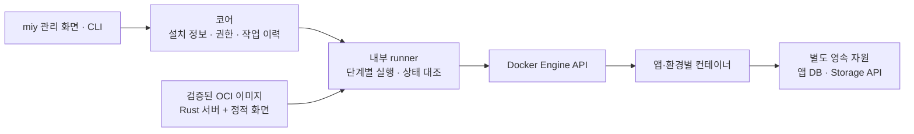

# miy 유사 프로젝트 비교

조사 기준일: 2026-10-20  
AI 세션 조사 보완: 2026-10-21  
풀스택 앱 실행 방식 조사 보완: 2026-10-21  
런타임 앱 설치·업데이트 조사 보완: 2026-10-21  
상태: 제품 기획 참고 자료

## 비교 결론

miy의 목표는 로컬 개발 에이전트가 만든 앱을 기업 환경에 배포하고, 인증·데이터·운영 권한과 내부 AI 활용을 함께 관리하는 것이다.

Paperclip은 에이전트 업무·예산 관리, Windmill은 CLI 기반 앱 개발과 관리형 업무 기능 실행, Coolify는 앱·DB·서버 운영 측면에서 참고 가치가 크다. 이들의 기능을 바탕으로, miy는 기업의 앱·데이터·운영 권한을 통합하는 방향을 택한다.

앱 설치·업데이트 구조는 Cloudron의 manifest·관리형 자원 연결과 Synology의 패키지 수명주기를 우선 참고한다. 초기 실행 기반은 Docker Engine으로 좁히고, miy가 설치 정보·권한·DB 변경·복구·관리 화면을 담당하는 방향을 추천한다. 근거와 대안은 [런타임 앱 설치와 업데이트 기술 비교](#런타임-앱-설치와-업데이트-기술-비교)에 정리한다.

Windmill에서는 프로젝트 생성·개발 지침·타입·의존성 관리·배포 흐름을 차용한다. miy는 공통 UI·데이터 계약 안에서 자유롭게 개발하고, 로컬 앱 실행과 플랫폼 개발 영역 평가를 모두 제공한다. 구체적인 사용자 흐름은 [개발 계획](DEVELOPMENT.md)에 정리한다.

아래의 기능 설명은 연결된 공식 문서·저장소를 기준으로 하며, 차용 방향은 miy를 위한 설계 판단이다. 제품 범위와 요구사항은 [PRD](PRD.md)에서 관리한다.

## 프로젝트 비교

| 프로젝트 | 확인한 주요 기능 | 차용할 개념 | miy 적용 방향 |
| --- | --- | --- | --- |
| [Paperclip](https://github.com/paperclipai/paperclip) | 다양한 에이전트 연결, 업무·목표 관리, 예산, 실행 이력 | 실행 책임자 추적, 예산 제한, 작업별 이력 | AI 운영 정책에 참고. 에이전트 조직도와 자율 회사 운영은 후속 범위 |
| [Windmill 앱 CLI](https://www.windmill.dev/docs/full_code_apps/cli_workflow) | 프로젝트 생성, 로컬 화면 개발·원격 백엔드 실행, 타입·에이전트 지침 생성과 배포 | CLI로 시작하여 플랫폼에서 검증·운영하는 경험 | CLI·SDK·UI 자산·계약 검사를 제공하고 완전한 로컬 앱 실행 경로도 설계 |
| [Windmill MCP](https://www.windmill.dev/docs/core_concepts/mcp) | 외부 에이전트에 작업·리소스 기능 제공, 토큰별 도구 범위 설정 | 배포 앱의 기능을 권한에 따라 에이전트에 공개 | 앱 API와 AI 도구를 같은 기능 계약으로 연결 |
| [Coolify](https://coolify.io/docs/core/what-is-coolify) | 서버의 앱·DB·서비스 배포, HTTPS, 상태 확인 | 설치부터 배포·장애 진단까지 이어지는 운영 화면 | 단일 서버에서 시작하는 인프라 운영 경험에 참고 |
| [Backstage](https://backstage.io/docs/features/software-catalog/) | 소스 메타데이터를 이용한 소프트웨어 카탈로그, 소유자 관리 | 앱의 담당자·저장소·API·운영 상태를 연결하는 카탈로그 | 전담 플랫폼팀 없이 사용할 수 있는 기본 구성 제공 |
| [Supabase Storage](https://supabase.com/docs/guides/storage/security/access-control) | PostgreSQL RLS와 연계한 파일 접근 정책 | 인증 주체와 데이터·파일 접근 정책의 연결 | 클라이언트용 데이터·스토리지 API와 SDK 설계에 참고 |
| [Gitea](https://docs.gitea.com/) | 자체 Git 호스팅과 개발 협업 기능 | 외부 계정 없이 시작하는 소스 관리 | 내장 Git 구성 요소로 활용하는 방향을 기본 제안 |
| [Hermes Agent](https://github.com/NousResearch/hermes-agent) | 에이전트 실행, 도구 사용, 대화·메모리, MCP 연동 | 내장 업무 챗봇의 모델·도구 실행 루프 | miy 설치 내부의 백엔드 엔진으로 통합하고 기업 권한·데이터 정책은 miy가 집행 |

## 차용할 주요 설계

### 개발 맥락과 배포 경험

Windmill은 `wmill app new`로 프로젝트를 만들고 `wmill app dev`로 화면을 개발한다. 개발 중 백엔드 함수는 연결된 Windmill 워커에서 실행한다. CLI는 호출 타입, 에이전트용 지침·데이터 설명과 의존성 잠금 파일 생성을 지원한다. [Windmill CLI 개발 흐름](https://www.windmill.dev/docs/full_code_apps/cli_workflow)

`wmill sync push`는 앱 메타데이터를 읽어 화면을 번들링하고 백엔드 함수를 업로드한다. 소스를 API로 제출하여 워커에서 빌드하는 경로와 앱 버전 관리도 제공한다. [Windmill 배포](https://www.windmill.dev/docs/full_code_apps/deployment)

| 차용할 개념 | miy에서 적용할 내용 |
| --- | --- |
| CLI 프로젝트 생성 | manifest, SDK·UI 자산, 인증·데이터 예제, 테스트 데이터와 지침을 함께 생성 |
| 자유로운 코드 개발 | 필수 UI·데이터·공개 기능 계약을 지키면서 화면·업무 로직을 확장 |
| 개발 맥락 생성 | 권한이 있는 스키마·지침·생성 타입을 버전과 함께 제공하고 사용자 코드 보존 |
| 반복 평가 | 로컬 화면·백엔드·작업 실행과 플랫폼 개발 영역 미리보기를 별도 경로로 제공 |
| 버전별 배포 | 중간 작업본 스냅샷과 운영 릴리스를 구분하고 검증한 산출물을 승격 |

miy의 로컬 실행 요구에는 테스트 데이터로 앱 백엔드와 작업을 실행하는 기능도 포함한다. Windmill의 원격 워커를 이용하는 개발 방식을 그대로 로컬 실행의 정의로 삼지 않는다. 플랫폼 개발 영역에서는 실제 인증·권한·데이터 연결·앱 간 호출을 검증한다.

### 독립 앱과 관리형 실행

Windmill의 full-code 앱은 프런트엔드에서 워커의 백엔드 함수를 호출하며, 기존 스크립트·플로를 참조할 수도 있다. [Windmill 백엔드 함수](https://www.windmill.dev/docs/full_code_apps/backend_runnables)

miy에서도 앱별 소스·버전·권한·데이터 수명주기를 유지하면서 함수·작업의 실행 환경은 플랫폼이 관리하는 구조를 우선 검토한다. 독립 앱 배포가 앱마다 상시 서버를 필요로 하는 것은 아니다. 상시 연결과 특수 실행 환경이 필요한 앱은 독립 서비스 실행 프로필을 검토한다.

공유 워커만으로 앱 간 격리가 보장되지는 않는다. Windmill 문서는 작업 격리가 기본 비활성 상태이며 별도 설정이 필요하다고 안내한다. miy는 필요한 실행 격리를 기본 제공하고 조건을 충족하지 못하면 실행을 거부하는 방향으로 설계한다. [Windmill 실행 격리](https://www.windmill.dev/docs/advanced/security_isolation)

관리형 실행은 앱 제작자의 운영 작업을 줄일 수 있지만 런타임·의존성·작업 상태·재시도·자원 제한은 플랫폼의 책임이 된다. 초기 지원 프로필과 언어를 좁혀 검증하고 범용 워크플로 편집기까지 첫 출시 범위를 확대하지 않는다. 실행 엔진의 직접 도입 여부는 별도 기술 선택이다.

### 앱의 기능을 API와 AI 도구로 공개

Windmill MCP는 스크립트·플로와 플랫폼 관리 기능을 외부 클라이언트에 제공하고, 토큰과 OAuth 연결에서 공개할 기능 범위를 선택하게 한다. miy에서는 앱이 공개한 업무 기능을 앱 간 호출과 Hermes 도구 호출에서 함께 사용할 수 있도록 한다. [Windmill MCP](https://www.windmill.dev/docs/core_concepts/mcp)

앱이 공개하는 기능에는 입력·출력, 필요한 권한, 변경 효과를 연결한다. 사용자를 대신하는 호출과 서비스 계정의 호출을 구분하고 실제 호출마다 현재 권한을 검사한다.

### 운영 상태와 복구

Coolify는 앱·DB·서비스의 배포와 운영을 관리하며 MCP로도 허용된 조회·수명주기 작업을 제공한다. 따라서 MCP 연결 자체만으로 miy의 차별점을 정의하지 않는다. [Coolify 소개](https://coolify.io/docs/core/what-is-coolify), [Coolify MCP](https://coolify.io/docs/mcp/what-is-mcp)

Coolify의 플랫폼 인스턴스 백업에는 앱·DB·볼륨 데이터가 포함되지 않는다. miy는 플랫폼 설정과 업무 데이터의 백업 범위를 함께 표시하고, 백업 생성과 실제 복원 검증도 구분한다. [인스턴스 백업](https://coolify.io/docs/core/backup-and-recovery/instance-backup), [DB 백업](https://coolify.io/docs/databases/backups)

### 앱 카탈로그와 담당자

Backstage는 소스와 함께 관리되는 메타데이터로 소프트웨어의 소유자와 관계를 카탈로그에 연결한다. miy의 앱 카탈로그에도 담당자, 소스, 공개 API, 설치 환경과 활성 버전을 연결한다. [Backstage 카탈로그](https://backstage.io/docs/features/software-catalog/)

manifest에 적힌 요청 권한과 실제 설치에서 승인된 권한은 분리한다. 앱을 발견하거나 목록에서 볼 수 있다는 사실이 데이터 접근 권한을 뜻하지 않게 한다.

### 소스와 산출물 보관

Gitea의 자체 Git 호스팅과 OCI 클라이언트를 지원하는 컨테이너 레지스트리를 내장 소스·산출물 관리의 기본 후보로 삼는다. 실제 통합에서는 기준 저장소, 커밋, 빌드 결과와 배포 버전의 연결을 miy가 관리한다. [Gitea 소개](https://docs.gitea.com/), [컨테이너 레지스트리](https://docs.gitea.com/usage/packages/container/)

Rust 백엔드라는 제품 제약은 외부 Git 서비스를 Rust로 재작성하는 요구로 해석하지 않는다. 최종 구성 요소와 지원 버전은 설치·업데이트·복구 비용을 비교하여 정한다.

### AI 실행 책임과 비용

Paperclip은 회사·에이전트·프로젝트의 예산과 실행 이력을 관리한다. miy에서도 사용자·앱·업무의 실행 주체와 AI 사용량을 연결하고, 설정한 한도에서 중단할 수 있게 한다. [Paperclip](https://github.com/paperclipai/paperclip)

Hermes는 miy 사이트의 내장 챗봇을 구동하는 백엔드 엔진으로 사용한다. 사용자의 질문은 miy API와 내부 디스패치를 거쳐 Hermes로 전달되고, 모델 호출·도구 실행·결과 반영 루프의 진행 상황과 답변은 miy 화면으로 돌아온다. 플랫폼이 사용자 식별과 현재 권한을 확인하고, Hermes에 제공하는 도구와 데이터 범위를 제한한다. 모델의 판단이나 대화 메모리를 권한 부여의 근거로 사용하지 않는다. 도구 연결에는 MCP를 활용할 수 있다. [Hermes MCP 연동](https://hermes-agent.nousresearch.com/docs/user-guide/features/mcp)

## 풀스택 앱 실행 방식 재검토

조사일: 2026-10-21. 아래는 기술 비교와 추천이며 실제 구현이나 성능 검증은 수행하지 않았다. 현재 [개발 계획](DEVELOPMENT.md#rust-풀스택-앱의-플러그인-구조)의 기본안은 Rust 서버와 React 정적 화면을 같은 OCI 이미지로 배포하고 앱별 컨테이너를 중지 후 교체하는 방식이다. 정적 파일의 바이너리 내장은 선택안이다.

### 개발 단위와 실행 단위를 분리

대부분의 앱을 프런트엔드·백엔드·DB 변경이 함께 있는 풀스택 프로젝트로 제공하는 것은 현재 목표에 맞는다. 그러나 한 프로젝트라는 사실이 프런트 서버와 백엔드 서버를 각각 운영하거나, 앱마다 상시 프로세스를 유지해야 한다는 뜻은 아니다.

| 결정할 대상 | miy에서 유지하거나 검토할 방향 |
| --- | --- |
| 개발 단위 | CLI가 화면, 서버, 공유 타입, DB 마이그레이션, SDK·지침을 한 프로젝트로 생성 |
| 배포 단위 | 화면·백엔드·DB 변경을 같은 릴리스로 추적하고 호환성을 검증 |
| 화면 제공 | React SPA는 정적 자산으로 빌드. 현재처럼 앱 서버에서 제공하거나 공용 자산 서버에서 앱별 origin으로 제공 가능 |
| 백엔드 실행 | 독립 Rust 서버와 작업을 앱·환경별 컨테이너로 실행 |
| 화면 통합·격리 | 신뢰한 UI 모듈의 라우터 통합을 우선 검증. 별도 브라우저 격리가 필요한 앱의 iframe·출처 경계와 구분 |
| 데이터 격리 | 실행 엔진을 공유하더라도 앱·환경별 DB 역할·비밀값·권한은 계속 분리 |

Rust 앱 서버 하나가 정적 화면과 API를 함께 제공할 수 있다. 앱별 컨테이너는 앱별 VM과 다르며 호스트 커널을 공유하는 프로세스 실행 방식이다. 비용은 컨테이너 개수나 언어만으로 판단하지 않고 실제 프로세스 메모리·의존성·DB 연결 풀·작업량을 함께 측정해야 한다. [Docker 컨테이너 설명](https://docs.docker.com/get-started/docker-concepts/the-basics/what-is-a-container/)

### 실행 기술 비교

다음 표의 기능은 공식 자료에서 확인한 내용이며, 적합성 판단은 miy의 요구사항을 기준으로 한 제안이다.

| 후보 | 실행 방식과 장점 | miy에서 확인할 제약 | 판단 |
| --- | --- | --- | --- |
| Rust + 정적 화면 + 앱별 컨테이너 | 서버와 화면을 같은 OCI 이미지로 배포. 앱·환경별 버전·수명주기·자원 제한 관리 | CPU 대상별 빌드, Rust 개발 도구·SDK 제공 필요. 유휴 자원·DB 풀은 실제 측정 필요 | 현재 첫 실행 프로필의 기본안. 중지 후 교체로 신구 서버 동시 실행을 요구하지 않음 |
| [Windmill 관리형 함수](https://www.windmill.dev/docs/full_code_apps/backend_runnables) | 앱 프로젝트의 화면이 워커의 백엔드 runnables를 호출. 업무 함수·배치 작업에 적합 | 일반 서버 코드를 함수·작업 계약에 맞춰야 함. 요청 지연·워커 대기·의존성 준비·격리를 검증해야 함 | CLI 개발 경험과 작업 실행 모델 차용. 모든 웹 API를 작업 큐로 바꾸지는 않음 |

Windmill의 작업 격리는 별도 설정이 필요하다. 앱의 DB 권한을 분리하는 것만으로 실행 프로세스의 권한·장애 경계까지 해결되지는 않는다. miy는 앱·환경별 컨테이너와 실행 정책으로 이 경계를 관리한다. [Windmill 실행 격리](https://www.windmill.dev/docs/advanced/security_isolation)

### 앱 제작 도구와 실행 엔진을 구분

Rust 템플릿은 OpenAPI 기반 TypeScript 타입 생성을 제안한다. 플랫폼이나 다른 앱에 공개할 API의 버전·권한 계약은 별도로 유지한다. CLI가 화면·서버의 빌드·미리보기·산출물을 표준화하고, 플랫폼의 실행 계층이 앱 격리와 수명주기를 관리한다.

### miy에 대한 추천과 다음 검증

하나의 풀스택 프로젝트와 릴리스 계약을 유지하고, 첫 구현은 Rust 서버와 React 정적 화면을 같은 Docker 이미지에 넣는 구성으로 좁힌다. 실행 파일과 정적 파일을 이미지 안에서 분리하면 화면만 바뀔 때 Rust 빌드 결과를 재사용할 수 있다. 바이너리 내장도 가능하지만 서버의 컨테이너 관리 단위는 같으므로 필수 조건으로 두지 않는다. React SPA에 별도의 상시 프런트 서버를 요구하지 않고, SSR이 필요한 앱은 별도 요구로 다룬다.

공유 실행 엔진을 검토하더라도 앱 백엔드 코드를 Rust 코어 서버 프로세스에 적재하지 않는다. 코어와 별도의 앱 실행 서비스로 연결하고, 앱 실행 서비스의 교체·장애가 코어의 관리·복구 기능을 중단시키지 않도록 한다. 브라우저의 UI 모듈 통합은 별도의 신뢰 경계로 다루며 [집중 검증 계획](VALIDATION.md)에서 실제 배포·라우팅을 확인한다.

중지 후 교체와 메인 플랫폼의 시작·중지·재시작·삭제를 먼저 검증한다. 무중단 배포를 첫 출시의 전제조건으로 삼지 않는다.

첫 검증은 구매 관리 예제로 수행한다. 화면, CRUD·트랜잭션, 앱별 PostgreSQL 접속, 플랫폼 SDK 인증, 파일 업로드, 배치 내보내기를 포함하고, 필요한 경우 지속 연결도 추가한다. 같은 업무 범위에서 Rust 컨테이너의 자원·개발·운영 비용을 먼저 측정하고 추가 실행 엔진의 필요성을 판단한다.

| 검증 항목 | 판단에 필요한 근거 |
| --- | --- |
| 유휴·부하 자원 | 동일 호스트에서 앱 수를 늘려 전체 메모리·CPU·DB 연결 수·디스크 사용량 측정. 엔진과 추가 격리 계층 비용 포함 |
| 응답과 시작 지연 | 평상시 응답, 처음 실행하는 요청, 유휴 종료 후 재개, 실행 큐 대기 시간 |
| 독립 업데이트 | 앱 A 교체 중 앱 B의 응답·연결 유지, 새 버전 실패 시 복구, 화면과 API 버전 불일치 방지 |
| 수명주기 관리 | 수동 중지 상태의 재부팅 후 유지, 제어 요청 직렬화, 중지한 앱의 업데이트, 삭제 후 업무 데이터 보존 |
| 오류·권한 경계 | 무한 루프·메모리 초과·금지된 파일/네트워크 접근이 다른 앱에 미치는 영향 |
| 개발·배포 경험 | 로컬과 플랫폼 실행의 차이, 의존성 호환성, DB 마이그레이션, 로그·디버깅·백업 복구 |

실험 전에는 앱당 메모리, 지원 앱 수, 절감률을 확정하지 않는다. Rust라는 이유만으로 특정 자원 절감률을 보장하지 않으며 실제 업무 앱으로 판단한 후 [기술 스택](STACK.md)과 [개발 계획](DEVELOPMENT.md)을 갱신한다.

## 런타임 앱 설치와 업데이트 기술 비교

조사일: 2026-10-21. 운영 중인 플랫폼에 앱을 추가·교체하고 시작·중지·삭제하는 기술을 비교했다. 여기서 런타임 설치는 플랫폼을 다시 빌드하지 않고 독립 앱의 설치 상태를 변경한다는 뜻이다. 실행 중인 프로세스에 코드를 동적으로 삽입하거나 무중단으로 교체해야 한다는 뜻은 아니다. 대상 앱의 일시 중단을 허용하고 코어·다른 앱의 운영을 유지하는 현재 요구에 맞춰 평가했다.

### 제품과 실행 기술의 역할

| 후보 | 공식 자료에서 확인한 방식 | miy에서 차용하거나 검토할 부분 | 초기 판단 |
| --- | --- | --- | --- |
| [Synology 패키지](https://help.synology.com/developer-guide/synology_package/scripts.html) | 패키지 설치·업그레이드 단계와 시작·중지·상태 스크립트를 호출 | 앱 목록에서 설치와 실행 상태 관리, 업데이트 단계 표시, 이전 실행 여부 유지 | 관리 경험·수명주기 참고. DSM 패키지 형식 자체는 도입하지 않음 |
| [Cloudron](https://docs.cloudron.io/packaging/tutorial/) | Docker 앱에 manifest·포트·addon 요구사항을 선언하고 CLI로 설치·업데이트. 코드와 영속 데이터를 분리 | miy manifest, 앱별 자원 준비, 연결 정보 주입, 업데이트와 백업 연계 | 현재 목표에 가장 가까운 패키지 관리 모델로 우선 참고 |
| [Coolify](https://coolify.io/docs/applications/) | Git·Dockerfile·기존 이미지·Compose로 서버에 앱 컨테이너 배포 | 배포 진행·로그·도메인·환경 설정·상태 확인을 연결하는 운영 화면 | 운영 UX 참고. 전체 제품을 miy 내부 엔진으로 채택하지 않음 |
| [Dokku](https://dokku.com/docs/processes/process-management/) | 앱별 컨테이너의 시작·중지·재시작·규모와 재부팅 후 실행 복원 관리 | 앱·환경별 제어 명령, 실제 실행 상태 조회, 서버 재시작 후 복원 | 단일 서버의 CLI·서비스 관리 모델 참고 |
| [YunoHost](https://doc.yunohost.org/en/dev/packaging/structure/) | Git 패키지의 manifest·설정 템플릿과 설치·업데이트·백업·복원 스크립트 | 패키지에 운영 계약·설명·복구 절차까지 포함 | 참고 대상. 외부 앱이 임의 호스트 설치 스크립트를 실행하는 계약은 채택하지 않음 |
| [Docker Engine API](https://docs.docker.com/reference/api/engine/)·[Compose](https://docs.docker.com/reference/cli/docker/compose/up/) | Engine의 HTTP API로 컨테이너 제어. Compose는 설정·이미지 변경 시 기존 컨테이너를 중지·재생성하고 마운트 볼륨 유지 | 내부 runner가 제한된 실행 명령을 Engine API로 수행 | 초기 실행 기반 추천. 앱 권한·DB 변경·복구 정책은 miy가 관리 |
| [Podman Quadlet](https://docs.podman.io/en/latest/markdown/podman-systemd.unit.5.html) | 컨테이너·네트워크·볼륨 선언을 systemd 서비스로 생성. 시스템·사용자 서비스 지원 | Linux 서비스 관리와 컨테이너 운영을 통합하는 대안 | Docker의 대안으로 비교하되 첫 출시에서 두 엔진을 동시 지원하지 않음 |
| [systemd 직접 실행](https://www.freedesktop.org/software/systemd/man/latest/systemd.service.html) | 실행 파일을 서비스로 감독하고 시작·종료·재시작 정책 적용 | Rust 바이너리를 직접 배포할 경우의 실행 관리자 | 가능하지만 패키지·OS 의존성·격리·버전 교체는 별도 설계 필요 |
| [Extism / WebAssembly](https://extism.org/docs/concepts/plug-in-system/) | 호스트 SDK가 Wasm 모듈을 로드하고 공개 함수를 호출. Rust PDK 제공 | 계산·검증·데이터 변환 등 함수형 확장을 별도 실행 서비스로 제공하는 후보 | 일반 Axum 서버 전체를 그대로 실행하는 대체재로 채택하지 않음 |
| [Nomad](https://developer.hashicorp.com/nomad/docs/job-declare/strategy) | 작업 정의와 상태 확인을 바탕으로 rolling·blue/green·canary 배포 지원 | 다중 서버 스케줄링이 필요해질 때 운영 범위 비교 | 현재 단일 서버·중단 허용 조건에서는 우선 도입하지 않음 |

이 표는 전부 같은 종류의 대체재를 나열한 것이 아니다. Cloudron·Coolify·Dokku·YunoHost는 운영 플랫폼이고, Docker·Podman은 실행 기반이며, systemd는 서비스 관리자, Extism은 함수 호출 형태의 플러그인 실행 도구다. miy가 다른 플랫폼을 통째로 감싸면 설치 상태·권한·업데이트 책임이 중복되므로 우선 개념과 계약을 차용하고 실행 기반만 직접 통합하는 방향을 추천한다.

컨테이너 밖의 대안은 Rust 바이너리의 systemd 직접 실행과 Wasm 함수 실행으로 구분한다. 전자는 버전별 디렉터리에 산출물을 준비하고 서비스 중지 후 실행 경로를 바꾸는 구성을 설계할 수 있지만 배포 트랜잭션·데이터 복구를 systemd가 대신하지 않는다. 후자는 함수 모듈을 로드하는 호스트가 필요하고, DB·파일 등 필요한 기능을 허용된 Host Function·런타임 API로 연결해야 한다. Extism의 manifest는 메모리·HTTP 대상·파일 경로 범위도 설정한다. miy에 적용한다면 코어와 분리된 실행 서비스에서 작은 업무 함수를 지원하는 후속 안으로 검증한다. 현재 Rust·Axum·SQLx 앱을 수정 없이 Wasm 플러그인으로 옮길 수 있다고 가정하지 않는다. [Extism Host Functions](https://extism.org/docs/concepts/host-functions/), [Extism manifest](https://extism.org/docs/concepts/manifest/)

### Synology와 Cloudron에서 가져올 계약

Synology의 `.spk`는 설치 메타데이터, 실행 파일·화면을 담은 `package.tgz`, 수명주기 스크립트 등을 묶는다. 일반 패키지가 모두 Docker 컨테이너인 것은 아니다. 컨테이너 기반 패키지는 Docker worker에 자원을 선언해 설치 때 Compose 구성을 생성하고 시작·중지 때 컨테이너 제어를 위임할 수도 있다. miy도 앱 등록·메뉴·설치 상태와 실제 컨테이너 실행을 분리하는 개념을 참고할 수 있다. [패키지 구성](https://help.synology.com/developer-guide/synology_package/introduction.html), [Docker worker](https://help.synology.com/developer-guide/resource_acquisition/docker.html)

Cloudron의 addon은 앱이 필요한 DB·인증·메일·캐시를 선언하면 플랫폼이 준비하고 연결 정보를 제공하는 구조다. 공용 서비스의 앱별 접근을 분리한다. miy는 이를 앱별 논리 DB·Storage API·데이터 연결에 대응시키며, 하나의 앱에 PostgreSQL 서버 전체를 내장하지 않는다. 앱은 자기 DB만 직접 접근하고 공통·타 앱 데이터는 SDK/API를 거치는 기존 경계를 유지한다. [Cloudron addons](https://docs.cloudron.io/packaging/addons/)

| 계약 | miy에 적용할 제안 |
| --- | --- |
| 배포 패키지 | manifest + 불변 OCI 이미지 digest + 공개 기능·DB 마이그레이션 + 검증 기록 |
| 설치 정보 | 고객사·앱·환경, 대상/활성 버전, 목표/실제 상태, 실제 부여 권한과 자원 연결 |
| 수명주기 | 설치·시작·중지·재시작·업데이트·복구·삭제를 플랫폼의 공통 작업으로 정의 |
| 변경 실행 | DB 변경은 해당 이미지의 제한된 migration 명령으로 수행. 외부 앱에 임의 호스트 스크립트 권한을 주지 않음 |
| 영속 자원 | 코드와 DB·업무 파일·환경별 비밀값 분리. 이미지 교체 후 데이터 유지 |
| 복구 | 이전 이미지 재실행 가능 여부와 DB·파일 복원 필요 여부를 따로 기록 |

### miy의 추천 구성과 업데이트 흐름

최초 설치는 계약·권한·자원 확인 → 이미지 확보 → 앱 DB·연결 준비 → 초기 migration → 컨테이너 시작 → 정상 확인 → 메뉴·접근 활성화로 구성한다. 업데이트는 아래 순서를 기본으로 한다.

1. 앱·환경별 작업 잠금을 확보하고 승인된 대상 digest, 호환성, 자원·디스크와 복구 계획을 검사한다. 이미지 확보·빌드는 서비스 중지 전에 완료한다.
2. 대상 앱만 점검 상태로 전환한다. 신규 요청·예약 작업을 차단하고 진행 중 쓰기·작업을 정리한 후 기존 컨테이너를 중지한다.
3. 변경 위험에 맞는 DB·파일 복구 지점을 확보·확인한다. 쓰기 중지 후 일관된 상태를 확보하고, migration은 지정 앱 DB의 제한된 계정으로 실행한다.
4. 새 컨테이너를 시작해 정상 상태를 확인한다. 성공하면 활성 버전 기록과 라우팅·작업 허용을 갱신한다.
5. 실패하면 이전 이미지와 현재 DB의 호환성을 확인한다. 호환되면 이전 버전을 시작하고, 그렇지 않으면 앱을 복구 필요 상태로 두고 명시적 데이터 복구 절차를 수행한다.

원래 중지한 앱은 업데이트 후에도 중지 상태를 유지한다. DB 변경에 필요한 일회성 작업만 실행하며 앱 서버와 예약 작업을 자동으로 켜지 않는다. 앱 삭제와 데이터 영구 삭제를 구분하고, 일반 삭제는 업무 데이터를 기본 보존한다. 상세 상태·권한·실패 처리는 [개발 계획의 운영 계약](DEVELOPMENT.md#메인-플랫폼의-앱-운영-화면과-제어-계약)에 따른다.

Podman auto-update는 이미지 변경을 감지해 systemd 서비스를 재시작하고 시작 실패 시 이전 이미지로 되돌리는 기능을 제공한다. 그러나 준비 완료 신호가 없으면 실패 감지가 불충분할 수 있고, 이미지 복구는 업무 DB 복구를 뜻하지 않는다. miy는 변경 가능한 `latest` 태그 추적을 기본 배포 정책으로 사용하지 않고, 검증된 digest의 승격·명시적 업데이트 작업을 기준으로 삼는다. [Podman auto-update와 rollback](https://docs.podman.io/en/latest/markdown/podman-auto-update.1.html)

초기에는 Docker Engine API 어댑터 하나만 구현하고 Compose는 코어 설치·로컬 개발 등 묶음 서비스 구성이 필요한 범위에서 검토한다. 외부 앱의 임의 Compose 파일을 운영 권한으로 그대로 실행하지 않는다. 컨테이너 시작 명령만 감싸는 데서 끝내지 않고, 저장된 목표 상태·작업 이력과 실제 실행 상태의 대조, 수동 중지 보존, 업데이트 재개·복구를 검증한다. Nomad·Kubernetes와 복수 런타임 지원은 다중 서버 요구가 생기면 다시 판단한다.

다음 설계 검증에서는 최초 설치, 실행 중 업데이트, 중지 상태 업데이트, migration 실패, 새 버전 정상 확인 실패, runner·호스트 재시작, 데이터 보존 삭제를 같은 예제로 확인한다. 실제 엔진 도입·성능 측정은 아직 수행하지 않았다.

## 표준 프로토콜 참고

MCP는 Resources, Prompts, Tools를 구분한다. miy는 개발 맥락 제공과 작업 실행을 이 구분에 맞추며, 앱 배포 패키지와 플랫폼 API의 계약은 별도로 정의한다. [MCP 명세](https://modelcontextprotocol.io/specification/2026-07-28)

연결 대상별 지원 기능과 인증 방식은 실제 지원 버전을 기준으로 검증한다. Hermes는 원격 HTTP·로컬 stdio MCP와 리소스·프롬프트 접근을 문서화하고, 현재 Pi도 stdio·Streamable HTTP 및 MCP 인증을 문서화하고 있다. [Hermes MCP](https://hermes-agent.nousresearch.com/docs/user-guide/features/mcp), [Pi MCP](https://pi.dev/docs/latest/mcp)

특정 클라이언트의 연결 문서가 존재한다는 사실을 miy와의 통합 검증 완료로 표시하지 않는다.

### 개발 자산 제공에서 MCP와 CLI의 역할

MCP Resources는 문서·스키마 등 개발 맥락을 제공하고, 어떤 자료를 모델에 포함할지는 클라이언트가 결정한다. Prompts는 사용자가 선택해 호출하는 안내 템플릿이며, Tools는 검색·조회·서버 기능 호출에 사용할 수 있다. MCP 연결 자체가 모든 지침의 자동 적용이나 로컬 프로젝트 생성을 보장하지는 않는다. [MCP Resources](https://modelcontextprotocol.io/specification/2026-07-28/server/resources), [MCP 서버 구성](https://modelcontextprotocol.io/docs/2026-07-28/learn/server-concepts)

miy에는 HTTP API·버전이 있는 개발 자산을 공통 기준으로 두고, CLI가 지침·SDK·UI를 포함한 프로젝트를 준비하며 MCP가 공개 API 전체의 검색·사용법·권한 있는 실행을 제공하는 조합을 추천한다. 이는 로컬 개발, 사람·CI 자동화와 여러 개발 에이전트를 함께 지원하기 위한 설계 판단이다. MCP 지원은 유지하되 기본 개발 흐름의 필수 연결로 만들지 않는다.

Gitea의 npm Package Registry는 scope 패키지의 게시·설치를 지원하므로 SDK·UI의 사내 배포 후보로 활용할 수 있다. CLI가 설치 대상의 호환 버전을 고르고 패키지 인증을 연결하는 기능은 miy에서 구현해야 한다. 외부 npm 의존성의 자동 미러링까지 제공한다고 해석하지 않는다. [Gitea npm Registry](https://docs.gitea.com/usage/packages/npm/)

제공 자산, 버전 고정, MCP API 정보와 갱신 정책은 [개발 자산 제공 계획](DEVELOPMENT.md#개발-자산-제공과-mcp의-역할)에 정리한다.

## 기존 miy에서 참고할 계약

기존 프로젝트는 새 요구사항을 검토하는 참고 자료다. 아래 계약을 새 프로젝트에 그대로 적용하거나 기존 기능 전체를 이전하는 것으로 취급하지 않는다.

| 참고 자료 | 활용할 내용 | 후속 설계에서 구분할 점 |
| --- | --- | --- |
| [앱 플랫폼 계약](../../miy/dev/docs/domains/app-platform/README.md) | 회사·사용자·그룹·앱 접근, 별도 출처의 앱 실행 | 기존 내장 앱의 공통 배포 구조와 신규 독립 앱 목표 |
| [독립 앱 계약](../../miy/dev/apps/api/src/miy_api/domains/independent_apps/README.md) | manifest, release, installation, 앱 세션과 배포 상태 | 기존 구현의 지원 프로필과 miy-v2의 웹앱·API·작업 실행 범위 |
| [앱 SDK](../../miy/dev/packages/app-sdk/README.md) | 앱 실행 연결과 인증·데이터 접근 계약 | 새 API·언어·패키지 버전에 맞춘 SDK 설계 |
| [독립 앱 템플릿](../../miy/dev/templates/independent-app/README.md) | 플랫폼과 분리된 앱 소스와 개발 안내 | 기존 템플릿의 기술 스택을 새 앱 전체에 강제하지 않음 |
| [원본 데이터 접근 계약](../../miy/dev/docs/domains/source-access/README.md) | 검색·RAG·직접 조회의 현재 권한 확인 | 신규 앱·커넥터에도 같은 경계가 적용되는지 검증 |
| [Hermes 계약](../../miy/dev/docs/domains/ai/hermes.md) | 실행 주체, 도구 권한, 모델 정책과 격리 | 기존 서비스·설정·버전을 그대로 도입하지 않고 새 구조에 맞춰 검토 |

### 기존 miy에서 확인한 내장 챗봇 경로

2026-10-20 로컬 `../miy/dev`의 문서와 소스에서 다음 흐름을 확인했다.

| 구간 | 확인한 구현 |
| --- | --- |
| 사이트 챗봇 → miy API | [챗봇 어댑터](../../miy/dev/packages/platform-web/src/chatbot/api/chatbot-api.ts)의 `startHermesRun`이 세션과 실행을 만들고, [API 클라이언트](../../miy/dev/packages/platform-web/src/ai/hermes-agent-api.ts)가 `/api/v1/agent` 경로를 사용 |
| 실행 등록 → 내부 디스패치 | [실행 라우터](../../miy/dev/apps/api/src/miy_api/domains/hermes/router.py)의 `create_run`이 소유 대화·모델 정책을 확인하고 실행을 저장한 뒤 디스패치를 발행 |
| 워커 → Hermes 런타임 | [워커](../../miy/dev/apps/worker/src/miy_worker/tasks/hermes.py)가 `execute_hermes_run`을 호출하고, [런타임 클라이언트](../../miy/dev/apps/api/src/miy_api/domains/hermes/client.py)가 내부 Hermes의 `/v1/runs`를 사용 |
| 도구 반복 실행과 결과 반환 | [Hermes 계약](../../miy/dev/docs/domains/ai/hermes.md)은 모델 호출·추론·도구 반복 실행을 Hermes 책임으로 명시하며, 브라우저는 miy의 재연결 가능한 SSE 이벤트와 실행 결과를 소비 |

이 구조에서 차용할 것은 **사이트 내장 챗봇 → miy 대화·실행 관리 → 내부 Hermes 루프 → 통제된 도구 호출 → 사이트 응답**의 책임 구분이다. 기존 Python API·워커 구현, 큐 제품, 런타임 버전과 경로를 miy-v2의 기술 선택으로 그대로 확정하지 않는다. 앱 작업 큐는 업무 작업을 실행하고, Hermes 루프는 대화 중 다음 모델·도구 호출을 결정한다.

### 구독 연결과 사용자별 세션에서 참고할 기존 구현

2026-10-20 `../miy/dev`에서 확인한 범위에서는 **구독 인증을 쓰는 Workbench와 제품 내장 Hermes가 별도 실행 경로**다. v2의 구독 AI 기본 연결은 기존 구현을 그대로 켜는 작업이 아니라 두 경로의 유용한 계약을 참고하여 새로 설계할 부분이다.

| 확인한 근거 | 실제 구현과 v2에 참고할 내용 |
| --- | --- |
| [Workbench 실행 경계](../../miy/dev/docs/apps/codex-console/README.md#실행-경계) | 소유자 한 명의 ChatGPT 구독으로 공식 `codex app-server`를 사용하는 별도 클라이언트. 제품 AI workload의 공용 공급자가 아니며 현재 서버 사용자의 인증 저장소를 사용 |
| [Codex 런타임](../../miy/dev/apps/codex-console-api/src/codex_console/runtime.py) | `account/read`로 ChatGPT 인증 상태를 확인하고 `account/rateLimits/read`, `model/list`, `thread/start`·`thread/resume` 사용. 공식 프로토콜·계정 상태·대화 재개 처리 참고 |
| [Hermes 모델](../../miy/dev/apps/api/src/miy_api/domains/hermes/models.py) | `HermesProfileBinding`은 사용자·route에 귀속되고 `HermesSessionBinding`은 사용자·profile·Hermes 세션을 연결. 사용자별 세션 소유 관계 참고 |
| [Hermes 실행](../../miy/dev/apps/api/src/miy_api/domains/hermes/execution.py)과 [실행 계약](../../miy/dev/docs/domains/ai/hermes.md) | 실행 소유자의 앱 권한 재검사, 실행 lease·동시 실행 제어, 대화별 순서와 재연결·중복 실행 방지 참고 |
| [제품 AI gateway](../../miy/dev/docs/domains/ai/gateway.md) | 등록 workload와 관리자가 지정한 API·사내 모델 연결을 사용. 이 경로에 다중 사용자 Codex·Claude Code 구독 연결이 이미 구현되었다고 해석하지 않음 |

v2에서는 관리자가 설정하는 공통 AI 연결과 사용자별 독립 세션을 설계한다. 직원별 공급자 로그인은 요구하지 않는다. 기존 Codex 런타임의 thread 시작·재개와 Hermes의 사용자별 소유 관계를 참고하여, 공통 연결 아래의 대화·이벤트·도구 권한을 분리한다. 사용자별 취소·로그아웃과 공통 인증 갱신·해제·한도 초과의 영향을 구분한다. 위에서 조사한 Hermes·Workbench 경로에서는 Claude Code 구독을 내장 Hermes의 모델 백엔드로 연결한 구현을 확인하지 못했다.

2026-10-21 공식 문서에서 Codex의 `thread/start`·`thread/resume`, `turn/start`·`turn/interrupt`, thread·turn·item 이벤트와 공통 계정 상태 조회를 확인했다. miy 사용자마다 별도 대화를 매핑하고 이벤트와 도구 권한을 집행하는 설계의 근거로 사용한다. thread 기능 자체가 파일·메모리·사용자 권한까지 격리하는 것은 아니므로 이 부분은 miy가 구현·검증한다. [Codex App Server](https://learn.chatgpt.com/docs/app-server)

공통 연결에 사용할 계정·요금제와 공급자별 허용 범위는 별도 검토한다. OpenAI는 조직 자동화용 서비스 계정을 사용량 기반 요금제에 제공하며, ChatGPT plan usage와 Claude Code에도 각각 적용 조건이 있다. 이러한 검토가 제품 요구사항을 직원별 개인 구독 연결로 바꾸는 것은 아니다. [OpenAI 서비스 계정](https://learn.chatgpt.com/docs/enterprise/service-accounts), [ChatGPT plan usage](https://developers.openai.com/siwc/token-sharing-open-source), [Claude Code 호스팅·인증 조건](https://code.claude.com/docs/en/legal-and-compliance)

지원 후보·제약과 공통 연결·사용자별 독립 세션 계약의 기준 문서는 [내부 AI 계획](AI.md)이다.

## 도입 판단 원칙

Paperclip·Windmill·Coolify·Backstage·Supabase는 기능과 운영 개념의 비교 대상으로 사용한다. 플랫폼 전체를 이들 중 하나의 포크나 단순 조합으로 확정하지 않는다.

Hermes는 요구된 챗봇 엔진으로 통합하고, Gitea는 내장 Git의 기본 후보로 검토한다. 직접 도입할 구성 요소는 후속 기술 설계에서 라이선스, 필요한 기능의 제공 범위, 지원 버전, 자원 사용량과 업데이트·복구 절차를 확인한다.
