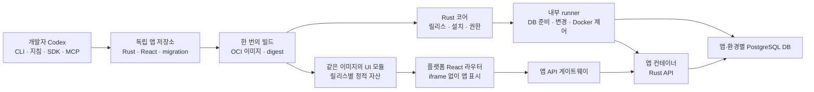

# miy 핵심 개발 배포 흐름 검증 계획

작성일: 2026-10-21  
기준: PRD 0.5  
상태: V0~V1 통과 · V2~V6 로컬 추가 실증 · 정식 V2~V7 전체 인수 미완료

2026-10-22 보충: 사용자 지정 과제인 휴가 관리 대장으로 CLI·실제 Codex·로컬 Docker·앱 DB·UI/API·기본 제어를 연결한 [추가 실증](LEAVE-LEDGER-RESULTS.md)을 완료했다. 아래 정식 V2~V7의 원격 서버·운영 승격·파일/타 앱 연결·장애 복구·독립 3회 반복은 완료하지 않았으므로 전체 단계 판정과 구분한다.

같은 날 bundle 0.3.0으로 [개발·등록·배포 과정 재검증](IMPLEMENTATION-RESULTS.md#개발등록배포-과정-재검증-bundle-030)을 수행했다. CLI 등록 신청·관리자 승인·권한 부여, 고정 번들로 실제 Codex v1/v2 개발, 스키마 변경 배포, migration 실패 롤백과 새 릴리스 전진 복구를 로컬에서 통과했다. 템플릿 생성 3회와 전체 개발 경로 3회는 구분하며, 정식 CLI OAuth·원격 전송·백업 복원과 전체 독립 반복은 남아 있다.

**최소 플랫폼을 준비한 뒤, Codex가 CLI·개발 하네스·MCP로 Rust·React 앱을 만들고 하나의 이미지로 배포하여 플랫폼 라우터에서 실행하는 전체 흐름을 검증한다.** 앱 전용 DB 생성·변경·보존과 실패 복구도 같은 흐름에 포함한다. 제품 전체 구현에 앞서 이 경로가 성립하는지 판단하는 것이 목적이다.

V0~V1은 [확정한 구현 계획](IMPLEMENTATION.md)에 따라 구현·검증했으며 [결과 보고서](IMPLEMENTATION-RESULTS.md)와 [로컬 실행 안내](RUNNING.md)를 제공한다. 이 문서의 전체 V0~V7 통과를 완료한 것은 아니며, 기존 miy의 구현이나 테스트 결과로 통과를 대신하지 않는다. 제품 요구사항은 [PRD](PRD.md), 전체 추진 순서는 [PLAN](PLAN.md), 개발 계약은 [DEVELOPMENT](DEVELOPMENT.md), UI 통합 후보는 [FRONTEND](FRONTEND.md#플랫폼-라우터에서-독립-앱-화면-통합)를 따른다.

## 검증에서 답할 질문

| 질문 | 통과를 판단할 증거 |
| --- | --- |
| Codex가 플랫폼 소스를 보지 않고 앱을 개발할 수 있는가 | 깨끗한 앱 작업공간, 제공된 개발 번들·MCP 조회 기록, 생성 코드와 독립 인수 검사 |
| 지침과 실제 집행 계약이 일치하는가 | CLI 검사와 서버의 재검증 결과, 잘못된 manifest·권한·버전의 거부 결과 |
| 앱 전체를 하나의 빌드와 배포물로 관리할 수 있는가 | 소스 커밋 → OCI digest → UI 자산 해시 → DB 변경 이력 → 설치 상태의 연결 |
| 별도 서버에 앱과 DB를 자동 준비할 수 있는가 | 서버에서 관측한 컨테이너·앱 전용 DB·역할·migration 이력과 실제 요청 결과 |
| 플랫폼 재빌드 없이 앱 화면이 라우터에 추가되는가 | 전후 플랫폼 빌드 해시 동일, 실제 브라우저에서 새 경로·직접 링크·뒤로 가기 동작 |
| 업데이트와 실패 후에도 업무 데이터를 유지하는가 | 기존 레코드 보존, 새 UI/API 버전 일치, 이전 버전 복구 또는 복구 필요 상태 |

## 고정할 구조와 검증할 선택

플랫폼 코어와 개별 앱 백엔드는 Rust, 플랫폼과 기본 앱 화면은 React·Vite로 구성한다. CLI의 한 빌드 명령이 Rust 실행 파일·정적 UI 모듈·manifest·DB 마이그레이션을 같은 OCI 이미지에 포함한다. 서버에서는 앱·환경별 Docker 컨테이너로 실행한다. 정적 화면의 바이너리 내장은 필수로 두지 않는다.

이번 UI 검증의 성공 경로는 **플랫폼 라우터 안에 React UI 모듈을 직접 로드하는 방식**이다. iframe에 앱을 표시한 결과로 대체하지 않는다. Module Federation을 우선 시험하고, 실패하면 원인과 비용을 기록한 뒤 ES Module 로딩과 비교한다. 두 실행 방식을 동시에 제품화하지 않는다. 기존 TanStack Router와 공통 앱 진입점을 먼저 검증하며 구체적인 패키지·버전·UI 계약은 첫 단계에서 고정한다.

통합 UI는 플랫폼과 같은 브라우저 실행 공간을 사용한다. 이번 실험은 개발사 소유의 검증용 앱과 합성 데이터로 한정하며, 이를 외부의 임의 코드에 대한 UI 격리 검증으로 취급하지 않는다. 앱별 서버 권한 검사와 컨테이너 격리는 별도로 검증한다. UI 코드의 신뢰 범위가 다른 앱은 [분리형 UI 검토](FRONTEND.md#격리와-적용-범위)를 따른다.

## 최소 구현 범위

| 구성 | 이번 검증에 필요한 최소 기능 | 이번 경로에서 미룰 기능 |
| --- | --- | --- |
| Rust 코어·인증 | 실제 사용자·토큰 검사, 앱·환경별 권한, 앱·릴리스·설치·작업 상태, 등록 정보 조회 | 기업 SSO 전체 자동화, 복잡한 조직 관리 |
| API·MCP | 같은 권한 서비스를 사용하는 API, 개발 계약·SDK 예제·허용된 연결 조회, 검증·개발 배포·상태 조회 | 모든 에이전트 동시 지원, 공개 API 전체의 제품 수준 문서화 |
| 개발 자산·CLI | 한 템플릿, Rust·브라우저 SDK, 공통 UI 예제, 지침, 버전 잠금, 생성·로컬 실행·검사·빌드·배포 명령 | 템플릿 마켓, IDE 확장, 자동 업그레이드 도구 |
| 개발 하네스 | 생성 지침, 표준 검사 명령, 구조화된 진단, 수정·재검사 흐름, 외부 인수 검사 | 범용 에이전트 오케스트레이션 |
| PostgreSQL | 코어 DB와 앱·환경별 DB·역할, migration, 백업·별도 DB 복원 | DB 엔진 추가, 대규모 튜닝 |
| 이미지·실행기 | 실제 OCI 이미지 저장·전송, Rust runner, Docker Engine 제어, 상태·로그·제한된 자원 설정 | 다중 서버 스케줄러, 무중단 교체 |
| 플랫폼 화면 | 로그인, 앱 목록·메뉴, 공통 앱 경로, UI 로더, 설치·업데이트 진행과 기본 제어 | 완성된 운영 대시보드와 전체 디자인 체계 |
| 파일·데이터 연결 | Storage API의 작은 파일 업로드·조회, 테스트용 읽기 연결 하나 | 대용량 처리, 모든 외부 커넥터 |

일반 Git 저장소와 하나의 실제 이미지 저장 경로로 시작할 수 있다. 내장 Git 제품의 전체 설치·관리 화면을 이 경로의 선행 조건으로 만들지 않는다. 소스 커밋과 원격 서버가 실행한 이미지 digest를 확인할 수 있어야 한다.

이번 최소 공개 API는 범위를 명시하고 그 범위의 명세·SDK 예제·MCP 문서가 모두 일치해야 한다. 제품 전체의 API 목록이나 개발 자산 카탈로그가 완성되었다고 판단하지 않는다. HTTP API를 직접 호출해도 MCP·CLI와 같은 거부 정책을 적용한다.

내장 Hermes와 공통 AI 연결의 사용자별 세션은 [AI 선행 검증](AI.md#구현-전-확인할-사항과-인수-조건)으로 별도 추적한다. 여기서 사용하는 Codex는 외부 개발자의 개발 도구이며, 이 경로의 성공이 내장 챗봇의 연결·세션 검증을 대신하지 않는다.

## 기준 환경과 예제 앱

개발자 PC, 실제 브라우저, 별도의 Linux 검증 서버 한 대를 사용한다. 서버에는 코어·PostgreSQL·이미지 저장 경로·runner·Docker·진입 프록시를 둔다. 운영 승격은 같은 서버의 별도 검증용 운영 환경에서 합성 데이터로 수행한다. 실제 고객 운영 환경을 사용하지 않는다.

착수 전에 OS·CPU 아키텍처·CPU/메모리/디스크, Rust·프런트 도구·UI 로더·SDK·계약 버전, Codex 클라이언트·모델 설정과 네트워크 조건을 기록한다. 로컬은 필요한 대체 서비스를 사용할 수 있지만 서버 인수 검사는 실제 PostgreSQL·Docker·API·MCP·브라우저를 연결한다. 인증 우회, 모의 DB, 배포 상태 응답만으로 해당 단계를 통과하지 않는다.

| 대상 | 역할과 범위 |
| --- | --- |
| 관리자 | 검증 환경 준비, 권한 부여, 검증용 운영 승격과 복구 |
| 앱 개발자 | 지정 앱의 생성·개발·미리보기 배포. 코어 수정·운영 승격·호스트 관리 권한 없음 |
| 일반 사용자 A·B | 서로 다른 계정으로 앱 사용. 레코드 소유권·접근 회수 확인 |
| 기준정보 앱 | 검증 담당자가 미리 준비하는 작은 Rust·React 앱. 자산 분류 조회 API·메뉴와 비공개 조회 API 제공 |
| 자산 관리 앱 v1 | Codex가 생성·개발. 자산 등록·목록·상세·수정·삭제, 분류 조회, 작은 첨부 파일 처리 |
| 자산 관리 앱 v2 | Codex가 v1을 수정. 선택형 점검 예정일을 추가하고 기존 데이터·권한·첨부 유지 |

자산에는 ID, 관리 번호, 이름, 분류 ID, 등록자와 등록 시각을 둔다. 등록자는 서버가 검증한 사용자로 결정하며 요청 본문의 사용자 ID를 신뢰하지 않는다. 일반 사용자는 자기 레코드만 사용하고 관리자는 전체를 조회한다. 잘못된 입력과 중복 관리 번호를 거부한다. 조회 권한이 있는 기준정보는 공개 API로 가져오고 기준정보 앱 DB에 직접 연결하지 않는다.

기준정보 앱과 수작업으로 준비한 초기 연결 예제는 플랫폼 진단용이다. 이를 Codex가 개발한 결과로 집계하지 않는다. 로컬·개발·검증용 운영 데이터는 분리하며 운영 승격으로 개발 레코드·비밀값을 복사하지 않는다.

## 단계와 통과 조건

먼저 UI 통합과 최소 인증·MCP 연결의 큰 불확실성을 작게 확인한다. 이후 하나의 앱으로 전체 흐름을 연결하고, v2 변경과 실패를 통과한 뒤 깨끗한 환경에서 반복한다. 각 단계의 실패 원인이 해결되어야 이를 전제로 하는 다음 단계의 성공을 인정한다.

| 단계 | 구현·검증 작업 | 통과 조건과 산출물 |
| --- | --- | --- |
| V0 계약과 연결 실험 | 지원 버전·환경 고정, 최소 manifest·SDK·UI 진입점·인증 계약 정의. 수작업 React 모듈 두 개를 런타임에 등록하고 MCP 문서 조회 한 건 연결 | 호스트 빌드 이후 추가한 모듈을 iframe 없이 로드. 코어 재빌드 없음. 실제 인증 성공·거부 구분. 선택 버전·계약 초안·미해결 항목 기록 |
| V1 최소 플랫폼과 DB | Rust API, 사용자·권한, 앱·릴리스·설치·작업 상태, 앱 DB·역할 준비와 migration 실행기 | 같은 요청의 재시도로 DB·설치가 중복 생성되지 않음. 앱 계정의 코어·타 앱 DB 및 DDL 접근 거부. 실패 상태와 재개 경로 기록 |
| V2 CLI와 개발 하네스 | Rust·React 템플릿, SDK·UI·지침·잠금 파일, 로컬 실행·계약 검사, API·MCP 문서·예제 연결 | 깨끗한 앱 디렉터리에서 실행. 의도적으로 깨뜨린 계약을 CLI와 서버 모두 거부. 코어 저장소 없이 자료·스키마 조회 가능 |
| V3 Codex 앱 개발 | 새 개발 세션에서 업무 요구만 전달하고 CLI·하네스·MCP로 v1 개발 | 실제 MCP 조회를 사용하고 앱 밖 코어 변경 없이 로컬 업무·계약의 독립 인수 검사 통과. 진단을 이용한 수정 과정과 사람 개입 기록 |
| V4 빌드와 서버 설치 | 단일 빌드 → 이미지 저장·전송 → 서버 사전 검사 → 앱 DB·권한 → migration → 컨테이너 시작 | 서버의 실행 digest가 빌드 결과와 일치. UI 자산·migration이 같은 릴리스에 연결. DB 준비·시작을 수동 명령으로 보완하지 않아도 동작 |
| V5 라우터 통합과 승격 | 앱 목록·권한·UI 진입점 등록, 경로별 모듈 로딩, 화면·API 연결, 개발 검증 후 같은 digest 승격 | 실제 브라우저에서 목록·CRUD·첨부·타 앱 API 동작. 새 경로·직접 링크·뒤로 가기 성공. 플랫폼 빌드 해시 동일, 앱 iframe 없음, 환경별 데이터 분리 |
| V6 변경과 운영 실패 | Codex의 v2 변경, DB 추가 migration, 중지 후 교체, 관리 화면 제어와 장애 주입 | 기존 데이터 보존, 새 UI/API 일치, 수동 중지 유지, 실패 복구·삭제 후 데이터 보존 확인. 단계별 증거 확보 |
| V7 반복과 판단 | 고정한 번들·계약으로 새 작업공간·세션·설치에서 전체 흐름 반복 | 아래 반복 기준 충족. 성공·실패·개입·시간·자원 결과를 합쳐 진행·보완·재설계를 판단 |

V0는 로딩 방식의 가능성 확인이고 V5는 실제 배포물·등록 정보·인증·DB를 연결한 검증이다. V0에서 수동으로 URL을 넣어 성공한 결과만으로 런타임 설치를 통과시키지 않는다. 두 단계 모두 필요한 이유다.

## Codex 개발과 하네스 평가

하네스는 Codex를 대신하는 별도 모델이 아니라, 개발 지침·SDK·예제·명령·검사·진단·수정 흐름을 묶은 실행 환경을 뜻한다. 앱 작업공간에는 짧은 `AGENTS.md`, 상세 계약, 예제, 잠금 파일과 검사 명령을 제공한다. MCP는 그 버전의 공개 API·권한·허용된 스키마·연결 정보를 제공한다. 필수 규칙은 지침뿐 아니라 서버와 검사 도구가 집행한다.

### 독립 실행 조건

- Codex는 생성된 앱 작업공간과 공개된 개발 자료·SDK·MCP만 사용할 수 있는 격리된 개발 환경에서 실행한다. 플랫폼 소스, 내부 관리자 자격증명, Docker 관리 소켓, 평가용 인수 검사 구현은 제공하지 않는다.
- 개발 계정과 MCP 연결은 사전에 준비하고, 테스트용 자격증명은 보호된 설정으로 연결한다. 대화·소스·일반 실행 로그에 토큰·DB 암호를 넣지 않는다.
- 평가자는 업무 요구와 관찰 가능한 인수 조건을 먼저 고정한다. Codex가 템플릿 테스트를 통과시키는 것과 독립 인수 검사를 통과하는 것을 구분한다.
- 평가자는 앱 코드를 대신 고치거나 서버의 누락 자원을 수동 생성하지 않는다. 필요한 개입은 이유·범위와 함께 기록하고 무개입 성공으로 집계하지 않는다.
- 계약·SDK·하네스를 수정하면 새 버전으로 기록한다. 수정 전 실패를 지우지 않고, 변경된 버전으로 관련 단계를 다시 수행한다.

### 개발 과제와 기대 행동

| 과제 | Codex에 제공할 요구 | 관찰할 행동과 판정 |
| --- | --- | --- |
| 신규 개발 | 자산 관리 v1의 업무 기능·권한·화면 조건 | CLI로 시작하고 Rust·React 구조 유지. SDK·공통 UI·자기 DB migration을 사용하고 로컬 검사 수행 |
| MCP 탐색 | 설치마다 이름·스키마가 다른 허용된 자산 분류 연결 사용 | MCP에서 연결·API 예제·권한·버전 조회. 실제 조회 결과와 코드의 바인딩 일치. 하드코딩한 답으로 통과하지 않음 |
| 진단과 수정 | 계약 버전 오류 또는 공개 기능 입력 스키마 불일치가 있는 별도 평가 사례 | 검사 진단을 읽고 앱 범위에서 수정·재검사. 검사 제거·권한 우회로 해결하면 실패 |
| 기존 앱 변경 | v2 점검 예정일 추가, 기존 레코드·첨부·권한 유지 | 새 migration과 UI/API 변경을 같은 릴리스에 포함. 기존 DB 초기화·적용 이력 수정 없이 완료 |
| 실행 거부 대응 | 허용되지 않은 연결·운영 승격 요청 | 제한을 설명하거나 허용된 개발 경로로 진행. 관리자 토큰·코어 수정으로 우회하지 않음 |

최종 정식 반복은 **서로 다른 새 작업공간·Codex 세션·앱 설치에서 v1 개발과 v2 변경을 포함하는 3회**로 한다. 각각 플랫폼이 제공한 연결 정보를 조회하게 하고, 이전 답안·작업 캐시·개발 세션의 누적 지식에 의존하지 않도록 한다. 최소 1회에는 전용 검증 환경에서 코어·runner·호스트 재시작 시나리오를 포함한다.

필수 업무·권한·배포 인수 조건은 각 회차 모두 통과해야 한다. 3회는 초기 재현성 판단용 표본이며 일반적인 모델 성공률의 추정치로 확대 해석하지 않는다. 초기 진단 실패 후 Codex가 스스로 수정한 성공과 첫 시도 성공을 따로 기록한다. 한 회차의 최대 시간·수정 시도 제한은 V0에서 환경에 맞춰 고정하고 실패 후 임의로 늘리지 않는다.

MCP 연결이 필수인 평가에서는 실제 조회·호출 기록이 있어야 한다. 별도로 CLI와 로컬 문서만 사용하는 기본 개발 경로도 한 번 점검하되 MCP 평가를 대체하지 않는다. Codex의 완료 선언 대신 독립 검사와 서버·브라우저 관측 결과로 판정한다.

## API와 데이터 계약 검사

| 경계 | 성공 사례 | 반드시 거부할 사례 |
| --- | --- | --- |
| 개발 자산 | 지원 버전의 번들·SDK·UI 준비 | 지원하지 않는 계약·템플릿 버전과 잘못된 파일 해시 |
| API·MCP | 허용된 API·연결 조회와 개발 배포 | 만료·철회 토큰, 타 앱·타 환경 접근, 개발자의 운영 승격 |
| 사용자 데이터 | A의 자기 레코드와 관리자의 허용된 전체 조회 | B가 A의 ID로 조회·수정·파일 다운로드, 본문 사용자 ID 위조 |
| 앱 DB | 앱 실행 역할의 허용된 CRUD | 코어·타 앱·타 환경 DB 접속, 실행 역할의 DDL |
| Migration | 지정 앱 DB에 미적용 변경만 적용 | 적용된 SQL의 사후 변경, 알 수 없는 이력, 동시에 같은 설치 변경 |
| 앱 간 연결 | 기준정보의 허용된 공개 API 호출 | 비공개 API·기준정보 DB 직접 접근, 호출 중 권한 회수 후 재사용 |
| 파일 | SDK·Storage API로 허용된 작은 파일 저장·조회 | 다른 사용자 파일 ID·설치 ID 사용, 호스트 경로 지정 |

권한 거부는 화면의 버튼 숨김이 아니라 서버 응답과 실제 상태 불변으로 확인한다. 일시적 오류·권한 오류·버전 불일치의 결과를 구분하고, CLI·MCP·직접 API에서 같은 정책을 검사한다.

## 배포와 UI 런타임 검사

빌드 결과에는 소스 커밋·잠금 파일·도구체인·manifest·이미지 digest·UI 자산 목록과 해시·migration 목록을 연결한다. 검증용 운영 승격은 개발에서 검증한 동일 이미지 digest를 사용하며 서버에서 다시 빌드하지 않는다. 빌드 시간이 달라져 이미지 해시가 달라지는 문제와 검증한 산출물의 동일성은 구분한다.

서버는 이미지에서 정적 UI 자산을 검증해 릴리스별 읽기 전용 위치로 준비한다. 별도 프런트 소스를 다시 빌드하거나 수동 복사해 맞추지 않는다. 개발과 운영은 같은 UI 자산을 사용할 수 있어야 하며 API 경로·설치 식별자·테마 같은 환경 정보는 실행 계약으로 전달한다. 비밀값은 UI에 포함하지 않는다.

플랫폼을 먼저 빌드하고, 그 후 새 ID의 자산 앱을 설치한다. 호스트에 앱 ID·모듈 URL·내부 경로를 미리 하드코딩하지 않는다. 실제 브라우저에서 다음을 확인한다.

- `/apps/{appId}/assets/{id}`의 직접 접근·새로고침·뒤로 가기와 목록·상세 이동.
- 플랫폼 메뉴·헤더를 유지한 상태에서 기준정보 앱과 자산 앱을 전환하며 iframe을 사용하지 않음.
- 공통 React·SDK·UI 호환, CSS 충돌·캐시 혼선·이벤트 중복 없이 앱별 상태 정리.
- 앱 로드 실패·자산 누락·지원하지 않는 UI 계약에서 플랫폼의 관리 화면은 계속 사용 가능.
- 열린 이전 버전 화면의 새로고침 안내와 입력 처리, UI/API 버전 불일치 시 변경 요청 차단.
- 활성·복구용 UI 자산 보존, 앱 중지 시 신규 진입 차단과 열린 화면의 이용 불가 안내.

브라우저의 네트워크 요청·URL·DOM·플랫폼 빌드 해시와 화면 캡처를 함께 기록한다. UI를 다른 서버에서 내려받았다는 사실만으로 별도 출처 격리를 달성했다고 판정하지 않는다.

## 업데이트와 장애 주입

| 시나리오 | 기대 결과 |
| --- | --- |
| 설치·배포 요청 중복 | 같은 작업 키의 결과를 재사용하며 DB·컨테이너·migration 중복 없음 |
| 이미지 확보·계약 검사 실패 | 기존 앱·UI·DB 유지. 중지 전에 실패 원인 표시 |
| DB 생성·초기 migration 실패 | 설치 실패 단계 기록. 재시도 시 이미 만든 자원 식별, 불완전한 설치를 정상으로 표시하지 않음 |
| v1에서 v2로 정상 변경 | 점검 상태 → 기존 실행 종료 → 복구 지점 확인 → migration → 새 버전 확인 → UI/API 활성화. 기존 레코드·파일 유지 |
| Migration 실패 | 새 버전 활성화 차단. 적용 상태와 이전 코드 호환성 확인 후 재실행 또는 복구 필요 상태 |
| 새 서버 정상 확인 실패 | 호환되는 이전 이미지·UI를 함께 복구. DB를 자동 초기화하지 않음 |
| UI 모듈 누락·잘못된 공유 의존성 | 릴리스 사전 검사 또는 로더에서 오류 표시. 이전 릴리스 복구와 관리 화면 접근 가능 |
| runner 중단·재시작 | 저장된 작업 단계와 실제 DB·컨테이너를 대조. 특히 migration 완료와 상태 기록 사이 중단에도 중복 변경 없음 |
| 수동 중지 후 요청·업데이트·호스트 재부팅 | 앱은 중지 유지. 백그라운드 작업이나 재시작 정책으로 자동 기동하지 않음 |
| 메모리 한도 초과·시작 자원 부족 | 해당 앱 실패 또는 시작 거부를 기록. 다른 앱·코어의 관리 기능 유지 |
| 앱 제거 | 컨테이너·라우트·예약·자격증명 정리, DB·업무 파일 기본 보존. 타 환경·공유 서비스 유지 |
| 백업 복원 | 별도 검증 DB·파일 영역에 복원한 뒤 실제 API·화면으로 레코드와 첨부 확인 |

DB 변경 이후의 코드 복귀 가능 여부를 먼저 확인한다. 호환되지 않는 DB 상태에서 이전 이미지를 강제 실행해 복구 성공으로 표시하지 않는다. 데이터 복원은 코드 교체와 별도 작업이며, 이미 생긴 쓰기를 유실시킬 수 있는 자동 복원은 하지 않는다.

## 증거와 판정

구현 시 검증 실행별 결과 디렉터리를 만들고 다음 정보를 연결한다. 문서 작성 단계에서는 결과 파일이나 성공 수치를 미리 만들지 않는다.

| 증거 | 필요한 내용 |
| --- | --- |
| 실행 조건 | 실행 ID, 시각, 환경·버전·모델 설정, 업무 요구, 인수 조건, 시간·수정 제한 |
| 개발 과정 | 생성 소스 해시, Codex의 파일 변경·명령·검사 결과, 정제한 MCP 호출·진단, 사람 개입 |
| 배포 추적 | 커밋·이미지 digest·UI 자산 해시·DB 변경 이력·설치 ID·작업 ID·활성 버전 |
| 서버 관측 | 실제 컨테이너 상태·이미지·DB와 역할·권한 거부·구조화 로그·자원 사용 |
| 브라우저 검증 | 경로·직접 링크·화면 전환·CRUD·첨부·버전 갱신의 검사 결과, 필요한 화면·네트워크 증거 |
| 실패와 복구 | 실패 단계·원인·영향·재시도·복구 시간, 데이터 보존 결과, 남은 결함 |

코어·runner·브라우저·MCP 기록은 실행·설치·작업 ID로 상호 연결한다. 사용자 입력·고객 데이터 대신 합성 데이터를 쓰고, 인증값·DB 암호·불필요한 원문은 증거에서 제외한다. 모델의 비공개 추론을 수집할 필요는 없다.

측정값은 앱 생성·로컬 첫 실행·개발 완료·빌드·이미지 전송·DB 준비·배포·UI 로딩·교체 중단·복구 시간을 구분한다. 캐시가 없는 실행과 캐시가 있는 실행, 서버 유휴·부하 메모리·CPU·DB 연결·디스크 증가도 따로 기록한다. 목표 시간을 달성했다는 주장은 기준 환경과 사전 목표가 있을 때만 한다.

## 완료 기준과 다음 결정

| 판단 | 기준과 다음 행동 |
| --- | --- |
| 진행 | 3회 모두 필수 인수 조건 통과. 앱별 코어·호스트 수동 수정 0건, 권한 경계·데이터 보존·UI/API 일치 충족. 제품 구현 범위 확장 |
| 보완 후 재검증 | 흐름은 성립하지만 지침·SDK·진단·빌드·로더 결함으로 실패. 원인에 해당하는 계약·도구를 수정하고 관련 단계와 최종 반복 재실행 |
| 구조 재검토 | 앱마다 코어 재빌드가 필요하거나, UI 통합에 수용할 수 없는 권한 경계·호환성 문제가 있거나, DB 변경·배포 상태를 복구할 수 없음. 해당 설계를 다시 결정 |

개발자가 수동으로 완성한 앱의 성공은 인프라 검증에만 사용할 수 있다. iframe 대체, 앱별 호스트 설정 수정, 관리자 토큰 공유, 수동 DB 수정, 검증 이후 재빌드한 이미지 배포는 이번 전체 흐름의 통과로 인정하지 않는다.

착수 시 첫 작업 묶음은 V0와 V1에 필요한 계약·UI 로더·최소 API/MCP 연결·DB 실행기다. 이 결과로 V2의 템플릿과 하네스를 고정한 뒤 Codex 개발 평가를 시작한다. 일정과 담당자는 기준 서버·인력·실험 제한을 정한 후 배정하며, 본 검증의 완료와 전체 제품의 출시 준비 완료는 구분한다.
