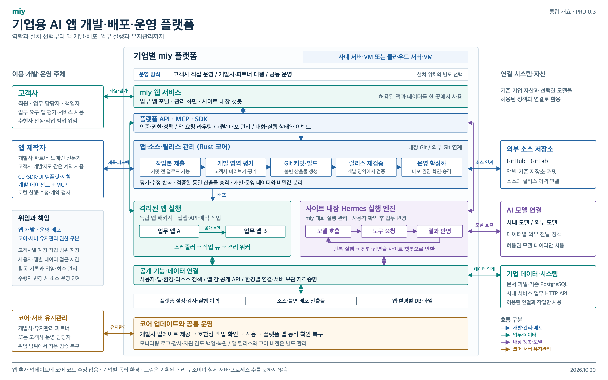
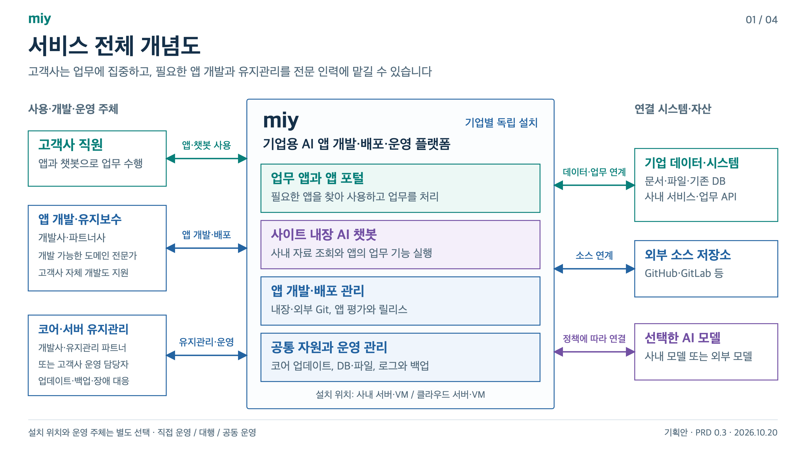
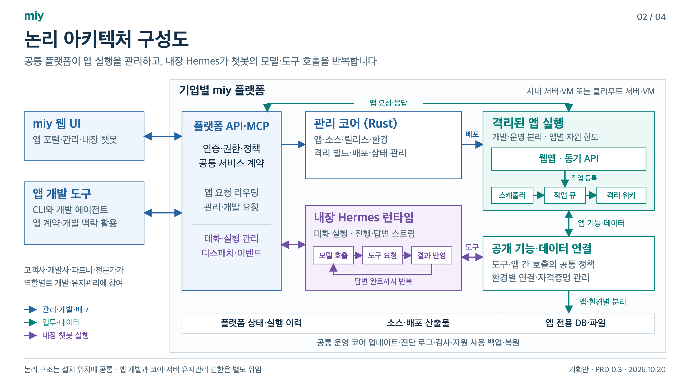
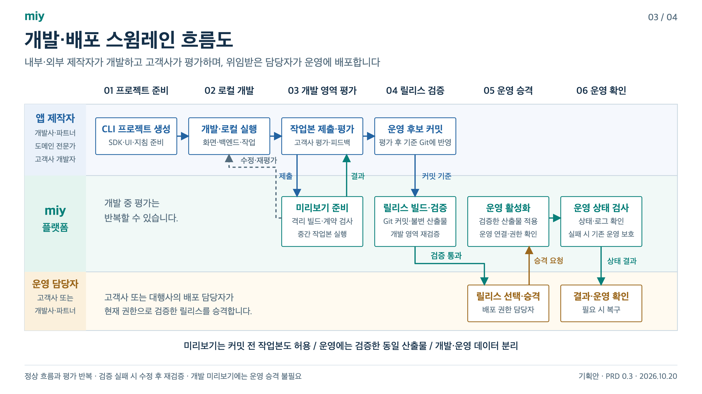
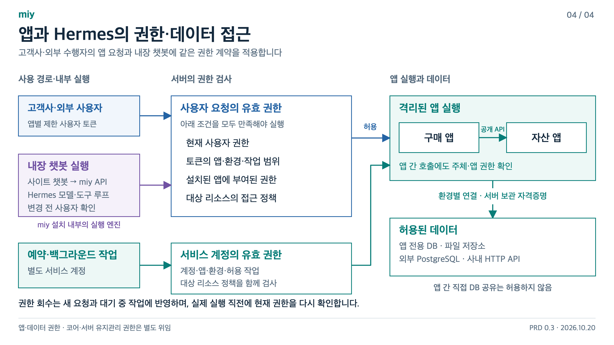

# miy 아키텍처 설명

도식 작성일: 2026-10-20 · PRD 0.3  
설명 보완일: 2026-10-21 · PRD 0.5

miy의 서비스 범위, 내부 구성과 개발·운영 흐름을 설명한다. **한 장으로 설명할 때는 00 통합 개요를 사용한다.** 상세 설명은 01~03 순서로 진행하고, 권한과 데이터 경계를 검토할 때 04를 이어서 본다. 그림은 계획한 책임과 동작을 표현하며 실제 구현·배포 상태를 나타내지 않는다.

도식은 책임과 연결을 나타내는 기존 개념도를 유지한다. Rust 서버·정적 화면의 통합 이미지와 중지 후 교체 방식은 아래 설명에 보완했으며, 최신 실행 계약은 [개발 계획](../DEVELOPMENT.md#rust-풀스택-앱의-플러그인-구조)을 기준으로 한다.

기존 그림의 별도 출처·화면 격리는 분리형 UI에 해당한다. 현재 우선 검증 대상은 신뢰한 앱 UI 모듈을 플랫폼 라우터에 직접 로드하는 통합형이며 같은 브라우저 실행 공간을 공유한다. 이 흐름의 도식·단계·통과 조건은 [핵심 검증 계획](../VALIDATION.md#배포와-ui-런타임-검사)을 따른다.

## 읽는 순서

| 순서 | 자료 | 설명할 내용 | 파일 |
| --- | --- | --- | --- |
| 00 | 플랫폼 전체 구조 | 참여자·설치·운영 선택, 개발·배포, 앱·Hermes 실행, 데이터 연결과 코어 유지관리를 한 장으로 설명 | [PNG](00-platform-overview.png) · [SVG](00-platform-overview.svg) · [PDF](00-platform-overview.pdf) |
| 01 | 서비스 전체 개념도 | 고객사·개발사·파트너·전문가의 역할, 사내·클라우드 설치, 연결 자산 | [PNG](01-service-context.png) · [SVG](01-service-context.svg) |
| 02 | 논리 아키텍처 구성도 | 설치 위치에 공통인 API·관리 코어, 앱 작업 큐와 내장 Hermes 실행 루프 | [PNG](02-logical-architecture.png) · [SVG](02-logical-architecture.svg) |
| 03 | 개발·배포 스윔레인 | 내부·외부 제작자의 개발, 고객사 평가, 커밋 기준 검증과 위임된 운영 승격 | [PNG](03-development-swimlane.png) · [SVG](03-development-swimlane.svg) |
| 04 | 권한·데이터 접근도 | 사용자·서비스 계정·앱 호출의 권한과 데이터 경계 | [PNG](04-access-control.png) · [SVG](04-access-control.svg) |

[통합 개요 1페이지 PDF](00-platform-overview.pdf) · [상세 구성도 4페이지 PDF](miy-architecture.pdf)

PNG는 문서·발표 삽입용, SVG는 글자·도형·연결선을 수정하는 원본이다. PDF는 한 장짜리 통합 개요와 01~04를 순서대로 읽는 상세 묶음으로 제공한다. 모든 최종 자료와 설명은 이 폴더에서 관리한다.

## 00 플랫폼 전체 구조

왼쪽은 고객사, 앱 제작자와 코어·서버 유지관리 담당자의 역할이다. 개발사·파트너·도메인 전문가가 고객사를 대신해 맡을 수 있는 업무와 위임·인계 원칙을 함께 표시한다.

가운데는 기업별 miy의 논리 구조다. 상단에서 사내·클라우드 설치와 직접·대행·공동 운영을 선택하고, 웹 서비스와 공통 API 아래에 앱 개발·배포 흐름을 배치했다. 개발 영역 평가와 커밋 릴리스 재검증을 거친 동일 산출물을 운영에 적용한다. 앱 실행·작업 큐와 사이트 내장 Hermes의 모델·도구 루프는 별도 실행 경로로 표현한다.

오른쪽은 외부 Git, AI 모델과 기업 데이터 연결이다. 아래쪽은 공통 데이터 접근·저장 책임과 코어 업데이트·운영 절차다. 앱의 독립 배포와 코어 유지관리를 구분하며, 설치·운영 선택에 따라 이 논리 구조 자체가 달라지는 것으로 표현하지 않는다.

파란 선은 개발·관리·배포, 청록색은 업무·데이터, 보라색은 내장 챗봇·모델, 황토색은 코어·서버 유지관리 흐름이다. 선의 교차는 별도 접속 지점을 뜻하지 않는다. 블록은 책임과 주요 관계를 설명하며 모든 API 호출이나 실제 서버 배치를 나열하지 않는다.

## 01 서비스 전체 개념

직원은 miy 사이트에서 업무 앱과 내장 챗봇을 사용한다. 앱 제작에는 고객사 개발자뿐 아니라 miy 개발사·파트너사와 앱 개발이 가능한 도메인 전문가가 참여한다. 고객사가 직접 개발·운영하기 어려우면 외부 수행자가 대행하고, 고객사 업무 담당자는 요구 정의와 평가를 맡는다.

코어·서버 유지관리는 고객사 운영 담당자 또는 위임받은 개발사·유지관리 파트너가 수행한다. 개발사는 코어 업데이트를 제공하고, 설치별 유지관리 담당자가 적용·검증·복구를 맡는다. 앱 제작자와 유지관리 담당자는 별도 역할이며 같은 조직이 함께 맡을 수도 있다.

**설치 위치와 운영 주체는 독립적으로 선택한다.** 사내 서버·VM과 클라우드 서버·VM 모두 기업별 독립 설치를 기본으로 하며, 각각 고객사 직접 운영·대행·공동 운영을 선택할 수 있다. 클라우드에 설치하더라도 한 설치가 한 고객사를 담당한다.

기업 문서·파일·기존 DB·사내 API를 연결하고 외부 Git 저장소와도 연계한다. 내장 Git도 제공하는 방향이다. 사내 모델 또는 외부 모델은 관리자가 정한 정책에 따라 연결한다. 모델과 기업 시스템의 위치는 제품과의 관계를 뜻하며 물리적인 서버 위치를 확정하지 않는다.

## 02 논리 아키텍처

웹 UI와 개발자 도구는 공통 플랫폼 API·MCP를 사용한다. Rust 관리 코어가 앱·소스·릴리스·환경과 빌드·배포를 관리하고, 앱은 개발·운영 영역의 격리된 환경에서 실행한다. 공개 업무 기능과 데이터 연결에는 공통 권한·데이터 정책을 적용한다.

이 논리 구조는 사내·클라우드 설치에 공통으로 적용한다. 외부 수행자는 고객사에서 위임받은 계정과 역할로 참여한다. 앱 개발·배포 권한과 코어·서버 유지관리 권한을 구분하며, 호스트·클라우드 관리 접속은 앱 API와 별도로 관리한다.

앱의 웹 화면·동기 API는 요청을 처리하고, 스케줄러나 앱에서 등록한 비동기 작업은 작업 큐를 거쳐 격리 워커에서 실행한다. 플랫폼은 앱별 자원 한도와 실행 상태를 관리한다.

현재 앱 기본안은 Rust 서버와 정적 화면을 한 OCI 이미지에 넣는 구성이다. 메인 플랫폼의 앱 관리 화면·API → 내부 runner → Docker Engine으로 시작·중지·재시작·업데이트·삭제를 제어한다. 수동 중지 앱은 요청·예약으로 재기동하지 않으며 DB·파일은 실행 환경과 분리해 보존한다. 세부 계약은 [앱 운영 계획](../DEVELOPMENT.md#메인-플랫폼의-앱-운영-화면과-제어-계약)을 따른다.

Hermes는 **miy 사이트에 내장된 챗봇의 백엔드 실행 엔진**이다. 사이트 챗봇이 miy API에 요청하면 플랫폼이 대화·실행 상태와 디스패치를 관리하고, Hermes는 모델 호출 → 도구 요청 → 결과 반영을 반복해 답변을 만든다. 도구가 필요하지 않으면 바로 답변할 수 있으며, 진행 이벤트와 답변은 사이트 챗봇으로 돌아온다.

Hermes의 도구 요청은 miy의 공통 정책 경계를 통해 앱의 공개 기능과 허용된 데이터에 접근한다. 이 대화 실행 루프와 앱의 예약·백그라운드 작업 큐는 역할을 구분한다. 개발자가 외부 개발 도구로 사용하는 Hermes도 플랫폼 내부 엔진과 별개의 역할이다.

내부 AI는 **공통 AI 연결 + 사용자별 독립 세션**으로 구성한다. 관리자가 공급자 연결을 설정하고 직원은 miy 로그인만 사용한다. Codex에서는 사용자·대화마다 별도 thread를 매핑하며 대화·파일·이벤트와 도구 권한을 분리한다. 공급자 인증과 총사용량 한도는 공통 연결에서 관리한다. 세부 구조와 공식 문서 근거는 [내부 AI 계획](../AI.md)을 따른다.

하단은 플랫폼 상태·실행 이력, 소스·배포 산출물, 앱 전용 DB·파일의 저장 책임을 나타낸다. 코어 업데이트·진단·로그·감사·자원 사용·백업·복원은 공통 운영 기능이다. 기업 시스템과 AI 모델의 연결 관계는 01에서 설명한다.

코어 업데이트는 개발사의 버전·변경 안내 제공 → 유지관리 담당자의 앱 호환성·영향 확인 → 백업·복구 준비 → 업데이트 적용 → 플랫폼·앱 동작 확인과 이력 기록으로 진행한다. 앱 배포와 별도의 작업으로 관리하며, 데이터 변경이 있으면 그에 맞는 복구 절차를 연결한다.

파란 선은 관리·개발·배포, 청록색 선은 업무·데이터, 보라색 선은 내장 챗봇 실행을 뜻한다. 블록은 논리적 책임 단위이며 별도 서버·프로세스 수나 물리적인 배치를 확정하지 않는다. 관리형 실행 프로필과 격리 엔진은 상세 설계에서 정한다.

## 03 개발과 배포의 역할

공용 컴포넌트는 플랫폼의 버전 저장소에서 배포하고, CLI·MCP는 같은 목록과 사용법을 조회한다. 새 컴포넌트 등록에 CLI 업데이트나 플랫폼 재시작은 필요하지 않다. 앱은 설치한 버전을 고정하고 명시적 갱신·재배포로 반영한다. [현재 구현과 사용법](../RUNNING.md#공용-컴포넌트-설치와-업데이트)을 참고한다.

개발사·파트너·도메인 전문가 또는 고객사 개발자가 CLI로 SDK·UI 기본 선언·지침이 포함된 프로젝트를 만들고, 공통 계약 안에서 화면·백엔드·작업을 구현한다. 로컬에서 테스트 데이터로 실행한 뒤 작업본을 플랫폼 개발 영역에 올린다. 플랫폼은 격리 빌드와 계약 검사를 수행한다. 고객사 업무 담당자 등 허용된 평가자는 미리보기를 사용하고 제작자는 피드백·로그를 확인하며 수정과 평가를 반복한다.

미리보기에는 커밋 전 작업본도 허용한다. 운영 후보는 기준 Git에 커밋하고, 해당 커밋으로 불변 릴리스 산출물을 빌드해 **개발 영역에서 다시 검증**한다. 관리자 또는 배포 권한을 위임받은 담당자가 검증한 **동일 산출물**을 운영으로 승격한다. 개발 DB·파일·비밀값은 함께 이동하지 않으며 운영 연결과 권한을 별도로 적용한다.

운영 승격과 개발 미리보기는 절차와 권한을 구분한다. 검증 실패 시 수정 후 재검증하며, 활성화 후에는 상태·로그를 확인하고 필요한 복구를 수행한다.

버전 교체는 이미지 확보·사전 검사 후 대상 앱 점검 안내 → 기존 앱 중지 → DB 변경 → 새 앱 시작·정상 확인 → 서비스 재개를 기본으로 한다. 대상 앱의 일시 중단을 허용하며 신구 버전 동시 실행이나 무중단 배포는 그림의 전제가 아니다. 실패 시 호환되는 이전 버전을 재실행하거나 복구 필요 상태를 표시한다.

운영 담당자도 고객사 직원 또는 위임받은 개발사·파트너일 수 있다. 고객사에 개발·운영 인력이 없더라도 같은 흐름을 외부 수행자가 이어서 수행한다. 이 그림은 앱 릴리스 흐름을 나타내며 코어 업데이트의 절차는 02의 설명과 PRD에서 다룬다.

## 04 권한과 데이터 접근

앱 화면과 내장 챗봇의 사용자 요청에는 현재 사용자 권한, 토큰의 앱·환경·작업 범위, 앱에 부여한 권한과 대상 리소스 정책을 함께 적용한다. 앱 간 호출에서도 원래 사용자와 호출 앱의 정보를 전달하고 같은 권한 계약을 따른다.

고객사 직원과 외부 수행자 모두 같은 앱·데이터 접근 계약을 적용받는다. 외부 수행자의 대상 고객사·앱·환경·작업·유효기간을 구분하고 위임·회수 이력을 남긴다. 코어·서버 유지관리 권한은 별도로 위임하며, 이 그림의 앱 토큰으로 호스트 접근을 부여하지 않는다.

예약·백그라운드 작업은 명시적으로 부여한 서비스 계정 권한으로 실행한다. 계정·앱·환경·허용 작업과 대상 리소스 정책을 함께 검사하고, 앱 간 호출에서도 실행 주체의 정보를 유지한다. 사용자 요청을 더 강한 서비스 계정 권한으로 조용히 대체하지 않는다.

데이터 연결과 자격증명은 환경별로 관리하며 앱 간 직접 DB 공유는 허용하지 않는다. 챗봇이 업무를 변경할 때는 사용자 확인을 받고, 실제 실행 직전에 현재 권한과 대상 상태를 다시 검사한다. 권한 회수는 새 요청과 대기 중인 작업에도 반영한다.

그림의 구매 앱과 자산 앱은 플랫폼 검증용 업무 예시다.

## 기준 문서와 편집

- 제품 범위와 인수 조건: [PRD](../PRD.md)
- CLI·로컬 실행·개발 영역·운영 승격: [개발 계획](../DEVELOPMENT.md)
- 추진 순서와 검증: [추진 계획](../PLAN.md)
- 기존 miy의 Hermes 통합 근거: [조사 문서](../RESEARCH.md#기존-miy에서-확인한-내장-챗봇-경로)

모든 그림은 SVG를 기준으로 수정하고 대응하는 PNG와 PDF를 갱신한다. 00은 한 장에 전체 내용을 담은 8:5 비율의 통합 개요로 PNG는 4800×3000, PDF는 1페이지다. 01~04의 PNG는 3200×1800이며 상세 묶음 PDF는 같은 순서의 16:9 페이지로 구성한다.
