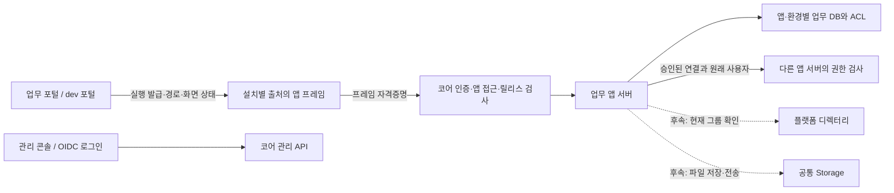

# 공통 컴포넌트 개발 전 코어·아키텍처 준비 상태 리뷰

- 검토일: 2026-11-13
- 목적: 로그인, 브레드크럼브, 사이드바, 서브메뉴, 사용자·그룹 선택, 파일 업로드·다운로드를 구현하기 전에 구조적인 공백과 선행 작업을 개발자들과 검토한다.
- 기준 소스: 최초 검토는 `d1e564c6e7c7d6c15771eb9dc7f6302b804f9ad7`과 당시 작업본이다. 후속 R01·R02 구현은 `69a8170`, 바이트 수명 보완은 `b79ebd7`, Unix TCP 시험 범위 보완과 배포 소스는 `18ce038`로 구분한다. 최초 검토 당시 문서 정리·자원 사용 보완의 미커밋 변경은 별도로 존재했다.
- 성격: **검토 보고서와 권고안이다. R01·R02는 아래에 구현·잔여 상태를 별도로 기록하며, 나머지 권고를 구현하거나 확정한 계약으로 취급하지 않는다.** 기존 제품·권한 계약과 작업 순서를 이 문서로 대체하지 않는다. 리뷰 합의 후 관련 담당 문서와 PLAN에 반영한다.
- 최초 문서 검토의 변경 범위: 이 문서 한 파일만 추가했고 기존 문서·제품 코드·게시 번들·개발 서버는 변경하지 않았다. 이후 사용자가 요청한 R01·R02 제품 구현과 이번 R01 보완은 별도 작업이며 아래에 소스와 검사를 구분한다. 이번 보완에는 검증 JSON과 CAPACITY·PLAN의 상태 동기화도 포함되며, 이 문서의 나머지 제안을 모두 구현했다는 뜻은 아니다.
- 보완(2026-11-13): 코드 대조 검토 후 R01·R02·R05·R10·R11의 권고를 구체화하고 근거를 추가했다(§9 보완 검토).
- 추가 보완(2026-11-13): `69a8170`의 응답별 4MiB 제한과 R02 재전송 수정을 분리했다. 이번 작업본은 R01의 permit을 실제 응답 Bytes 소유자에 결합했고, app_response 9개 검사와 Rust 정적·단위 검사를 통과했다. 그 보완 검토 당시에는 운영 미반영이었고 전체 runtime·브라우저·RSS/복합 부하는 실행하지 않았다. 과거 R02 재현 명령은 최초 소스에 고정했다.
- 배포 후속(2026-11-13): `18ce038`의 CI와 로컬 격리 검사를 통과하고 core·프레임 런타임을 개발 서버에 반영했다. 실제 로그인/CLI/MCP와 앱 4개 읽기 확인을 완료했다. 아래 과거 단계의 FAIL/NOT_RUN은 그대로 보존하며 현재 배포 결과는 §9의 후속 기록으로 구분한다.

## 1. 결론

**현재 플랫폼의 큰 구조는 유지할 수 있다. 공통 컴포넌트를 시작하기 위해 인증·라우터·앱 실행 엔진을 다시 만들 필요는 없다. 다만 공통 컴포넌트가 의존할 서비스와 계약까지 완성된 상태는 아니다.**

포털·콘솔의 분리, 설치별 앱 프레임, 서버의 앱 접근 판정, 앱·환경별 DB, 불변 릴리스와 개발/운영 분리는 재사용할 기반이다. 부족한 것은 주로 그 위에 놓일 공통 업무 API와 SDK, 화면과 서비스 사이의 계약이다. 몇 가지는 기존 구현에서 보완할 문제다.

최초 검토에서 발견한 **응답별 무제한 메모리 수집(R01)**과 **업무 401 이후 변경 요청의 자동 재전송(R02)**은 `69a8170`에서 각각 4MiB 제한과 Core 거부 표시로 보완했다. 추가 리뷰에서 확인한 R01의 permit 조기 해제도 이번 작업본에서 실제 Bytes 소유권에 결합해 수정했다. **R01·R02는 `18ce038`의 필수 CI와 로컬 격리 검사 후 개발 서버 반영을 완료했다.** 프로세스 RSS·여러 앱/관리 API를 함께 보는 복합 부하와 Windows 실제 TCP 인수는 별도다. R02는 구현을 유지하며 업무 401과 전달 전 거부의 구분을 회귀로 보호한다. 파일은 별도 전송 계약 없이 기존 API 한도만 올려 지원하지 않는다.

공통 UI 전체를 미룰 필요는 없다. 다음처럼 나눠 진행하는 것이 적절하다.

| 만들려는 것 | 현재 착수 판단 | 실제 기능 연결·게시 전에 필요한 것 |
| --- | --- | --- |
| 버튼·필드·패널·배지·로딩·기본 대화상자 | 시작 가능 | 공통 유지관리 소스·디자인 토큰·의존성 정책(R11). 인증과 업무 권한에 직접 의존하지 않게 작성 |
| 로그인 화면·계정 메뉴 | 기존 구현을 정리하며 진행 | 세션 만료·오류·안전한 복귀 URL·로그아웃 범위(R03·R04). 별도 인증 체계는 만들지 않음 |
| 사이드바·서브메뉴·브레드크럼브 | 소유권을 합의한 뒤 진행 | 포털 전역 메뉴와 앱 내부 업무 메뉴 구분, 라우팅 어댑터(R05). 메뉴를 숨기는 것으로 권한을 집행하지 않음 |
| 폼·편집기·업로드 진행 표시 | 표현 컴포넌트는 시작 가능 | R02의 구현된 업무 401 재전송 금지 유지, 응답 유실 재시도의 멱등 계약, 여러 작업의 미저장 상태 합산(R06) |
| 다크 테마·언어·날짜 표시 | 계약 보완과 함께 진행 | 초기값·변경 전달·설정 소유·시간대와 SDK 타입(R07) |
| 사용자·그룹 선택기 | 모양과 선택 상태는 시작 가능 | 앱용 디렉터리 DTO·페이지 처리·현재 그룹 확인(R08). 관리자 API를 일반 앱에 열지 않음 |
| 공유·역할·권한 편집기 | 서버 계약이 먼저 | 앱 소유 ACL와 공통 Rust 판정·회수 도구(R09), 선택 대상 재검사 |
| 파일 선택·첨부·업로드·다운로드 | 실기능은 서버 계약이 먼저 | Storage·현재 ACL·파일 상태·전송·예약량·최소 복원(R01·R03·R09·R10) |
| 다른 개발자가 설치해서 사용하는 공용 UI | 로컬 개발과 병행 가능 | 새 CLI/SDK 후보와 컴포넌트 배포 조합(R11·R13). 새 서버를 직접 구성하는 협업 환경은 R12도 필요 |

서비스 계정, API 전용 Invoke, 범용 업무 이벤트, 내장 AI, 전체 백업 제품·updater의 완성은 로그인·메뉴 같은 독립 컴포넌트의 일괄 선행 조건으로 올리지 않는다.

## 2. 유지할 구조와 책임



실선은 구현된 경로, 점선은 이번 리뷰에서 다루는 후속 계약이다. 그림의 앱 DB에 공통 ACL 도구가 이미 구현되어 있다는 뜻은 아니다. 현재는 각 앱이 업무 권한을 직접 구현해야 한다.

| 소유자 | 소유할 책임 | 넘기지 않을 책임 |
| --- | --- | --- |
| 플랫폼 코어 | 인증·사용자/그룹 정본, 앱·환경 입장, 설치 승인, 호출 주체와 릴리스, 배포·DB 준비, 공통 서비스의 접근 경계 | PLM 승인 절차, 프로젝트 역할의 의미, 전역 업무 워크스페이스 |
| 포털·콘솔 화면 | 로그인 진입·계정 메뉴, 앱 선택, 플랫폼 경로, 관리 화면, 앱 프레임의 생명주기 | 앱 내부 자원·업무 메뉴·자원 권한의 최종 판정 |
| 앱 서버 | 업무 데이터, 선택적 공간·자원·역할·ACL, 업무 상태와 승인 규칙 | 플랫폼 사용자·그룹 원장의 복제, 다른 앱 DB 직접 접근 |
| 앱 프레임·SDK | 앱 상대 경로, 자기 앱/승인된 연결 API, 입력 상태, 화면 설정 전달 | 포털 쿠키·CSRF 공유, 브라우저 입력의 사용자 ID를 신원으로 신뢰 |
| 공용 UI | 표현·접근성·상호작용, 전달받은 데이터와 서비스 어댑터 사용 | 자체 로그인 토큰 저장, 관리자 여부로 업무 권한 자동 부여 |

현재 프레임 안에서도 MF와 React AppRoot 계약을 사용한다. iframe 도입을 근거로 임의 프레임워크·임의 React 버전이 이미 지원된다고 설명하면 안 된다. 새로운 독립 HTML 앱 프로필은 별도 요구가 생길 때 검토한다.

## 3. 이미 확보한 기반과 확인 한계

| 기반 | 코드에서 확인한 현재 범위 | 이 사실로 완료라고 볼 수 없는 것 |
| --- | --- | --- |
| 인증·출처 | `portal / dev_portal / console` 용도, 경로 기본 거부, 콘솔의 앱 UI 실행 차단 | 모든 출처의 동시 로그아웃·로그인 복구 UX, 외부 앱 수용 인수 |
| 앱 프레임 | 원래 세션·사용자·설치·환경·릴리스 결합, 프레임 전용 자격증명, 브리지 메시지 검증 | 같은 사이트 쿠키 격리·브라우저 프로세스 분리, 범용 UI 메시지 브리지 |
| 플랫폼 권한 | prod 관리≠사용, dev 미리보기, 관리 기록의 Observe, 서버가 계산하는 `canOpen/canManage/canPromote` | 앱 문서·프로젝트·파일의 공통 자원 ACL |
| 앱 간 호출 | 승인된 connections 경로, 원래 사용자와 호출 체인·현재 승인 재검사 | Use 없이 허용하는 API Invoke, 서비스 계정, 업무 이벤트 |
| 데이터·배포 | 앱/환경 DB 분리, migration 이력, 동일 산출물 승격, 작업 ID·복구 기반 | 앱 DB·파일·키 전체를 묶는 백업 제품, 빈 서버 전체 인수 |
| API 계약 | 일부 Rust 응답→JSON Schema→TS 생성, 권한 쓰기 구조의 정적 검사 | 모든 API의 요청·응답·오류·OpenAPI 완전 일치 |
| R01·R02 후속 구현 | 응답별 4MiB·보유 바이트 수명의 64개 슬롯, 앱의 401 재전송 금지. `18ce038` 개발 서버 반영 | 전체 RSS·앱 간 공정성·복합 부하, 별도 파일 스트리밍 |
| 공용 UI 배포 | 불변 버전·해시·컴포넌트 동기화, 게시 UI의 Button·Panel | 파일 서비스, 통합 메뉴·선택기·복잡한 UI 의존성 설치 |

기존 시험에는 프레임 라우팅·작은 Blob 다운로드·갱신 실패·입력 보존 등이 있다. 최초 문서 검토에서는 그 코드를 읽었으며 전체 브라우저·runtime 시험을 다시 실행하지 않았다. `69a8170`의 R01·R02 구현 검사도 별도 실행 기록이며 이번 추가 보완 작업본의 신규 PASS로 옮기지 않는다.

## 4. 기존 구현에서 먼저 보완할 항목

### R01. 앱 API 응답의 크기와 버퍼 수명 제한

**현재 상태: 응답별 4MiB·Bytes 수명의 동시 예산 보완 구현·검증 및 `18ce038` 개발 서버 반영 완료 / 당시 중요도 높음 / 전체 부하 인수는 별도.**

**최초 관찰(`d1e564c`):** `runtime.rs:1081`은 요청 본문을 4MiB·15초로 제한했지만 `1176–1182`는 앱 응답을 `.bytes()`로 전부 수집했다. 로컬 preview도 `preview.rs:814`의 요청 제한과 `834–840`의 응답 수집이 비대칭이었다. Rust SDK의 응답 4MiB 제한은 코어가 이미 받은 응답의 메모리를 보호하지 못했다. 실제 메모리 고갈 재현은 NOT_RUN이며, 상한 없는 수집 경로를 코드에서 확인한 기록이다.

**후속 구현(`69a8170`, 운영 미반영):** 공통 `app_response::read`가 응답을 조각 단위로 읽어 실제 바이트 수를 4MiB로 제한한다. Content-Length 유무와 무관하게 초과를 거부하며, 길이 헤더가 이미 한도를 넘으면 수집 전에 거부한다. 초과는 502 `app_response_too_large` 또는 `preview_response_too_large`다. semaphore는 동시에 읽는 응답을 64개로 제한하며 10초 안에 자리를 얻지 못하면 503을 반환한다. 길이별·chunked 응답과 runtime·정적 검사의 당시 결과는 [구현 검증 기록](../releases/app-api-limits-2026-11-13-validation.json)에 보존한다.

**추가 리뷰에서 확인한 문제(`69a8170`):** `app_response::read`는 지역 변수 `_slot`을 함수가 반환할 때 해제했다. 반환된 `Vec<u8>`는 이후 응답 Body에 남으므로, 읽기 완료 뒤에도 보유하는 버퍼는 64개 읽기 제한 밖에 놓였다. 이전 리뷰에서 **1KiB 응답 65개, 합계 66,560바이트를 반환 후 계속 보유**할 수 있음을 확인했다. 이는 슬롯이 조기에 해제됨을 보인 것이며 실제 느린 TCP·RSS 부하 재현은 당시 NOT_RUN이었다. 응답별 4MiB의 집행과 살아 있는 전체 응답 버퍼의 예산은 다른 조건이다.

**이번 보완(작업본, 운영 미반영):** `BufferedResponse`가 `Vec<u8>`와 permit을 함께 소유하고 `Bytes::from_owner`로 전달한다. 함수 반환이나 Body 소비만으로 자리를 반납하지 않으며, 바이트를 공유하는 clone/slice까지 마지막 소유권이 해제되어야 반환한다. 벡터의 증설 요청도 4MiB를 넘지 않게 제어한다. 이 예산은 애플리케이션 응답 바이트에 대한 제한이며 소켓·요청 본문·런타임 전체 메모리까지 같은 수치로 제한한다는 뜻은 아니다.

**이번 검사:** app_response 9개가 PASS했고 그중 신규 6개는 완료 응답 64개 보유/65번째 대기, Body 소비 후 clone/slice 수명, 슬롯 대기 timeout·취소, 수집 중 취소, upstream 오류·초과 응답 반환, 실제 느린 loopback TCP의 연결 종료 뒤 슬롯 회수를 확인한다. TCP 시험은 송수신 버퍼를 4096바이트로 설정하고 4MiB 응답을 읽지 않는 동안 슬롯 유지·busy, 연결 종료 뒤 회수, 새 정상 클라이언트의 4MiB 완전 수신을 확인했다. 전체 Rust 검사도 PASS다. 명령·정확한 범위는 [이번 검증 기록](../releases/app-api-response-lifetime-2026-11-13-validation.json)과 §9에 둔다.

**적용 지점:** CLI·위임 bearer의 업무 API, 프레임의 `/_miy/api`, 앱 간 연결이 사용하는 `runtime::proxy`와 로컬 preview 모두 공통 응답 읽기를 사용한다. 파일은 R10의 별도 스트리밍 경로로 처리한다. 기존 API 한도만 크게 올리거나 Content-Length만 신뢰하지 않는다.

**완료 범위와 잔여:** 길이 헤더 있음/없음·chunked 한도, 읽기 완료 뒤 Bytes 점유, 마지막 clone/slice 해제·오류·취소 때 반환과 위 로컬 TCP 시나리오는 이번 검사 범위에서 확인했다. 프로세스 RSS 측정, 여러 앱/관리 API의 가용성을 포함한 복합 부하, 전체 격리 runtime 129개·브라우저 UI·Windows 재실행, 배포는 이번에 NOT_RUN이다. 이 보완을 플랫폼·베타 인수 전체의 완료로 확대하지 않는다.

### R02. 업무 401에 변경 요청까지 자동 재전송

**현재 상태: 최초 문제의 소스 수정(`69a8170`)·후속 검증 및 `18ce038` 개발 서버 반영 완료 / 당시 중요도 높음 / 현재 수정의 회귀 유지.**

**최초 관찰(`d1e564c`):** `web/frame-runtime/src/main.tsx:145–180`의 `call()`은 메서드와 관계없이 HTTP 401이면 갱신 후 같은 요청을 한 번 더 전송했다. 당시 `tests/runtime-health.spec.ts:362–373`도 업무 GET의 2회 호출을 기대했다. Core의 전달 전 인증 거부와 앱 자신의 401을 구분하는 전송 표시는 없었다.

그 소스의 `call()`을 추출해 네트워크 없는 모의 fetch로 실행했을 때 **동일 본문 POST 2회·갱신 1회**를 확인했다. 업무 처리 뒤 외부 시스템 인증 실패 등으로 401을 내는 앱에서 중복 효과가 발생할 가능성을 보여 준다. 실제 업무 DB의 중복 변경은 NOT_RUN이다. §9의 명령은 이 과거 소스에 고정했으므로 수정된 현재 동작을 재현하는 명령이 아니다.

**현재 구현(`69a8170`에서 수정, `18ce038`로 개발 서버 반영):** `app_response::api`는 앱 응답에 프로세스 내부 `FromApp` 표시를 붙이고, 프레임 listener는 그 표시가 없는 Core의 401에만 `x-miy-frame-credential: rejected`를 붙인다. 프레임 런타임은 이 거부 표시가 있는 401만 갱신 후 한 번 재전송한다. 앱 자신의 401은 메서드와 관계없이 그대로 반환한다. 앱 헤더는 Content-Type 외에 전달되지 않으므로 backend가 같은 헤더를 보내도 거부 표시를 위조할 수 없다. 만료 5초 전의 전송 전 갱신도 유지한다.

추가 코드 리뷰에서는 직접 API와 연결 API 모두 앱 응답의 `FromApp`을 유지하고, upstream 전송 뒤 통신·응답 수집 실패는 502/503으로 반환하는 것을 확인했다. 따라서 현재 경로의 표시된 401은 앱에 전달하기 전 거부다. 이 성질을 바꾸는 후처리·새 응답 경로를 추가할 때도 표시의 의미를 유지해야 한다. A가 업무 처리 뒤 B의 실패를 자기 401로 반환한 경우에는 A의 앱 응답이므로 재전송하지 않는다.

업무 GET·PUT의 401 단일 전송, 표시된 Core 거부의 PUT 갱신·재전송, backend 표시 위조 차단은 [당시 구현 검증 기록](../releases/app-api-limits-2026-11-13-validation.json)에 있다. 이를 이번 R01 추가 보완 작업본의 신규 PASS나 모든 업로드·메서드 조합의 인수 완료로 확대하지 않는다.

**남은 계약:** 응답 유실·취소 뒤 쓰기를 재시도해야 하는 동작은 별도로 서버의 멱등 키와 결과 조회를 먼저 구현한다. 헤더 이름만 추가하면 멱등 처리가 되는 것은 아니다. 새 파일·공통 폼을 연결할 때에는 실제 사용하는 메서드·본문·취소 조합으로 재전송 경계를 확인한다.

**유지할 인수 조건:** 업무 401의 POST/PUT/PATCH/DELETE·업로드는 1회 전달, Core 거부 표시가 있는 401만 갱신 후 재전송(거부된 첫 요청의 앱 도달 0회), 앱이 같은 헤더를 보내도 전달되지 않음, 전송 전 갱신 유지. 응답 유실·취소 후 무조건 쓰기를 재실행하지 않으며 멱등 요청을 제공하는 경우 실제 효과는 한 번이어야 한다.

### R03. 로컬·배포 전송과 공통 오류 계약이 다름

**분류: 코드상 불일치와 부분 구현 / 중간 / 데이터 연결 컴포넌트에 선행.**

- `packages/sdk/src/index.ts:66–83`의 `request()`는 항상 JSON Content-Type을 기본으로 넣는다. 로컬 `runtime.api()`가 이 함수를 사용하므로 기본 FormData 업로드도 JSON으로 표시된다.
- 배포 프레임은 `main.tsx:152–154`에서 문자열 본문에만 JSON 기본값을 준다. 따라서 로컬과 배포에서 같은 코드의 multipart 처리 결과가 달라질 수 있다.
- SDK는 `Error(code)`만 반환해 HTTP status·requestId를 잃는다. 공통 `request()`는 모든 응답을 JSON으로 읽고, 프레임의 JSON 함수는 파싱 실패를 null로 바꾼다. 빈 성공 응답·프록시 오류·업무 오류를 표현하는 규칙이 통일되어 있지 않다.
- `/me`, 디렉터리와 일부 권한 응답은 아직 전체 생성 타입 체계에 포함되지 않았다. 임의 generic `T`는 서버 응답의 검증이나 권한 계약이 아니다.

**권고:** 공통 UI와 서비스 코드가 사용하는 좁은 전송 인터페이스를 정의하고 포털·프레임·로컬 preview가 각각 어댑터를 제공한다. 인증 구현까지 하나로 합치지 않는다. 포털은 용도별 쿠키·CSRF, 프레임은 자기 출처 bearer, preview는 로컬 계약을 유지한다.

최소 계약은 JSON/바이너리/FormData, 204·빈 본문, AbortSignal, HTTP·네트워크·파싱 오류 구분, `status/code/requestId`, 안전한 재시도 분류다. FormData의 multipart boundary는 브라우저가 생성하게 한다. 새 DTO는 기존 Rust→Schema→TS 흐름을 확장하고, UI만의 손작성 타입을 늘리지 않는다. 전체 과거 API 이전을 먼저 끝낼 필요는 없다.

**완료 조건:** 같은 입력으로 로컬/배포 업로드를 비교, 정상·204·잘못된 JSON·HTML 장애·401/403/409/413/429/5xx·취소를 구분, 오류 추적 ID 보존, 토큰·쿠키를 로그나 컴포넌트 props에 노출하지 않음.

### R04. 로그인 후 복귀·만료·로그아웃·현재 사용자 표시 계약

**분류: 부분 구현 / 중간 / 공통 로그인·계정 메뉴 연결 시 보완.**

현재 `SessionProvider`는 초기·수동 retry에서만 세션을 읽는다. 다른 API의 코어 세션 만료를 반영하는 공통 흐름은 없다. OAuth 복귀 경로는 CLI 승인만 보존하며 콜백은 `/`로 이동한다. 따라서 업무 앱의 깊은 URL·query·hash 복원이 일반화되어 있지 않다.

로그아웃은 인증 확인을 거쳐 현재 purpose의 세션을 지우고 IdP 로그아웃으로 이동한다. 만료·IdP 장애 때의 로컬 정리와 실패 안내를 보완해야 한다. 현재 동작을 세 출처의 모든 프레임·CLI 세션이 즉시 종료되는 기능으로 설명하면 안 된다. 원래 부모 세션의 종료는 해당 프레임에서 재확인하지만, 다른 출처의 부모 세션과 IdP 회수 전파는 별개다.

또한 AppRuntime과 FrameBootstrap에는 공통 사용자 표시 DTO가 없다. 앱 서버는 검증된 사용자 ID를 받으므로 인증 자체가 없는 것은 아니다. 포털 `/me`에는 CSRF와 포털 전용 정보가 있어 이를 통째로 프레임에 전달하면 안 된다.

**권고:**

- 로그인은 기존 OIDC·SessionProvider 위에서 정리한다. 업무 앱에 별도 비밀번호 입력·토큰 저장 컴포넌트를 배포하지 않는다.
- 현재 출처 내부의 검증된 상대 URL만 로그인 복귀용으로 보존하고, 복귀 시 현재 권한을 다시 확인한다.
- 코어 세션 만료는 중앙에서 확인하되 업무 API의 401을 전체 로그아웃으로 처리하지 않는다. 통신 장애도 익명 상태로 바꾸지 않는다.
- 우선 현재 브라우저 세션 종료 범위를 명확히 표시한다. 전체 브라우저 로그아웃을 제공할 때에는 서버의 명시적 철회 범위를 별도로 구현한다. CLI 회수는 별도 기능으로 유지한다.
- Origin·CSRF 보호를 유지하면서, 이미 만료한 세션의 쿠키 정리가 IdP 가용성 때문에 막히지 않도록 처리하고 실패/재시도를 표시한다.
- UserBadge는 데이터만 받게 한다. 앱에 필요하면 프레임 전용 자기 사용자 `id/name` DTO를 제공한다. 이것은 표시용이며 앱 서버의 신원/ACL 판정을 대신하지 않는다.

**완료 조건:** 중첩 경로 로그인 복귀, 외부 복귀 URL 거부, 로딩 이후 만료·IdP 장애 구분, 로그아웃 실패 안내, 출처별 종료 범위 설명과 시험, 미저장 프레임의 조용한 제거 방지.

## 5. 공통 컴포넌트 전에 확정할 작은 설계 계약

### R05. 전역 탐색과 앱 내부 탐색의 소유권

**분류: 미확정 공통 UI 계약 / 메뉴·브레드크럼브 착수 전 합의.**

현재 플랫폼 라우터는 앱 경로를 전달하고 프레임은 `runtime.location / navigate`를 제공한다. 그러나 manifest의 UI 항목은 진입점·export·계약 버전뿐이며 메뉴 스키마는 없다. DEVELOPMENT의 `ui.navigation` 예시는 장기 제안으로, 현재 manifest에 그대로 넣을 수 없다.

**이 프로젝트에 맞는 최소안은 앱 내부 메뉴를 앱 안에 두는 것이다.**

| 위치 | 공통 UI가 표시할 것 | 이동 어댑터 |
| --- | --- | --- |
| 포털 셸 | 앱 목록, 현재 앱 이름, 계정, 환경, 관리 연결 | 플랫폼 라우터·검증된 다른 출처 링크 |
| 콘솔 | 관리 기능·관리 대상·감사/개발 도구 | 콘솔 라우터 |
| 업무 앱 프레임 | 프로젝트/품목/폴더 등 업무 메뉴·서브메뉴·내부 breadcrumb | `runtime.navigate`, `runtime.location` |

Sidebar/Breadcrumb/Tabs는 라벨·안전한 링크·활성 상태·선택 콜백을 받는 표현 컴포넌트로 만든다. 앱 데이터 권한·활성 업무 자원은 앱 어댑터가 계산한다. 플랫폼 전역 공간 선택기나 각 앱의 업무 라우트 중앙 등록소를 만들지 않는다.

같은 포털의 앱 탐색은 현재 통합 라우팅을 유지한다. 포털↔콘솔·다른 포털의 명시적 링크는 새 탭, 잘못된 출처로 들어온 경로를 올바른 출처로 정정하는 redirect는 현재 탭을 사용하는 기존 구분을 유지한다.

포털에 업무 breadcrumb를 꼭 표시할 요구가 생기면 그때 텍스트·앱 상대 경로만 담는 제한된 메타데이터 메시지를 추가한다. 처음부터 HTML·React 노드·임의 fetch를 넘기는 범용 브리지는 만들지 않는다. 공통 모달·사용자/파일 선택기도 우선 프레임 내부에 배치한다. iframe의 성질상 프레임 내부 모달은 프레임 영역만 덮고 포털의 메뉴·헤더는 덮지 못한다. 디자인은 이를 전제로 한다. 포털 소유 대화상자가 꼭 필요할 때만 요청 ID·취소·현재 프레임 결합을 가진 전용 메시지를 설계한다.

**완료 조건:** 깊은 링크·새로고침·뒤로/앞으로·query/hash 일치, 앱 밖 경로 거부, 키보드/포커스와 활성 메뉴 일치, 메뉴 숨김과 별개로 직접 API 권한 거부.

### R06. 여러 폼·편집기·업로드의 미저장 상태 합산

**분류: 공통 컴포넌트 조합 시 드러나는 계약 공백 / 입력 기능에 선행.**

현재 `setNavigationState({dirty,message})`는 앱 전체의 상태 하나를 받는다. 앱이 합산해 한 번 보고하면 정상이다. 하지만 여러 컴포넌트가 직접 호출하면 마지막 보고가 앞의 상태를 덮는다. 예를 들어 업로드가 진행 중인데 폼 저장이 끝나 `dirty=false`를 보내면 미완료 업로드를 놓칠 수 있다.

**권고:** 앱 단위 PendingWorkProvider와 등록 훅을 제공한다. 작업별 key로 수정 중·저장 중·업로드 중 상태를 관리하고 하나라도 미완료면 runtime에 한 번 보고한다. 해제 시 자기 key만 제거한다. 기본 프레임 브리지의 상태 형식을 바꿀 필요는 없다.

현재 앱을 떠나면 프레임을 제거한다. 초기 업로드는 이 생명주기에 맞춰 취소·재시작하도록 하고, 앱 전환 후에도 계속되는 백그라운드 전송을 UI만으로 약속하지 않는다. 사용자가 완료를 기다리거나 취소를 선택하도록 한다.

**완료 조건:** 폼+편집기+업로드 동시 진행, 하나의 완료·unmount가 다른 작업을 지우지 않음, 앱 전환·로그아웃·재실행·창 닫기의 입력 보호, 취소 후 자원 정리.

### R07. 테마·언어·시간대와 화면 실행 context

**분류: 일부 타입만 준비, 실기능 미구현 / 공용 UI 기본 계약에 포함.**

브리지에는 `theme.changed` 타입/검증이 있지만 프레임 listener가 이를 소비하지 않는다. AppRuntime·프레임·preview는 `theme: "light"` 고정이며 locale이 없다. CSS 토큰도 플랫폼·공용 UI·프레임에 나뉘어 있다. 테마 전환이 이미 동작하는 것으로 보고 새 컴포넌트를 만들면 안 된다.

**권고:** 플랫폼이 사용자 화면 설정을 소유하고, SDK는 해석된 theme·locale·timezone과 변경 구독을 제공한다. 초기 기본값은 현재 light/한국어를 유지하되 이후 변경과 재실행 복원을 같은 계약으로 처리한다. `system` 선택과 실제 light/dark 값을 구분한다. 환경 표시가 필요하면 bootstrap에 있는 환경을 공개 runtime 타입으로 전달하고 URL 문자열에서 임의 추정하지 않는다.

순수 primitive는 번역 라이브러리를 강제하지 않고 label/message props를 받는다. 날짜 컴포넌트는 날짜만의 값과 UTC 시각을 구분하고 시간대는 표시 어댑터에서 적용한다. 앱 서버의 업무 날짜·공휴일 규칙까지 프론트 locale로 결정하지 않는다.

**완료 조건:** 로컬과 프레임의 초기값·실시간 변경 일치, 새 프레임의 설정 복원, 한국어/영어·날짜와 시각 경계, 라이트/다크 대비, 포털 CSS를 상속하지 않아도 앱 렌더링 정상.

### R08. 앱용 디렉터리와 현재 그룹 확인

**분류: 부분 구현 / 사용자·그룹 선택기의 실제 연결에 선행 / V1-G4.**

현재 directory는 설치 승인을 확인한 뒤 활성 사용자 `id/name` 전체 목록을 반환한다. 그룹 선택 DTO·검색·페이지·현재 멤버십 확인이 없다. 관리용 groups/members API는 관리자 전용이므로 일반 앱 선택기의 데이터 소스로 재사용하면 안 된다.

**권고:** 표시/검색용 Directory API와 서버 권한 판정용 현재 멤버십 조회를 분리한다. 안정된 `user | group` 참조, 이름, 페이지/cursor, 검색, 비활성 대상 처리와 노출 필드만 먼저 정의한다. UI가 전체 조직·보안 필드를 받아 필터링하는 방식은 사용하지 않는다.

그룹 정본은 코어 DB로 유지한다. 인사 주 소속의 정확 일치와 수동 멤버를 사용하며 상위 부서·중첩 그룹 권한을 자동 상속하지 않는다. 선택한 그룹을 당시 사용자 목록으로 풀어 영구 ACL에 복제하지 않는다. 멤버십 조회 장애 때에는 기본 거부한다.

**완료 조건:** 일반 앱 사용자에게 허용한 DTO만 노출, 페이지·검색·비활성화, 동일 그룹 이름과 안정 ID 구분, 그룹 회수 후 서버의 다음 판정 반영. 선택기의 표시 여부는 콘텐츠 권한과 별도.

### R09. 공통 업무 ACL의 첫 구현 범위

**분류: 설계 방향은 합의, 공통 구현 미완료 / 공유·권한·보호된 파일 기능에 선행 / V1-G5·G6.**

플랫폼의 `use/develop/deploy`와 앱 내부 자원 권한은 다르다. 현재 Rust SDK는 검증된 사용자·설치·릴리스·호출 체인을 제공하지만 공통 자원 ACL 미들웨어는 없다. 문서의 `authorize(subject, action, resource, context)`는 개념 표기이며 현재 호출 가능한 API가 아니다.

**권고하는 최초 범위:**

- 앱/환경 DB가 자원과 선택적 공간, 역할·ACL 관계를 소유한다. 전역 ACL DB·필수 workspace는 도입하지 않는다.
- 공통 Rust 라이브러리가 검증된 주체·현재 그룹·자원 범위·기본 거부·판정 이유를 같은 방식으로 다룬다. 사용자는 플랫폼의 안정 ID로 참조한다.
- 사용자/그룹 grant, 앱이 선언한 action과 역할 매핑, 회수부터 구현한다. 조직 계층 상속·중첩 관계·범용 정책 언어는 후속으로 둔다.
- 목록·검색은 권한 필터를 조회/페이지 처리에 적용한다. 조회 뒤 숨기는 것만으로 총건수·제목·cursor 누출을 막았다고 보지 않는다.
- 상세·쓰기·다운로드·대기 작업에도 같은 판정을 적용한다. UI `canX`는 표시용이고 서버가 실행 시 다시 검사한다. 사용자·그룹 조회 실패를 허용으로 바꾸지 않는다.
- ACL 변경은 대상 변경과 같은 트랜잭션 경계·현재 권한 재확인을 정한다. 플랫폼 admin을 앱 owner로 자동 취급하지 않는다.
- PLM의 자기 승인 금지·문서 상태 전이 같은 업무 규칙은 앱이 추가 검사한다. 공통 ACL이 업무 상태를 대신하지 않는다.

첫 인수는 기존 결정대로 프로젝트·업무 앱에서 실시한다. 같은 앱을 쓰는 두 사용자, 공간 없는 앱, 그룹 회수, 다른 앱/환경 ID 오용, 목록·직접 API의 일치를 확인한다. 전체 PLM을 코어 선행 과제로 만들지 않는다. 작은 PLM→PDM fixture는 원래 사용자와 파일 ACL 연계를 추가 확인할 때 사용한다.

### R10. 파일은 UI가 아니라 저장·권한·전송·수명주기 서비스

**분류: 공통 서비스 미구현 / 파일 실기능의 선행 / V1-F1·F2·F4.**

현재 `apiBlob()`과 작은 파일 다운로드 시험은 있다. 그러나 공통 Storage API·업무 파일 메타데이터·업로드 상태·공간 예약·재개 전송은 없다. 이미지/소스 배포 upload API는 업무 첨부 API가 아니다. 일반 gateway는 Content-Type 중심의 제한된 헤더만 전달하며 Range·Content-Disposition·ETag 등의 파일 전용 계약이 없다.

프레임 인증은 메모리 bearer다. 일반 `<a href>`에 앱 API 주소를 넣는 것만으로 이 인증이 따라가지 않는다. 작은 파일의 Blob→object URL 다운로드와 대용량 스트리밍을 구분해야 한다.

**권고하는 최소 첫 구현은 다음과 같다. 아래 필드·상태 이름은 설계 예시이며 공개 API가 아니다.**

| 주제 | 초기 권고안 |
| --- | --- |
| 저장 backend | 로컬 영속 볼륨. Storage 인터페이스를 분리하고 S3·분산 저장은 후속. MinIO를 도입하지 않음 |
| 식별·범위 | 불투명 fileId·불변 version, 소유 installation/environment, 크기·hash·MIME·원래 파일명. 파일 경로 자체를 사용자 입력이나 권한으로 사용하지 않음 |
| 업무 관계·ACL | 앱 DB가 첨부 대상과 ACL을 소유. 플랫폼은 저장 바이트·전송·용량을 관리. fileId를 알고 있는 것만으로 열람 허용하지 않음 |
| 첫 접근 경로 | 파일 소유 앱 서버가 현재 자원 ACL을 확인하고 제한된 Storage 연결로 저장/읽기. 브라우저는 인증된 앱 파일 API를 이용. 새 Storage 동작의 경로·설치 승인·원래 주체를 명시하며, 현재 증표로 이미 지원된다고 가정하지 않음 |
| 직접 다운로드 확장 | 필요해질 때 파일·버전·동작·주체·짧은 수명에 제한된 접근 교환을 설계. 발급 시 ACL만 확인하고 긴 bearer URL로 회수를 우회하지 않음. 광범위한 presigned URL은 첫 구현에 넣지 않음. 프레임 CSP가 `connect-src 'self'`, `img-src 'self' data: blob:`이므로(`app_frames.rs:1097`) 다른 출처의 다운로드·미리보기 URL은 막힌다. 전송 경로를 프레임 출처에 두거나 CSP 변경을 설계에 포함 |
| 현재 경로 한도 | Core 앱 API 요청 4MiB·15초(`runtime.rs:1081`), Nginx 프레임 블록 `client_max_body_size 8m`(`render-server-config.py:225`). 포털 블록의 1024m는 CLI 업로드용이며 앱 경로 한도가 아님. 아래 크기 후보는 이 한도를 올려서가 아니라 두 계층에 각각 한도를 둔 별도 파일 경로로 처리 |
| 전송 | 일반 JSON 경로와 분리한 bounded streaming. 필요한 헤더만 별도 허용 목록으로 명시. 앱의 Set-Cookie·Clear-Site-Data 등을 그대로 통과시키지 않음 |
| 초기 크기·재개 | 작은 첨부를 먼저 지원. 10MiB를 검토용 기본 후보로 제안하며 전체 전송 경로·예산 검증 후 확정. 이는 현재 v2 지원 수치가 아님. CAD 대용량·chunk/resume은 별도 후속 |
| 상태 | 업로드 생성·전송·검증 완료·첨부 연결·취소/만료를 구분. 바이트 업로드 성공과 업무 레코드의 첨부 완료는 다른 상태 |
| 중복·정합성 | 업로드/완료 요청 식별자와 결과 조회. 앱 DB와 Storage를 하나의 원자적 트랜잭션으로 간주하지 않음. commit 결과가 불명확하면 즉시 파일을 보상 삭제하지 않음 |
| 용량·정리 | 업로드 시작 시 예약, 완료 시 실제 크기 확정, 취소/timeout 후 회수. 앱별 한도와 전체 디스크/inode 하한 확인. 미완료·미참조 파일의 유예 기간과 정리 근거를 구분 |
| 보존·복원 | 앱 제거 시 기본 보존, 영구 삭제는 별도 범위. 업무 DB 첨부 관계와 파일 hash를 별도 영역에 함께 복원 확인 |

Storage도 검증된 호출 문맥의 설치·환경과 fileId의 소유 관계를 서버에서 다시 검사한다. 다른 앱의 파일은 승인된 연결을 통해 파일 소유 앱의 ACL 판정을 거친다. 호출한 앱이 자기 ACL만 확인한 뒤 다른 앱의 fileId를 읽는 경로는 허용하지 않는다.

프레임 내부 FileService 어댑터를 통해 UI가 위 서비스를 사용하게 한다. UI가 물리 저장 경로·업로드 토큰·원본 앱의 권한 정책을 직접 구성하지 않는다. 단기 다운로드 증표의 필요성 때문에 공용 폼 전체에 새 인증 체계를 도입하지 않는다.

**완료 조건:** 다른 앱/환경 ID 거부, 다운로드 시작 전 현재 ACL/그룹 회수 반영, 병렬 업로드의 예약 초과 방지, 취소·응답 유실 뒤 결과 조회, 새로고침 뒤 미완료 업로드의 취소/만료 확인, 중복 첨부 방지, 디스크 부족 시 일관된 실패, 파일명/MIME 안전 처리, 동일 fileId/version/hash 복원. 초기 인수는 전송 바이트 재개·업로드 UI 복원을 포함하지 않는다. 이미 전송한 바이트의 회수나 진행 중 전송의 즉시 전역 중단까지 보장한다고 설명하지 않는다.

### R11. 공용 UI 소스·의존성과 배포 단위

**분류: 기본 배포 기능은 구현, 확장 계약 미완료 / 새 공용 UI 게시에 선행.**

플랫폼 내부 UI와 앱 배포용 UI는 분리되어 있다. workspace `@miy/ui`는 registry 1.0.0을 재수출하고 신규 앱은 1.0.1을 받는다. 앱 게시 UI의 실제 범위는 Button·Panel이다. 이 분리 자체가 결함은 아니지만, 양쪽에서 Sidebar/Dialog 등을 따로 키우면 동작·접근성·토큰이 갈라질 수 있다.

컴포넌트 패키지는 소스·CSS·메타데이터를 배포하지만 `package.json`을 금지하고 npm 의존성 설치 계약이 없다. 복잡한 UI를 추가하면 필요한 패키지가 자동으로 설치된다고 가정하면 안 된다. 기존 bundleVersions에 대한 명시적 호환 코드가 있으므로 오래된 메타데이터만으로 현재 호환 오류라고 단정하지 않는다.

**권고:** 순수 primitive와 토큰의 유지관리 소스를 하나로 두고 플랫폼용·앱용 배포물을 만든다. 인증·라우터·데이터의 어댑터는 분리한다. 처음에는 개발 번들에 명시적으로 고정한 의존성만 사용한다. 필요 의존성을 늘릴 때에는 새 번들과 잠금 파일을 함께 갱신하며 임의 자동 설치를 추가하지 않는다.

**프레임 CSP 제약:** 앱 UI와 공용 UI는 프레임 안에서 `script-src 'self'`, `style-src 'self' 'unsafe-inline'`, `font-src 'self'`, `img-src 'self' data: blob:`, `connect-src 'self'`로 실행된다(`app_frames.rs:1097`). CDN 글꼴·스크립트, 외부 이미지, `eval`·`new Function`에 의존하는 라이브러리는 쓸 수 없다. 토큰·글꼴·아이콘은 번들에 포함해 프레임 출처에서 제공한다. 의존성을 고를 때 이 조건을 기준으로 삼는다.

각 릴리스에 CLI·SDK bundle·브리지·공용 UI·React 지원 조합을 작은 호환표로 기록한다. 게시한 파일은 덮어쓰지 않고 새 버전을 만든다. 개발 단계에서는 옛 계약에 대한 장기 fallback을 기본으로 만들지 않는다.

**완료 조건:** 새 CLI로 만든 앱과 플랫폼에서 같은 primitive 계약 확인, 컴포넌트 설치 후 깨끗한 의존성 설치·빌드, 잘못된 조합 거부, 잠금/해시 확인, 업무 파일을 덮어쓰지 않는 업그레이드.

## 6. 협업 개발과 코어에 남은 작업

### R12. 새 서버 조립과 앱 로딩 실패의 명시적 상태

**분류: 확인된 설치 공백·부분 실행 상태 / 다른 개발자의 재현 환경에 필요.**

`bootstrap.py:244`는 프레임 runtime 디렉터리를 설정하지만 `up.sh:45–47`의 루트 `pnpm build`는 platform/fixtures만 빌드한다. 프레임 runtime의 빌드·설치가 새 서버 실행 경로에 빠져 있다. `app_frames.rs:1077–1089`는 index가 없거나 형식이 맞지 않을 때 bootstrap만 있는 빈 페이지를 HTTP 200으로 반환한다.

현재 개발 서버에는 별도 rollout으로 프레임 runtime을 설치했다. 이 문제를 현재 서버가 동작하지 않는다는 뜻으로 해석하면 안 된다. 다만 같은 소스를 새 환경에 설치하는 완료 경로는 아니다.

프레임의 `frame.ready`도 원격 AppRoot 로드 전에 전송된다. 현재 호스트에는 “프레임 연결 완료”와 “실제 앱 준비 완료”를 구분하는 전체 로딩 계약·유한 대기가 없다. 공통 로딩 화면을 추가하는 것만으로 누락한 runtime이나 청크 실패가 해결되지 않는다.

**권고:** 새 설치 도구에 frame runtime build/install을 연결하고, 활성 프레임 프로필에서 runtime 누락을 readiness/doctor·실행 오류로 명시한다. UI는 실행 발급→프레임 연결→앱 준비/실패를 구분한다. 무한 대기 대신 재시도 가능한 안내를 제공하되, 입력이 있는 기존 프레임을 자동 제거하지 않는다. 범용 updater 전체는 이 수정의 선행 조건이 아니다.

**완료 조건:** 빈 격리 state의 설치→로그인→앱 실행, index 누락·청크 실패·연결 timeout의 명확한 오류, 재시행 시 데이터 보존. 현재 운영 `.local`로 이 시험을 실행하지 않는다.

### R13. 최신 CLI/SDK 전달과 릴리스 인수

**현재 상태: 다운로드 서버 게시 완료 / 정식 GitHub Release·Windows 사용자 인수는 별도 / 최초 검토에서는 릴리스 미완료.**

**게시(2026-11-13):** CLI 0.9.0 / 번들 0.9.0(`173c6d5`)을 서버 0.9.0과 함께 다운로드 서버에 게시했다. CLI 버전 검사 PASS, 5개 OS/CPU 후보·Windows 설치기 CI 성공. 정식 GitHub Release와 Windows 11 사용자 인수는 남아 있다([배포 기록](../releases/cli-0.9.0-2026-11-13-deployment.json)).

**최초 관찰(게시 전):** 당시 소스의 SDK bundle은 0.9.0이었지만 게시 CLI는 0.7.0/bundle 0.8.0이었고 CLI 소스 버전도 0.7.0이었다. 당시 `check-cli-version.py --candidate HEAD`는 변경된 client 입력 22개에 대해 `client_inputs_changed_without_version_bump`로 **FAIL**했다. 이 실패는 게시 전 검토의 이력으로 보존하며 현재 0.9.0 후보의 검사 결과와 구분한다.

이 관찰 당시에는 최신 runtime 기능을 사용하는 예제를 기존 다운로드 CLI로 생성한 프로젝트가 그대로 쓸 수 없었다. 플랫폼에 서버·프레임을 반영한 것과 개발 번들을 게시한 것은 다른 단계다.

**남은 인수:** 정식 GitHub Release의 공개 게이트와 Windows 11 사용자 인수를 별도로 수행한다. 게시 0.9.0 CLI로 현재 서버에 새 앱을 생성·배포하는 검사는 배포 기록에서 NOT_RUN으로 남아 있다. 격리 스택의 앱 생성·업그레이드 결과를 이 실서버 검사나 Windows 인수의 PASS로 옮기지 않는다. 게시 파일의 바이트는 유지한다.

### 공통 UI를 일괄 중단시키지 않을 후속 코어 항목

| 미완료 항목 | 필요한 시점 | 이번 컴포넌트와의 관계 |
| --- | --- | --- |
| 전체 서버 자원 예약·개별 앱/작업의 총예산 | 베타 전 종합 안정화 | R01 응답별 한도·버퍼 수명 예산의 소스 보완과 이번 범위 검사는 완료. 전체 RSS·복합 부하와 새 파일의 예약/디스크 보호는 별도 |
| 앱 DB·파일·설정·키의 통합 백업 제품, 호스트 updater | 베타 전 | 새 저장 기능의 최소 백업/복원은 동시에 필요. 전체 제품 완성을 메뉴 개발 이전 조건으로 두지 않음 |
| 새 서버 전체 수명주기·복원·독립 반복 인수 | 베타 전, 협업 환경은 R12 범위부터 | 기존 환경의 성공을 빈 서버 전체 성공으로 바꾸지 않음 |
| Windows 설치·갱신·제거 실기와 배치별 잔여 인수 | 사용자/해당 환경에서 수행 | 이번 Linux 코드 검토로 PASS 처리하지 않음 |
| A2 서비스 주체, UI Use/API Invoke 분리 | 무인 실행·API 전용 앱 연계 때 | 사용자 권한 실패를 관리자/서비스 계정으로 대신 처리하지 않음 |
| 업무 이벤트·알림·outbox·중복 방지·재처리 | 알림 서비스·비동기 업무 연계 때 | 배포/시작/중지 worker를 업무 이벤트 엔진으로 재사용했다고 간주하지 않음 |
| 외부 데이터 연결·검색·실시간 | 해당 기능 때 | 현재 JSON connections가 전부 제공하는 기능이 아님 |
| 공통 AI 연결·Hermes 도구 실행과 쓰기 승인 | AI 기능 때 | 공급자 로그인·모델 판단은 업무 권한이 아님 |
| P2 쿠키 간섭·접근성 등 남은 FV/BV, 공개 접속 범위 검토 | 해당 배치/노출 범위에서 별도 추적 | 공개 서버를 사내 신뢰 범위로 자동 인정하지 않음. 별도 IdP·MFA·자동 CA를 모든 공통 UI의 선행 조건으로 추가하지 않음 |

## 7. 개발자 리뷰에서 합의할 결정

아래는 이 프로젝트의 개발 단계에 맞춘 권고다. 선택을 다시 넓히기보다 이 작은 범위를 기준으로 반대 근거와 누락만 검토하는 편이 좋다.

| 결정 | 권고안 | 합의 후 바꿀 범위 |
| --- | --- | --- |
| 로그인 소유 | 플랫폼 OIDC 유지, 앱은 표시용 사용자 context만 소비 | SessionProvider·복귀/로그아웃·새 DTO·관련 인수 |
| 메뉴 소유 | 플랫폼 전역 탐색과 앱 내부 업무 탐색 분리, 순수 공용 UI와 이동 어댑터 | U1/U4/U6, AppRuntime 예제. 처음부터 manifest 메뉴 엔진을 추가하지 않음 |
| UI의 재사용 | primitive·토큰 유지관리 소스 공통, 인증·데이터 어댑터 별도 | 공용 UI 새 버전·의존성/배포 계약 |
| 입력 보호 | 앱 단위 작업 등록/합산 후 runtime에 한 번 보고 | 폼·편집기·업로드 공통 hook, 기존 브리지 유지 |
| 화면 설정 | 플랫폼 소유 theme/locale/timezone을 runtime에 전달 | U2/U3/U6·preview·브리지·프레임 모두 |
| 그룹·ACL | G4 먼저, G5/G6의 작은 앱 소유 ACL 라이브러리·대표 앱 인수 | CORE-PERMISSIONS와 SDK/서버. 전역 workspace·정책 엔진은 추가하지 않음 |
| 파일 | 로컬 Storage·앱 서버 ACL·별도 스트리밍·작은 첨부 우선 | F1/F2/F4·용량 예약·최소 복원. 대형 CAD·재개·S3는 후속 |
| 쓰기 재시도 | `69a8170`의 업무 401 재전송 금지·표시된 Core 전달 전 거부만 갱신 후 재전송하는 구현 유지. 응답 유실 재시도는 명시적 멱등 처리 | frame runtime 회귀 유지, preview·공통 전송·새 업무 동작의 계약과 시험 |
| 협업 전달 | 새 CLI/SDK/공용 UI 지원 조합을 명확히 게시 | CLI 릴리스, 새 앱 생성/업그레이드와 격리 설치 |

실제 작업 순서는 기존 PLAN을 유지한다. 아래는 별도 로드맵이 아니라 **공통 컴포넌트의 연결 조건**이다.

1. R01의 실제 Bytes 소유권까지 이어지는 permit 보완·이번 범위 검사는 완료했으므로 R02의 Core 거부 구분과 함께 유지한다. R03·R04의 전송/로그인 복구와 R13의 새 CLI 릴리스 준비를 이어간다. 전체 runtime/브라우저 재검사·복합 부하·서버 반영을 이번 PASS에 포함하지 않는다.
2. 메뉴 소유·공용 UI 소스·입력 보호·화면 설정의 최소 계약(R05·R06·R07·R11)을 합의하고 독립 primitive를 개발한다.
3. 계획된 G4→G5/G6(R08·R09)를 진행하면서 사용자/그룹 선택기·공유 UI를 실제 API에 연결한다. 모양 개발은 병행할 수 있다.
4. 계획된 Storage→파일 단계에서 R10을 구현하고 파일 컴포넌트를 연결한다. 같은 시점에 용량·취소·중복·최소 복원을 인수한다.
5. 기존 서버에 연결하는 신규 개발 환경은 R13, 새 서버까지 구성하는 환경은 R12도 확인한다. 전체 베타 인수는 별도 단계로 유지한다.

## 8. 구현 후 공동 리뷰의 최소 인수표

아래는 개선과 후속 기능의 수용 조건이다. **최초 문서 작성 때에는 모두 NOT_RUN**이었다. 이후 `69a8170`의 R01·R02 검사와 이번 작업본의 R01 버퍼 수명·로컬 TCP·Rust 검사 결과를 해당 행에서 구분한다. 과거 PASS를 새 소스나 더 넓은 시나리오로 옮기지 않는다.

| 대상 | 반드시 볼 시나리오 | 통과 의미 | 상태·범위 |
| --- | --- | --- | --- |
| API 메모리 | 큰 JSON·chunked·읽기 완료 뒤 보유/복제한 Bytes·느린 소비자·동시 응답·취소 | 수신 한도와 실제 버퍼 수명의 예산이 집행되고 다른 앱/관리 API가 유지됨 | 이번 app_response 9개·느린 loopback TCP·Rust 검사 PASS. 전체 RSS·여러 앱/관리 API 복합 부하는 NOT_RUN |
| 변경 요청 | 업무 401·Core 거부 401·표시 위조·응답 유실·재시도·동일 요청 식별자 | 앱이 받은 요청의 자동 재전송 없음, 전달 전 Core 거부만 재전송, 멱등 계약이 있는 동작의 중복 효과 없음 | `69a8170` 기록: 업무 GET/PUT 401·표시된 PUT 재전송·backend 표시 위조 차단 PASS. 이번 Rust 검사에는 FromApp·응답 헤더 단위 검사가 포함됨. 새 업로드/멱등 계약과 프레임 runtime·브라우저의 이번 재실행은 NOT_RUN |
| 로그인 | 깊은 URL·외부 return URL·만료·IdP 장애·로그아웃 실패 | 출처/권한 경계와 입력 보존을 유지하며 복구 가능 | 후속 계약 NOT_RUN |
| 탐색 | 직접 링크·query/hash·뒤로/앞으로·다른 출처 새 탭 | 포털/앱의 경로와 활성 메뉴가 일치하고 앱 밖 이동이 제한됨 | 공통 컴포넌트 연결 인수 NOT_RUN |
| 여러 입력 | 폼+파일 동시 변경, 하나만 저장/취소, 앱 전환 | 다른 컴포넌트의 미완료 작업을 지우지 않음 | 후속 계약 NOT_RUN |
| 화면 설정 | light/dark·ko/en·시간대, 로컬/프레임·재실행 | 같은 SDK 계약과 초기값/변경 전달 적용 | 후속 계약 NOT_RUN |
| 디렉터리/ACL | 두 사용자·그룹 회수·목록/상세/파일·잘못된 환경 | 화면과 직접 요청에 같은 현재 권한이 적용됨 | 후속 계약 NOT_RUN |
| 파일 | 업로드 완료 응답 유실·첨부 실패·취소·디스크 부족·다운로드 회수·복원 | 바이트 완료와 업무 첨부 상태가 구분되고 데이터/권한을 보존 | 후속 계약 NOT_RUN |
| 프레임 시작 | runtime 누락·청크 실패·연결 timeout | 빈 HTTP 200을 정상 준비로 오인하지 않고 오류/재시도를 표시 | R12 보완 인수 NOT_RUN |
| 배포 전달 | 새 CLI 설치→앱 생성→컴포넌트 설치→로컬→dev, 기존 앱 업그레이드 | 지원 조합이 재현되고 업무 파일·DB가 보존됨 | 새 지원 조합 인수 NOT_RUN |

PLM/PDM 검토용 추가 예시는 “PLM의 허용 사용자만 PDM 도면 버전을 읽고, 권한 회수 후 다음 다운로드는 거부되며, PLM/PDM DB는 공유하지 않는다”로 좁힌다. MES UI 입장 없이 업무 API만 호출하는 예시는 Invoke가 구현된 뒤 별도로 인수한다.

## 9. 이번 검토의 증거와 한계

### 최초 문서 검토에서 실행한 검사(`d1e564c` 기준)

다음은 최초 검토 당시의 기록이다. `--candidate HEAD`의 HEAD와 문서 링크 수 역시 그 실행 시점 기준이며, 아래 PASS/FAIL을 이번 추가 보완 작업본의 실행 결과로 해석하지 않는다.

| 명령·방법 | 결과 | 범위 |
| --- | --- | --- |
| `git status --short`, `git log -5`, `rg`, `nl -ba`, `sed` | 확인 | 현재 작업본·관련 설계·구현·기존 시험 정의를 정적 대조 |
| `node scripts/api-types.mjs --check` | PASS | 현재 JSON Schema와 생성 TS 일치. 모든 Rust API·OpenAPI 구현을 새로 검증한 결과가 아님 |
| `python3 scripts/check-write-decisions.py` | PASS | 정적 쓰기 경계 검사: 허용 목록 transaction 18·writer 6. 실제 DB 동시성 인수 아님 |
| `python3 scripts/check-cli-version.py --candidate HEAD` | **FAIL** | 게시 0.7.0 이후 client 입력 22개가 달라졌는데 후보 버전도 0.7.0. R13으로 유지 |
| 아래 Node 소스 추출·모의 fetch | 동작 확인 | POST 2회, 동일 본문, 갱신 1회. 실제 네트워크·DB 부작용은 실행하지 않음 |
| `python3 scripts/check-doc-links.py`, `git diff --cached --check` | PASS | 임시 Git index의 Markdown 62개·상대 링크 902개와 공백 검사. 새 문서와 이전 정리의 미커밋 이동을 포함 |

문서 검사에는 별도 `GIT_INDEX_FILE`을 사용해 새 위치를 반영했다. 실제 Git index와 기존 staging은 변경하지 않았다. 인증/ACL, UI/SDK, 서비스/배포의 독립 읽기 리뷰를 거쳐 파일 소유 앱의 ACL 검사와 초기 업로드 재개 제외, 새 서버 설치 조건의 적용 범위를 명확히 했다.

최초 문서 검토에서 제품 빌드, 전체 Rust/runtime 회귀, 실제 브라우저·OIDC·Windows, 대형 파일·메모리 부하, 새 서버 설치·복원은 **NOT_RUN**이었다. 문서 검토와 제한된 모의 확인의 범위를 넘기 때문이었다. 그 검토에서는 실서버 접속·재시작·DB 변경·배포·커밋·푸시도 수행하지 않았다. 이후 구현 작업의 검사는 아래 기록으로 구분한다.

### 첫 보완 검토(2026-11-13, `d1e564c` 기준)

이 문서의 주장을 `d1e564c`의 코드와 정적으로 대조했다. 대조한 코드 파일에는 미커밋 변경이 없어 줄 번호가 유효하다. 시험·빌드는 실행하지 않았다(NOT_RUN).

| 항목 | 대조 결과 |
| --- | --- |
| R01 | 요청 4MiB·15초 제한(`runtime.rs:1081`)과 응답 `.bytes()` 무제한 수집(`:1178`) 확인. 프레임 API·앱 간 연결도 같은 `runtime::proxy`를 사용 |
| R02 | `call()`이 메서드와 무관하게 401 후 재전송함을 확인. Core 거부 401은 고정 본문뿐이고, 앱 응답 헤더는 Content-Type 외에 전달되지 않음(`app_response.rs:9`) |
| R03 | preview의 `api()`가 `request()`를 사용하고 이 함수가 JSON Content-Type을 강제함을 확인 |
| R04 | OAuth 콜백이 `/`로만 이동함을 확인 |
| R07·R08·R12·R13 | `theme.changed` 미소비, 디렉터리의 활성 사용자 전체 반환, `frame.ready` 선전송·루트 빌드의 프레임 런타임 누락·런타임 없는 빈 200 문서, 게시 CLI 0.7.0/0.8.0 확인 |
| R10 | PRD·STACK의 MinIO 제외와 일치. 현재 앱 경로 한도(Core 4MiB, Nginx 프레임 블록 8MiB)와 프레임 CSP 제약 확인 |

위 문서 링크 PASS는 당시 다른 작업자의 미커밋 문서 이동을 넣은 임시 index 기준이다. 새 문서 내용과 후속 소스의 검사를 대신하지 않는다.

### R01·R02 구현과 추가 리뷰(2026-11-13)

| 단계 | 기록·관찰 | 범위 |
| --- | --- | --- |
| `69a8170` 구현 | [당시 검증 JSON](../releases/app-api-limits-2026-11-13-validation.json)의 app_response 단위 검사·runtime 129개 관찰·정적/브라우저 검사 PASS 기록 | 응답별 4MiB와 Core 거부 표시/업무 401 분리의 구현 검사. 살아 있는 응답 버퍼 전체 예산과 이번 작업본의 통과를 뜻하지 않음 |
| `69a8170` 추가 리뷰 | `app_response::read`의 지역 `_slot`이 반환 시 해제됨. 1KiB 응답 Body 65개, 합계 66,560바이트를 동시에 보유한 채 65번째 읽기가 완료됨을 확인 | 당시 R01 잔여 문제인 조기 해제 재현. 이 실행에서 실제 느린 TCP·RSS 부하는 NOT_RUN |
| R02 추가 코드 리뷰 | upstream 뒤 오류 502/503, 직접/연결 응답의 `FromApp` 유지, 앱 헤더 허용 목록 확인 | 현재 재전송 표시의 의미를 정적으로 대조. 신규 실서버 공격·업무 DB 중복 재현 NOT_RUN |
| 과거 프로브의 후속 실행 실패 | 이전 명령이 수정된 checkout의 `call()`만 추출하면서 새 외부 상수를 포함하지 않아 `ReferenceError: CREDENTIAL_REFUSED is not defined`로 **FAIL** | 재현 도구의 소스 의존 오류. 현재 제품의 401 처리가 실패했다는 증거로 쓰지 않으며 실패 기록을 보존 |
| 과거 재현 명령 수정 | `git show d1e564c:web/frame-runtime/src/main.tsx`에 입력을 고정하고 아래 명령 실행 | 과거 POST 2회·갱신 1회 동작 확인. 현재 R02 구현 시험이 아님 |
| 이번 R01 구현 | `BufferedResponse`와 `Bytes::from_owner`로 실제 바이트 수명에 permit을 결합하고 Vec 증설 요청을 4MiB 이내로 제한 | 소스 보완 완료. [이번 검증 JSON](../releases/app-api-response-lifetime-2026-11-13-validation.json)에 작업본 식별값·명령·범위를 기록. 운영 미반영 |
| `cargo test -p miy --locked app_response -- --nocapture` | **PASS: 9개, 실패 0개**. 기존 3개와 신규 6개 | 응답 한도, 완료 응답 64개 보유/65번째 대기·해제 후 재개, Body 소비/삭제 뒤 clone/slice 최후 해제, 슬롯 대기 timeout·취소, 수집 취소, upstream 오류·초과 시 반환, FromApp·응답 헤더. 실제 TCP 범위는 다음 행 |
| 위 검사에 포함된 실제 느린 TCP | **PASS:** loopback 송수신 버퍼 4096바이트, 4MiB 응답을 읽지 않는 클라이언트에서 슬롯 유지·다른 응답 busy, 연결 종료 후 회수, 새 정상 클라이언트가 4MiB 완전 수신 | 실제 로컬 HTTP/TCP 응답 수명 확인. 단일 느린 연결 시험이며 RSS 측정·여러 앱/관리 API의 가용성 인수는 아님 |
| `bash scripts/check-static.sh rust` | **PASS:** fmt, 서버/클라이언트 Clippy, 서버 206개 PASS·7개 ignored, 클라이언트 127개 PASS, 게시 번들 소스·정적 쓰기 경계 검사 | 이번 작업본의 Rust 검사. ignored인 격리 스위트와 전체 브라우저 인수의 통과를 뜻하지 않음 |
| 이번에 실행하지 않은 범위 | 전체 격리 runtime 129개, 브라우저 UI·OIDC·Windows·새 서버 전체 인수, RSS·여러 앱/관리 API 복합 부하, 커밋·푸시·게시·배포 **NOT_RUN** | 이번 변경은 응답 버퍼 소유권이며 인증·권한·DB·브라우저 소스는 바꾸지 않음. 이전 PASS를 이번 실행 결과로 옮기지 않음. 플랫폼·베타 전체 완료 판단은 별도 |

### 배포 후속(2026-11-13, `18ce038`)

`7952c8e`의 Windows CI는 작은 소켓 버퍼로 실제 전송 대기를 강제한다는 시험 전제가 성립하지 않아 FAIL이었다. 그 실패를 보존하고 해당 TCP 시험을 Unix 범위로 명시했다. Windows의 Bytes 수명·64개 제한·오류/취소 시험은 유지한다. 수정 SHA의 필수 CI 세 개·전체 7개 job, 로컬 Rust·스크립트·웹 82개·격리 runtime 129개 검사를 통과했다. DB 백업 43개 테이블의 별도 복원 후 core·프레임 런타임을 갱신했고, schema 22·기존 앱 컨테이너 7개와 포털 UI를 보존했다. 후속 실제 연결 22개·업무 앱 4개 읽기 검사도 통과했다. 명령·검사 도구의 실패와 재확인·복구 경로·남은 NOT_RUN은 [배포 기록](../releases/app-api-response-2026-11-13-deployment.json)에 둔다. 최초 검토와 보완 당시의 결과를 소급해서 고치지 않는다.

### R02의 과거 동작 재현 명령(`d1e564c` 고정)

저장소 루트에서 실행한다. `git show`로 최초 검토 소스의 함수 본문을 읽고 TS 시그니처만 제거한다. 현재 checkout의 파일은 읽거나 바꾸지 않으며 fetch는 외부망을 사용하지 않는 모의 함수다. 성공 종료는 과거 문제 동작을 확인했다는 뜻이며 현재 제품의 PASS가 아니다. 수정된 현재 함수는 Core 거부 표시 상수와 조건이 추가되었으므로 이 과거 프로브에 현재 파일을 대신 넣지 않는다.

```sh
node --input-type=module <<'JS'
import { execFileSync } from 'node:child_process';
import vm from 'node:vm';
const source = execFileSync('git', [
  'show', 'd1e564c:web/frame-runtime/src/main.tsx',
], { encoding: 'utf8' });
const start = source.indexOf('async function call(path: string');
const end = source.indexOf('\nasync function json<T>', start);
if (start < 0 || end < 0) throw new Error('source function not found');
const implementation = source.slice(start, end).replace(
  'async function call(path: string, init: RequestInit = {}): Promise<Response>',
  'async function call(path, init = {})',
);
const sent = [];
let renewals = 0;
const context = {
  stopped: null, frameExpiresAt: Date.now() + 3600000,
  tokenExpiresAt: Date.now() + 600000, token: 'synthetic-test-token',
  boot: { releaseId: 'synthetic-test-release' }, Date, Headers,
  renew: async () => { renewals += 1; },
  renewalError: (reason) => new Error(reason),
  fetch: async (_path, init) => {
    sent.push({ method: init.method, body: init.body });
    return new Response('{}', { status: sent.length === 1 ? 401 : 200 });
  },
};
vm.runInNewContext(implementation + '\nthis.probe = call;', context);
await context.probe('/api/write', { method: 'POST', body: '{"action":"write"}' });
console.log(JSON.stringify({
  sentRequests: sent.length, identicalBodies: sent[0]?.body === sent[1]?.body, renewals,
}));
if (sent.length !== 2 || renewals !== 1) process.exit(1);
JS
```

확인 출력: `{"sentRequests":2,"identicalBodies":true,"renewals":1}`.

### 소스 근거 색인

다른 문서를 열지 않아도 판단을 읽을 수 있게 위에 현재 동작과 권고를 설명했다. 아래는 개발자가 코드와 대조할 때 사용할 근거 위치다. 별도 소스 표시가 없는 행 번호는 최초 `d1e564c` 검토 기준이다. R01·R02의 후속 구현은 `69a8170`과 이번 작업본을 따로 대조한다.

| 관련 항목 | 주요 근거 |
| --- | --- |
| 유지할 경계·권한 | `crates/miy/src/browser_boundary.rs:23`, `:130`; `crates/miy/src/policy.rs:356`; `crates/miy/src/app_frames.rs:586`; `web/platform/src/router.tsx:13` |
| R01 응답 메모리 | 최초: `crates/miy/src/runtime.rs:1081`, `:1176`; `crates/miy/src/preview.rs:814`, `:834`; `templates/rust-react/sdk/rust/src/lib.rs:322`. `69a8170`: `crates/miy/src/app_response.rs:26`의 `read`와 지역 permit; `runtime.rs:1178`, `preview.rs:836`의 공통 읽기 호출. 이번 보완은 같은 모듈의 `BufferedResponse`·`Bytes::from_owner`와 수명 회귀 검사 |
| R02 재시도 | 최초: `web/frame-runtime/src/main.tsx:145`, `tests/runtime-health.spec.ts:362`. `69a8170`: `web/frame-runtime/src/main.tsx:169`; `crates/miy/src/app_frames.rs:457`, `:698`, `:724`; `crates/miy/src/app_response.rs:46`; `tests/runtime-health.spec.ts:362`, `:377`, `:398` |
| R03 전송·타입 | `packages/sdk/src/index.ts:66`; `templates/rust-react/sdk/preview/main.tsx:61`; `web/frame-runtime/src/main.tsx:152`, `:182`; `crates/miy/src/api_error.rs:110`; `crates/miy/src/api_contract.rs:296` |
| R04 인증 복구·사용자 | `web/platform/src/data/session.tsx:95`; `pages/Login.tsx:54`와 `layout/Shell.tsx:18`(둘 다 `web/platform/src/` 아래); `crates/miy/src/http.rs:1134`, `:1153`; `crates/miy/src/auth.rs:523`; `crates/miy/src/api_contract.rs:271`; `crates/miy/src/domain.rs:79` |
| R05 탐색 | `web/platform/src/layout/Shell.tsx:43`, `:147`, `:183`; `packages/sdk/src/index.ts:28`; `crates/miy/src/contract.rs:27`; `docs/DEVELOPMENT.md:227` |
| R06 입력 보호 | `packages/sdk/src/index.ts:40`; `web/frame-runtime/src/main.tsx:215`; `templates/rust-react/sdk/preview/main.tsx:82` |
| R07 설정 | `packages/frame-protocol/src/index.ts:34`, `:99`; `web/frame-runtime/src/main.tsx:201`, `:323`; `packages/sdk/src/index.ts:45` |
| R08 디렉터리 | `crates/miy/src/connections.rs:36`; `crates/miy/src/groups.rs:109`, `:225`; `docs/V1-ADOPTION.md:97` |
| R09 ACL | `templates/rust-react/sdk/rust/src/lib.rs:25`, `:72`; `docs/CORE-PERMISSIONS.md:156`, `:172`; `docs/PRD.md:233` |
| R10 파일 | 프레임 CSP `crates/miy/src/app_frames.rs:1097`; Nginx 프레임 블록 한도 `scripts/render-server-config.py:225`; `crates/miy/src/http.rs:32`; `crates/miy/src/app_response.rs:1`; `packages/sdk/src/index.ts:36`; `tests/app-frames.spec.ts:319`; `docs/PRD.md:262`; `docs/CORE-PERMISSIONS.md:189` |
| R11 UI 배포 | 프레임 CSP `crates/miy/src/app_frames.rs:1097`; `web/platform/src/ui/index.tsx:1`; `packages/ui/src/index.tsx:1`; `registry/components/ui/1.0.1/index.tsx:1`; `crates/miy/src/component_contract.rs:13`, `:57`; `templates/rust-react/miy.components.json:3`; `crates/miy/src/bundle.rs:12` |
| R12 설치·실행 | `scripts/bootstrap.py:244`; `scripts/up.sh:45`; `package.json:6`; `crates/miy/src/app_frames.rs:1070`; `web/frame-runtime/src/main.tsx:211`, `:269`; `web/platform/src/app/AppFrame.tsx:66`, `:123` |
| R13 릴리스 | `crates/miy/Cargo.toml:3`; `docs/CLI-RELEASE.md:19`; `scripts/check-cli-version.py` |
| 베타 전 잔여 | `docs/CORE-HARDENING.md:87`, `:101`, `:116`; `docs/PLAN.md:30`; `crates/miy/src/runtime_contract.rs:49`; `crates/miy/src/worker.rs:103`; `docs/CORE-PERMISSIONS.md:181` |

현재 요구·범위는 PRD, 권한은 CORE-PERMISSIONS, 실제 작업 순서는 PLAN, 실행 경계는 APP-BOUNDARIES/APP-FRAMES가 관리한다. 본문에서 제안한 필드·컴포넌트 이름·용량은 리뷰 합의 전의 권고이며 현재 배포된 API로 취급하지 않는다.
